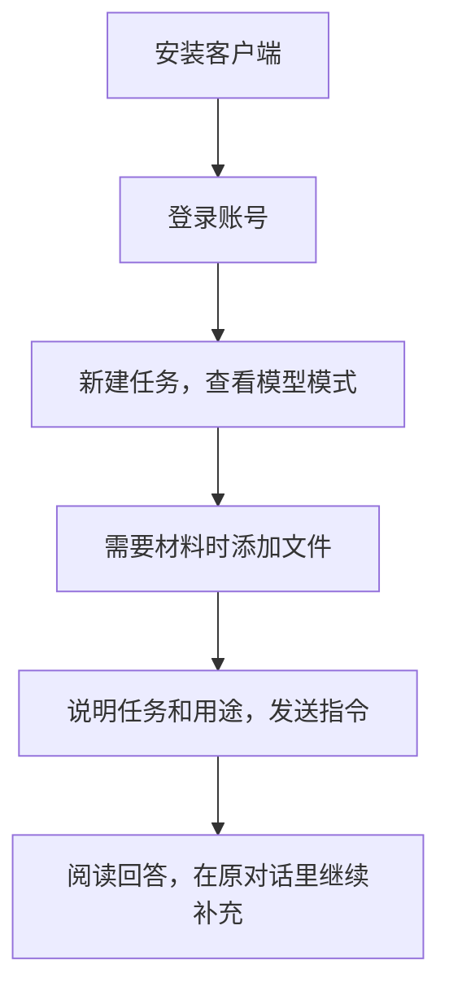

# 第三章　先把工具准备好

**安装并登录 WorkBuddy，按任务选择模型，再发出第一条指令**

**本章目录**

- [安装与登录](#安装与登录)
- [选择模型](#选择模型)
- [添加本地文件](#添加本地文件)
- [发出第一条指令](#发出第一条指令)
- [遇到问题时怎样处理](#遇到问题时怎样处理)
- [当次练习](#当次练习)

本章以腾讯 WorkBuddy 桌面版说明安装、登录、选择模型和发出第一条指令。操作说明参考 WorkBuddy 官方指南。产品界面、模型和账号权限会更新，实际操作应以单位批准的版本和官方文档为准。

**图3-1　第一次使用 WorkBuddy 的操作顺序**

## 安装与登录

安装前，先确认本单位允许使用 WorkBuddy，并按单位要求选择个人账号、企业账号或统一身份认证方式。单位已经部署客户端的，使用指定安装包和登录入口。

个人安装时，从 [WorkBuddy 官方网站](https://www.workbuddy.cn/) 下载适配当前电脑的版本。官方指南列出的要求为 macOS 12及以上，Windows 10及以上且支持 x64；Windows ARM64 设备的支持情况以当前版本说明为准。Mac 用户应按芯片类型选择 ARM64 或 X64 安装包。下载前请再次核对官网的系统要求。[Mac 系统安装指南](https://www.workbuddy.cn/docs/workbuddy/From-Beginner-to-Expert-Guide/Installation-Mac-Guide)；[Windows 系统安装指南](https://www.workbuddy.cn/docs/workbuddy/From-Beginner-to-Expert-Guide/Installation-Win-Guide)

Mac 用户双击下载的磁盘映像文件，将 WorkBuddy 拖入「应用程序」文件夹后再启动。Windows 用户运行安装包，按页面提示完成安装。安装包应来自官方网站或单位指定的渠道。

启动 WorkBuddy 后，点击登录并按页面提示完成身份验证。官方指南列出的方式包括微信扫码、手机号、邮箱和单点登录；不同账号的入口可能不同，读者应使用单位分配的账号登录。

## 选择模型

新建任务后，先查看输入框附近显示的模型模式。WorkBuddy 当前官方指南列出快速、均衡和极致三档：简单明确的问答或格式转换可以选快速模式；起草文稿、分析数据等日常任务适合均衡模式；多步推理或需要反复核验的任务可以选极致模式。不同账号和单位配置显示的选项可能不同，使用时以当前界面为准。[WorkBuddy 模型配置说明](https://www.workbuddy.cn/docs/workbuddy/From-Beginner-to-Expert-Guide/Function-Description/Model)

需要识别图片时，还要确认所选模型支持图片输入。模型能力、思考强度和使用成本会随配置变化，读者应查看当前模型列表及单位规定。第一次练习可以从默认选项开始；正式材料仍须按第二章核对事实、出处和计算结果。

| 模式 | 本书中的任务示例 | 选择时考虑 |
| --- | --- | --- |
| 快速 | 短文概括、格式转换 | 任务简单、要求明确 |
| 均衡 | 起草文稿、整理材料、分析数据 | 日常多步骤办公任务 |
| 极致 | 比较复杂条件、反复核验分析 | 需要更深入推理，可接受较长处理时间 |

以上按官方模式说明归纳，具体选项以当前账号为准。[WorkBuddy 模型配置说明](https://www.workbuddy.cn/docs/workbuddy/From-Beginner-to-Expert-Guide/Function-Description/Model)

## 添加本地文件

任务需要助手阅读已有材料时，点击上传按钮，或把文件拖入输入框。WorkBuddy 官方文档列出的常见格式包括 PDF、Word、Excel、PowerPoint、文本文件和图片；具体支持范围会随模型和功能变化。提交文件前，按第二章确认材料性质、使用权限和处理方式。[WorkBuddy 任务对话说明](https://www.workbuddy.cn/docs/workbuddy/Conversation)

文件加入后，先检查输入框中的附件卡片，确认文件名和版本，再写清希望助手完成的任务。附件显示正确后，点击发送，助手才会开始处理。

## 发出第一条指令

在输入框里说明要做什么，以及结果准备怎样使用。第一次练习可以上传一份公开通知，再输入：

> **使用者**
>
> 请用三句话概括这份通知要求办理的事项，并列出通知中的依据和办理时限。请把原文没有说明的内容单独标出。

读者也可以不上传文件，直接输入一项虚构工作任务，例如请助手把口述内容整理成三条议程。收到结果后，先检查它是否符合要求，再在同一对话中补充遗漏的背景或限制。

## 遇到问题时怎样处理

- 安装包无法启动时，先核对系统版本和安装包是否适配当前电脑，再查看 WorkBuddy 官方帮助。
- 登录后没有出现模型选择入口时，检查客户端版本和单位账号配置，并按单位指定的方式联系管理员。
- 文件加入后无法读取时，核对附件格式、文件大小和当前模型支持的输入类型；必要时改用单位允许的格式或模型。
- 返回结果与任务无关时，补充工作对象、目的、时间范围和成品形式，再在同一对话中继续说明。

## 当次练习

本练习约需五分钟：

1. 从官方渠道安装 WorkBuddy，或打开单位统一部署的客户端。
2. 按单位要求完成登录，查看当前选用的模型模式。
3. 上传一份公开材料，或输入一项虚构任务，请助手用三句话概括办理事项。
4. 对照原文或任务要求，检查对象、时限和依据是否准确。

完成练习后，可以从第四章学习「你想想」，再进入第五章「你找找」。后续练习需要文件时，按第二章的安全要求选材。
