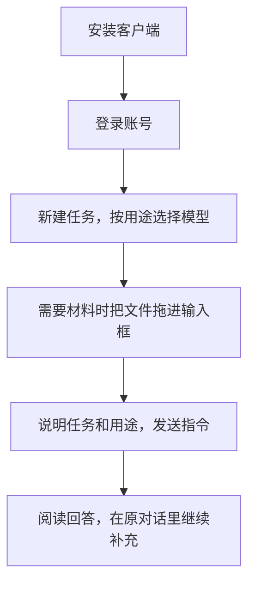

# 第三章　先把工具准备好

**安装并登录 WorkBuddy，按任务选择模型，再发出第一条指令**

**本章目录**

- [安装与登录](#安装与登录)
- [按用途选择模型](#按用途选择模型)
- [本地文件直接拖入](#本地文件直接拖入)
- [发出第一条指令](#发出第一条指令)

本章以腾讯 WorkBuddy 桌面版说明安装、登录、选择模型和发出第一条指令。产品界面、模型和账号权限会更新，实际操作应以单位批准的版本和官方文档为准。

**图3-1　第一次使用 WorkBuddy 的操作顺序**

## 安装与登录

安装前，先确认本单位允许使用 WorkBuddy，并按单位要求选择个人账号、企业账号或统一身份认证方式。单位已经部署客户端的，使用指定安装包和登录入口。

个人安装时，从 [WorkBuddy 官方网站](https://www.workbuddy.cn/) 下载适配当前电脑的版本。官方指南列出的要求为 macOS 12 及以上，Windows 10 及以上且支持 x64；Windows ARM64 设备的支持情况以当前版本说明为准。Mac 用户应按芯片类型选择 ARM64 或 X64 安装包。下载前请再次核对官网的系统要求。[Mac 系统安装指南](https://www.workbuddy.cn/docs/workbuddy/From-Beginner-to-Expert-Guide/Installation-Mac-Guide)；[Windows 系统安装指南](https://www.workbuddy.cn/docs/workbuddy/From-Beginner-to-Expert-Guide/Installation-Win-Guide)

Mac 用户双击下载的磁盘映像文件，将 WorkBuddy 拖入「应用程序」文件夹后再启动。Windows 用户运行安装包，按页面提示完成安装。安装包应来自官方网站或单位指定的渠道。

启动 WorkBuddy 后，点击登录并按页面提示完成身份验证。官方指南列出的方式包括微信扫码、手机号、邮箱和单点登录；不同账号的入口可能不同，读者应使用单位分配的账号登录。

## 按用途选择模型

WorkBuddy 按任务复杂程度提供快速、均衡、极致三种模式。先根据当前任务选择，拿不准时可从均衡模式开始。

| 模式 | 本书中的任务示例 |
| --- | --- |
| 快速 | 简单问答、格式整理、短文润色 |
| 均衡 | 日常文稿起草、材料整理和数据分析 |
| 极致 | 多步骤推理、复杂条件比较、需要反复验证的分析 |

当前内置模型包括 Hy3、Hy4 preview、GLM-5.3、GLM-5.3-Flash、Deepseek-V4-Flash、Deepseek-V4-Pro 和 Kimi-K3 等。模式与具体模型分别查看，模型名称、可用功能及费用以当前账号显示为准。需要识别图片时，还应确认所选模型支持图片输入。[WorkBuddy 模型配置说明](https://www.workbuddy.cn/docs/workbuddy/From-Beginner-to-Expert-Guide/Function-Description/Model)

登录后没有找到模型选择入口时，可以先查看官方使用说明，核对客户端版本和当前账号可用的功能。

## 本地文件直接拖入

任务需要助手阅读已有材料时，把文件从桌面或文件夹直接拖进输入框，也可以点击上传按钮选择文件。WorkBuddy 官方文档列出的常见格式包括 PDF、Word、Excel、PowerPoint、文本文件和图片；具体支持范围会随模型和功能变化。提交文件前，按第二章确认材料性质、使用权限和处理方式。[WorkBuddy 任务对话说明](https://www.workbuddy.cn/docs/workbuddy/Conversation)

文件加入后，先检查输入框中的附件卡片，确认文件名和版本，再写清希望助手完成的任务。附件显示正确后，点击发送，助手才会开始处理。

文件拖入后无法读取时，核对附件格式、文件大小和当前模型支持的输入类型，必要时改用单位允许的格式或模型。

## 发出第一条指令

第一次可以直接键入一项虚构工作任务，试着在同一对话中补充要求。

> **使用者**
>
> 你想想，下周三下午要开一次科室工作例会，一小时，主要说年底几项工作怎么收尾，帮我排个议程。

需要阅读文件时，可以拖入一份公开通知，再这样说。

> **使用者**
>
> 请用三句话概括这份通知要求办理的事项，并列出通知中的依据和办理时限。请把原文没有说明的内容单独标出。

收到结果后，检查它是否符合任务要求，再在原对话里补充遗漏的背景或限制。

**当次练习**

本练习约需五分钟。

1. 从官方渠道安装 WorkBuddy，或打开单位统一部署的客户端，完成登录。
2. 按任务选择模型模式，确认当前账号可用。
3. 键入上面的例会示范句，或拖入一份公开通知，请助手概括办理事项。
4. 对照任务要求或原文，检查对象、时限和依据，再补充一项要求，查看助手是否接着原对话处理。

完成练习后，可以从第四章学习「你想想」，再进入第五章「你找找」。后续练习需要文件时，按第二章的安全要求选材。
