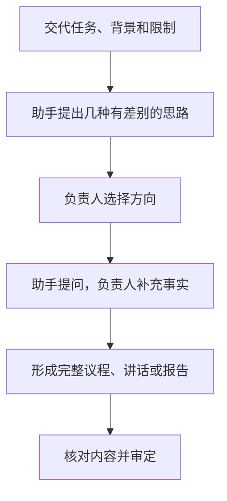
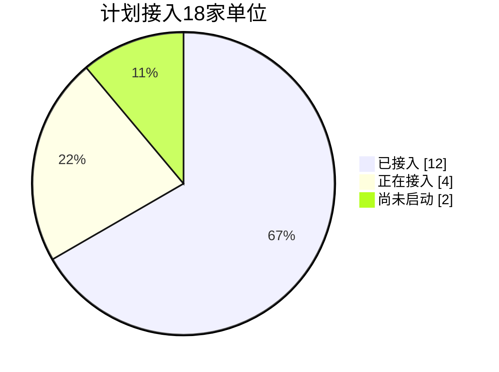
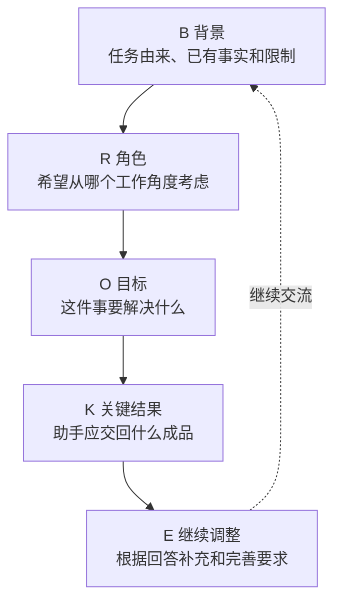

# 第四章　「你想想」

**接到一项任务，先请助手提出几种可供选择的思路**

**本章目录**

- [怎样交代和追问](#怎样交代和追问)
- [案例一：专题会怎么开](#案例一专题会怎么开)
  - [最终成品：会议议程](#最终成品会议议程)
- [案例二：一项工作要求怎么传达](#案例二一项工作要求怎么传达)
  - [最终成品：值班要求传达讲话](#最终成品值班要求传达讲话)
- [案例三：工作进展怎么汇报](#案例三工作进展怎么汇报)
  - [最终成品：工作进展汇报稿](#最终成品工作进展汇报稿)
- [案例四：跨部门数据协作困难怎么分析](#案例四跨部门数据协作困难怎么分析)
  - [最终成品：跨部门数据协作问题分析报告](#最终成品跨部门数据协作问题分析报告)
- [怎样把「你想想」用好](#怎样把你想想用好)
- [记忆方法：BROKE 五项交代](#记忆方法broke-五项交代)
- [当次练习](#当次练习)
- [相关章节](#相关章节)

领导干部接到一项新任务时，手头可能只有一句交办，也可能已经掌握几项情况，却还没想好怎样安排。「你想想」可以请助手先提出几种思路，并说明各自适用的条件和需要留意的地方。负责同志选定方向后，再补充事实，形成会议议程、讲话稿或汇报稿。

口述或键入任务、背景和已知情况，助手就能开始提出思路。

## 怎样交代和追问

### 把任务交代清楚

「你想想」三个字是交代的开头，接着说明任务的背景、对象、目标和限制条件，助手提出的思路才贴近实际：

- 这件事的背景，例如由谁交办、为什么要做
- 面向谁，例如参会人员、传达对象、汇报对象
- 想达到什么目的
- 有哪些限制，例如时间、人数、场地、篇幅

### 要求几种有差别的思路

请助手提出两到三种思路，并说明每种思路要写出什么：

- 具体怎样做
- 适合在什么情况下采用
- 需要注意的地方

流程、适用情况和风险三项齐全，负责同志才能判断几种思路的差异。差别不大时，可以要求助手换一个角度再提。

### 允许它先提问

交代中有会影响安排的信息尚未说清时，可以让助手先提问。能确认的情况，直接补充；暂时没有答案的，说明可以先按什么假设讨论，并把假设标出来。思路较多或涉及本单位具体安排的任务，往往要经过两三轮交流，结果才会贴近实际。

### 在同一对话里选择和调整

第一轮结果出来后，使用者可以在同一对话里说明选择和调整要求。选定一种思路后，请助手继续展开；方案不合本单位情况时，说明原因并要求调整，也可以组合其中适用的做法。

### 一段通用交代

使用者可以在 WorkBuddy 对话框里键入下面这段通用交代，再把方括号内的内容换成本次实际情况：

> **使用者**
>
> 我现在要做【这件事】，主要是给【谁】用，想达到【目的】。有【时间等要求】，你帮我想想怎么弄。情况不清楚的再问我，别自己编。

**图4-1　从一项交办到完整成品**

## 案例一：专题会怎么开

**工作情境**

真知集团分管安全生产的副总经理付明准备下周组织一次专题会，讨论三季度安全生产检查中发现问题的整改。他已经知道参会范围、会议时长，检查情况也有书面汇总。他还没有想清楚的是：这个会怎样开，才能「开得实在一点，别又是念材料」。

**怎样向助手交代**

> **付明**
>
> 下周我想开个会，讨论三季度安全检查发现的问题怎么整改。集团几个部门和三家分公司的负责人参加，二十来个人，最多开两个小时。检查汇总已经有了，可以提前发。别又变成念材料，我想多听听基层有什么困难，最后把分工定下来。你帮我想想这个会怎么开。别自己编具体查出哪些问题。

**助手可能给出的思路**

> **助手**
>
> 思路一：会前发材料，会上只谈办法。会前把检查汇总发给参会人员，会上不再通报情况，三家分公司各讲整改打算，相关部门回应，最后明确分工。适合参会人员会前有时间看材料、问题已经比较清楚的情况。
>
> 思路二：按问题分组讨论，再集中汇报。适合问题涉及多个部门、需要共同找办法的情况，需要有分组场地。
>
> 思路三：先听基层，再定任务。三家分公司先讲整改中的实际困难，相关部门逐一回应，最后明确分工。适合最想了解基层困难的情况，主持人需要把发言及时引到解决办法上。

三种思路的差别在于会议时间花在哪里：整改打算、共同讨论，或听取基层困难。

**怎样继续追问和调整**

第一轮，付明选定思路，并补充会议的具体条件：

> **付明**
>
> 就先听基层讲困难，再让部门回应，材料提前发。会定在11月13日星期五下午两点半，总部三楼第二会议室，我主持。集团这边是安全环保部李宁、生产运营部王海涛、设备管理部陈静，都是部长；三家分公司是总经理赵卫东、孙磊、周敏，分别是一、二、三分公司。周敏离得远，线上参加，现场也没地方分组。你帮我排份议程，谁在什么时间讲都写上，两小时以内，别排太满。

助手排出议程后，提出两个问题：检查汇总由谁、在哪天发给参会人员；会议记录由谁负责。

第二轮，付明作出答复：

> **付明**
>
> 检查汇总让李宁11月11日发给大家，刘洋负责记录，他是安全环保部的。三个部门回应，各留十分钟。

第三轮，付明核对时间后提出：

> **付明**
>
> 排到下午四点二十分结束，剩下十分钟机动。最后我来定整改分工和完成时间，议程里写上这个环节就行，具体怎么分会上再定。

**采用前要核对什么**

- 逐段核算起止时间，确认各段首尾相接，总时长与结束时间一致
- 核对每位发言人的姓名、职务和单位，与本人补充的信息一致
- 检查议程有没有出现检查发现的具体问题或分工结论；这些内容交代时没有提供，要在会上确定
- 确认线上参会的安排写进了议程，便于会务人员准备

### 最终成品：会议议程

> **教学案例成品**

---

**真知集团三季度安全生产检查问题整改专题会议程**

会议时间：2026 年 11 月 13 日（星期五）14:30—16:20  
会议地点：集团总部三楼第二会议室（三分公司线上参会）  
主持人：集团副总经理付明  
参会人员：安全环保部、生产运营部、设备管理部负责人，一分公司、二分公司、三分公司负责人  
会议记录：安全环保部刘洋  
会议材料：《三季度安全生产检查情况汇总》，由安全环保部部长李宁于 11 月 11 日发送全体参会人员，会上不再通报

| 时间 | 议程 | 发言人 |
| --- | --- | --- |
| 14:30—14:35 | 说明会议目的和议程 | 付明 |
| 14:35—14:50 | 一分公司介绍整改中的实际困难和需要的支持 | 一分公司总经理赵卫东 |
| 14:50—15:05 | 二分公司介绍整改中的实际困难和需要的支持 | 二分公司总经理孙磊 |
| 15:05—15:20 | 三分公司介绍整改中的实际困难和需要的支持（线上） | 三分公司总经理周敏 |
| 15:20—15:30 | 安全环保部回应 | 安全环保部部长李宁 |
| 15:30—15:40 | 生产运营部回应 | 生产运营部部长王海涛 |
| 15:40—15:50 | 设备管理部回应 | 设备管理部部长陈静 |
| 15:50—16:10 | 讨论需要多方配合的事项 | 与会人员 |
| 16:10—16:20 | 明确整改分工和完成时限 | 付明 |

议程共 110 分钟，距两小时上限留有 10 分钟机动时间。

---

## 案例二：一项工作要求怎么传达

**工作情境**

某市政府办公室副主任张建华要在 2026 年 11 月的市直部门办公室主任例会上，向各部门负责人布置元旦假期值班工作，讲话控制在五分钟以内。他已经确定了三条要求：

- 节假日期间实行领导带班
- 值班人员保持通信畅通
- 发生突发情况按规定及时报告

他还没有想清楚的是：五分钟里先讲什么、后讲什么，怎样讲大家才记得住。

**怎样向助手交代**

> **张建华**
>
> 我要在市直部门办公室主任例会上讲一下元旦值班的事，主要是领导带班、保持电话畅通，有突发情况及时报告。帮我列个讲话提纲，五分钟以内。就这三点，不要自己编材料。

**助手可能给出的思路**

> **助手**
>
> 可以按值班前、值班期间和遇到突发情况来讲：
>
> 一、节前安排好带班领导和值班人员。
>
> 二、值班期间保持通信畅通。
>
> 三、发生突发情况按规定及时报告。
>
> 最后提醒各部门把安排落实到人。

这份提纲把三条要求放进值班的实际过程，便于接着补充具体安排。

**怎样继续追问和调整**

第一轮，张建华选定顺序，并补充落实方式：

> **张建华**
>
> 就按值班前、值班中、出情况这个顺序讲。我再补充一下：值班表2026年12月25日前报市政府办公室刘芳主任，办公室统一汇总。各部门班子成员轮流带班，值班电话和带班领导手机号都填进去。临时换人，各部门先安排好替班，再把新表报刘芳。出了突发情况，按规定报告，同时打电话给市政府总值班室。按这些写一稿，五分钟以内，开头结尾自然点，别瞎编。

助手写出讲话稿后，张建华读了一遍，第二轮提出：

> **张建华**
>
> 结尾就提醒大家回去把值班表落实到人。报告时限按现行规定来，这里还是写“按规定报告”。

**采用前要核对什么**

- 对照三条已定要求和本人补充的落实方式，检查讲话有没有多出新的规定，例如报告时限或处分措施
- 核对日期、联系人姓名和职务
- 按正常语速试读一遍，确认不超过五分钟

### 最终成品：值班要求传达讲话

> **教学案例成品**

---

**在市直部门办公室主任例会上关于元旦假期值班工作的讲话**

张建华

同志们：

借今天例会的时间，请各部门提前安排元旦假期值班。我把有关要求按值班先后顺序讲一讲：节前怎样安排，值班期间怎样联络，遇到情况怎样报告。

第一，节前把带班和值班安排好。元旦假期实行领导带班，各部门带班领导由本部门领导班子成员轮流担任。请各部门在 2026 年 12 月 25 日前把值班表报市政府办公室，联系人是办公室主任刘芳。值班表要写清每天的带班领导和值班人员，以及值班电话和带班领导的手机号。市政府办公室汇总后，可以及时掌握各部门假期值班安排。

第二，值班期间保持通信畅通。值班电话要有人接听，带班领导的手机要保持开机。值班人员需要临时调整时，由本部门安排好替班人员，并把更新后的值班表报给刘芳主任。

第三，遇到突发情况按规定及时报告，并打电话告知市政府总值班室，便于市政府及时掌握情况。

请各部门回去后把值班表落实到每一位带班领导和值班人员，并在 2026 年 12 月 25 日前报给刘芳主任。

我就讲这些。

---

## 案例三：工作进展怎么汇报

**工作情境**

真知集团分管财务的副总经理陈立，下周要向集团董事长汇报财务共享中心建设的进展，时间控制在十分钟以内。他手头的情况都清楚，还没有想好汇报怎样组织：是先讲结论，还是按时间顺序讲，还是重点讲问题。其中有一件事需要董事长作出决定。

**怎样向助手交代**

> **陈立**
>
> 下周我要跟董事长汇报财务共享中心的进展，十分钟以内。他时间紧，还得请他定一件事。先帮我列个汇报大纲，别自己编东西。

**助手可能给出的思路**

> **助手**
>
> 可以先按这个大纲准备：
>
> 一、总体进展。
>
> 二、已经完成和正在推进的主要工作。
>
> 三、需要董事长决定的事项。
>
> 具体情况还没提供，先留出这几个部分，补充后再展开。

**怎样继续追问和调整**

第一轮，陈立选定结构，并调整顺序：

> **陈立**
>
> 就先说总体进展，接着把要请董事长定的事讲出来，再讲具体工作。那件事写两个办法，我的建议也写进去。

第二轮，他补充实际情况：

> **陈立**
>
> 我把情况补一下，你帮我写成会上能直接讲的稿子，八百字左右。
>
> 今年计划接入18家，已经接了12家，4家正在接，预计12月底完成。还有四分公司、六分公司没启动。已经接入的12家，从9月上线到现在处理了3600笔报销。
>
> 全年预算860万元，花了520万元。剩下340万元，原来的合同和那4家接入还要250万元，能调剂的有90万元。
>
> 四分公司、六分公司的系统老，要改接口。有两个办法：今年一起改，约45万元，在年度预算里调剂，12月底接完，这样18家今年都能接上；或者等两家明年换新业务系统时再接，今年不用单独花这笔接口改造费，但得等到明年二季度。
>
> 我倾向今年改。下一步先把在接的4家做好，12月底前接完；董事长如果同意今年改，就把这两家的接口改造也一起推进。

助手写出初稿后，第三轮他提出：

> **陈立**
>
> 接入完成了百分之多少、预算花了百分之多少，你算一下加进去，我再核对。写事实就行，不用自己写个评价上去。

**采用前要核对什么**

- 核算数字：12 加 4 加 2 等于 18；12 家占 18 家的 66.7%；520 万元占 860 万元的 60.5%；当前已支出加改造费用为 565 万元；全年预计支出为 520 加 250 加 45，共 815 万元，比预算 860 万元少 45 万元。两个数要分清，判断预算够不够用，要看全年预计 815 万元
- 区分已完成、正在进行和计划中的工作，检查有没有把计划写成已完成
- 检查有没有出现本人没有提供的成效或评价

**图4-2　财务共享中心接入进度**

数据来自本案例陈立补充的虚构教学材料，分别为12家、4家和2家。

**预算测算（单位为万元）**

| 项目 | 金额 |
| --- | ---: |
| 年度预算 | 860 |
| 已支出 | 520 |
| 后续合同及4家接入预计支出 | 250 |
| 采用做法一的接口改造费用 | 45 |
| 全年预计支出 | 815 |
| 预计结余 | 45 |

来源为本案例补充数据。全年预计支出按采用做法一测算，520＋250＋45＝815。

### 最终成品：工作进展汇报稿

> **教学案例成品**

---

**关于财务共享中心建设进展情况的汇报**

陈立

董事长：

我把财务共享中心建设的进展向您汇报一下，有一件事需要您定。

**一、总体进展**

今年计划接入共享中心的所属单位共 18 家。目前已完成接入 12 家，占三分之二，即 66.7%；正在接入 4 家，预计 12 月底前完成；还有 2 家未启动，是四分公司和六分公司。已接入的 12 家自 9 月上线以来共处理报销单据 3600 笔。

**二、需要您决定的事项**

四分公司和六分公司没有启动，原因是这两家的财务系统版本较老，需要改造数据接口才能接入。现在有两个做法。

做法一，今年统一改造两家的接口。费用约 45 万元，在年度预算内调剂解决，12 月底前完成接入。这样年内 18 家可以全部接入。

做法二，等这两家明年上新的业务系统时再接入。这样今年不需要单独支出这笔接口改造费用，但两家要到明年二季度才能接入，今年接入的是 16 家。

年度预算 860 万元，目前已支出 520 万元，预算执行率为 60.5%。扣除余下合同和 4 家在建单位接入预计需要的 250 万元，尚有 90 万元可以调剂。接口改造费用约 45 万元，可从这部分资金中安排；连同已支出和后续预计支出计算，全年预计支出 815 万元，结余 45 万元。

我建议采用做法一。一方面，现有预算能够覆盖接口改造费用；另一方面，两家单位可以在年内接入，不必等到明年二季度。

**三、下一步安排**

一是 12 月底前完成正在接入的 4 家单位。

二是您同意采用做法一后，同步启动四分公司和六分公司的接口改造，12 月底前完成接入。

汇报完毕，请您指示。

---

## 案例四：跨部门数据协作困难怎么分析

**工作情境**

2026 年 11 月初，真知集团副总经理付明发现，安全生产数据平台的设备台账共享工作推进缓慢。他知道的情况是：

- 已经开过两次协调会
- 二分公司和四分公司尚未按要求提供设备台账数据
- 这两家单位反映人手紧张

推进缓慢的其他原因尚未查明。付明想先听取可行做法，待了解原因后，再形成分析报告。

**怎样向助手交代**

> **付明**
>
> 设备台账共享这事推不动了，协调会开了两次，二分公司和四分公司还没交数据，都说人手不够。你帮我想想接下来怎么办。不清楚的我们可以问。

**助手可能给出的思路**

> **助手**
>
> 做法一：先摸清情况。派人到两家单位当面了解，确认人手紧张的具体环节，以及有无口径、技术或权限方面的障碍。需要安排专人和一定时间；风险是推进时间进一步拉长。
>
> 做法二：减轻报送负担。提供统一的数据模板，或先报送最急需的部分，其余分批报送。需要先明确哪些数据最急需；风险是后续部分继续拖延。
>
> 需要进一步了解的问题：
>
> - 人手紧张是否是主要原因
> - 两家单位对数据范围和口径是否有疑问
> - 平台账号和权限是否到位

**怎样继续追问和调整**

第一轮，付明选定做法：

> **付明**
>
> 那先去两家当面了解一下，一周内弄清楚。你帮我列列，去了重点问什么。

助手列出问题清单后，付明安排信息化部部长吴涛带队，用一周时间到两家单位作了了解。

第二轮，付明把了解到的情况补充进对话：

> **付明**
>
> 问过了，情况不太一样。
>
> 二分公司原来是设备科两个人兼职管台账，现在一个人做不了这项工作，实际就剩一个人。台账有纸质的，也散在几个表格里，约1200台设备得重新录进平台。
>
> 四分公司有三个人，人手倒够。他们不知道租赁设备算不算，原来的台账不含这一块，一直等集团说清楚。账号现在也只能看，录不了。
>
> 前两次会主要是催报，没把租赁设备的口径和权限问题解决。集团也还没发统一说明，其他分公司是不是也有这个疑问，目前不知道。
>
> 你帮我写份分析报告，说说问题卡在哪、可以怎么办。没弄清楚的就写没弄清楚，办法先写成建议。

第三轮，助手在初稿里提出责任和期限需要由付明确定。付明答复：

> **付明**
>
> 我想先这么安排，你写进报告，等集团研究后再执行：租赁设备怎么录，让安全环保部李宁2026年11月20日前发个说明；四分公司的录入权限，让信息化部吴涛11月25日前开通。二分公司那边，让设备管理部陈静从一分公司、三分公司各协调一个熟悉台账的人去帮忙，12月15日前录完。四分公司等说明发了、权限开了，12月10日前录完。现在还只是拟安排，别写成已经定了。

**采用前要核对什么**

- 报告中写成原因的内容，逐条对照本人补充的了解结果，助手推测的原因不能写成已查明的事实
- 「其他分公司是否有同样疑问」这类尚未了解的情况，要单独列出
- 责任人和期限要写明是拟安排，不能写成已经执行的决定，也不能写已经取得的成效

### 最终成品：跨部门数据协作问题分析报告

> **教学案例成品**

---

**关于设备台账数据共享工作推进缓慢的分析报告**

**一、基本情况**

按照安全生产数据平台建设安排，各分公司须将设备台账数据录入平台。目前，二分公司和四分公司尚未按要求提供数据。集团已就此召开两次协调会。为弄清原因，信息化部部长吴涛带队，用一周时间到两家单位作了了解。

**二、推进缓慢的原因**

调查情况显示，两家单位当前面临的困难不同。

二分公司的困难集中在维护人手和台账整理上。设备台账由设备科 2 人兼职维护，其中 1 人目前无法承担这项工作，实际只有 1 人负责。现有台账一部分是纸质，一部分分散在多个表格里，约 1200 台设备需要重新录入，增加了整理和录入工作量。

四分公司有 3 人负责，人手够用；目前未录入与口径和权限有关。一是口径不明确：平台要求录入租赁设备，四分公司的台账不含租赁设备，单位一直在等集团说明，没有开始录入。二是权限未开通：四分公司的平台账号目前只能查看，不能录入。

**三、核心问题**

两家单位的情况说明，推进缓慢还与集团层面的两项准备工作未到位有关：

1. 租赁设备是否录入、怎样录入，集团还没有印发统一说明
2. 部分单位的平台录入权限还没有开通

经了解，前两次协调会主要是督促报送，没有研究这两个问题。这两项准备工作没有落实，四分公司虽然人手够用，也无法开始录入。

**四、尚未了解清楚的情况**

其他分公司对租赁设备口径是否也有疑问，目前还不清楚。建议在印发口径说明时一并征询各分公司意见。

**五、解决办法（建议）**

建议分两个阶段推进。

第一阶段，先把集团层面的准备工作做到位：

1. 安全环保部部长李宁在 2026 年 11 月 20 日前，印发租赁设备录入口径说明，同时征询各分公司对口径的意见
2. 信息化部部长吴涛在 2026 年 11 月 25 日前，开通四分公司的平台录入权限

第二阶段，帮助两家单位完成录入：

1. 设备管理部部长陈静从一分公司、三分公司各协调 1 名熟悉台账的人员，支援二分公司整理录入，2026 年 12 月 15 日前完成
2. 四分公司在口径说明印发、权限开通后，2026 年 12 月 10 日前完成录入

以上责任和期限为拟安排，经集团研究后执行。

**六、完成标准**

建议按以下标准检查完成情况：

- 两家单位按口径说明整理补全设备台账，自有设备和租赁设备分别列明
- 平台中的设备数量与补全后的台账一致，自有设备、租赁设备分别核对
- 录入后检查有无重复记录，并对设备编号、名称、所在位置等关键字段逐项复核

**七、需要注意的风险**

- 支援人员来自一分公司和三分公司，抽调期间可能影响两家单位自身工作，需要事先与两家单位商定时间
- 二分公司部分台账是纸质，录入时容易出错，建议录入后由二分公司设备科逐台复核
- 如果其他分公司对口径也有疑问，口径说明印发后可能还需要补充解释

---

## 怎样把「你想想」用好

**先说清要解决的问题。** 案例一把目标定为听取基层困难、明确整改分工，助手提出的会议安排便围绕这两件事展开。只交代「开个专题会」，助手通常只能给出通用流程。

**把时间、对象和已定要求讲明白。** 案例一的两小时时长、案例二的五分钟、案例三的十分钟，都影响思路取舍。案例二还把三条已确定的值班要求交给助手，便于它组织表达，同时限定讲话内容。

**请助手提出有实际差别的选项。** 案例一比较发言和讨论的组织方式，案例三比较汇报结构，案例四比较调查与推进路径。每种做法都写明适用条件和风险，负责同志才能结合本单位情况选择。

**选定方向后，再补充事实和成品要求。** 四个案例的最终成品都在后续交流中形成。付明补上日期、地点和发言人；张建华补上落实办法；陈立补充进度数据和两个备选做法。具体事实齐备后，还要说明成品形式、篇幅和用途。

**让助手问清空缺，自己确认答案。** 案例一中的材料发送人和会议记录人、案例四中的责任人和期限，都需要由负责同志确认。助手可以标出缺少的信息，事实、判断和未决事项则要分别处理。案例三的比例由助手计算后，也由陈立按原始数字复核。

## 记忆方法：BROKE 五项交代

四个案例都先交代背景和目标，再请助手提出思路；负责同志选定方向、补充事实后，才形成具体成品。BROKE 把这段交流过程归纳为五项：背景、角色、目标、关键结果和继续调整。日常小事说清背景和目标往往就够；涉及多方安排、重要汇报或正式成品时，可以逐项检查。

**图4-3　BROKE 五项交代的关系**

### 五项交代

**B—背景（Background）**

说明任务由来、已经掌握的事实、限制条件和仍待了解的情况。案例四先交代已开过两次协调会、两家分公司尚未报送数据及其反映的人手问题，并把其他原因留作待查。

**R—角色（Role）**

可以直接说明希望讨论的工作角度，例如「你帮我想想，这个会怎么组织」。这样的说明可以引导分析重点，不能代替专业资格、岗位职责或负责人判断。

**O—目标（Objectives）**

说明希望解决什么问题、推进到哪一步。案例一的目标是听清基层整改困难，并明确会议要讨论的分工。

**K—关键结果（Key Result）**

说明要交回什么成品、成品包含哪些内容，以及怎样判断它符合要求。案例一先请助手研究会议怎么开，助手提供几种安排供选择；选定思路后，再形成总时长不超过两小时、列出时间和发言人的完整议程。目标说明工作要解决什么，关键结果说明助手要交回什么。

**E—继续调整（Evolve）**

根据每轮结果补充事实、纠正理解或调整要求。案例一先比较会议安排，之后才补入日期、地点、发言人和材料发送人；这些信息由负责人提供，助手据此修改议程。

### 用 BROKE 写一段完整交代

以案例一的专题会为例，可以这样向助手交代：

> **使用者**
>
> 下周准备开个安全整改会，集团几个部门和三家分公司的负责人参加，二十来个人，两小时以内。检查汇总可以提前发，现场没地方分组。我想多听基层有什么困难，最后把分工定下来。你从怎么组织这个会的角度帮我想想。具体检查问题还没给你，先别编，不清楚的再问我。

使用者选定思路后，可以继续补充条件：

> **使用者**
>
> 就先听基层，再定任务。有一家分公司离得远，可能线上参加，你把这个考虑进去，需要准备什么设备也提醒我。议程排在两小时以内，谁讲、讲多久写清楚，人选没定的先空着。

结果超过两小时，就指出需要调整的环节和必须保留的内容：

> **使用者**
>
> 这都超过两小时了。部门回应压短一点，基层发言和最后定任务的时间留够，你再排一遍。

### 使用时注意

BROKE 是一张任务交代检查清单，实际交流时可以按任务选择需要说明的项目。任务简单，交代背景和目标即可；信息较多或结果要求严格，再补充角色、关键结果和后续调整。助手不了解本单位未提供的事实，缺少的信息仍由负责同志核实。

## 当次练习

本练习约需五分钟，读者可以口述或键入任务。

1. 想一件近期要做、但还没有想好怎么做的事，例如一次会议、一次讲话或一次汇报。
2. 在 WorkBuddy 中口述或键入任务、背景、对象和限制条件，请助手提出几种有差别的思路。
3. 挑出最接近自己想法的一种，在同一对话里至少追问或调整一次。
4. 检查结果里有没有自己没有提供的情况，有的话标出来留待核实。
5. 对照 BROKE 五个要素，看看这次交代缺了哪一项，下次补上。

练习结果仅供参考，不外发。

## 相关章节

- 选定思路后若要引用政策、数据或案例，可以继续读第五章「你找找」，学习怎样查找原文并核对出处。
- 已有通知、讲话或汇报初稿需要调整内容、结构、篇幅或文体时，可以读阶段二「你改改」。
- 手头已有两套以上成形方案需要逐项比较时，可以读阶段二「你比比」。
