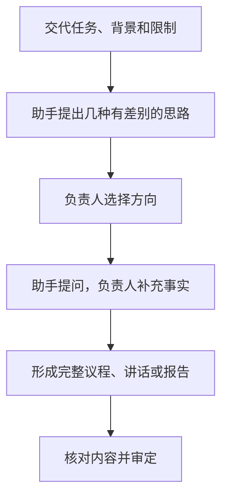
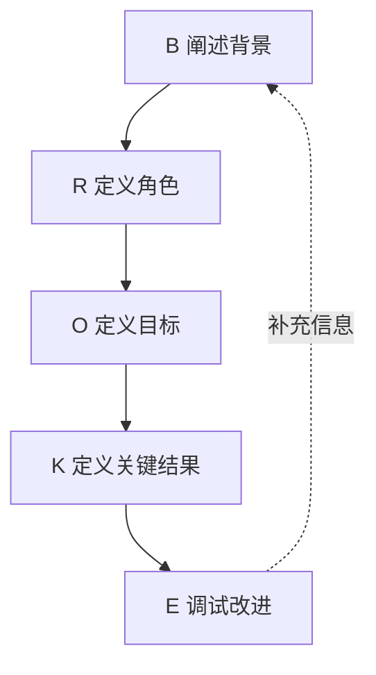

# 第四章　「你想想」

**接到一项任务，先请助手提出几种可供选择的思路**

**本章目录**

- [怎样交代和追问](#怎样交代和追问)
- [案例一：专题会怎么开](#案例一专题会怎么开)
- [案例二：一项工作要求怎么传达](#案例二一项工作要求怎么传达)
- [案例三：工作进展怎么汇报](#案例三工作进展怎么汇报)
- [案例四：跨部门数据协作困难怎么分析](#案例四跨部门数据协作困难怎么分析)
- [怎样把「你想想」用好](#怎样把你想想用好)
- [记忆方法：BROKE 五项交代](#记忆方法broke-五项交代)
- [当次练习](#当次练习)
- [相关章节](#相关章节)

领导干部接到一项新任务时，手头可能只有一句交办，也可能已经掌握几项情况，却还没想好怎样安排。「你想想」可以请助手先提出几种思路，并说明各自适用的条件和需要留意的地方。负责同志选定方向后，再补充事实，形成会议议程、讲话稿或汇报稿。口述或键入任务、背景和已知情况，助手就能开始提出思路。

## 怎样交代和追问

**把任务交代清楚**

「你想想」三个字是交代的开头，接着说明任务的背景、对象、目标和限制条件，助手提出的思路才贴近实际：

- 这件事的背景，例如由谁交办、为什么要做
- 面向谁，例如参会人员、传达对象、汇报对象
- 想达到什么目的
- 有哪些限制，例如时间、人数、场地、篇幅

**要求几种有差别的思路**

请助手提出两到三种思路，并说明每种思路要写出什么：

- 具体怎样做
- 适合在什么情况下采用
- 需要注意的地方

做法、适用情况和注意事项三项齐全，负责同志才能判断几种思路的差异。

**允许它先提问**

交代中有会影响安排的信息尚未说清时，可以让助手先提问。能确认的情况，直接补充；暂时没有答案的，说明可以先按什么假设讨论，并把假设标出来。思路较多或涉及本单位具体安排的任务，往往要经过两三轮交流，结果才会贴近实际。

**在同一对话里选择和调整**

第一轮结果出来后，使用者可以在同一对话里说明选择和调整要求。选定一种思路后，请助手继续展开；方案不合本单位情况时，说明原因并要求调整，也可以组合其中适用的做法。

**一段通用交代**

使用者可以在 WorkBuddy 对话框里键入下面这段通用交代，再把方括号内的内容换成本次实际情况：

> **使用者**
>
> 你想想【任务】怎么做。这事是【谁交办、为什么】，面向【谁】，想达到【目的】，限制是【时间、人数等】。给我两三种不一样的思路，各说做法、适合什么情况、要注意什么。有影响思路又没说清的，先问我。

**图4-1　从一项交办到完整成品**

## 案例一：专题会怎么开

**工作情境**

真知集团副总经理付明准备下周组织一次专题会，讨论三季度安全生产检查中发现问题的整改。他已经知道参会范围、会议时长，检查情况也有书面汇总。他还没有想清楚的是：这个会怎样开，才能「开得实在一点，别又是念材料」。

**怎样向助手交代**

> **付明**
>
> 你想想：下周那个安全整改专题会怎么开。三季度检查发现的问题，已经汇总好了，材料可以提前发。集团相关部门和三家分公司的负责人都来。我就怕会上光顾着念材料，基层到底卡在哪儿，反倒没人说。得给他们留点时间，也得把谁负责什么定下来。二十来个人，最多两个小时。你帮我想两三个开法，说说哪种在什么情况下合适，有什么要留意的。有需要就问我。

**助手可能给出的思路**

> **助手**
>
> 思路一：会前发材料，会上只谈办法。会前把检查汇总发给参会人员，会上不再通报情况，三家分公司各讲整改打算，相关部门回应，最后明确分工。适合参会人员会前有时间看材料、问题已经比较清楚的情况。
>
> 思路二：按问题分组讨论，再集中汇报。适合问题涉及多个部门、需要共同找办法的情况，需要有分组场地。
>
> 思路三：先听基层，再定任务。三家分公司先讲整改中的实际困难，相关部门逐一回应，最后明确分工。适合最想了解基层困难的情况，主持人需要把发言及时引到解决办法上。

三种思路的差别在于会议时间花在哪里：整改打算、共同讨论，或听取基层困难。

**怎样继续追问和调整**

第一轮，付明选定思路，并补充会议的具体条件：

> **付明**
>
> 就先听基层讲困难，再让部门回应，材料提前发。会定在11月13日星期五下午两点半，总部三楼第二会议室，我主持。集团这边是安全环保部、生产运营部、设备管理部负责人，三家分公司总经理参会。三分公司离得远，线上参加，现场也没地方分组。你帮我排份议程，谁在什么时间讲都写上，两小时以内，别排太满。

> **助手**
>
> 三位部门负责人和三位总经理的名字还请您说一下，我写进议程。按先听基层、再由部门回应的顺序，我先排一版。检查汇总由谁、哪天发？会议记录谁来做？三个部门回应完，建议留二十分钟讨论需要几家一起配合的事，再由您明确分工，您看这样安排合适吗？

第二轮，付明作出答复：

> **付明**
>
> 三位部门负责人分别是邵毅、王海涛、唐蕾，一、二、三分公司总经理分别是贺松、孙磊、岳蓉。检查汇总让邵毅11月11日发给大家，毕卓负责记录，他是安全环保部的。三个部门回应，各留十分钟。

> **助手**
>
> 按三家分公司各十五分钟、三个部门各十分钟、协调讨论二十分钟、开头五分钟和最后定分工十分钟计算，共一百一十分钟，14:30开始，16:20结束，留十分钟机动。最后一段由您明确分工和时限，具体安排会上定，行吗？

第三轮，付明确认：

> **付明**
>
> 行，就这么排。

**采用前要核对什么**

- 逐段核算起止时间，确认各段首尾相接，总时长与结束时间一致
- 核对每位发言人的姓名、职务和单位，与本人补充的信息一致
- 检查议程有没有出现检查发现的具体问题或分工结论；这些内容交代时没有提供，要在会上确定
- 确认线上参会的安排写进了议程，便于会务人员准备

### 最终成品：会议议程

> **教学案例成品**

---

**真知集团三季度安全生产检查问题整改专题会议程**

会议时间：2026 年 11 月 13 日（星期五）14:30—16:20  
会议地点：集团总部三楼第二会议室（三分公司线上参会）  
主持人：集团副总经理付明  
参会人员：安全环保部、生产运营部、设备管理部负责人，一分公司、二分公司、三分公司负责人  
会议记录：安全环保部毕卓  
会议材料：《三季度安全生产检查情况汇总》，由安全环保部副部长邵毅于 11 月 11 日发送全体参会人员，会上不再通报

| 时间 | 议程 | 发言人 |
| --- | --- | --- |
| 14:30—14:35 | 说明会议目的和议程 | 付明 |
| 14:35—14:50 | 一分公司介绍整改中的实际困难和需要的支持 | 一分公司总经理贺松 |
| 14:50—15:05 | 二分公司介绍整改中的实际困难和需要的支持 | 二分公司总经理孙磊 |
| 15:05—15:20 | 三分公司介绍整改中的实际困难和需要的支持（线上） | 三分公司总经理岳蓉 |
| 15:20—15:30 | 安全环保部回应 | 安全环保部副部长邵毅 |
| 15:30—15:40 | 生产运营部回应 | 生产运营部部长王海涛 |
| 15:40—15:50 | 设备管理部回应 | 设备管理部部长唐蕾 |
| 15:50—16:10 | 讨论需要多方配合的事项 | 与会人员 |
| 16:10—16:20 | 明确整改分工和完成时限 | 付明 |

议程共 110 分钟，距两小时上限留有 10 分钟机动时间。

---

## 案例二：一项工作要求怎么传达

**工作情境**

青岚市政府办公室副主任张建华要在 2026 年 11 月的市直部门办公室主任例会上，向各部门负责人布置元旦假期值班工作，讲话控制在五分钟以内。他已经确定了三条要求：

- 节假日期间实行领导带班
- 值班人员保持通信畅通
- 发生突发情况按规定及时报告

他还没有想清楚的是：五分钟里先讲什么、后讲什么，怎样讲大家才记得住。

**怎样向助手交代**

> **张建华**
>
> 你想想：元旦值班这几条怎么讲，大家听一遍就记得住？市直部门办公室主任例会上要布置这件事，我是讲给各部门负责人的。回去得落实三件事：领导带班，值班人员联系得上，遇到突发情况按规定及时报告。最多讲五分钟，也就这三条。你帮我想两个讲法，各列个短提纲。

**助手可能给出的思路**

> **助手**
>
> 顺序一：按要求逐条讲。依次讲三条要求，每条配一句具体做法，最后提醒各单位落实到人。适合听众对值班工作比较熟悉、只需提醒重点的情况。
>
> 顺序二：按值班的时间顺序讲。先讲节前安排好带班领导和值班人员，再讲值班期间保持通信畅通，最后讲出现情况时及时报告。适合希望听众把要求和实际值班过程对应起来的情况。

> **张建华**
>
> 按时间顺序讲。

**怎样继续追问和调整**

> **助手**
>
> 按值班前、值班中、出情况的顺序讲，需要具体落实办法。值班表什么时候报、报给谁？临时换人怎么处理？有突发情况，除了按规定报告，是否还要电话告知总值班室？

第一轮，张建华补充落实方式：

> **张建华**
>
> 值班表2026年12月25日前报市政府办公室，联系人是办公室主任石淮，由市政府办公室统一汇总。各部门班子成员轮流带班，值班电话和带班领导手机号都填进表里。临时换人，各部门先安排好替班，再把新表报石淮。有突发情况，按规定报告，同时打电话给市政府总值班室。按这些写一稿，五分钟以内，我拿来直接讲。开头结尾自然点。

> **助手**
>
> 报告时限您没有另给，我沿用「按规定及时报告」，具体时限依现行规定办理。结尾再提醒大家把值班表落实到人，您看行吗？

第二轮，张建华确认：

> **张建华**
>
> 对，就这样。结尾提醒大家回去把值班表落实到人。

**采用前要核对什么**

- 对照三条已定要求和本人补充的落实方式，检查讲话有没有多出新的规定，例如报告时限或处分措施
- 核对日期、联系人姓名和职务
- 按正常语速试读一遍，确认不超过五分钟

### 最终成品：值班要求传达讲话

> **教学案例成品**

---

**在市直部门办公室主任例会上关于元旦假期值班工作的讲话**

张建华

同志们：

借今天例会的时间，请各部门提前安排元旦假期值班。我把有关要求按值班先后顺序讲一讲：节前怎样安排，值班期间怎样联络，遇到情况怎样报告。

第一，节前把带班和值班安排好。元旦假期实行领导带班，各部门带班领导由本部门领导班子成员轮流担任。请各部门在 2026 年 12 月 25 日前把值班表报市政府办公室，联系人是办公室主任石淮。值班表要写清每天的带班领导和值班人员，以及值班电话和带班领导的手机号。

第二，值班期间保持通信畅通。值班电话要有人接听，带班领导的手机要保持开机。值班人员需要临时调整时，由本部门安排好替班人员，并把更新后的值班表报给石淮主任。

第三，遇到突发情况按规定及时报告，并打电话告知市政府总值班室，便于市政府及时掌握情况。

请各部门回去后把值班表落实到每一位带班领导和值班人员，并在 2026 年 12 月 25 日前报给石淮主任。

我就讲这些。

---

## 案例三：工作进展怎么汇报

**工作情境**

真知集团分管财务的副总经理陈立，下周要向集团董事长汇报财务共享中心建设的进展，时间控制在十分钟以内。他手头的情况都清楚，还没有想好汇报怎样组织：是先讲结论，还是按时间顺序讲，还是重点讲问题。其中有一件事需要董事长作出决定。

**怎样向助手交代**

> **陈立**
>
> 你想想：财务共享中心的进展怎么讲比较顺。下周要汇报建设情况，还有一件事得会上定。这次是直接跟董事长讲，他时间紧，我想让他一听就知道项目到哪儿了、要他定什么。最多十分钟。你给我几个大纲，说说先讲哪块、后讲哪块，什么时候用哪个合适。你先搭个架子，进展和数字我待会儿补。

**助手可能给出的思路**

> **助手**
>
> 结构一：先结论，后依据。先讲总体进展，再讲主要工作，最后讲需要决定的事项。适合时间紧、听者最关心结论的情况。
>
> 结构二：按时间顺序讲。依次讲已完成、正在推进和下一步安排的工作。适合工作周期较长、需要让听者了解全过程的情况；时间紧时容易讲不到重点。
>
> 结构三：先讲问题，再讲打算。重点讲当前遇到的问题和打算采取的办法。适合工作遇到较大困难、希望争取支持的情况。

**怎样继续追问和调整**

第一轮，陈立选定结构，并调整顺序：

> **陈立**
>
> 就先说总体进展，接着把要请董事长定的事讲出来，再讲具体工作。那件事写两个办法，我的建议也写进去。

> **助手**
>
> 要请董事长定的具体是哪件事？两个办法各花多少钱、什么时候能接完？预算已花多少、后续还需多少、可以调剂多少？您补充这些，我再写成汇报。

第二轮，他补充实际情况：

> **陈立**
>
> 我把情况补一下，你帮我写成会上能直接讲的稿子，八百字左右。
>
> 今年计划接入18家，已经接了12家，4家正在接，预计12月底完成。还有四分公司、六分公司没启动。已经接入的12家，从9月上线到现在处理了3600笔报销。
>
> 全年预算860万元，花了520万元。剩下340万元，原来的合同和那4家接入还要250万元，能调剂的有90万元。
>
> 四分公司、六分公司的系统老，要改接口。有两个办法：今年一起改，约45万元，在年度预算里调剂，12月底接完，这样18家今年都能接上；或者等两家明年换新业务系统时再接，今年不用单独花这笔接口改造费，但得等到明年二季度。
>
> 我倾向今年改。下一步先把在接的4家做好，12月底前接完；董事长如果同意今年改，就把这两家的接口改造也一起推进。

> **助手**
>
> 整体进展和两个办法已写入初稿。接入家数与预算支出还可以补比例，方便会上说明当前进度。

第三轮，他提出：

> **陈立**
>
> 接入完成了百分之多少、预算花了百分之多少，你算一下加进去，我再核对。这两处写清比例和计算依据，我自己对照进展判断。

> **助手**
>
> 已完成接入12家，占18家的66.7%；已支出520万元，预算执行率60.5%。判断预算够不够用，还要看全年预计支出：520加250再加45，共815万元，预计结余45万元。我会把执行率和全年测算分开写。

**采用前要核对什么**

- 核算数字：12 加 4 加 2 等于 18；12 家占 18 家的 66.7%；520 万元占 860 万元的 60.5%；全年预计支出为 520 加 250 加 45，共 815 万元，比预算 860 万元少 45 万元。两个数要分清，判断预算够不够用，要看全年预计 815 万元
- 区分已完成、正在进行和计划中的工作，检查有没有把计划写成已完成
- 检查有没有出现本人没有提供的成效或评价

### 最终成品：工作进展汇报稿

> **教学案例成品**

---

**关于财务共享中心建设进展情况的汇报**

陈立

董事长：

我把财务共享中心建设的进展向您汇报一下，有一件事需要您定。

**一、总体进展**

今年计划接入共享中心的所属单位共 18 家。目前已完成接入 12 家，占三分之二，即 66.7%；正在接入 4 家，预计 12 月底前完成；还有 2 家未启动，是四分公司和六分公司。已接入的 12 家自 9 月上线以来共处理报销单据 3600 笔。

**二、需要您决定的事项**

四分公司和六分公司没有启动，原因是这两家的财务系统版本较老，需要改造数据接口才能接入。现在有两个做法。

做法一，今年统一改造两家的接口。费用约 45 万元，在年度预算内调剂解决，12 月底前完成接入。这样年内 18 家可以全部接入。

做法二，等这两家明年上新的业务系统时再接入。这样今年不需要单独支出这笔接口改造费用，但两家要到明年二季度才能接入，今年接入的是 16 家。

年度预算 860 万元，目前已支出 520 万元，预算执行率为 60.5%。扣除余下合同和 4 家在建单位接入预计需要的 250 万元，尚有 90 万元可以调剂。接口改造费用约 45 万元，可从这部分资金中安排；连同已支出和后续预计支出计算，全年预计支出 815 万元，结余 45 万元。

我建议采用做法一。一方面，现有预算能够覆盖接口改造费用；另一方面，两家单位可以在年内接入，不必等到明年二季度。

**三、下一步安排**

一是 12 月底前完成正在接入的 4 家单位。

二是您同意采用做法一后，同步启动四分公司和六分公司的接口改造，12 月底前完成接入。

汇报完毕，请您指示。

---

## 案例四：跨部门数据协作困难怎么分析

**工作情境**

2026 年 11 月初，真知集团副总经理付明发现，安全生产数据平台的设备台账共享工作推进缓慢。他知道的情况是：

- 已经开过两次协调会
- 二分公司和四分公司尚未按要求提供设备台账数据
- 这两家单位反映人手紧张

推进缓慢的其他原因尚未查明。付明想先听取可行做法，待了解原因后，再形成分析报告。

**怎样向助手交代**

> **付明**
>
> 你想想：设备台账共享这事怎么往下推。安全生产数据平台的协调会开了两次，二分公司和四分公司还是没按要求交数据，都说人手不够。这事得集团相关部门跟两家分公司一起办。我想弄清楚，下一步到底是先去问清情况，还是能先做点什么。现在只知道他们说缺人，其他原因还没核实。你想几个办法，说说各得先具备什么条件、容易在哪儿卡住。拿不准的列给我，我再去问。

**助手可能给出的思路**

> **助手**
>
> 做法一：先摸清情况。派人到两家单位当面了解，确认人手紧张的具体环节，以及有无口径、技术或权限方面的障碍。需要安排专人和一定时间；风险是推进时间进一步拉长。
>
> 做法二：减轻报送负担。提供统一的数据模板，或先报送最急需的部分，其余分批报送。需要先明确哪些数据最急需；风险是后续部分继续拖延。
>
> 需要进一步了解的问题：
>
> - 人手紧张是否是主要原因
> - 两家单位对数据范围和口径是否有疑问
> - 平台账号和权限是否到位

**怎样继续追问和调整**

第一轮，付明选定做法：

> **付明**
>
> 那先去两家当面了解一下，一周内弄清楚。你帮我列列，去了重点问什么。

> **助手**
>
> 建议当面问清四件事。
> 
> - 人手具体缺在整理旧台账，还是录入平台？
> - 对租赁设备是否录入、怎样录入，有没有口径疑问？
> - 平台账号能否正常录入，权限是否齐全？
> - 希望集团先提供什么支持？

付明安排信息化部部长吴涛带队，用一周时间到两家单位作了了解。

第二轮，付明把了解到的情况补充进对话：

> **付明**
>
> 问过了，两家情况不太一样。
>
> 二分公司的设备台账原来是设备科两个人兼职管，其中一个现在做不了，实际就剩一个人。台账有纸质的，也散在几个表格里，约1200台设备得重新录进平台。
>
> 四分公司有三个人，人手够。平台要求租赁设备也要录，可他们原来的台账没有这一块，一直等集团说清楚。账号现在也只能看，录不了。
>
> 前两次会主要是催报，租赁设备的口径和录入权限都没研究。集团也还没发统一说明，其他分公司有没有同样的问题，目前不知道。
>
> 帮我写份分析报告，说说为什么卡住、主要问题在哪、接下来可以怎么解决。已经弄清楚的和还没弄清楚的分开写，办法先写成建议。

> **助手**
>
> 办法先作为建议。谁牵头、何时完成，还需要您确定。我也可以列出建议的完成标准和风险，供集团研究时取舍。如果需要从其他分公司抽人支援，要先商量哪些时间可用，准备抽调多久？

第三轮，付明答复：

> **付明**
>
> 我想先这么安排，你写进报告，等集团研究后再执行：租赁设备怎么录，让安全环保部邵毅2026年11月20日前发个说明；四分公司的录入权限，让信息化部吴涛11月25日前开通。二分公司那边，让设备管理部唐蕾从一分公司、三分公司各协调一个熟悉台账的人去帮忙，12月15日前录完。四分公司等说明发了、权限开了，12月10日前录完。现在还只是拟安排，别写成已经定了。抽人的事先请唐蕾与两家商量，起止时间也一并确认。完成后怎么验、还有什么风险，你也提几条，我看着办。

**采用前要核对什么**

- 报告中写成原因的内容，逐条对照本人补充的了解结果，助手推测的原因不能写成已查明的事实
- 「其他分公司是否有同样疑问」这类尚未了解的情况，要单独列出
- 责任人和期限要写明是拟安排，不能写成已经执行的决定，也不能写已经取得的成效

### 最终成品：跨部门数据协作问题分析报告

> **教学案例成品**

---

**关于设备台账数据共享工作推进缓慢的分析报告**

**一、基本情况**

按照安全生产数据平台建设安排，各分公司须将设备台账数据录入平台。目前，二分公司和四分公司尚未按要求提供数据。集团已就此召开两次协调会。为弄清原因，信息化部部长吴涛带队，用一周时间到两家单位作了了解。

**二、推进缓慢的原因**

调查情况显示，两家单位当前面临的困难不同。

二分公司的困难集中在维护人手和台账整理上。设备台账由设备科 2 人兼职维护，其中 1 人目前无法承担这项工作，实际只有 1 人负责。现有台账一部分是纸质，一部分分散在多个表格里，约 1200 台设备需要重新录入，增加了整理和录入工作量。

四分公司有 3 人负责，人手够用；目前未录入与口径和权限有关。一是口径不明确：平台要求录入租赁设备，四分公司的台账不含租赁设备，单位一直在等集团说明，没有开始录入。二是权限未开通：四分公司的平台账号目前只能查看，不能录入。

**三、核心问题**

两家单位的情况说明，推进缓慢还与集团层面的两项准备工作未到位有关：

1. 租赁设备是否录入、怎样录入，集团还没有印发统一说明
2. 部分单位的平台录入权限还没有开通

经了解，前两次协调会主要是督促报送，没有研究这两个问题。这两项准备工作没有落实，四分公司虽然人手够用，也无法开始录入。

**四、尚未了解清楚的情况**

其他分公司对租赁设备口径是否也有疑问，目前还不清楚。建议在印发口径说明时一并征询各分公司意见。

**五、解决办法（建议）**

建议分两个阶段推进。

第一阶段，先把集团层面的准备工作做到位：

1. 安全环保部副部长邵毅在 2026 年 11 月 20 日前，印发租赁设备录入口径说明，同时征询各分公司对口径的意见
2. 信息化部部长吴涛在 2026 年 11 月 25 日前，开通四分公司的平台录入权限

第二阶段，帮助两家单位完成录入：

1. 设备管理部部长唐蕾从一分公司、三分公司各协调 1 名熟悉台账的人员，支援二分公司整理录入，2026 年 12 月 15 日前完成
2. 四分公司在口径说明印发、权限开通后，2026 年 12 月 10 日前完成录入

以上责任和期限为拟安排，经集团研究后执行。

**六、完成标准**

建议按以下标准检查完成情况：

- 两家单位按口径说明整理补全设备台账，自有设备和租赁设备分别列明
- 平台中的设备数量与补全后的台账一致，自有设备、租赁设备分别核对
- 录入后检查有无重复记录，并对设备编号、名称、所在位置等关键字段逐项复核

**七、需要注意的风险**

- 支援人员来自一分公司和三分公司，抽调期间可能影响两家单位自身工作，需要事先与两家单位商定时间
- 二分公司部分台账是纸质，录入时容易出错，建议录入后由二分公司设备科逐台复核
- 如果其他分公司对口径也有疑问，口径说明印发后可能还需要补充解释

---

## 怎样把「你想想」用好

- **只得到通用流程时，补充这次最想解决的问题。** 「开个会」只能说明形式。希望听清基层困难，还是当场确定分工，会直接影响时间分配和讨论顺序。
- **几套提纲只换了标题时，重新检查目标和约束。** 选项缺少实际差异，常因目标过泛，或缺少影响安排的条件。补充这次最想解决的问题，再看时间分配、讨论重点和推进先后是否随之变化。
- **用已定条件筛选思路。** 时长、对象、场地和已定要求都是取舍依据。需要分组的思路遇到线上参会或场地限制，就要调整。
- **区分拟安排与已决定事项。** 责任人和期限还需研究时，写明拟安排或设置会上确定的环节。正式成品应把当前状态交代完整。
- **复算影响安排的数字。** 合计、比例和议程时长都按原始数再算一次，尤其检查各段是否首尾相接、全年预计与当前支出是否分开。

## 记忆方法：BROKE 五项交代

BROKE 可以用来检查一段任务交代是否说清了背景、角色、目标、关键结果，以及怎样继续改进。简单任务按需要选用，复杂任务可以逐项检查。

**图4-2　BROKE 五项交代的关系**

**阐述背景（B，Background）**

说明任务由来、已知事实和限制。自己知道却没有告诉助手的信息属于「隐藏区」。例如慰问对象已有名单、费用已有上限，这些条件说出来后，助手才能据此提出安排。

**定义角色（R，Role）**

说明希望助手从哪个工作角度考虑，例如从办公室统筹的角度安排慰问路线。角色用于明确分析重点，专业意见及正式决定由相应负责人确认。

**定义目标（O，Objectives）**

说明这件事希望解决什么问题，例如让慰问覆盖既定对象，同时减少往返。

**定义关键结果（K，Key Result）**

说明需要什么成品、包含什么内容。例如先要两种走访安排，各写适用条件和所需准备，选定后再形成完整行程。

**调试改进（E，Evolve）**

根据回答补充信息、检验假设并调整要求。双方都未注意到的遗漏和假设属于「盲区」，例如没有考虑部分对象当天不在家。多轮交流可以减少盲区，重要内容仍需由人核对，继续检查尚未发现的遗漏。

**一段口头交代**

> **使用者**
>
> 你想想，年底我们要走访慰问退休职工，名单已经定了，分住在三个片区，半天时间（B，背景）。我想让大家都能见到，又少走些回头路（O，目标）。你从办公室统筹的角度（R，角色），给我两种安排，各说说适合什么情况、要提前准备什么（K，关键结果）。具体人数和地址我选好方向后再补，你觉得有影响安排的缺口就先问我。

看到初稿后，可以继续补充。

> **使用者**
>
> 先按分片走访来排。有人可能当天不在家，你把提前联系确认这一环节加上。负责人会上再定，先写清环节和时长。

## 当次练习

本练习约需五分钟，读者可以口述或键入任务。

1. 想一件近期要做、但还没有想好怎么做的事，例如一次会议、一次讲话或一次汇报。
2. 在 WorkBuddy 中口述或键入任务、背景、对象和限制条件，请助手提出几种有差别的思路。
3. 挑出最接近自己想法的一种，在同一对话里至少追问或调整一次。
4. 检查结果里有没有自己没有提供的情况，有的话标出来留待核实。
5. 对照 BROKE 五个要素，看看这次交代缺了哪一项，下次补上。

练习结果仅供参考，不外发。

## 相关章节

- 需要查找公开依据，继续读[第五章「你找找」](05-zhaozhao.md)。
- 学完阶段一后，可读[第六章「手机语音与远程续办」](06-advanced-mobile.md)，练习离开工位后跟进任务。
- 已有初稿需要修改，参阅[第八章「你改改」](../02-materials/08-gaigai.md)。
- 已有两套以上成形方案需要比较，参阅[第十章「你比比」](../02-materials/10-bibi.md)。
