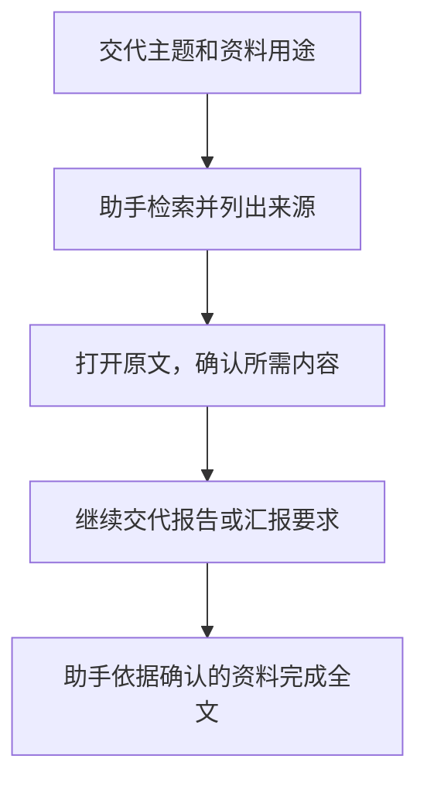
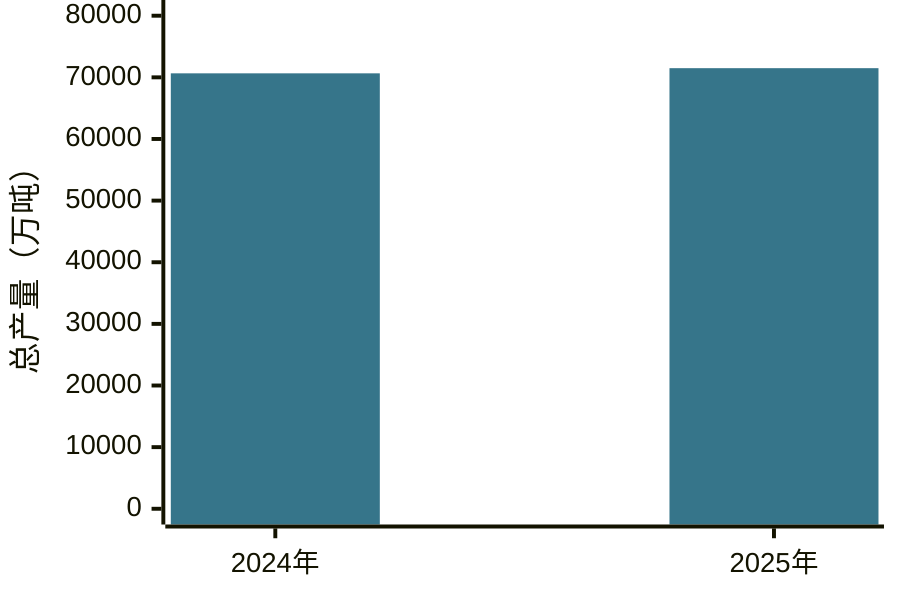

# 第五章　「你找找」

**请助手查找工作所需的公开资料，核对原文后再引用**

**本章目录**

- [怎样交代查找任务](#怎样交代查找任务)
- [案例一：人工智能办公培训请示怎样查找政策依据](#案例一人工智能办公培训请示怎样查找政策依据)
  - [最终成品：关于开展人工智能办公培训的请示](#最终成品关于开展人工智能办公培训的请示)
- [案例二：汇报中的数据怎样找到原始出处](#案例二汇报中的数据怎样找到原始出处)
  - [最终成品：2024—2025年全国粮食产量对比表](#最终成品20242025年全国粮食产量对比表)
- [案例三：怎样找到有参考价值的公开案例](#案例三怎样找到有参考价值的公开案例)
  - [最终成品：优化企业信息变更服务的案例讨论简报](#最终成品优化企业信息变更服务的案例讨论简报)
- [怎样把「你找找」用好](#怎样把你找找用好)
- [资料查找四步法：问、找、核、用](#资料查找四步法问找核用)
- [当次练习](#当次练习)
- [相关章节](#相关章节)

很多领导干部在准备讲话时，需要查找政策依据，说明上级要求和本单位开展工作的考虑。撰写汇报时，他们有时记得一个数字，却想不起出处；研究怎样改进服务时，也会想了解其他地方已经公开的做法。遇到这类问题，领导干部可以向人工智能助手交代需求，请它检索公开资料。

使用「你找找」时，领导干部可以在 WorkBuddy 对话框中口述或键入任务，交代资料用途、查找时间和范围。

## 怎样交代查找任务

### 说清主题和用途

「找一些人工智能资料」这个要求过于宽泛，助手很难据此判断资料的用途。交代时可以具体一些，例如「我准备为集团办公室人员安排人工智能培训，请找一找国家层面关于技能培训的政策依据」。助手了解了培训对象和查找目的，就可以围绕技能培训筛选资料，减少返回模型原理或产品介绍等无关内容。

- 这次具体要查找什么
- 查到的资料准备用于讲话、汇报，还是内部讨论
- 资料应当属于哪个时期、地方或行业
- 希望助手优先到哪些机构的网站查找
- 希望助手整理成资料清单、引用摘记，还是简短的案例介绍

回顾某一年的工作时，应说明相应年份，方便助手按时间检索。查询最新情况时，请助手查看发布机构有没有后续更新或更正。引用政策文件前，还须核实其适用范围，并检查有关规定是否已经调整。

### 要求提供能核对的出处

- 政策资料需要注明文件全名、发文机关、文号和成文日期，助手还应指出相关内容在文件的哪一部分。
- 数据资料应注明发布机构、统计期间和统计范围。助手整理结果时，还要保留原文的指标名称、数值和单位。
- 一份供工作参考的案例介绍，应当写清哪个地方或单位采取了什么做法，并附上报道日期和来源网页，方便查阅。

直接引用的文字，应由助手摘录原句并注明所在段落。助手概括原文时，也要标明哪些内容属于概述，便于对照检查。本单位准备采取的做法，则根据实际情况另作说明。

### 使用联网检索并打开来源核对

发出任务前，先确认当前会话能否联网检索。WorkBuddy 官方[插件系统说明](https://www.workbuddy.cn/docs/workbuddy/Plugins)将网络搜索列为可安装的插件能力；插件是否可用及单位网络管理要求都会影响检索。助手返回结果时，应提供来源网页并说明检索方式。打开链接后，先确认网页是否由资料发布机构发布，再核对正文是否包含所需内容。

当前会话无法联网检索时，可以请助手列出关键词和建议访问的网站，再自行查询。使用浏览器或其他检索工具，也须符合本单位的管理要求。

助手根据模型已有知识提供的文件名、数字或说法，仍须查找原始出处。网页无法打开，可以到发布机关网站重新检索，或者查找政府网站的转载。经过查找仍无法核实的内容，应暂缓引用。

### 一段通用交代

下面这段交代可供参考，按实际需要填写方括号中的内容。

> **使用者**
>
> 你找找【具体主题】的资料，我准备将资料用于【用途】，希望查找的范围是【年份、地域或行业】。请你优先到【发布机构或网站】检索，选出最相关的资料，并逐项列出标题、发布机构、日期、原文位置和来源链接。我还需要知道每项资料能够支持什么说法，哪些文字是原文摘录，哪些是你的概述。没有查到相关资料时，请你直接说明。你觉得我交代的信息不足，也可以先向我提问。

**图5-1　查找资料怎样进入完整工作成果**

## 案例一：人工智能办公培训请示怎样查找政策依据

**工作情境**

真知集团办公室主任刘芳准备向分管领导请示，拟面向集团办公室人员开展人工智能办公培训。她先要核实国家层面的政策依据，目前只记得一份与「人工智能+」有关的文件。具体课程安排尚待集团研究。

**怎样向助手交代**

> **刘芳**
>
> 你找找国务院2025年发的那个“人工智能+”文件，我记得里面提过人工智能技能培训。集团办公室想办次AI办公培训，我得先拿着政策依据去跟分管领导请示。你从官方正文里找，把文件叫什么、文号、哪天成文、在哪一段和原文链接一起给我。再说一句这段能支持什么，我打开原文核过再写请示。培训方案先放一放。

**助手可能给出的思路**

> **助手**
>
> 我找到一项国家层面的相关文件：
>
> - 文件：《国务院关于深入实施“人工智能+”行动的意见》
> - 文号：国发〔2025〕11号
> - 成文日期：2025年8月21日；中国政府网发布页面标注为2025年8月27日
> - 原文位置：二、加快实施重点行动，（四）“人工智能+”民生福祉，1.创造更加智能的工作方式
> - 相关表述：“大力支持开展人工智能技能培训”
> - 来源：[中国网信网转载的文件正文](https://www.cac.gov.cn/2025-08/27/c_1758018277755538.htm)
>
> 这条表述可用于说明开展人工智能技能培训的政策背景。文件没有规定真知集团应开设哪些课程，具体安排仍需集团研究。

> **原文摘录 · 人工智能技能培训**
>
> 大力支持开展人工智能技能培训
>
> 来源 [《国务院关于深入实施“人工智能+”行动的意见》二、（四）、1，国家数据局转载](https://www.nda.gov.cn/sjj/swdt/xwfb/0826/20250826173046592282838_pc.html)

**怎样继续追问和调整**

刘芳看过结果后，把查找范围进一步缩小：

> **刘芳**
>
> 就要跟技能培训直接有关的那句原话，再说说请示里怎么引用。别写成文件要求每家企业都办一样的课。

第二轮，刘芳打开官方正文，对照段落后补充：

> **刘芳**
>
> 培训主要给集团办公室的人上，想教大家查资料、改稿子、整理数据，也练练怎么跟AI交代任务、怎么核对结果。用上刚才核过的政策依据，帮我写个三五百字的请示。说清为什么办、准备学什么、这次请领导同意什么。课程、课时、预算和具体怎么办还得研究，领导同意后再拟方案报审。

**采用前要核对什么**

- 打开文件正文后，核对文件名、文号和落款日期，确认没有把网页发布日期当作成文日期
- 对照所标段落逐字核对摘录，阅读前后文，确认引用时保留了适用条件
- 检查本单位培训说明有没有被助手扩写出文件未规定的课程、课时或考核要求
- 正式报送前，再查本单位有关的后续文件和实施要求

### 最终成品：关于开展人工智能办公培训的请示

> **教学案例成品**

**关于开展人工智能办公培训的请示**

集团分管领导：

为提升集团办公室人员运用人工智能辅助办公的能力，拟开展一次人工智能办公培训。现将有关事项请示如下。

**一、开展培训的考虑**

《国务院关于深入实施“人工智能+”行动的意见》（国发〔2025〕11号）提出「大力支持开展人工智能技能培训」，为开展相关培训提供了政策背景。[政策原文](https://www.cac.gov.cn/2025-08/27/c_1758018277755538.htm)

办公室承担文稿起草、资料整理、会议服务和工作协调等任务，对办理效率和材料质量都有较高要求。培训拟从这些日常工作入手，帮助工作人员掌握人工智能辅助办公的方法，提升资料处理和文字组织能力，为内容研判、沟通协调留出更多精力。

**二、拟定培训重点**

建议围绕资料查找、文稿修改、数据整理等常见任务，重点学习怎样交代工作背景和用途，怎样通过追问补充信息、完善结果，以及怎样核对来源、数字和事实。培训以形成可用的通知、汇报和工作表格为目标，让参训人员能够结合本职工作练习，逐步掌握从提出需求到完成材料的操作方法。材料使用范围和保密要求一并纳入教学。

**三、请示事项**

现提请同意面向集团办公室人员开展上述培训。同意后，办公室将进一步研究具体课程、课时、预算和组织方式，另行拟订培训方案报审。

妥否，请批示。

真知集团办公室

2026年11月8日

## 案例二：汇报中的数据怎样找到原始出处

**工作情境**

真知集团分管农业业务的副总经理陈立准备在年度工作汇报中回顾2025年农业生产情况。他记得当年全国粮食产量超过7亿吨，想找到国家统计局的原始发布，核准具体数字和同比变化。

**怎样向助手交代**

> **陈立**
>
> 你找找2025年全国粮食总产量，年度汇报里有一段要回顾去年全国的农业生产，这个数我得核准。去国家统计局找原始公告，看看总产量是多少、比上年增了多少。公告哪天发的、数字写在哪儿，连链接一块儿给我，我对一遍再用。

**助手可能给出的思路**

> **助手**
>
> 我找到国家统计局2025年12月12日发布的《国家统计局关于2025年粮食产量数据的公告》。公告第三项列明，2025年全国粮食总产量为71488万吨，比2024年增加838万吨，增长1.2%。
>
> 来源：[国家统计局原文](https://www.stats.gov.cn/sj/zxfbhjd/202512/t20251212_1962049.html)
>
> 这条来源对应2025统计年度，资料发布日期也已列明，引用时应保留这两项信息。

**怎样继续追问和调整**

陈立看过2025年的结果后，接着追问：

> **陈立**
>
> 2024年的也到国家统计局找一下。先看看两年是不是都算全国全年的粮食总产量，单位也得一样。对得上就把总产量和同比变化放一张表里。两个原始出处都带上，我汇报时好核对。

助手继续检索，找到国家统计局2024年12月13日发布的《国家统计局关于2024年粮食产量数据的公告》。公告第三项列明，2024年全国粮食总产量为70650万吨，比2023年增加1109万吨，增长1.6%。[国家统计局原文](https://www.stats.gov.cn/sj/zxfb/202412/t20241213_1957744.html)

**采用前要核对什么**

- 确认两年的指标均为全国全年粮食总产量，统计范围一致
- 分别核对统计年度和资料发布日期，确认2024年、2025年数据与各自公告对应
- 保留公告第三项使用的数值和万吨单位
- 确认同比变化各自对应上一年，2024年与2023年比，2025年与2024年比

> **原文摘录 · 2024年粮食产量**
>
> 全国粮食总产量70650万吨
>
> 来源 [国家统计局2024年粮食产量公告，第三项](https://www.stats.gov.cn/sj/zxfb/202412/t20241213_1957744.html)

> **原文摘录 · 2025年粮食产量**
>
> 全国粮食总产量71488万吨
>
> 来源 [国家统计局2025年粮食产量公告，第三项](https://www.stats.gov.cn/sj/zxfbhjd/202512/t20251212_1962049.html)

**图5-2　2024—2025年全国粮食总产量**

两年分别为70650万吨、71488万吨，纵轴从零开始。数据来源为上列国家统计局公告。

### 最终成品：2024—2025年全国粮食产量对比表

> **教学案例成品**

**2024—2025年全国粮食产量对比表**

| 项目 | 2024年 | 2025年 |
| --- | --- | --- |
| 全国全年粮食总产量（万吨） | 70650 | 71488 |
| 比上年增加（万吨） | 1109 | 838 |
| 同比增长 | 1.6% | 1.2% |
| 发布机构 | 国家统计局 | 国家统计局 |
| 资料发布日期 | 2024年12月13日 | 2025年12月12日 |
| 来源 | [《国家统计局关于2024年粮食产量数据的公告》](https://www.stats.gov.cn/sj/zxfb/202412/t20241213_1957744.html) | [《国家统计局关于2025年粮食产量数据的公告》](https://www.stats.gov.cn/sj/zxfbhjd/202512/t20251212_1962049.html) |
| 原文位置 | 公告第三项「全国粮食总产量」 | 公告第三项「全国粮食总产量」 |

## 案例三：怎样找到有参考价值的公开案例

**工作情境**

一名市政务服务管理部门负责人周敏准备研究企业办事时重复填写信息的问题。她想先看看几个地方的公开做法，再选一个与本地问题接近的案例，深入了解怎样减少重复填报，为内部讨论准备参考。

**怎样向助手交代**

> **周敏**
>
> 你找找别的地方办企业信息变更时，有没有办法让企业少填表、少交重复材料。我们内部正要谈这个，先从政府网站挑几个公开案例。每个说两句到底是怎么做的，再把谁发的、哪天发的、原文在哪儿带上。我挑一个跟我们情况接近的，点进去细看。

**助手可能给出的思路**

> **助手**
>
> 我找到三个地方的公开做法，可以先看看哪一种更接近你们要讨论的问题。
>
> | 地方 | 公开做法 | 可以进一步了解的内容 | 来源 |
> | --- | --- | --- | --- |
> | 上海 | 将企业变更字段与联办部门的信息关联，通过共享企业变更信息、同步更新等方式，减少额外填写表格、提交材料和再次登录确认 | 变更信息怎样在部门之间复用，企业还需要申报哪些内容 | [上海市政府案例报道，2025年2月24日](https://www.shanghai.gov.cn/nw31406/20250224/525bd29287084deea5cc89ff79391a19.html) |
> | 浙江 | 在统一入口办理企业信息变更，企业勾选需要同步办理的事项，登记信息推送至相关部门，按场景联动办理 | 关联事项怎样整合，哪些信息共享、哪些仍需补充采集 | [市场监管总局介绍浙江做法，2024年6月7日](https://www.samr.gov.cn/xw/df/art/2024/art_266fb16c489241cb99f2bb63bb5f5e18.html) |
> | 北京 | 政务服务网提供企业信息变更“一件事”入口，列明市场监管、税务、社保、公积金和医保相关信息变更的一次性办理服务 | 多部门事项怎样集中到同一办理入口，企业如何申请 | [北京市政务服务网办理页面](https://banshi.beijing.gov.cn/pubtask/bhyjs/ztbg/ztbg.html) |
>
> 上海和浙江的材料介绍了具体做法，北京的材料是办理页面。选定后，我可以继续查对应说明，整理成供内部讨论的案例简报。

**怎样继续追问和调整**

周敏比较三个地方的介绍后，选定上海这一例：

> **周敏**
>
> 就看上海这个。企业登记信息改了，其他部门怎么跟着更新，怎么少让企业再填一遍，你再说具体点。先不看办理量，也不用那些宣传性的评价。

助手随后展开说明上海的具体做法。

> **助手**
>
> 报道介绍了四项做法，可以结合你关心的重复填报问题来理解。
>
> 1. **关联变更字段。** 将企业登记变更涉及的信息与联办部门需要更新的字段对应起来，让不同部门知道哪些信息需要同步变更。
> 2. **共享同一来源的信息。** 企业变更信息进入共享库后，供联办部门复用，支持各部门采用同源数据并同步更新。
> 3. **处理不同系统之间的衔接。** 报道提到通过‘一源加工’解决地方部门数据与国家垂直管理系统之间的协同问题，具体接口和更新规则还需要进一步了解。
> 4. **集中告知办理要求。** 企业仍须申报变更登记所需的信息和材料。相关联办环节复用这些信息，企业可省去额外填表、另交材料和再次登录确认的环节。
>
> 可以重点研究的是，各部门怎样复用一次申报的信息，以及需要同步更新的字段如何对应。本地能否采用这些做法，还要看部门职责和系统条件。[上海市政府原文](https://www.shanghai.gov.cn/nw31406/20250224/525bd29287084deea5cc89ff79391a19.html)

周敏看过这轮说明，并打开报道核对后，进一步要求：

> **周敏**
>
> 帮我把上海这个例子整理成一份简报，内部讨论用。怎么做的、我们能借鉴什么、自己这边还得弄清楚什么，都说一下，下一步怎么讨论也提点建议。本地情况不知道就别编，报道里的做法和你的建议分清楚。落款写2026年11月8日。

**采用前要核对什么**

- 确认报道来源和实施单位，避免把外地做法写成本地已有成果
- 对照报道核实适用范围和具体业务，确认案例讲的是企业信息变更
- 核对摘要有没有把减少部分材料夸大成所有事项、所有材料都免提交
- 将公开报道介绍的做法与本地尚待了解的实施条件分开写

### 最终成品：优化企业信息变更服务的案例讨论简报

> **教学案例成品**

**优化企业信息变更服务的案例讨论简报**

**一、案例出处与做法**

上海市政府网站2025年2月24日刊发《上海案例获评全国“行风建设助力优化营商环境”2024年十大优秀实践案例》，信息来源为上海市市场监管局。报道介绍，上海探索企业信息自动变更，通过“一表关联”“一库共享”“一次告知”等方式推动联办部门共享企业变更登记信息、同步更新相关信息，减少重复填写、提交和确认。企业仍须申报变更登记所需的信息和材料。[上海市政府原文](https://www.shanghai.gov.cn/nw31406/20250224/525bd29287084deea5cc89ff79391a19.html)

**二、值得借鉴的地方**

- 从企业重复填写、提交信息的具体环节入手，梳理哪些数据可以在部门间复用。
- 将信息共享、业务系统更新和一次告知放在同一流程中研究，减少企业在不同环节反复提供相同信息。
- 在优化流程时，继续明确企业需要申报的信息和材料，保持服务便利与登记要求衔接。

**三、本地需要进一步澄清的信息**

- 哪些企业信息变更事项重复填报较多，重复填写的字段、提交的材料和办理环节分别是什么。
- 相关信息由哪些部门产生和管理，各部门共享、调用和更新信息的依据及职责是什么。
- 现有业务系统能否交换和同步信息，涉及国家垂直管理系统时需要哪些协同条件。
- 哪些信息仍须企业申报，哪些环节需要企业确认，现行办事指南和制度如何规定。

**四、建议的下一步讨论安排**

1. 选定一项重复填报较突出的企业信息变更事项，梳理从申请、受理到信息更新的现行流程、表单和材料。
2. 邀请业务主管部门、联办部门和信息化人员逐项核实数据来源、管理职责、共享依据、系统条件及企业仍需申报的内容。
3. 根据核实情况列出可优化环节和需要保留的办理要求，形成供会议讨论的调整思路、实施条件和待决事项。
4. 会议确定是否继续论证，以及牵头部门、补充材料和后续汇报安排。

2026年11月8日

## 怎样把「你找找」用好

**引用前回到原文核对。** 负责同志打开来源网页，找到对应段落，核实文件标题、发布机关、年份、适用条件和统计口径。助手的摘要可能漏掉适用条件，搜索结果也可能混入其他年份的数据或名称相近的文件；确认资料能够支持当前说法后，再决定如何引用。

**先说清资料准备用在哪里。** 刘芳要向分管领导请示培训安排，查国家层面的政策依据；陈立要回顾2025年农业生产，先查该年度数据，再补查2024年数据作比较；周敏准备讨论本地服务改进，查其他地区的公开做法。用途不同，查找的年份、地域和优先来源也会不同。

一个问题牵涉政策、数据和地方条件时，先列出需要核实的具体问题，再分批检索。每查完一项，确认它能否支持当前判断，再决定下一项查什么。

## 资料查找四步法：问、找、核、用

查找资料时，可以记住「问、找、核、用」四步：

1. **问**：说清要解决的问题、资料用途和查找范围。
2. **找**：优先查找发布机关或原始来源。
3. **核**：打开原文，核对标题、日期、段落、统计口径和适用条件。
4. **用**：完成原文核对后，继续向助手交代报告或汇报稿的用途、对象和重点，请它依据原文写出完整内容。引用处附上原文链接，暂时无法核实的内容单独列为待核事项。

## 当次练习

下面的练习约需五分钟。选定一个具体问题后，直接口述或键入查找要求。

1. 从近期工作中选一个具体问题，明确需要查找哪项公开政策、数据或案例。
2. 在对话框里口述或键入查找主题，说明用途和范围，并请助手提供官方来源、发布日期及原文位置。
3. 助手返回结果后，从中选一项资料，打开网页核对标题、日期和关键内容。
4. 发现统计口径不清或出处不符时，在同一对话里要求助手重新查找。
5. 核对完成后，在同一对话中继续交代成稿要求，让助手把已核实的资料用于一份完整报告或汇报稿。比如：「请根据刚才核对的原文资料，围绕【事项】为【对象】起草一份用于【场合】的完整【报告或汇报稿】，按【结构和篇幅】组织。文中引用请附原文链接，暂时无法核实的内容请单独列为待核事项。」

练习只使用公开资料。五分钟内找不到原文时，记下查过的网站和待核内容，完成核对后再决定是否引用。

## 相关章节

- 完成阶段一的两式后，领导干部可以继续阅读[第六章阶段一进阶课「手机语音与远程续办」](06-advanced-mobile.md)，练习从手机交代任务、查看电脑端状态并接续处理。
- 进入阶段二后，可从「你看看」开始，练习请助手阅读已有文件、检查初稿并按要求审阅材料。
- 已有文稿需要调整时，可继续阅读「你改改」，学习依据核实后的资料修改内容、结构和表达。
- 手头已有两套以上方案或材料时，可阅读「你比比」，学习按费用、进度等条件逐项比较。
