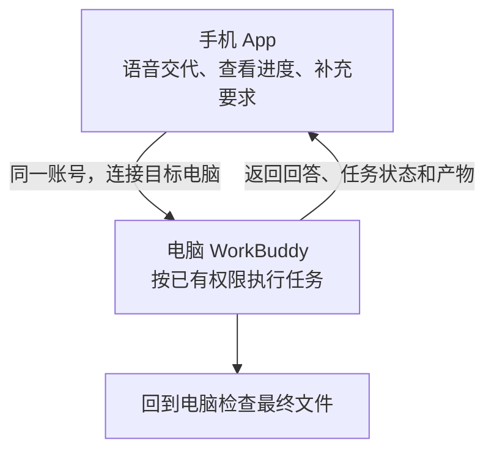
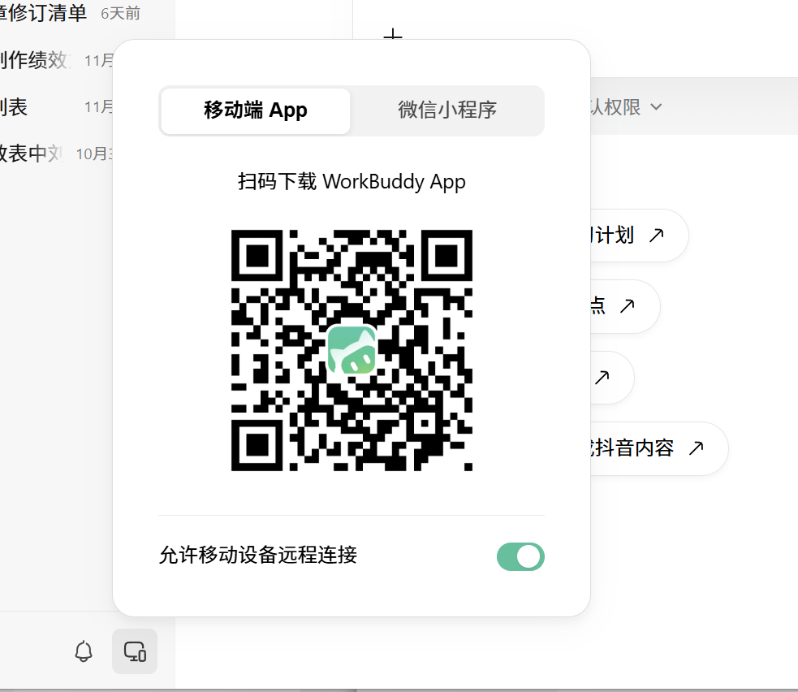
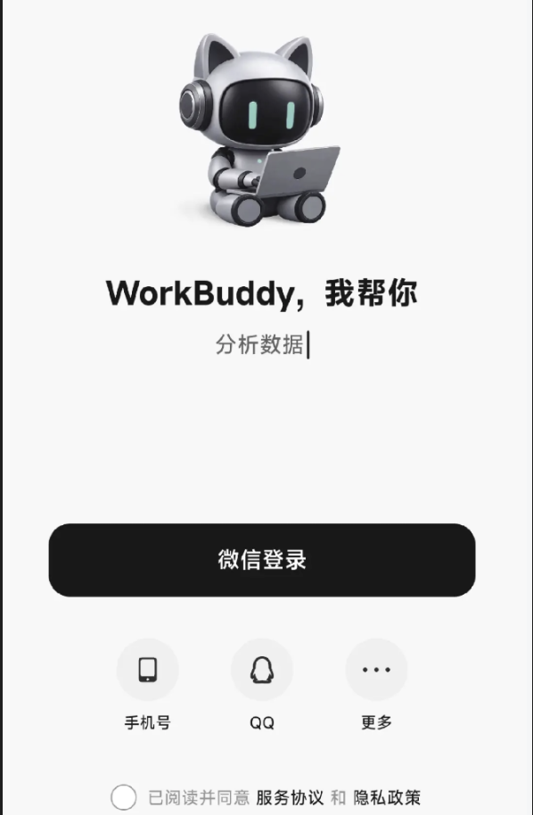
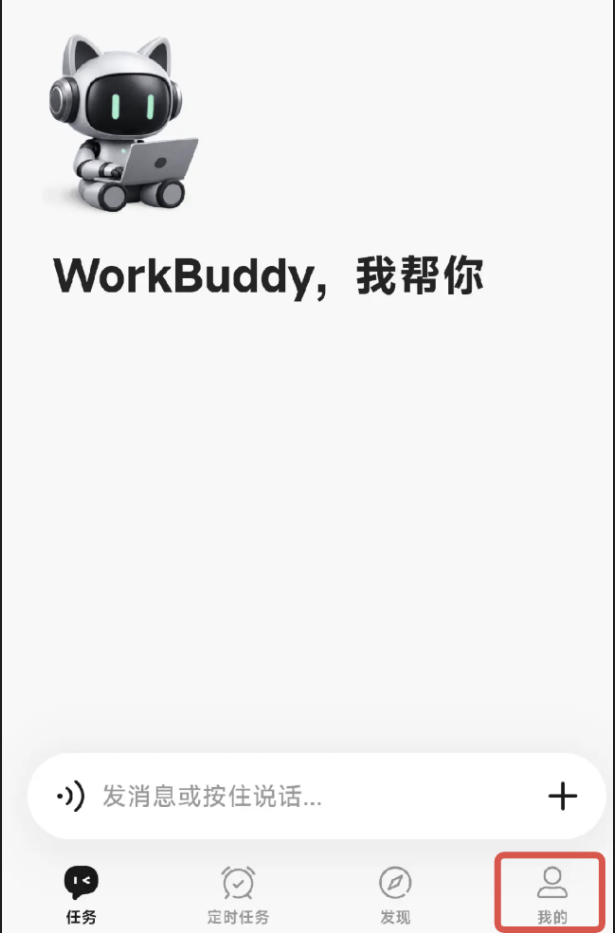
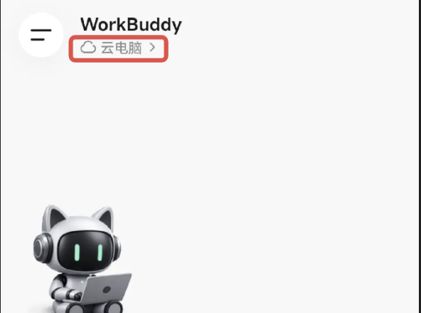
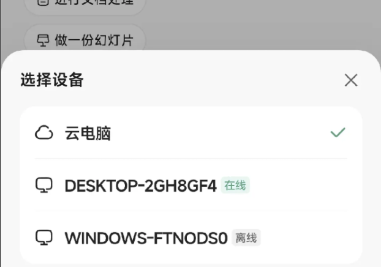
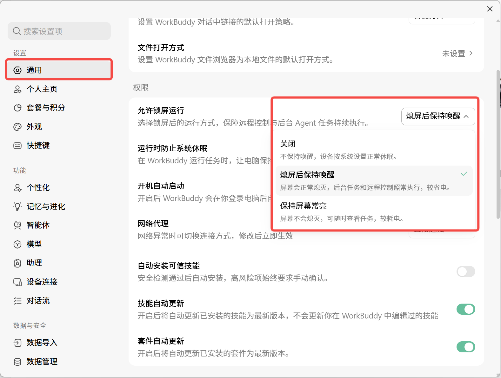

# 第六章　阶段一进阶课｜手机语音与远程续办

**用手机交代和跟进电脑端任务，离开工位后继续处理工作**

**本章目录**

- [开始前连好手机和电脑](#开始前连好手机和电脑)
- [用语音交代任务](#用语音交代任务)
- [在手机上查看和续办](#在手机上查看和续办)
- [怎样把手机语音与远程续办用好](#怎样把手机语音与远程续办用好)
- [记忆方法：任务、用途、事实、边界](#记忆方法任务用途事实边界)
- [当次练习](#当次练习)
- [官方资料](#官方资料)
- [相关章节](#相关章节)

阶段一的「你想想」和「你找找」都可以从口头交代开始。工作途中，领导干部可以在手机上语音发起任务，也可以接着电脑上已经开始的对话，查看进度、补充要求或停止执行。任务由电脑端的 WorkBuddy 按当前账号和已有权限处理，手机端用于交代和跟进。

本课沿用阶段一的口述和键入方式，练习不需要上传文件。WorkBuddy 的移动端入口和功能会随版本调整，正式培训时应先对照实际界面与单位使用要求。

**图6-1　手机交代，电脑执行，两端继续同一任务**

## 开始前连好手机和电脑

第一次使用时，先在电脑端打开连接许可，再到手机上选择这台电脑。下面按实际操作顺序说明，两端都要保持联网。

**第一步　在电脑上打开 WorkBuddy**

1. 在准备远程使用的电脑上启动 WorkBuddy，完成登录。安装方法可参阅[第三章「先把工具准备好」](../00-prepare/03-prepare.md)。
2. 记下这次使用的登录方式和账号，手机端沿用同一账号。例如，电脑端用微信登录，手机端也使用同一个微信账号。
3. 保持 WorkBuddy 运行，接着设置移动端连接。

**第二步　打开电脑端的连接许可**

1. 在电脑端 WorkBuddy 的左侧边栏底部，找到「连接移动端」图标。
2. 将鼠标移到图标上，打开「连接移动端」面板。
3. 在面板中选择移动端 App 分页，打开连接许可开关。图6-2所示版本标为「允许移动设备远程连接」。
4. 暂时保留这个面板，后面可用其中的二维码打开或下载手机 App。[官方连接说明](https://www.workbuddy.cn/docs/workbuddyapp/features/Multidevice)

**图6-2　电脑端移动连接面板，打开「允许移动设备远程连接」开关**

**第三步　在手机上安装并登录 App**

1. 打开手机应用商店，搜索「WorkBuddy」并安装。iPhone 使用 App Store，安卓手机使用应用市场。也可以扫描电脑端连接面板中的二维码，按页面引导打开或下载 App。
2. 启动 App，按页面提示登录，使用与电脑端一致的账号。
3. 进入主页后，从「我的」或当前版本的账号入口查看账号信息，确认手机端登录的是这次准备连接电脑的账号。[移动端快速开始](https://www.workbuddy.cn/docs/workbuddyapp/Quickstart)、[侧边栏说明](https://www.workbuddy.cn/docs/workbuddyapp/features/Sidebar)

**图6-3a　手机端登录页，沿用电脑端账号登录**

**图6-3b　手机端主页，可从「我的」查看账号信息**

**第四步　选择要连接的电脑**

1. 打开手机 App 侧边栏，点击顶部的设备入口。
2. 在「选择设备」面板中找到这次准备使用的电脑，点击设备名称。
3. 返回后查看当前设备名称和状态。设备名称与所选电脑一致，并显示绿色「在线」标签时，即可继续打开这台电脑上的任务。
4. 如果账号下有多台电脑，逐一看清设备名称，选中本次要使用的那一台。连接关系会保留，之后打开 App 可继续查看已连接电脑的任务。[设备选择与状态说明](https://www.workbuddy.cn/docs/workbuddyapp/features/Multidevice)

**图6-4a　手机端主页顶部的设备入口**

**图6-4b　选择设备列表，确认目标电脑名称和在线状态**

**图6-5　连接后显示的目标电脑名称与状态标记**

**第五步　设置电脑锁屏后继续运行**

外出或开会前，可开启「允许锁屏运行」，让后台任务和远程操作在锁屏后继续进行。

1. 在电脑端点击头像，进入「设置」，找到「允许锁屏运行」所在页面。
2. 找到「允许锁屏运行」设置并开启。连接面板中显示「保持唤醒状态，以便远程访问」时，也可以从该入口设置。
3. 界面提供以下两种运行方式时，按需要选择。

| 运行方式       | 使用效果                                                       |
| -------------- | -------------------------------------------------------------- |
| 熄屏后保持唤醒 | 屏幕正常熄灭，后台任务和远程操作继续运行，适合离开工位后使用。 |
| 保持屏幕常亮   | 屏幕持续显示，便于现场观察任务过程。                           |

设置好后，接通电脑电源，再用手机查看设备在线状态。[官方锁屏运行与连接说明](https://www.workbuddy.cn/docs/workbuddyapp/features/Multidevice)

**图6-6　电脑端设置中的「允许锁屏运行」及运行方式**

**第六步　用一个简单任务走完连接过程**

1. 在电脑端新建一个任务，输入下面这段话。

   > **使用者**
   >
   > 你想想，明天部门碰头会有四十五分钟，主要讨论重点任务进展和需要协调的事情，先帮我排个议程。

2. 等电脑端出现回答后，拿起手机，在所选电脑的任务列表中打开刚才这段对话。
3. 在手机上继续输入一句话。

   > **使用者**
   >
   > 把需要协调的事情放到前面，进展通报放到后面，总时长保持四十五分钟，给我一份完整议程。

4. 查看助手是否接着原任务修改议程，再回到电脑端查看同一对话。两端都能看到这次补充及后续回答，就完成了从手机续办电脑任务的操作。
5. 使用锁屏远程功能时，再将电脑锁屏，从手机上打开同一任务继续交代一次，确认准备使用的场景能够正常接续。[任务续办说明](https://www.workbuddy.cn/docs/workbuddyapp/features/Multidevice)

**图6-7a　电脑端简单书籍推荐对话**

**图6-7b　手机端接续同一书籍推荐对话并追问**

图6-7以简单书籍推荐对话展示两端接续的效果。上面的议程练习可按相同步骤操作。

**遇到连接问题时怎么处理**

| 看到的情况               | 处理顺序                                                                                     |
| ------------------------ | -------------------------------------------------------------------------------------------- |
| 手机设备列表中找不到电脑 | 先在电脑上打开 WorkBuddy，查看「允许移动设备远程连接」是否开启，再检查两端账号是否一致。     |
| 能看到电脑，但显示离线   | 先查看电脑是否开机、WorkBuddy 是否仍在运行，再检查两端网络，恢复后重新打开设备入口查看状态。 |
| 手机里找不到刚才的任务   | 查看当前执行环境和所选电脑，再从这台电脑的任务列表打开原对话。                               |
| 电脑锁屏后任务中断       | 回到电脑查看「允许锁屏运行」设置，检查供电和在线状态，再重新尝试续办。                       |

完成以上步骤后，就可以继续练习用手机语音交代任务。

## 用语音交代任务

手机和电脑都可以安装微信输入法。在 WorkBuddy 输入框中切换到微信输入法，手机上使用输入法的语音入口，电脑上按输入法设置中显示的语音快捷键开始说话。转成文字后，先核对再发送。具体入口和快捷键以所用系统与版本为准。[微信输入法隐私政策](https://wxkeyboardcms-1258476243.file.myqcloud.com/page/article/index/11.html)

口述时，可以按四项交代。

1. **任务**：请助手完成什么工作。
2. **用途**：结果供谁、在什么场合使用。
3. **事实**：已知情况、时间、范围和限制。
4. **边界**：哪些信息不能补写，结果先做到哪一步。

用微信输入法说完后，先看转出的文字再发送。人名、单位名称、日期、金额、文件名称以及「不」「未」等词容易被识别错，尤其要逐项确认。App 自带的按住说话功能，转写结果也应先核对。

例如，领导干部可以这样口述：

> **使用者**
>
> 你找找，今年防汛工作的上级文件，重点看值班和隐患排查方面的要求。我准备安排科室工作，先把相关原文和链接给我。

助手返回资料后，可以在原对话中补充关注的地区或事项，继续请它核对出处。

## 在手机上查看和续办

App 会显示电脑是否在线，以及对话所处状态。不同版本的界面文字可能略有差异，常见状态如下：

| 状态     | 处理方式                                                 |
| -------- | -------------------------------------------------------- |
| 运行中   | 查看当前进度；需要补充要求时，打开原对话继续交代。       |
| 等待输入 | 阅读助手的问题，补充缺少的事实或说明下一步要求。         |
| 已完成   | 查看完整对话和可用产物；正式使用前核对内容与文件。       |
| 已停止   | 查看停止前已经完成的内容，再决定是否从现有结果继续。     |
| 失败     | 查看错误信息；需要重试时，先确认任务和工作空间是否正确。 |

续办时应把新要求说具体。例如，助手询问议程如何安排，领导干部可以在手机上补充：「议程分为会前情况说明、进展通报、集中协调、明确下一步安排四项，时间分别为5分钟、15分钟、20分钟和5分钟。请保持45分钟总时长，先修订提纲。」发送前要检查语音指令或识别结果，确认环节和时长没有错。

发现任务偏离方向时，可以在 App 中停止本轮执行。停止后，已经完成的步骤和产物仍会保留；领导干部要先检查现有结果，再决定是否继续修改或清理文件。

电脑生成的部分产物可以在 App 中预览或导出。涉及正式报送、印发或决策的文件，仍应回到电脑打开原文件，检查内容、格式、版本和保存位置，并由有权人员审定。

## 怎样把手机语音与远程续办用好

- **长任务先在电脑上交代，手机上补充要求。** 背景和限制较多时，电脑上更便于检查。手机适合补一句、回答追问和查看进度。
- **续办时打开原对话。** 查看所选电脑和任务名称，确认前面的交代仍在，再补充要求。另开任务前，先判断是否确实要单独形成一份结果。
- **补充几次后，核对当前采用哪套要求。** 先后改过时间、范围或顺序时，请助手复述当前方案，确认先前要求已怎样调整，再继续执行。
- **遇到发送后没有回执的情况，先确认指令是否已收到。** 网络恢复后打开原任务查看最新对话，确认刚才的指令是否存在，再决定是否重发，避免同一任务执行两次。
- **涉及文件修改时，先看具体动作。** 手机指令由电脑端按已有权限执行，覆盖、删除或对外发送前，核对目标文件、修改内容和接收对象。

材料和工具的使用范围按[第二章「安全要求」](../00-prepare/02-safety.md)办理。

## 记忆方法：任务、用途、事实、边界

说任务、说用途、说事实、划边界。先看文字，再发送。

## 当次练习

约用十分钟，选一件明天要办、可以只用口述或键入说明的事，练习两端接续。

1. 在电脑端用「你想想」或「你找找」交代任务，等助手返回初步结果。
2. 用手机打开所选电脑上的同一对话，语音补充一项实际要求，检查文字后发送。
3. 根据状态回答一次追问或查看后续结果，确认补充要求被采用。
4. 回电脑检查原对话和最终结果，再试一次锁屏后的接续。

## 官方资料

- [WorkBuddy 多端协同（连接电脑）](https://www.workbuddy.cn/docs/workbuddyapp/features/Multidevice)：连接条件、任务状态、远程续办和停止、数据同步及权限范围。
- [WorkBuddy 移动端「发起任务」](https://www.workbuddy.cn/docs/workbuddyapp/features/Create-Task)：App 自带语音输入的说明。

## 相关章节

- 从口头任务提出思路，参阅[第四章「你想想」](04-xiangxiang.md)。
- 查找公开资料，参阅[第五章「你找找」](05-zhaozhao.md)。
- 需要阅读已有材料，参阅[第七章「你看看」](../02-materials/07-kankan.md)。
