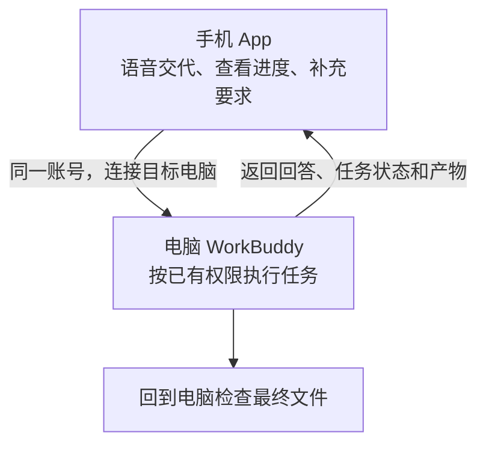

# 第六章　阶段一进阶课｜手机语音与远程续办

**用手机交代和跟进电脑端任务，离开工位后继续处理工作**

阶段一的「你想想」和「你找找」都可以从口头交代开始。工作途中，领导干部可以在手机上语音发起任务，也可以接着电脑上已经开始的对话，查看进度、补充要求或停止执行。任务由电脑端的 WorkBuddy 按当前账号和已有权限处理，手机端用于交代和跟进。

本课沿用阶段一的口述和键入方式，练习不需要上传文件。WorkBuddy 的移动端入口和功能会随版本调整，正式培训时应先对照实际界面与单位使用要求。

**图6-1　手机交代，电脑执行，两端继续同一任务**

## 开始前连好手机和电脑

第一次使用时，先在电脑端打开连接许可，再到手机上选择这台电脑。下面按实际操作顺序说明，两端都要保持联网。

### 第一步　在电脑上打开 WorkBuddy

1. 在准备远程使用的电脑上启动 WorkBuddy，完成登录。安装方法可参阅[第三章「先把工具准备好」](../00-prepare/03-prepare.md)。
2. 记下这次使用的登录方式和账号，手机端沿用同一账号。例如，电脑端用微信登录，手机端也使用同一个微信账号。
3. 保持 WorkBuddy 运行，接着设置移动端连接。

### 第二步　打开电脑端的连接许可

1. 在电脑端 WorkBuddy 的左侧边栏底部，找到「连接移动端」图标。
2. 将鼠标移到图标上，打开「连接移动端」面板。
3. 在面板中选择「App」分页，打开「允许移动端连接此设备」开关。
4. 暂时保留这个面板，后面可用其中的二维码打开或下载手机 App。[官方连接说明](https://www.workbuddy.cn/docs/workbuddyapp/features/Multidevice)

> **官方界面文字 · 连接许可**
>
> 允许移动端连接此设备
>
> 来源 [WorkBuddy 多端协同说明](https://www.workbuddy.cn/docs/workbuddyapp/features/Multidevice)

**图1　电脑端开启移动端连接（待补截图）**

| 截图位置 |
| :---: |
|        |

截图应同时展示侧边栏底部的图标、展开的「连接移动端」面板、「App」分页，以及已经打开的连接开关。

### 第三步　在手机上安装并登录 App

1. 打开手机应用商店，搜索「WorkBuddy」并安装。iPhone 使用 App Store，安卓手机使用应用市场。也可以扫描电脑端连接面板中的二维码，按页面引导打开或下载 App。
2. 启动 App，按页面提示登录，使用与电脑端一致的账号。
3. 进入主页后，打开左上角菜单，在侧边栏底部查看账号信息，确认手机端登录的是这次准备连接电脑的账号。[移动端快速开始](https://www.workbuddy.cn/docs/workbuddyapp/Quickstart)、[侧边栏说明](https://www.workbuddy.cn/docs/workbuddyapp/features/Sidebar)

**图2　手机端登录及账号信息（待补截图）**

| 截图位置 |
| :---: |
|        |

可并排放置登录页和登录后的侧边栏，标出登录入口及账号信息所在位置。

### 第四步　在手机上切换到「连接电脑」

1. 回到 App 主页，找到当前任务执行环境的标签。
2. 点击模式标签，选择「连接电脑」。也可以从左上角菜单展开侧边栏，在顶部切换执行环境。
3. 查看当前模式是否已显示为「连接电脑」，接着选择设备。本课的任务由选中的电脑执行。[主页与导航说明](https://www.workbuddy.cn/docs/workbuddyapp/features/Homepage)

**图3　手机端切换执行环境（待补截图）**

| 截图位置 |
| :---: |
|        |

截图应展示模式切换入口和「连接电脑」选项，让读者能看清点击位置。

### 第五步　选择要连接的电脑

1. 打开手机 App 侧边栏，点击顶部的设备入口。
2. 在「选择设备」面板中找到这次准备使用的电脑，点击设备名称。
3. 返回后查看当前设备名称和状态。设备名称与所选电脑一致，并显示绿色「在线」标签时，即可继续打开这台电脑上的任务。
4. 如果账号下有多台电脑，逐一看清设备名称，选中本次要使用的那一台。连接关系会保留，之后打开 App 可继续查看已连接电脑的任务。[设备选择与状态说明](https://www.workbuddy.cn/docs/workbuddyapp/features/Multidevice)

**图4　手机端设备入口与选择列表（待补截图）**

| 截图位置 |
| :---: |
|        |

可并排放置两张图，分别标出侧边栏顶部的设备入口和「选择设备」列表中的目标电脑。

**图5　电脑连接成功后的手机界面（待补截图）**

| 截图位置 |
| :---: |
|        |

截图应展示当前电脑名称、绿色「在线」标签，以及可打开的任务列表。

### 第六步　设置电脑锁屏后继续运行

外出或开会前，可开启「允许锁屏运行」，让后台任务和远程操作在锁屏后继续进行。

1. 在电脑端点击头像，依次进入「设置」「系统设置」。
2. 找到「允许锁屏运行」设置并开启。连接面板中显示「保持唤醒状态，以便远程访问」时，也可以从该入口设置。
3. 界面提供以下两种运行方式时，按需要选择。

| 运行方式 | 使用效果 |
| --- | --- |
| 熄屏后保持唤醒 | 屏幕正常熄灭，后台任务和远程操作继续运行，适合离开工位后使用。 |
| 保持屏幕常亮 | 屏幕持续显示，便于现场观察任务过程。 |

设置好后，接通电脑电源，再用手机查看设备在线状态。[系统设置说明](https://www.workbuddy.ai/docs/zh/workbuddy/From-Beginner-to-Expert-Guide/Function-Description/System-Settings)、[锁屏运行方式说明](https://www.workbuddy.cn/docs/workbuddyapp/features/Multidevice)

**图6　电脑端锁屏运行设置（待补截图）**

| 截图位置 |
| :---: |
|        |

截图应展示「允许锁屏运行」所在位置和已选中的运行方式。

### 第七步　用一个简单任务走完连接过程

1. 在电脑端新建一个任务，输入下面这段话。

   > **使用者**
   >
   > 你想想，明天部门碰头会有四十五分钟，主要讨论重点任务进展和需要协调的事情，先帮我排个议程。

2. 等电脑端出现回答后，拿起手机，在所选电脑的任务列表中打开刚才这段对话。
3. 在手机上继续输入一句话。

   > **使用者**
   >
   > 把需要协调的事情放到前面，进展通报放到后面，总时长保持四十五分钟，给我一份完整议程。

4. 查看助手是否接着原任务修改议程，再回到电脑端查看同一对话。两端都能看到这次补充及后续回答，就完成了从手机续办电脑任务的操作。
5. 使用锁屏远程功能时，再将电脑锁屏，从手机上打开同一任务继续交代一次，确认准备使用的场景能够正常接续。[任务续办说明](https://www.workbuddy.cn/docs/workbuddyapp/features/Multidevice)

**图7　手机续办电脑任务（待补截图）**

| 截图位置 |
| :---: |
|        |

可并排放置电脑和手机中的同一段对话，展示手机补充的指令及助手修改后的议程。

### 遇到连接问题时怎么处理

| 看到的情况 | 处理顺序 |
| --- | --- |
| 手机设备列表中找不到电脑 | 先在电脑上打开 WorkBuddy，查看「允许移动端连接此设备」是否开启，再检查两端账号是否一致。 |
| 能看到电脑，但显示离线 | 先查看电脑是否开机、WorkBuddy 是否仍在运行，再检查两端网络，恢复后重新打开设备入口查看状态。 |
| 手机里找不到刚才的任务 | 查看当前执行环境和所选电脑，再从这台电脑的任务列表打开原对话。 |
| 电脑锁屏后任务中断 | 回到电脑查看「允许锁屏运行」设置，检查供电和在线状态，再重新尝试续办。 |

完成以上步骤后，就可以继续练习用手机语音交代任务。

## 用语音交代任务

WorkBuddy 移动端支持通过语音下达任务。口述时，可以按四项交代：

1. **任务**：请助手完成什么工作。
2. **用途**：结果供谁、在什么场合使用。
3. **事实**：已知情况、时间、范围和限制。
4. **边界**：哪些信息不能补写，结果先做到哪一步。

App 将语音转成可编辑文字时，领导干部应在发送前核对识别结果。人名、单位名称、日期、金额、文件名称以及「不」「未」等词容易被识别错，尤其要逐项确认。语音直接发送、没有文字预览时，可以先请助手复述任务和关键事实；确认无误后，再让它继续处理涉及文件修改或对外操作的事项。

例如，领导干部可以这样口述：

> **使用者**
>
> 你想想，明天部门碰头会只有四十五分钟，我想听听重点任务进展，再把需要协调的事议一议。先帮我排个议程，各部门的具体情况我接着补。

助手据此安排议程框架。领导干部可以在同一对话中补充发言顺序和时长，确认后请助手写出完整议程。

## 在手机上查看和续办

App 会显示电脑是否在线，以及对话所处状态。不同版本的界面文字可能略有差异，常见状态如下：

| 状态 | 处理方式 |
| --- | --- |
| 运行中 | 查看当前进度；需要补充要求时，打开原对话继续交代。 |
| 等待输入 | 阅读助手的问题，补充缺少的事实或说明下一步要求。 |
| 已完成 | 查看完整对话和可用产物；正式使用前核对内容与文件。 |
| 已停止 | 查看停止前已经完成的内容，再决定是否从现有结果继续。 |
| 失败 | 查看错误信息；需要重试时，先确认任务和工作空间是否正确。 |

续办时应把新要求说具体。例如，助手询问议程如何安排，领导干部可以在手机上补充：「议程分为会前情况说明、进展通报、集中协调、明确下一步安排四项，时间分别为5分钟、15分钟、20分钟和5分钟。请保持45分钟总时长，先修订提纲。」发送前要检查语音指令或识别结果，确认环节和时长没有错。

发现任务偏离方向时，可以在 App 中停止本轮执行。停止后，已经完成的步骤和产物仍会保留；领导干部要先检查现有结果，再决定是否继续修改或清理文件。

电脑生成的部分产物可以在 App 中预览或导出。涉及正式报送、印发或决策的文件，仍应回到电脑打开原文件，检查内容、格式、版本和保存位置，并由有权人员审定。

## 怎样把手机语音与远程续办用好

手机发出的指令会在已连接的电脑端执行，使用该电脑上 WorkBuddy 当前已有的权限。手机连接沿用现有权限设置。发出涉及修改、删除、共享或对外发送的指令前，应先核对任务内容、目标文件和操作范围。

多端协同会同步电脑与手机之间的对话内容和任务记录，供移动端显示状态、历史对话和执行信息。领导干部应使用单位认可的账号、设备和工作环境，并遵守本单位的数据管理要求。涉密材料不得输入系统；其他内部信息按第二章的要求处理。

## 当次练习

练习约需五分钟，不使用附件。先在电脑端启动一个简单任务，再用手机语音补充要求。

1. 电脑端与手机 App 使用同一账号，确认手机连接到正确设备。
2. 在电脑端请助手拟一份45分钟部门碰头会议程框架，说明用途和现有事实，并要求助手先列提纲。
3. 打开手机 App 中的同一对话，用语音补充一项议程安排；App 显示识别文字时先核对，未显示时请助手先复述关键要求。
4. 查看任务状态。助手等待输入时补齐信息，任务方向偏离时停止本轮。
5. 任务完成后核对议程时长，再回到电脑检查工作空间中的最终文件。

## 记忆方法：任务、用途、事实、边界

手机交代任务时，先说清要做什么，再说明结果用在哪里；把已知事实交代准确，把不能补写的内容和输出范围讲明白。发送语音前核对识别文字，续办时沿用原对话，结束后检查保留的结果。

## 官方资料

- [WorkBuddy 多端协同（连接电脑）](https://www.workbuddy.cn/docs/workbuddyapp/features/Multidevice)：连接条件、任务状态、远程续办和停止、数据同步及权限范围。
- [WorkBuddy 移动端「发起任务」](https://www.workbuddy.cn/docs/workbuddyapp/features/Create-Task)：说明语音输入、松开发送、语音转文字和麦克风授权。
- [WorkBuddy 系统设置](https://www.workbuddy.ai/docs/zh/workbuddy/From-Beginner-to-Expert-Guide/Function-Description/System-Settings)：锁屏运行与远程访问设置。

## 相关章节

- 阶段一「你想想」和「你找找」分别练习从口头交代整理思路、查找并核对公开资料。
- 涉及现有文件的阅读和修改时，进入阶段二「就地取材」，并先按第二章确认材料可以在所用环境中处理。
