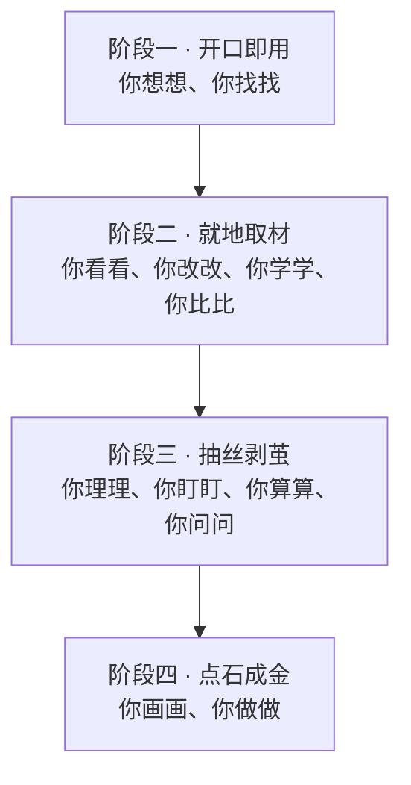

# 第一章　前言

**用十二个工作指令处理从接到任务到交付成果的日常公务**

**本章目录**

- [日常公务里的这些环节](#日常公务里的这些环节)
- [十二个工作指令](#十二个工作指令)
- [默认的工作环境](#默认的工作环境)
- [读者与安全边界](#读者与安全边界)
- [建议的阅读顺序](#建议的阅读顺序)

## 日常公务里的这些环节

领导干部的日常工作，常从一份来文、一项交办或一次会议开始。阅读上级要求后，负责人要研究本单位怎样落实；准备汇报、讲话或会议时，还要查找依据、听取意见、核对数字，并想清楚哪些事项需要协调。任务有时只有一句交代，有时已经带着来文、草稿或几份待比较的方案，处理重点也随之变化。

一项任务常见的工作环节有：

1. 阅读来文，找出与本单位有关的要求。
2. 查找政策依据和公开资料，打开原文核对出处。
3. 研究落实思路，比较方案并作出选择。
4. 起草、修改文稿，整理讨论意见和会议记录。
5. 核对数据，明确责任分工，跟进工作进展。
6. 把已经核实的内容整理成表格、图表或演示文稿。

助手可以承担查找、整理、起草和检查等工作。交代任务时，应说明来由、对象、目标和成品要求；涉及本单位的事实与决定，由相应负责人核实、审定。

## 十二个工作指令

本书把常见的人工智能办公任务归纳为十二个工作指令：你想想、你找找、你看看、你改改、你学学、你比比、你理理、你盯盯、你算算、你问问、你画画、你做做。读者可以根据手头任务，选择相应指令开始交流。

| 手头的任务 | 可以从哪一句开始 |
| --- | --- |
| 有一项交办，需要研究思路或查找资料 | 你想想、你找找 |
| 已有材料，需要审阅、修改、参考或比较 | 你看看、你改改、你学学、你比比 |
| 信息较多，需要理清意见、分工、数字或问题 | 你理理、你盯盯、你算算、你问问 |
| 内容已经核实，需要制作图表或演示文稿 | 你画画、你做做 |

十二式的学习按任务的起步方式和处理深度分为四个阶段。

1. **开口即用**包括「你想想」「你找找」。阶段一只用口述或键入，不依赖上传材料：「你想想」请助手提出思路；「你找找」用于查找公开资料并核对出处。
2. **就地取材**包括「你看看」「你改改」「你学学」「你比比」。读者提供已有文稿、来文、往年材料或待比较的方案，请助手阅读、修改、仿写或比较。
3. **抽丝剥茧**包括「你理理」「你盯盯」「你算算」「你问问」。这四式用于梳理多方意见、明确工作分工、核对数字，以及预演汇报或决策中可能遇到的问题。
4. **点石成金**包括「你画画」「你做做」。读者把已经核实的内容整理成图表、流程图或演示文稿。

学习顺序从口头交代逐步走向多材料协作和成果制作。信息越多、判断越复杂，越要补充背景并核验事实、出处和计算；实际工作按业务需要选用各式。

「你想想」从一项交办出发，请助手提出几种可选思路；「你比比」则要把两套以上已经成形的材料放在一起，按明确标准逐项比较。已有文稿需要调整内容、结构、篇幅或文体时，用「你改改」；需要检查文稿、查错字或对照要求审阅时，用「你看看」。

**图1-1　四个阶段与十二个工作指令**

## 默认的工作环境

本书以腾讯 WorkBuddy 桌面版演示操作。读者可以用自然语言交代任务、按需要选择模型，并在授权范围内处理文件。产品功能、模型和界面会随版本、账号类型及单位配置变化，实际操作应遵循本单位批准的工具和当前界面。本书介绍的方法也适用于单位允许使用的其他人工智能助手。

安装、登录、模型选择和添加文件的基本操作见第三章。将审定内容整理成演示文稿，可继续阅读「你做做」。手机语音、会议录音转写和计算机自动操作等进阶用法，安排在相应阶段的进阶课程中介绍。

## 读者与安全边界

本书面向党政机关、中央企业和国有企业的领导干部。案例使用说明见第二章末尾。读者在本单位开展练习时，应按规定选择材料和工具；涉密信息、个人信息和内部敏感信息的处理要求见第二章。

人工智能助手可以协助阅读、查找、起草、比较和整理信息。政策依据、数据和计算结果须对照权威来源核实；正式发出的文稿由有权人员审定。各章案例和练习都按这一边界安排。

## 建议的阅读顺序

1. 先读第二章「安全要求」，再按第三章的步骤完成工具准备。
2. 按四个阶段顺序学习十二式，每章完成一道当次练习。阶段一从口述或键入开始；需要文件的练习按安全要求选材。
3. 学完十二式后，完成综合练习，按照实际工作顺序连贯使用多个指令。
4. 用于授课时，可以先看附录中的讲授提纲，再按课程安排回到相应章节。

读完阶段一，读者应能从一句交办出发比较几种思路，也能查找公开政策和资料、打开原文核对出处。学完十二式后，读者可以根据任务选择合适的指令，整理信息、形成成品，并按规定核实和审定结果。
