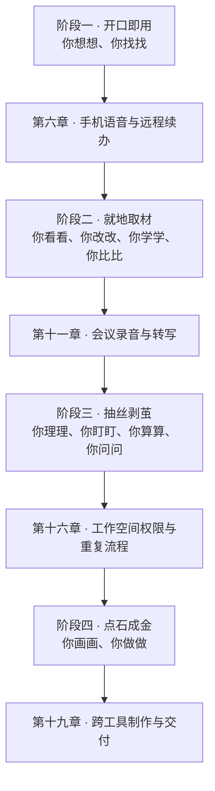

# 第一章　前言

**用十二个工作指令处理从接到任务到交付成果的日常公务**

**本章目录**

- [日常公务里的这些环节](#日常公务里的这些环节)
- [十二个工作指令](#十二个工作指令)
- [默认的工作环境](#默认的工作环境)
- [读者与安全边界](#读者与安全边界)
- [建议的阅读顺序](#建议的阅读顺序)

## 日常公务里的这些环节

领导干部的日常工作，常从一份来文、一项交办或一次会议开始。阅读上级要求后，负责人要研究本单位怎样落实；准备汇报、讲话或会议时，还要查找依据、听取意见、核对数字，并想清楚哪些事项需要协调。任务有时只有一句交代，有时已经带着来文、草稿或几份待比较的方案，处理重点也随之变化。

一项任务常见的工作环节有：

1. 阅读来文，找出与本单位有关的要求。
2. 查找政策依据和公开资料，打开原文核对出处。
3. 研究落实思路，比较方案并作出选择。
4. 起草、修改文稿，整理讨论意见和会议记录。
5. 核对数据，明确责任分工，跟进工作进展。
6. 把已经核实的内容整理成表格、图表或演示文稿。

助手可以承担查找、整理、起草和检查等工作。交代任务时，应说明来由、对象、目标和成品要求；涉及本单位的事实与决定，由相应负责人核实、审定。

## 十二个工作指令

本书把常见的人工智能办公任务归纳为十二个工作指令：你想想、你找找、你看看、你改改、你学学、你比比、你理理、你盯盯、你算算、你问问、你画画、你做做。读者可以根据手头任务，选择相应指令开始交流。

| 手头的任务 | 可以从哪一句开始 |
| --- | --- |
| 有一项交办，需要研究思路或查找资料 | 你想想、你找找 |
| 已有材料或几句口头意思，需要审阅、整理、参考或比较 | 你看看、你改改、你学学、你比比 |
| 信息较多，需要理清意见、分工、数字或问题 | 你理理、你盯盯、你算算、你问问 |
| 内容已经核实，需要制作图表或演示文稿 | 你画画、你做做 |

四个学习阶段及对应指令见图1-1。

**图1-1　四个阶段与十二个工作指令**

「你想想」从一项交办出发，请助手提出几种可选思路；「你比比」则要把两套以上已经成形的材料放在一起，按明确标准逐项比较。手头只有几句口头意思或一段粗稿，需要整理成得体的文稿时，用「你改改」；需要检查文稿、查错字或对照要求审阅时，用「你看看」。

## 默认的工作环境

本书以腾讯 WorkBuddy 桌面版演示操作。读者可以用自然语言交代任务、按需要选择模型，并在授权范围内处理文件。产品功能、模型和界面会随版本、账号类型及单位配置变化，实际操作应遵循本单位批准的工具和当前界面。本书介绍的方法也适用于单位允许使用的其他人工智能助手。

安装、登录、模型选择和添加文件的基本操作见第三章。将审定内容整理成演示文稿，可继续阅读[第十八章「你做做」](04-creation/18-zuozuo.md)。四门进阶课分别安排在各阶段之后。

- 第六章「手机语音与远程续办」，介绍离开工位后怎样交代和跟进任务。
- 第十一章「会议录音与转写」，介绍怎样整理会议纪要和积累工作记录。
- 第十六章「工作空间权限与重复流程」，介绍怎样管理读取范围和复用任务流程。
- 第十九章「跨工具制作与交付」，介绍怎样复核、保存和交付文件。

## 读者与安全边界

本书面向党政机关、中央企业和国有企业的领导干部。案例使用说明见第二章末尾。读者在本单位开展练习时，应按规定选择材料和工具；涉密信息、个人信息和内部敏感信息的处理要求见第二章。

人工智能助手可以协助阅读、查找、起草、比较和整理信息。政策依据、数据和计算结果须对照权威来源核实；正式发出的文稿由有权人员审定。各章案例和练习都按这一边界安排。

## 建议的阅读顺序

1. 先读第二章「安全要求」，再按第三章的步骤完成工具准备。
2. 按四个阶段顺序学习十二式，每章完成一道当次练习。阶段一的两式只用口述或键入，不上传材料，学完后进入第六章「手机语音与远程续办」。从阶段二起，需要材料的任务按第二章选材。
3. 学完十二式后，完成综合练习，按照实际工作顺序连贯使用多个指令。
4. 用于授课时，可以先看[附录中的讲授提纲](appendices.md)，再按课程安排回到相应章节。

学完十二个指令后，读者能借助人工智能助手，把一件日常公务从接到任务走到交出成品。来文阅读、资料查找、思路研究、文稿起草和数字核对可以在多轮交流中接续完成，最后形成工作需要的文稿、表格或演示文稿。
