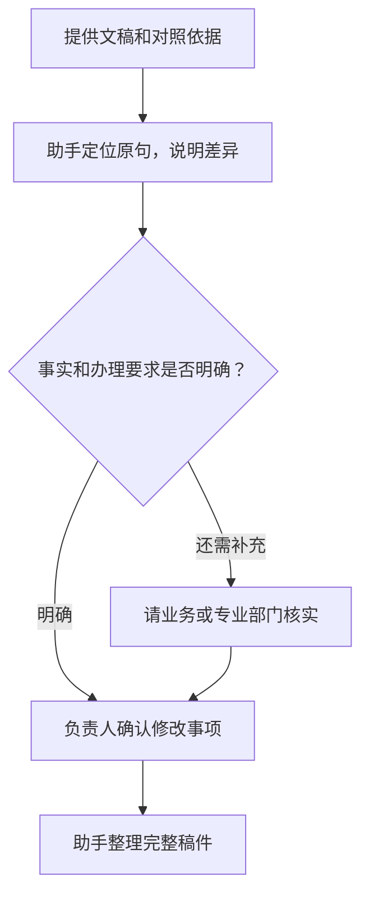

# 第七章　「你看看」

**请助手对照已有材料和明确要求，找出问题并说明依据**

**本章目录**

- [怎样审阅现有材料](#怎样审阅现有材料)
  - [先说清审阅依据](#先说清审阅依据)
  - [要求助手定位问题](#要求助手定位问题)
  - [一段通用交代](#一段通用交代)
- [案例一：通知稿的范围和时限是否准确](#案例一通知稿的范围和时限是否准确)
  - [最终成品：跨部门办事事项梳理通知](#最终成品跨部门办事事项梳理通知)
- [案例二：跨部门整改方案有没有落实会议决定](#案例二跨部门整改方案有没有落实会议决定)
  - [最终成品：三季度安全检查问题整改方案](#最终成品三季度安全检查问题整改方案)
- [案例三：财务汇报中的进展和数字是否一致](#案例三财务汇报中的进展和数字是否一致)
  - [最终成品：财务共享中心建设进展汇报](#最终成品财务共享中心建设进展汇报)
- [案例四：投资项目上会材料还缺哪些依据](#案例四投资项目上会材料还缺哪些依据)
  - [最终成品：冷链物流基地项目预审材料准备情况报告](#最终成品冷链物流基地项目预审材料准备情况报告)
- [怎样把「你看看」用好](#怎样把你看看用好)
- [看稿四步：定依据、标位置、说理由、列待核](#看稿四步定依据标位置说理由列待核)
- [当次练习](#当次练习)
- [相关章节](#相关章节)

领导干部收到一份通知、方案、汇报或项目材料后，常要判断内容是否符合上级要求、会议决定和已有事实。「你看看」可以请助手先通读材料，按明确的依据检查内容，再把发现的问题整理出来，供负责同志处理。

这一式需要已有材料作为输入，属于「就地取材」。助手先标出问题、说明依据。负责同志确认后，可以接着用「你改改」完成文稿。手头有几套方案时，还可以接「你比比」分析取舍。

## 怎样审阅现有材料

### 先说清审阅依据

审阅材料时，先说明这次要检查什么、材料用于哪个环节、应当对照哪些文件或决定。上级文件、会议纪要、已定方案、数据底表和内部审核清单都可以作为依据。需要助手判断依据是否齐全时，应把已掌握且获准处理的材料一并提供；还没查到的政策原文，可以先用「你找找」核实。

审阅重点应落到具体内容。例如，通知稿可以检查适用对象、任务要求、责任部门、报送方式和时限；工作方案可以核对任务分解、职责边界、协商情况和进度安排；汇报材料可以对照数据底表检查统计期间、指标名称、单位和结论。

党政机关公文文稿的审核事项包括行文依据、政策衔接、措施可行性、部门协商，以及人名、时间、数字和引文等内容。[《党政机关公文处理工作条例》第二十条](https://www.miit.gov.cn/xwdt/szyw/art/2020/art_6afb8ee6d07540dcacccbeb47dbc0fd4.html)

> **原文摘录 · 公文审核**
>
> 行文依据是否准确
>
> 来源 [《党政机关公文处理工作条例》第二十条](https://www.miit.gov.cn/xwdt/szyw/art/2020/art_6afb8ee6d07540dcacccbeb47dbc0fd4.html)

### 要求助手定位问题

可以先说材料准备做什么用，请助手通读找问题。看到初步意见后，再要求它定位原句，列出对照依据和处理建议。依据不足的判断应标成「待确认」；文字表达建议也要和事实错误、要求冲突分开。

### 一段通用交代

把方括号中的内容换成本次工作的实际情况，并附上获准提供的材料：

> **使用者**
>
> 你看看这份【材料】，准备在【场合】使用，相关依据也附上了。帮我找找有没有内容对不上、事情没说清的地方，先列出来。我确认后，再一起把正式要用的材料整理好。

**图7-1　审阅意见怎样形成可用稿件**

## 案例一：通知稿的范围和时限是否准确

**工作情境**

某市政务服务局办公室副主任周敏，收到领导交办，要组织各区梳理跨部门办事事项。她手头有上级工作通知、局务会纪要和一份通知稿，准备先检查通知稿有没有准确传达要求。

上级工作通知要求各区在2026年12月10日前完成事项梳理并报送市政务服务局，市局在12月20日前汇总报市政府办公室。局务会纪要要求先选五个区试填样表，第一批于11月25日前反馈；其他区继续准备，分批安排由办公室另行通知。通知稿第一段写成「请全市各区和有关市级部门于12月2日前报送全部事项清单」，第二段要求各单位分管领导签字。

> **材料原句 · 虚构教学材料**
>
> 通知稿第一段「请全市各区和有关市级部门于12月2日前报送全部事项清单」。
>
> 上级工作通知要求各区于2026年12月10日前报市局；局务会纪要安排第一批试填于11月25日前反馈。
>
> 来源为本案例设定的通知稿、上级工作通知及局务会纪要。

**怎样向助手交代**

周敏把三份材料上传到工作台，并交代：

> **周敏**
>
> 这份事项梳理通知要发给各区，你对着上级通知和局务会纪要看看，有没有写岔了的。要改的、还得问清楚的，先列给我。

**助手可能给出的思路**

> **助手**
>
> 我对照了上级工作通知、局务会纪要和通知稿，发现三处需要处理：
>
> | 核对项 | 通知稿表述 | 对照材料 | 初步判断 |
> | --- | --- | --- | --- |
> | 通知稿第一段：梳理对象 | 「全市各区和有关市级部门」 | 局务会纪要要求先选五个区试填，名单由办公室另行确定 | 第一批范围扩大到全市各区和市级部门；市级部门参与尚无依据 |
> | 通知稿第一段：报送时间 | 「全部事项清单于12月2日前报送」 | 第一批试填于11月25日前反馈；全市完整清单于12月10日前报市局，市局于12月20日前汇总报市政府办公室 | 两个阶段和对应时限被合并，需分别写明 |
> | 通知稿第二段：签字要求 | 「各单位分管领导签字」 | 上级工作通知和局务会纪要均未提到签字要求 | 现有依据不支持这一要求，需办公室确认有无其他规定 |
>
> 请办公室核定第一批名单，并确认市级部门参与和签字要求是否另有正式依据。

**怎样继续追问和调整**

周敏对照两份依据后，要求助手把确定要改的内容和仍待办公室决定的事项分开：

> **周敏**
>
> 问过办公室了，第一批五个区的名单还没定，样表按局务会说的11月25日前交。全市各区的完整清单还是12月10日前报。市级部门参不参加，领导还没定。你先把哪些能改、哪些还得问清楚理一下，先别改通知。

第二轮，助手按两类事项重新整理。周敏再核对通知稿后要求：

> **周敏**
>
> 每个问题把原文和哪份材料写的带上，方便我核对。市级部门参加、分管领导签字这两件事都还没依据，发之前得确认。

办公室核定名单后，周敏补充：

> **周敏**
>
> 名单定了，东河区、西城区、南城区、北城区和滨江区。这次只发各区，分管领导签字也不要求了。按刚才说清楚的两个阶段，把完整通知写好，我拿去送审。

**采用前要核对什么**

- 先核实局务会纪要是否为本次工作的有效依据，并确认办公室已经明确的第一批时限有无记录。
- 第一批五区名单以办公室核定结果为准，通知中的名单须与周敏补充的五个区逐一对应。
- 上级通知和局务会纪要分别安排了全量梳理与第一批试填，通知稿需要区分这两个阶段。
- 办公室已确认本轮对象为各区，通知按该范围起草，并删除未经确定的签字要求。

### 最终成品：跨部门办事事项梳理通知

> **教学案例成品**

**关于开展跨部门办事事项梳理和样表试填的通知（送审稿）**

各区政务服务部门：

根据上级工作通知和局务会安排，现就跨部门办事事项梳理及样表试填工作通知如下。

**一、先行开展样表试填**

第一批由东河区、西城区、南城区、北城区和滨江区开展试填，于2026年11月25日前将样表及填写中发现的问题反馈市政务服务局办公室。其他区同步做好梳理准备，分批安排由办公室另行通知。

**二、按期报送完整清单**

全市各区应于2026年12月10日前完成事项梳理，将完整清单报送市政务服务局。市局于12月20日前汇总报市政府办公室。

请各区按上述阶段和时限组织落实。

市政务服务局办公室

## 案例二：跨部门整改方案有没有落实会议决定

**工作情境**

真知集团安全环保部部长李宁，负责起草三季度安全检查问题整改方案。集团专题会已经明确牵头部门、协作事项和各单位报送节点，方案初稿也已形成。李宁需要先检查方案是否准确落实会议决定，再送相关部门征求意见。

会议纪要明确：安全环保部牵头整改工作并汇总进展；设备管理部在11月14日前提供重点设备台账；生产运营部协调生产安排，提供检修窗口；三家分公司在11月18日前报送首批问题清单；安全环保部每周一汇总进展。初稿写成由生产运营部牵头、安全环保部指导，设备管理部「配合提供台账」，没有写报送日期；每周进展则报生产运营部。

**怎样向助手交代**

李宁上传会议纪要、整改方案初稿和集团现行的安全整改工作要求后交代：

> **李宁**
>
> 你帮我看看这份安全整改方案，分工和时间跟专题会定的是不是一致。我准备发给相关部门征求意见，先找找问题。

**助手可能给出的思路**

> **助手**
>
> 我对照了专题会纪要和《安全隐患整改工作要求》，发现以下差异：
>
> - 牵头部门：方案写为生产运营部牵头、安全环保部指导；会议纪要明确由安全环保部牵头，生产运营部负责协调生产安排。
> - 设备台账：方案只写设备管理部配合提供，没有写时间；会议纪要明确应于11月14日前提供，方案漏掉了已定节点。
> - 首批问题清单：三家分公司于11月18日前报送，与会议纪要一致。
> - 进展报送：方案写每周一报生产运营部；会议纪要要求安全环保部每周一汇总。
> - 部门意见：方案还未征求相关部门意见，当前不能写成已会签。
>
> 设备管理部提供台账的日期已在会议纪要中明确；方案还未征求相关部门意见，当前不能写成已会签。

**怎样继续追问和调整**

李宁查过纪要并联系设备管理部后补充：

> **李宁**
>
> 设备管理部确认了，就按纪要11月14日前交台账，日期的出处写上。已经定下来的、还得征求意见的，你分开列一下。

第二轮，助手重新整理审阅清单。李宁继续要求：

> **李宁**
>
> 就照纪要和现有要求核对，别另外加整改要求。哪里还不清楚，告诉我该找谁问。

李宁接着要求：

> **李宁**
>
> 按刚才核对的改成一份征求意见稿，谁负责、什么时候报、每周怎么汇总写清楚。具体问题和措施等首批清单上来再细化，这个步骤写上。

**采用前要核对什么**

- 对照会议纪要原文，确认安全环保部与生产运营部的职责分工准确。
- 三个部门尚未完成会签，方案当前仍处于征求意见阶段。
- 设备管理部提供台账的日期来自会议纪要，李宁补充确认部门仍按该节点执行；正式方案应保留相应记录。
- 问题清单、整改措施和责任单位都应能在会议决定或已提供的工作要求中找到依据。

### 最终成品：三季度安全检查问题整改方案

> **教学案例成品**

**三季度安全检查问题整改方案（征求意见稿）**

为落实集团安全生产专题会决定，现就本轮安全检查问题整改工作提出如下安排，送相关部门征求意见。

**一、职责分工**

安全环保部牵头组织整改并汇总进展。设备管理部提供重点设备台账。生产运营部协调生产安排，提供检修窗口。三家分公司按会议要求整理并报送首批问题清单。

**二、材料和时间节点**

设备管理部于2026年11月14日前提供重点设备台账。三家分公司于11月18日前报送首批问题清单。安全环保部每周一汇总整改进展，生产运营部结合整改需要协调生产安排。

**三、意见征求与后续办理**

本稿送安全环保部、生产运营部和设备管理部核对职责、协作事项及节点安排。各部门反馈后，由安全环保部汇总修改，再履行集团内部审定程序。

**待进一步细化的内容**

具体问题、整改措施和责任单位需结合首批问题清单补充，经确认后纳入整改安排。

## 案例三：财务汇报中的进展和数字是否一致

**工作情境**

真知集团分管财务的副总经理陈立，准备在经营分析会上汇报财务共享中心建设进展。办公室提供了一份汇报稿，财务共享中心也提交了截至9月30日的项目状态表。陈立请助手对照两份材料检查进度、单位和金额口径，供他确认后修改。

状态表记录：截至9月30日，系统改造进度为80%；三家试点单位中两家已上线，第三家处于联调测试；批准预算为4600万元，已签合同4350万元，已支付3200万元。汇报稿第二部分称系统改造已经完成、三家单位均已上线，第三部分把4600万元称作项目累计投入；全文没有注明统计截止日期。

财务共享服务涉及职责分工、流程和数据质量。财政部的管理会计应用指引提出，建设财务共享服务中心应明确功能定位和各方职责，并建立质量管理等运营机制。[《管理会计应用指引第804号——财务共享服务》第十条、第十九条](https://kjs.mof.gov.cn/zhengcefabu/202606/t20260630_3992536.htm)

**怎样向助手交代**

陈立上传《财务共享中心建设进展汇报（讨论稿）》和《项目状态表（截至9月30日）》后交代：

> **陈立**
>
> 这份财务共享中心汇报会上要用，你对着附上的项目状态表看看，进度和金额有没有写错，有出入的标出来。

**助手可能给出的思路**

> **助手**
>
> 我对照了汇报稿和截至9月30日的项目状态表，发现四处差异：
>
> - 汇报稿第二部分：「系统改造已经完成」；状态表记录「系统改造进度：80%」。
> - 汇报稿第二部分：「三家单位均已上线」；状态表记录「已上线2家，第3家处于联调测试」。
> - 汇报稿第三部分：「项目累计投入4600万元」；状态表列出「批准预算4600万元、已签合同4350万元、已支付3200万元」。「累计投入」与底表字段名称不一致。
> - 汇报稿未注明统计截止日期；状态表采用9月30日口径。
>
> 目前材料只能说明表内记录的状态，差异原因和第三家单位的验收情况仍需业务部门确认。

**怎样继续追问和调整**

陈立联系财务共享中心后补充：

> **陈立**
>
> 我确认过了，改造进度、上线家数都是截至9月30日的。这次就汇报到9月30日。4600万元是预算，4350万元是签了合同的，3200万元是已经付的，别混着写。哪些确定写错了、哪些还得问业务部门，你分开列一下，投资完成率先不用算。

第二轮，助手据此列出差异。陈立继续要求：

> **陈立**
>
> 把有问题的地方在汇报稿和状态表里指给我看。表里没解释原因的先列着，我找业务部门问一下。

陈立确认差异后说：

> **陈立**
>
> 这几处按状态表改，给我一份完整稿。先说系统和试点，再说预算、合同和付款，最后把还得找业务部门补的列上。

**采用前要核对什么**

- 汇报稿和状态表应采用同一个统计截止日期，避免把10月的新进展写进9月末数据。
- 完成比例和上线数量要对照项目状态表原字段核实，助手不应另换口径计算。
- 批准预算、已签合同金额和已支付金额分别代表不同事项，引用时须保留准确名称。
- 底表只证明其中记录的状态；项目进度变化的原因仍要由业务部门核实。

**三项金额的含义（单位为万元）**

| 底表字段 | 金额 | 表示什么 |
| --- | ---: | --- |
| 批准预算 | 4600 | 经批准的项目预算 |
| 已签合同 | 4350 | 已签订合同的金额 |
| 已支付 | 3200 | 已经支付的金额 |

来源为本案例《项目状态表（截至9月30日）》。三项金额含义不同，按底表字段分别列示。

### 最终成品：财务共享中心建设进展汇报

> **教学案例成品**

**财务共享中心建设进展汇报**

现将截至2026年9月30日的建设进展汇报如下。

**一、系统改造和试点上线情况**

系统改造进度为80%。三家试点单位中，两家已上线，第三家处于联调测试阶段。

**二、预算、合同和支付情况**

项目批准预算为4600万元，已签合同金额4350万元，已支付金额3200万元。三项金额分别反映预算批准、合同签订和资金支付情况，本次汇报按项目状态表原口径列示。

**三、后续需核实的事项**

请财务共享中心结合项目记录，补充说明系统剩余改造工作及第三家试点单位的联调、上线安排。进度变化的原因和后续节点待业务部门确认后补充。

## 案例四：投资项目上会材料还缺哪些依据

**工作情境**

真知集团战略投资部副总经理张建华准备将一个冷链物流基地项目提交投资决策会议讨论。项目建议书已经形成，内部投资管理制度要求项目材料提交前列出可行性研究、投资估算、风险分析和决策事项。张建华希望先做一次上会前检查，了解材料中哪些结论缺少支撑。

他同时提供了《中央企业投资监督管理办法》作为对照依据。该办法要求中央企业对新投资项目深入开展技术、市场、财务和法律等方面的可行性研究与论证；股权投资项目还应开展必要的尽职调查，并按要求履行资产评估或估值程序。[《中央企业投资监督管理办法》第十五条](https://wap.sasac.gov.cn/n2588035/n2588320/n2588335/c20164244/content.html)

项目建议书的技术方案部分提出年处理能力8万吨，技术附件只有设备初步清单，没有工艺方案比较和产能测算；市场分析引用2023年行业材料；财务附件列出总投资估算和9.1%的预计内部收益率，但没有列全测算假设。材料包没有单独的风险分析，建议书也没有明确列出提请会议审议的事项。投资方案拟与合作方成立合资公司，合作方尽调和估值尚未完成；土地手续仍在沟通，项目资料尚未附法务意见。

**怎样向助手交代**

张建华上传项目建议书、内部投资管理制度、测算表和市场分析材料后交代：

> **张建华**
>
> 冷链物流项目要上预审会，你帮我看看还缺哪些依据和附件。集团投资制度和相关办法都在这里，对照着查一下，我要在会上说说材料准备到哪儿了。

**助手可能给出的思路**

> **助手**
>
> 我按集团投资制度和《中央企业投资监督管理办法》第十五条核对了项目建议书及附件，初步发现以下事项：
>
> - 技术方案部分提出年处理能力8万吨，设备附件未列工艺方案比较和产能测算。
> - 市场分析引用2023年行业材料，项目组需要说明数据范围和对当前需求判断的适用性。
> - 财务附件列出总投资估算和9.1%的预计内部收益率，但测算假设不完整，暂时无法复核结果。
> - 项目建议书没有风险分析部分，材料包也没有附风险分析；集团制度要求列明这项内容。
> - 土地手续仍在沟通，材料中没有法务意见。
> - 投资方案拟与合作方成立合资公司，合作方尽调和估值尚未完成。
> - 建议书没有列出提请会议审议的具体事项。
>
> 这些是材料完整性和依据核对结果，不构成可行性、合规或投资价值结论。请项目组补充材料，法务、财务和技术部门按职责核实专业内容。

**怎样继续追问和调整**

张建华说明，这份清单用于下周预审会，并补充交代：

> **张建华**
>
> 缺的材料和已有但没说清楚的，你分开列。土地手续找法务核，技术找技术部门，投资测算找财务。先看材料备齐没有，合不合规、投不投先别下结论。

第二轮，助手调整意见类别并列出责任方。张建华要求成品逐项注明材料位置、缺口类型和后续动作：

> **张建华**
>
> 每个问题把对应文件和位置带上，方便查。哪些缺材料、哪些论证不够、哪些要找专业部门确认，分清楚。开头说一下，这只是给项目组准备预审会用的，不是投资结论。

张建华最后交代：

> **张建华**
>
> 帮我写份给预审会的报告，材料准备到哪了、还缺什么、找哪些部门核实，都说清楚。刚才那张核对清单附后。

**采用前要核对什么**

- 核对集团内部投资管理制度的适用版本。案例已说明项目拟成立合资公司，尽职调查和估值材料按股权投资要求核对。
- 年处理能力和内部收益率来自项目建议书，仍需查看原始测算和关键假设，不能视为已经核验的结果。
- 合作方尽调和估值尚未完成，清单应如实标注材料状态。
- 土地手续、市场预测、财务测算和风险分析由对应责任部门按程序核实；这份清单用于准备预审，不替代专业审核或会议决策。

### 最终成品：冷链物流基地项目预审材料准备情况报告

> **教学案例成品**

**冷链物流基地项目预审材料准备情况报告**

本次依据集团投资管理制度及提供的相关办法，对项目建议书和附件作了上会前梳理。建议书已提出年处理能力8万吨和预计内部收益率9.1%，但产能测算、财务假设、风险分析及拟提请审议事项仍需补充。合作方尽调、估值尚未完成，用地相关法务意见也未附入。

建议项目组先补齐技术论证、测算假设、市场依据、风险分析及拟审议事项，分别提交技术、财务和法务部门核验。涉及合资设立的尽调、估值材料按适用要求准备。材料补充和专业意见形成后，再按集团程序提交预审。

各项材料状态和补充要求列示如下。

**冷链物流基地项目上会前核对清单**

| 序号 | 核对方面 | 材料现状 | 依据或缺口 | 责任方及问题 |
| --- | --- | --- | --- | --- |
| 1 | 技术可行性 | 建议书提出年处理能力8万吨，技术附件只有设备初步清单 | 未见工艺方案比较和产能测算，现有附件不足以复核处理能力 | 项目组补充技术论证和测算过程；技术部门核验适用性 |
| 2 | 市场可行性 | 市场分析引用2023年行业材料 | 尚需说明资料范围、时点及其对当前市场判断的适用性 | 项目组补充市场数据来源和预测口径；必要时提供更新资料或说明沿用理由 |
| 3 | 财务论证与投资估算 | 建议书列出总投资估算和9.1%的预计内部收益率 | 测算假设不完整，附件无法支持复核结果 | 项目组补充测算依据；财务部门核验模型、假设和计算过程 |
| 4 | 风险分析 | 材料包没有单独的风险分析 | 集团投资制度要求列明风险分析，当前材料未提供 | 项目组补充风险分析及应对安排，再由相关部门核对 |
| 5 | 法律可行性 | 土地手续仍在沟通，材料未附法务意见 | 现有材料不足以判断用地手续及项目合同安排 | 法务部门根据选址、土地条件和交易结构核实适用要求并出具意见 |
| 6 | 股权投资程序 | 项目拟设合资公司，尚未完成合作方尽职调查和估值 | 《中央企业投资监督管理办法》第十五条要求股权投资项目开展必要的尽职调查，并按要求履行资产评估或估值程序 | 项目组准备尽调材料；财务及相关部门核实估值程序和材料 |
| 7 | 提请会议审议事项 | 建议书没有明确列出本次提请会议审议的问题 | 集团投资制度要求列明决策事项，现有材料没有给出明确表述 | 项目组写明需要会议研究或决定的具体事项 |

**后续办理**

项目组汇总补充材料后，分别提交相关专业部门核验，再根据集团预审要求更新报告和附件。项目决策由有权机构依据完整材料按程序办理。

## 怎样把「你看看」用好

- **先给对照依据。** 周敏提供了上级通知、局务会纪要和通知稿，助手才有条件分清全量报送与第一批试填；只上传通知稿时，助手无法判断要求是否来自上级安排。
- **要求指出具体位置。** 李宁拿到每项问题对应的纪要和方案原句后，可以直接回到材料核对；「职责分工不清」这样的概括，无法指导修改。
- **把问题和待确认事项分开。** 陈立的底表能够证明汇报稿中进度与金额口径有差异，却没有说明差异原因；张建华的清单也不能替代专业审核。

收到审阅意见后，先回到原文确认助手标注的位置，再检查它引用的依据是否适用于这份材料。对照事实、政策和业务安排时，使用者要逐条确认；助手没有权限替代正式审核、法务审查、财务核验或领导决策。

提供材料前，先按第二章确认材料类别和获准使用的环境。正式发文仍须履行本单位审核、签发程序。

核对意见确认后，可以接着交代「请按确认结果，把完整稿子写出来」。周敏由审阅走到通知送审稿，陈立将修正的进度和金额写入汇报，张建华则把材料缺口整理成预审报告。

## 看稿四步：定依据、标位置、说理由、列待核

1. **定依据**：明确按哪份文件、纪要、制度或数据底表审阅。
2. **标位置**：指出页码、段落、表格行或字段，并摘录原文。
3. **说理由**：说明材料与依据相符、冲突或缺少支撑的具体原因。
4. **列待核**：把需要领导、业务部门或专业部门确认的事项单独列出。

四步都完成后，审阅意见才能让材料负责人逐条处理。范围较大的项目，还可以注明审阅对象、材料版本和截止日期，避免不同版本混在一起。

## 当次练习

找一份已经公开、且不含个人信息或内部敏感信息的制度、通知或工作方案，再准备一份与它相关的公开材料或自拟短稿。请助手按「定依据、标位置、说理由、列待核」审阅一遍。检查每条意见是否引用准确、问题分类是否合适，最后自己决定哪些修改、哪些交由业务部门确认。

可以先这样交代。

> **使用者**
>
> 你看看这份通知，依据也附上了，帮我看看哪些地方还要调整，我准备拿去送审。

核对审阅意见后，确认修改事项，请助手写出完整通知或方案，并把仍待核实的信息另列。

## 相关章节

- 需要查找政策原文或公开依据，先看[第五章「你找找」](../01-oral/05-zhaozhao.md)。
- 需要根据审阅意见直接修改已有文稿，接着看[第八章「你改改」](08-gaigai.md)。
- 手头已有两套以上成形方案，需要按同一标准逐项比较时，后续可学习第十章「你比比」。
