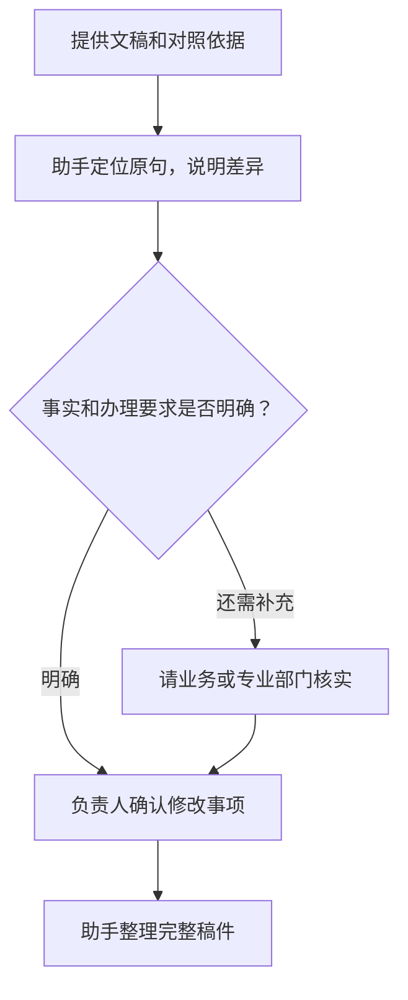

# 第七章　「你看看」

**请助手对照已有材料和明确要求，找出问题并说明依据**

**本章目录**

- [怎样审阅现有材料](#怎样审阅现有材料)
- [案例一：通知稿的范围和时限是否准确](#案例一通知稿的范围和时限是否准确)
- [案例二：跨部门整改方案有没有落实会议决定](#案例二跨部门整改方案有没有落实会议决定)
- [案例三：财务汇报中的进展和数字是否一致](#案例三财务汇报中的进展和数字是否一致)
- [案例四：投资项目上会材料还缺哪些依据](#案例四投资项目上会材料还缺哪些依据)
- [怎样把「你看看」用好](#怎样把你看看用好)
- [看稿四步：定依据、标位置、说理由、列待核](#看稿四步定依据标位置说理由列待核)
- [当次练习](#当次练习)
- [相关章节](#相关章节)
- [资料来源](#资料来源)

领导干部收到一份通知、方案、汇报或项目材料后，常要判断内容是否符合上级要求、会议决定和已有事实。「你看看」可以请助手先通读材料，按明确的依据检查内容，再把发现的问题整理出来，供负责同志处理。

这一式需要已有材料作为输入，属于「就地取材」。助手先标出问题、说明依据。负责同志确认后，可以接着用「你改改」完成文稿。手头有几套方案时，还可以接「你比比」分析取舍。

## 怎样审阅现有材料

**先说清审阅依据**

审阅材料时，先说明这次要检查什么、材料用于哪个环节、应当对照哪些文件或决定。上级文件、会议纪要、已定方案、数据底表和内部审核清单都可以作为依据。需要助手判断依据是否齐全时，应把已掌握且获准处理的材料一并提供；还没查到的政策原文，可以先用「你找找」核实。

审阅重点应落到具体内容。例如，通知稿可以检查适用对象、任务要求、责任部门、报送方式和时限；工作方案可以核对任务分解、职责边界、协商情况和进度安排；汇报材料可以对照数据底表检查统计期间、指标名称、单位和结论。

**要求助手定位问题**

可以先说材料准备做什么用，请助手通读找问题。看到初步意见后，再要求它定位原句，列出对照依据和处理建议。依据不足的判断应标成「待确认」；文字表达建议也要和事实错误、要求冲突分开。

**一段通用交代**

把方括号中的内容换成本次工作的实际情况，并附上获准提供的材料：

> **使用者**
>
> 你看看这份【材料】，准备在【场合】用。按附上的【依据】，重点核一下【对象、时限、分工、数字】这几块。对不上的，把原句和依据一起指出来，拿不准的单列。

**图7-1　审阅意见怎样形成可用稿件**

## 案例一：通知稿的范围和时限是否准确

**工作情境**

青岚市政务服务局办公室副主任汪清，收到领导交办，要组织各区梳理跨部门办事事项。她手头有上级工作通知、局务会纪要和一份通知稿，准备先检查通知稿有没有准确传达要求。

上级工作通知要求各区在2026年12月10日前完成事项梳理并报送市政务服务局，市局在12月20日前汇总报市政府办公室。局务会纪要要求先选五个区试填样表，第一批于11月25日前反馈；其他区继续准备，分批安排由办公室另行通知。通知稿第一段写成「请全市各区和有关市级部门于12月2日前报送全部事项清单」，第二段要求各单位分管领导签字。

**怎样向助手交代**

汪清把三份材料上传到工作台，并交代：

> **汪清**
>
> 你看看这份事项梳理通知，发各区之前我想再过一遍。上级通知和局务会纪要都在这儿，按这两份核。哪句话跟依据对不上，直接在稿子里指出来，把原句和为什么要改一起告诉我。还有没拿准的，另列一下，我发之前好去问。

**助手可能给出的思路**

> **助手**
>
> 我对照了上级工作通知、局务会纪要和通知稿，发现三处需要处理：
>
> | 核对项 | 通知稿表述 | 对照材料 | 初步判断 |
> | --- | --- | --- | --- |
> | 通知稿第一段：梳理对象 | 「全市各区和有关市级部门」 | 局务会纪要要求先选五个区试填，名单由办公室另行确定 | 第一批范围扩大到全市各区和市级部门；市级部门参与尚无依据 |
> | 通知稿第一段：报送时间 | 「全部事项清单于12月2日前报送」 | 第一批试填于11月25日前反馈；全市完整清单于12月10日前报市局，市局于12月20日前汇总报市政府办公室 | 两个阶段和对应时限被合并，需分别写明 |
> | 通知稿第二段：签字要求 | 「各单位分管领导签字」 | 上级工作通知和局务会纪要均未提到签字要求 | 现有依据不支持这一要求，需办公室确认有无其他规定 |
>
> 请办公室核定第一批名单，并确认市级部门参与和签字要求是否另有正式依据。

**怎样继续追问和调整**

汪清对照两份依据后，要求助手把确定要改的内容和仍待办公室决定的事项分开：

> **汪清**
>
> 问过办公室了，第一批五个区的名单还没定，样表按局务会说的11月25日前交。全市各区的完整清单还是12月10日前报。市级部门参不参加，领导还没定。你先把哪些能改、哪些还得问清楚理一下，先别改通知。

> **助手**
>
> 已经明确的两阶段时限可以修改，第一批名单、市级部门参与和签字要求仍需办公室确认。另外，其他区目前做什么、样表从哪里取、有问题联系谁，通知里还需交代。办公室准备怎样安排？

> **汪清**
>
> 其他区先准备，12月10日跟大家一起报完整清单。样表作附件，联系人写办公室彭佳，电话用局内通讯录里她的办公电话。

> **助手**
>
> 其他区安排、附件和联系人已明确。第一批名单、市级部门是否参加和签字要求，还需办公室确定，确定后就能整理完整通知。

> **汪清**
>
> 刚才又跟办公室确认了，第一批五个区定了：东河区、西城区、南城区、北城区和滨江区。这次只发各区，分管领导签字也不要求了。按刚才说清楚的两个阶段，把完整通知写好，我拿去送审。

**采用前要核对什么**

- 先核实局务会纪要是否为本次工作的有效依据，并确认办公室已经明确的第一批时限有无记录。
- 第一批五区名单以办公室核定结果为准，通知中的名单须与汪清补充的五个区逐一对应。
- 上级通知和局务会纪要分别安排了全量梳理与第一批试填，通知稿需要区分这两个阶段。
- 办公室已确认本轮对象为各区，通知按该范围起草，并删除未经确定的签字要求。

### 最终成品：跨部门办事事项梳理通知

> **教学案例成品**

**关于开展跨部门办事事项梳理和样表试填的通知（送审稿）**

各区政务服务部门：

根据上级工作通知和局务会安排，现就跨部门办事事项梳理及样表试填工作通知如下。

**一、先行开展样表试填**

第一批由东河区、西城区、南城区、北城区和滨江区开展试填，于2026年11月25日前将样表及填写中发现的问题反馈市政务服务局办公室。其他区同步做好梳理准备，分批安排由办公室另行通知。

**二、按期报送完整清单**

全市各区应于2026年12月10日前完成事项梳理，将完整清单报送市政务服务局。市局于12月20日前汇总报市政府办公室。

请各区按上述阶段和时限组织落实。样表见附件，填写中遇到问题请联系市政务服务局办公室彭佳，办公电话见局内通讯录。

附件：事项梳理样表

| 事项名称 | 涉及部门 | 当前办理环节 | 重复提交的信息或材料 | 需协调的问题 |
| --- | --- | --- | --- | --- |

填写说明：各区逐项填写现有事项，按实际办理情况说明涉及部门和重复提交内容，问题栏填写需要协调的具体事项。

市政务服务局办公室

## 案例二：跨部门整改方案有没有落实会议决定

**工作情境**

真知集团安全环保部副部长邵毅，负责起草三季度安全检查问题整改方案。集团专题会已经明确牵头部门、协作事项和各单位报送节点，方案初稿也已形成。邵毅需要先检查方案是否准确落实会议决定，再送相关部门征求意见。

会议纪要明确：安全环保部牵头整改工作并汇总进展；设备管理部在11月14日前提供重点设备台账；生产运营部协调生产安排，提供检修窗口；三家分公司在11月18日前报送首批问题清单；安全环保部每周一汇总进展。初稿写成由生产运营部牵头、安全环保部指导，设备管理部「配合提供台账」，没有写报送日期；每周进展则报生产运营部。

**怎样向助手交代**

邵毅上传会议纪要、整改方案初稿后交代：

> **邵毅**
>
> 你看看这份安全整改方案的初稿，我得先核一遍再发给各部门征求意见。照专题会纪要，看看分工和时间有没有写岔。哪一段跟哪条对不上，摘出来说一下。还得找哪个部门确认，也给我记一笔。

**助手可能给出的思路**

> **助手**
>
> 我对照了专题会纪要，发现以下差异：
>
> - 牵头部门：方案写为生产运营部牵头、安全环保部指导；会议纪要明确由安全环保部牵头，生产运营部负责协调生产安排。
> - 设备台账：方案只写设备管理部配合提供，没有写时间；会议纪要明确应于11月14日前提供，方案漏掉了已定节点。
> - 首批问题清单：三家分公司于11月18日前报送，与会议纪要一致。
> - 进展报送：方案写每周一报生产运营部；会议纪要要求安全环保部每周一汇总。
> - 部门意见：方案还未征求相关部门意见，当前不能写成已会签。

**怎样继续追问和调整**

邵毅查过纪要并联系设备管理部后补充：

> **邵毅**
>
> 设备管理部确认了，就按纪要11月14日前交台账，日期的出处写上。已经定下来的、还得征求意见的，你分开列一下。

> **助手**
>
> 已定的是会议纪要中的牵头职责、台账和首批清单报送节点，以及每周汇总安排；各协作部门和分公司还需反馈落实条件。另需确认检修窗口什么时候提供。纪要只明确生产运营部负责，没有写日期，后续整改要据此排时间。这一项需要向生产运营部确认。

> **邵毅**
>
> 我问了生产运营部王海涛，11月20日前给检修窗口安排，这一条也写进去。按刚才核对的改成一份征求意见稿，谁负责、什么时候报、每周怎么汇总写清楚。具体问题和措施等首批清单上来再细化，这个步骤写上。

**采用前要核对什么**

- 对照会议纪要原文，确认安全环保部与生产运营部的职责分工准确。
- 三个部门尚未完成会签，方案当前仍处于征求意见阶段。
- 设备管理部提供台账的日期来自会议纪要，邵毅补充确认部门仍按该节点执行；正式方案应保留相应记录。
- 问题清单、整改措施和责任单位都应能在会议决定或已提供的工作要求中找到依据。

### 最终成品：三季度安全检查问题整改方案

> **教学案例成品**

**三季度安全检查问题整改方案（征求意见稿）**

为落实集团安全生产专题会决定，现就本轮安全检查问题整改工作提出如下安排，送相关部门征求意见。

**一、职责分工**

安全环保部牵头组织整改并汇总进展。设备管理部提供重点设备台账。生产运营部协调生产安排，提供检修窗口。三家分公司按会议要求整理并报送首批问题清单。

**二、材料和时间节点**

会议纪要明确，设备管理部于2026年11月14日前提供重点设备台账，该部门已确认按该节点执行。三家分公司于11月18日前报送首批问题清单。生产运营部于11月20日前提供检修窗口安排。安全环保部每周一汇总整改进展，生产运营部结合整改需要协调生产安排。

**三、意见征求与后续办理**

本稿送生产运营部、设备管理部和三家分公司征求意见，核对职责、协作事项及节点安排。各部门反馈后，由安全环保部汇总修改，再履行集团内部审定程序。

**待进一步细化的内容**

具体问题、整改措施和责任单位需结合首批问题清单补充，经确认后纳入整改安排。

## 案例三：财务汇报中的进展和数字是否一致

**工作情境**

真知集团分管财务的副总经理陈立，准备在经营分析会上汇报司库管理系统建设进展。办公室提供了一份汇报稿，财务部门也提交了截至9月30日的项目状态表。陈立请助手对照两份材料检查进度、单位和金额口径，供他确认后修改。

状态表记录：截至9月30日，系统改造进度为80%；三家试点单位中两家已上线，第三家处于联调测试；批准预算为4600万元，已签合同4350万元，已支付3200万元。汇报稿第二部分称系统改造已经完成、三家单位均已上线，第三部分把4600万元称作项目累计投入；全文没有注明统计截止日期。

**怎样向助手交代**

陈立上传《司库管理系统建设进展汇报（讨论稿）》和《项目状态表（截至9月30日）》后交代：

> **陈立**
>
> 你看看这份司库管理系统的汇报，会上一问起数字，我得能说清楚。对着附件里截至9月30日的项目状态表，核一下进度、单位和金额口径。哪句和哪项数据对不上，指给我看，说说差在哪儿。表里查不出来的先放一块儿，我再问业务部门。

**助手可能给出的思路**

> **助手**
>
> 我对照了汇报稿和截至9月30日的项目状态表，发现四处差异：
>
> - 汇报稿第二部分：「系统改造已经完成」；状态表记录「系统改造进度：80%」。
> - 汇报稿第二部分：「三家单位均已上线」；状态表记录「已上线2家，第3家处于联调测试」。
> - 汇报稿第三部分：「项目累计投入4600万元」；状态表列出「批准预算4600万元、已签合同4350万元、已支付3200万元」。「累计投入」与底表字段名称不一致。
> - 汇报稿未注明统计截止日期；状态表采用9月30日口径。
>
> 目前材料只能说明表内记录的状态，差异原因和第三家单位的验收情况仍需业务部门确认。

**怎样继续追问和调整**

陈立联系财务部门后补充：

> **陈立**
>
> 我确认过了，改造进度、上线家数都是截至9月30日的。这次就汇报到9月30日。4600万元是预算，4350万元是签了合同的，3200万元是已经付的，别混着写。哪些确定写错了、哪些还得问业务部门，你分开列一下，投资完成率先不用算。

> **助手**
>
> 状态表没有写第三家预计何时完成联调，也没说明剩余20%改造是什么。汇报前需要向财务部门和项目组核实，是否请他们补充截至9月30日已知的安排？

> **陈立**
>
> 问过了，剩下的是报表模块，计划10月20日完成；第三家计划10月15日完成联调，测试通过后再上线。这都是9月末掌握的计划，写清楚，还得看测试结果。

> **助手**
>
> 已按9月末口径补入报表模块、联调和上线条件。10月15日、20日分别标为计划，后续实际进展再更新。

陈立确认后说：

> **陈立**
>
> 这几处按状态表改，给我一份完整稿。先说系统和试点，再说预算、合同和付款，最后把还得找业务部门补的列上。

**采用前要核对什么**

- 汇报稿和状态表应采用同一个统计截止日期，计划节点与已完成进展分开表述。
- 完成比例和上线数量要对照项目状态表原字段核实，助手不应另换口径计算。
- 批准预算、已签合同金额和已支付金额分别代表不同事项，引用时须保留准确名称。
- 底表只证明其中记录的状态；项目进度变化的原因仍要由业务部门核实。

### 最终成品：司库管理系统建设进展汇报

> **教学案例成品**

**司库管理系统建设进展汇报**

现将截至2026年9月30日的建设进展汇报如下。

**一、系统改造和试点上线情况**

系统改造进度为80%，剩余工作为报表模块，项目组截至9月末的计划为10月20日完成。三家试点单位中，两家已上线，第三家处于联调测试，计划10月15日完成联调，测试通过后再上线。

**二、预算、合同和支付情况**

项目批准预算为4600万元，已签合同金额4350万元，已支付金额3200万元。三项金额分别反映预算批准、合同签订和资金支付情况，本次汇报按项目状态表原口径列示。

**三、后续需核实的事项**

请财务部门和项目组继续跟进报表模块及第三家联调情况，依据测试结果确认上线时间，及时更新实际进展。剩余改造及联调安排尚需实施，暂按9月末掌握的计划说明。

**三项金额对照（单位为万元）**

| 底表字段 | 金额 |
| --- | ---: |
| 批准预算 | 4600 |
| 已签合同 | 4350 |
| 已支付 | 3200 |

来源为《项目状态表（截至9月30日）》。

## 案例四：投资项目上会材料还缺哪些依据

**工作情境**

真知集团战略投资部副总经理庄伟准备将一个冷链物流基地项目先提交预审会，预审后再按程序提交投资决策会议讨论。项目建议书已经形成，内部投资管理制度要求项目材料提交前列出可行性研究、投资估算、风险分析和决策事项。庄伟希望先做一次上会前检查，了解材料中哪些结论缺少支撑。

他同时提供了《中央企业投资监督管理办法》，作为本次材料核对的依据。

项目建议书的技术方案部分提出年处理能力8万吨，技术附件只有设备初步清单，没有工艺方案比较和产能测算；市场分析引用2023年行业材料；财务附件列出总投资估算和9.1%的预计内部收益率，但没有列全测算假设。材料包没有单独的风险分析，建议书也没有明确列出提请会议审议的事项。投资方案拟与合作方成立合资公司，合作方尽调和估值尚未完成；土地手续仍在沟通，项目资料尚未附法务意见。

**怎样向助手交代**

庄伟上传项目建议书、内部投资管理制度、测算表和市场分析材料后交代：

> **庄伟**
>
> 你看看冷链物流项目的上会材料。预审会上人家问依据，我得知道哪些拿得出来、哪些还没准备好。集团投资制度和《中央企业投资监督管理办法》都附上了。你对着查，有哪份附件缺了，或者哪一节说了结论、证据没跟上，把位置和原因告诉我。需要专业部门再核的单列，我带着去问。

**助手可能给出的思路**

> **助手**
>
> 我按集团投资制度和《中央企业投资监督管理办法》第十五条核对了项目建议书及附件，初步发现以下事项：
>
> - 技术方案部分提出年处理能力8万吨，设备附件未列工艺方案比较和产能测算。
> - 市场分析引用2023年行业材料，项目组需要说明数据范围和对当前需求判断的适用性。
> - 财务附件列出总投资估算和9.1%的预计内部收益率，但测算假设不完整，暂时无法复核结果。
> - 项目建议书没有风险分析部分，材料包也没有附风险分析；集团制度要求列明这项内容。
> - 土地手续仍在沟通，材料中没有法务意见。
> - 投资方案拟与合作方成立合资公司，合作方尽调和估值尚未完成。
> - 建议书没有列出提请会议审议的具体事项。
>
> 这些是材料完整性和依据核对结果，不构成可行性、合规或投资价值结论。请项目组补充材料，法务、财务和技术部门按职责核实专业内容。

**怎样继续追问和调整**

庄伟说明，这份清单用于下周预审会，并补充交代：

> **庄伟**
>
> 缺的材料和已有但没说清楚的，你分开列。土地手续找法务核，技术找技术部门，投资测算找财务。先看材料备齐没有，合不合规、投不投先别下结论。

> **助手**
>
> 七项问题可以按主要缺口分组：风险分析、法务意见、尽调估值和审议事项四项需补材料，技术与财务两项需完善论证，市场资料一项需说明适用性。技术、财务和法务内容还要交对应部门核实。土地手续说「仍在沟通」，是选址未定，还是供地方式未定？这会影响法务核验。

> **庄伟**
>
> 选址已经定了，供地方式还在跟当地谈，法务要按这个进展核。把这些整理成预审会的完整报告，清单附后。

> **助手**
>
> 土地一项更新为选址已定、供地方式仍在沟通，法务据此核实适用要求。我按文件、位置、问题类型和责任部门整理完整清单，附在预审会报告后。

**采用前要核对什么**

- 核对集团内部投资管理制度的适用版本。项目拟成立合资公司，尽职调查和估值材料按股权投资要求核对。
- 年处理能力和内部收益率来自项目建议书，仍需查看原始测算和关键假设，不能视为已经核验的结果。
- 合作方尽调和估值尚未完成，清单应如实标注材料状态。
- 土地手续、市场预测、财务测算和风险分析由对应责任部门按程序核实；这份清单用于准备预审，不替代专业审核或会议决策。

### 最终成品：冷链物流基地项目预审材料准备情况报告

> **教学案例成品**

**冷链物流基地项目预审材料准备情况报告**

本次依据集团投资管理制度及《中央企业投资监督管理办法》，对项目建议书和附件作了上会前梳理。建议书已提出年处理能力8万吨和预计内部收益率9.1%，但产能测算、财务假设、风险分析及拟提请审议事项仍需补充。合作方尽调、估值尚未完成，用地相关法务意见也未附入。

建议项目组先补齐技术论证、测算假设、市场依据、风险分析及拟审议事项，分别提交技术、财务和法务部门核验。涉及合资设立的尽调、估值材料按适用要求准备。材料补充和专业意见形成后，再按集团程序提交预审。

各项材料状态和补充要求列示如下。

**冷链物流基地项目上会前核对清单**

| 序号 | 核对方面 | 材料现状 | 依据或缺口 | 责任方及问题 |
| --- | --- | --- | --- | --- |
| 1 | 技术可行性 | 建议书提出年处理能力8万吨，技术附件只有设备初步清单 | 未见工艺方案比较和产能测算，现有附件不足以复核处理能力 | 项目组补充技术论证和测算过程；技术部门核验适用性 |
| 2 | 市场可行性 | 市场分析引用2023年行业材料 | 尚需说明资料范围、时点及其对当前市场判断的适用性 | 项目组补充市场数据来源和预测口径；必要时提供更新资料或说明沿用理由 |
| 3 | 财务论证与投资估算 | 建议书列出总投资估算和9.1%的预计内部收益率 | 测算假设不完整，附件无法支持复核结果 | 项目组补充测算依据；财务部门核验模型、假设和计算过程 |
| 4 | 风险分析 | 材料包没有单独的风险分析 | 集团投资制度要求列明风险分析，当前材料未提供 | 项目组补充风险分析及应对安排，再由相关部门核对 |
| 5 | 法律可行性 | 选址已定，供地方式仍在沟通，材料未附法务意见 | 现有材料不足以判断用地手续及项目合同安排 | 法务部门根据选址、土地条件和交易结构核实适用要求并出具意见 |
| 6 | 股权投资程序 | 项目拟设合资公司，尚未完成合作方尽职调查和估值 | 《中央企业投资监督管理办法》第十五条要求股权投资项目开展必要的尽职调查，并按要求履行资产评估或估值程序 | 项目组准备尽调材料；财务及相关部门核实估值程序和材料 |
| 7 | 提请会议审议事项 | 建议书没有明确列出本次提请会议审议的问题 | 集团投资制度要求列明决策事项，现有材料没有给出明确表述 | 项目组写明需要会议研究或决定的具体事项 |

**后续办理**

项目组汇总补充材料后，分别提交相关专业部门核验，再根据集团预审要求更新报告和附件。项目决策由有权机构依据完整材料按程序办理。

## 怎样把「你看看」用好

- **判断是否准确，需要给出对应依据。** 文字通顺可以只看稿子，核对要求是否传达准确，还要提供上级文件、会议纪要或底表。依据不全的意见单列为待确认。
- **对象与时限要按阶段核对。** 试填、全量报送和汇总上报各有范围与期限。稿子将几阶段合成一句时，逐一确认对应关系及新增要求的来源。
- **保留底表的字段含义。** 预算、合同和支付分别反映不同事项，改成「累计投入」前，要确认该名称对应的计算范围。
- **区分缺材料与论证不足。** 未附文件需要承办方补交，已经有结论却缺计算或假设，则需完善论证并交专业部门核实。
- **根据清单用途判断需要写到多细。** 交代时先说明用途，再检查清单是否便于接收者办理。

  - 用于补材料时，写清缺什么。
  - 用于准备会议时，写清影响哪项讨论。
  - 用于专业审核时，列出待核依据。

  专业结论由有权部门依据完整材料形成。

材料和工具的使用范围按[第二章](../00-prepare/02-safety.md)办理。

## 看稿四步：定依据、标位置、说理由、列待核

1. **定依据**：明确按哪份文件、纪要、制度或数据底表审阅。
2. **标位置**：指出页码、段落、表格行或字段，并摘录原文。
3. **说理由**：说明材料与依据相符、冲突或缺少支撑的具体原因。
4. **列待核**：把需要领导、业务部门或专业部门确认的事项单独列出。

## 当次练习

选一份可用于练习的通知和对应依据，约用五分钟核对对象与时限。

> **使用者**
>
> 你看看这份通知，按附上的上级文件核一下对象和时限，对不上的把原句指出来。

1. 将通知和依据分别标明名称、版本，交给助手审阅。
2. 选择一条审阅意见，确认助手标出的位置和依据能在原文中找到。
3. 检查对象和时限是否按阶段对应，将材料未说明的要求列为待确认。
4. 确认要改的条目后，请助手整理完整稿，再核对修改范围。

## 相关章节

- 需要查找政策原文或公开依据，先看[第五章「你找找」](../01-oral/05-zhaozhao.md)。
- 需要根据审阅意见直接修改已有文稿，接着看[第八章「你改改」](08-gaigai.md)。
- 手头已有两套以上成形方案，需要按同一标准逐项比较时，后续可学习[第十章「你比比」](10-bibi.md)。

## 资料来源

- [《党政机关公文处理工作条例》](https://www.miit.gov.cn/xwdt/szyw/art/2020/art_6afb8ee6d07540dcacccbeb47dbc0fd4.html)，供了解公文审核事项。
- [《中央企业投资监督管理办法》](https://wap.sasac.gov.cn/n2588035/n2588320/n2588335/c20164244/content.html)，案例四材料核对依据。
