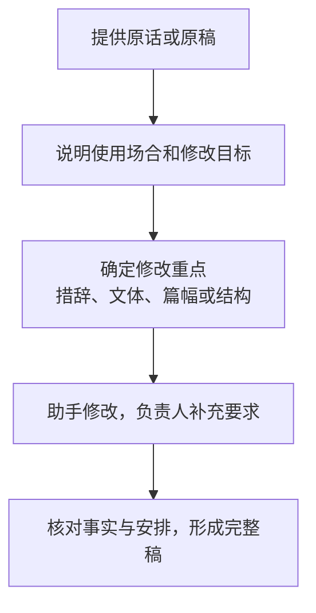

# 第八章　「你改改」

**把口头意思整理成得体的文稿**

**本章目录**

- [怎样交代修改任务](#怎样交代修改任务)
- [案例一：工作群催办通知怎样改得明确](#案例一工作群催办通知怎样改得明确)
- [案例二：书面方案怎样改成会议开场讲话](#案例二书面方案怎样改成会议开场讲话)
- [案例三：五百字月报怎样压缩到两百字左右](#案例三五百字月报怎样压缩到两百字左右)
- [案例四：进展报告怎样调整成领导简报](#案例四进展报告怎样调整成领导简报)
- [怎样把「你改改」用好](#怎样把你改改用好)
- [改稿四步：给原话、定目标、划边界、核结果](#改稿四步给原话定目标划边界核结果)
- [当次练习](#当次练习)
- [相关章节](#相关章节)

领导干部要发一条群提醒、讲几句开场或汇报工作进展，手头可能只有几句口头意思，也可能有一段粗稿或旧稿。给谁看、在哪里用、需要多长，都会影响文稿的写法。

「你改改」可以把这些原话或原稿整理成得体的文稿。说清用途和必须保留的事实，先看一稿，再调整结构、语气和篇幅。需要先检查原稿与依据是否一致时，可用「你看看」核对后再改。

## 怎样交代修改任务

**先交出原话或原稿，再说用在哪里**

只有几句意思时，可以直接口述，并说明已确定的事项。已有粗稿或旧稿时，可以粘贴文字或提供文件，再说清给谁、在什么场合使用及大约篇幅。

**说明修改方向和保留内容**

交代时，明确哪些部分可以调整，哪些信息必须保留。姓名、数字、日期、政策要求、责任分工和已经作出的决定，都应按原文或本次补充的事实处理。助手可以调整顺序、删去重复表达、改变语气和文体；没有依据的事实、承诺和处理措施，不应由助手自行添加。

首轮可以先说最想改的地方，例如「太长了，压到两百字左右」或「我要会上讲，读起来顺一些」。助手给出初稿后，再结合内容补充必须保留的事项，逐步确定篇幅和结构。

**一段通用交代**

把方括号里的内容换成本次要求，口述原话或提供已有原稿。

> **使用者**
>
> 你改改，我想说的意思是【几句口头话，或附上原稿】，要给【对象】在【场合】用，大约【篇幅或时长】。【必须保留的事实】照原样，没定的事先不写。先出一稿，我看了再调。

**图8-1　根据用途确定修改重点**

## 案例一：工作群催办通知怎样改得明确

**工作情境**

真知集团办公室副主任韩莉需要在工作群提醒总部各部门和所属公司报送安全生产自查表。她已有一条草拟消息，觉得语气偏重，时间和报送渠道也没有写清，准备按已经确定的事项改成一则正式提醒。

**怎样向助手交代**

韩莉把草拟消息粘贴进对话框：

> **原稿节选 · 韩莉提供**
>
> 各单位抓紧填报安全生产自查表，越快越好。迟报的后果自负，集团会上点名。

她接着交代：

> **韩莉**
>
> 你改改，我想在群里提醒总部各部门和所属公司交安全生产自查表，13号下午三点截止，在集团安全管理平台上交。原来那条「迟报后果自负、会上点名」太冲了，处理方式我还在问，先把已经定下来的写好。

**助手可能给出的思路**

助手第一轮给出的版本如下：

> **助手**
>
> **关于报送安全生产自查表的提醒**
>
> 为做好本轮安全生产自查，请总部各部门、各所属公司组织填报《安全生产自查表》并按时报送。材料须于2026年11月13日15时前通过集团安全管理平台提交。请各单位按时完成。
>
> 原消息里「会上点名」这句先拿掉，处理方式确认后再加。

**怎样继续追问和调整**

第一轮，韩莉核对逾期处理安排后，补充说明：

> **韩莉**
>
> 确认了，逾期没报的由安全环保部汇总名单，报集团办公室掌握。按这个改。

助手调整后，询问提交方式和咨询安排：

> **助手**
>
> 为做好本轮安全生产自查，请总部各部门、各所属公司组织填报《安全生产自查表》并按时报送。材料须于2026年11月13日15时前通过集团安全管理平台提交。逾期未报单位名单由安全环保部汇总后报集团办公室掌握。请各单位重视并按时完成。
>
> 群里读消息通常只扫一眼，要不要把截止时间和提交平台放到第一句？另外，自查表在平台哪个栏目提交，咨询找谁，需要写进去吗？

第二轮，韩莉确认：

> **韩莉**
>
> 对，截止和平台放最前面。栏目不用写，大家知道，咨询找安全环保部。

**采用前要核对什么**

- 对照原消息和韩莉补充的信息，确认报送对象、截止时间、提交平台及名单处理方式都准确。
- 集团没有决定处分或考核措施，修改稿不能引入这类内容。
- 工作群提醒应采用已确认的标题和渠道说明；咨询部门按补充写为安全环保部，具体联系人、电话和下载地址未提供。

### 最终成品：安全生产自查表报送提醒

> **教学案例成品**

**关于报送安全生产自查表的提醒**

总部各部门、各所属公司：

请于2026年11月13日15时前，通过集团安全管理平台报送《安全生产自查表》。逾期未报单位名单由安全环保部汇总后报集团办公室掌握。

填报中遇到问题，请咨询安全环保部。请各单位按时完成报送。

## 案例二：书面方案怎样改成会议开场讲话

**工作情境**

青岚市机关事务服务中心副主任梅舒，将在机关节能宣传周启动会上作简短开场。活动方案已经确定了时间、对象、三项活动内容和材料报送安排，具体要求将在会后发给各单位。梅舒手头有一段约700字的书面说明，读起来像方案摘要，句子较长。她希望改成一分钟以内、可以自然口述的开场讲话。

活动方案明确：机关节能宣传周为2026年11月16日至22日，目的是增强干部职工节能意识、推动办公场所节能措施落实；参加单位为市级机关和各区机关事务部门；安排包括办公场所能耗自查、节能管理培训和无纸化办公宣传；各单位在11月18日前完成自查，11月20日前将问题清单交机关事务服务中心；宣传周活动情况于11月25日前报送。梅舒没有提供各单位的节能成效数据，也没有确定表彰或通报安排。

**怎样向助手交代**

梅舒上传《机关节能宣传周活动方案》和《启动会开场讲话（初稿）》后交代：

> **梅舒**
>
> 你改改附件里节能宣传周开场讲话的初稿。启动会上我最多讲一分钟，原稿这些长句我念着有点拗口。活动安排照旁边那份方案。你改一稿，我念一遍听听。

**助手可能给出的思路**

助手第一轮改写出的讲话如下：

> **助手**
>
> 同志们：
>
> 2026年机关节能宣传周定于11月16日至22日开展，请市级机关和各区机关事务部门参加办公场所能耗自查、节能管理培训和无纸化办公宣传。各单位于11月18日前完成自查，11月20日前报送问题清单，11月25日前报送活动情况。请大家按时完成。
>
> 一分钟约能讲两百字，三个报送日期都念出来，会偏向任务安排。开场是否先讲活动为什么重要、希望大家做什么，具体日期放在会后通知里？

**怎样继续追问和调整**

> **梅舒**
>
> 对，先讲讲为什么办，再讲这三项活动希望大家做什么。我上台直接讲，写得自然点，具体报送时间会后发。

**采用前要核对什么**

- 对照活动方案核实活动日期、参加单位、活动内容和报送时间。
- 「宣传无纸化办公」不能改成要求单位全面实行无纸化办公。
- 各单位节能成效没有提供，讲话中不能加入百分比、排名或表扬内容。
- 按正常语速试读，检查活动意义和参与要求是否衔接自然，时长是否在一分钟以内。具体报送时间和渠道在会后通知中写清楚。

### 最终成品：机关节能宣传周启动会开场讲话

> **教学案例成品**

**在机关节能宣传周启动会上的开场讲话**

同志们：

今年11月16日至22日，我们开展机关节能宣传周。机关带头节约，要从每天用电、用纸的小事做起。这次活动，希望大家学会节能方法，养成节约习惯。

请市级机关和各区机关事务部门一起参与。先通过能耗自查，找找办公场所有哪些浪费。参加培训时，带着日常管理中的问题学办法。平时多用线上流转，减少纸张消耗。

具体安排会后发给大家。请各单位组织好，把学到的办法用于日常办公。谢谢大家！

## 案例三：五百字月报怎样压缩到两百字左右

**工作情境**

真知集团能源管理部部长何川，准备在2026年11月经营分析会上用一段短汇报说明节能改造进展。他手头已有一份约500字的《能源管理专项月报（初稿）》，统计截至2026年10月底，里面写了自查过程、措施数量、完成情况、两项设备改造进度和需要会议研究的事项。何川希望把它压缩到约200字，便于会上口头汇报。

月报记载：集团8家所属单位已完成本轮能源管理自查，共梳理节能措施23项，18项完成并经使用部门核验，5项仍在推进；其中，装备公司空压机更新、材料公司循环水泵更新两个项目因设备尚未到货，进度较原计划延后。装备公司车间照明改造、材料公司蒸汽管网保温修复、物流公司能耗监测系统安装三项按原计划推进。能源管理部已请采购部门确认到货时间，建议会议研究是否将两个项目的验收时间调整至12月15日。

**怎样向助手交代**

何川上传《能源管理专项月报（初稿）》后交代：

> **何川**
>
> 你改改附件里那份能源管理专项月报初稿。经营分析会上我就说两百字左右。前面怎么查的可以收一收，把做完的、拖了的项目和要请会上研究的事说清楚。数字和进度照月报来。先给我一版，我对着原稿看看有没有漏掉要紧的。

**助手可能给出的思路**

助手第一轮压缩出的汇报如下：

> **助手**
>
> 截至2026年10月底，集团8家所属单位已完成能源管理自查，共梳理节能措施23项，其中18项完成并经使用部门核验，5项仍在推进。两个设备更新项目因设备尚未到货，进度较原计划延后；另外三项按计划推进。能源管理部已请采购部门确认到货时间，建议会议研究是否将两个项目的验收时间调整至12月15日。

**怎样继续追问和调整**

第一轮，助手请何川进一步明确会上要突出的内容：

> **助手**
>
> 这段汇报既有整体进展，也有验收时间的建议。会上更希望大家了解总体情况，还是重点研究这两个项目的验收安排？

何川说明：

> **何川**
>
> 主要是研究那两个项目的验收时间。已经完成的少讲点，还在推进的和采购进展多讲点。

助手保留总体数字，并突出需要会议研究的事项：

> **助手**
>
> 能源管理部已请采购部门确认到货时间，建议会议研究是否将两个项目的验收时间调整至2026年12月15日。

第二轮，何川读了一遍后补充：

> **何川**
>
> 再口语化一点，我要在经营分析会上讲，还是两百字左右，数字按原稿。

助手据此调整了表达。

> **助手**
>
> 截至2026年10月底，集团8家所属单位都已完成能源管理自查。23项节能措施中，18项已经完成，并经使用部门核验，5项还在推进。两个设备更新项目因为设备还没到货，进度延后，另外三项按计划推进。我们已请采购部门确认到货时间，建议这次会议研究，是否将两个项目的验收时间调整到12月15日。

第三轮，何川觉得项目说得还不够具体，继续要求：

> **何川**
>
> 两个设备更新项目叫什么，另外三项又是什么？把月报里的名字带上，不然会上听不出来是哪几件事。

助手补齐名称后提示：

> **助手**
>
> 补上五个项目名称后，这版约240字，略长于原来两百字的要求。项目名称、进度和需要会议研究的事项都保留了，你看看这个篇幅是否合适。

> **何川**
>
> 两百四十字就两百四十字，名字得说。

**采用前要核对什么**

- 五个项目名称与月报一致，两个延期项目和三个按计划推进项目分别对应准确。
- 两个项目延后与设备尚未到货的原因都来自月报，稿件不能增加其他原因。
- 12月15日是待会议研究的建议时间，修改稿要保留建议性质。
- 增加项目名称后，篇幅略有增加，何川已确认采用这版汇报。

### 最终成品：能源管理专项进展摘要

> **教学案例成品**

**能源管理专项进展汇报**

我汇报一下节能改造的进展。到今年10月底，集团8家所属单位都完成了这轮自查。梳理出的23项节能措施，已经完成18项，使用部门也核验过了，还有5项正在做。

这5项里，装备公司的空压机更新、材料公司的循环水泵更新，因为设备还没到货，进度比原计划晚了。我们已经请采购部门确认到货时间。另外，装备公司的车间照明改造、材料公司的蒸汽管网保温修复，还有物流公司的能耗监测系统安装，都在按计划推进。

今天想请大家研究一下，空压机和循环水泵这两个项目，验收时间能不能调整到今年12月15日。

## 案例四：进展报告怎样调整成领导简报

**工作情境**

青岚市政务服务局办公室副主任汪清，准备向分管领导汇报高频事项办事指南更新情况。业务处室提交的初稿按时间顺序记录了发通知、收集意见、逐条修改和内部复核等过程。领导希望先看到整体进度、尚未完成的事项和需要协调的工作。

初稿记载：本轮共更新12项高频事项办事指南，已有8项完成更新并上线；剩余4项中，两项正在等待相关部门补充业务数据，一项等待法规处复核，一项尚未确定牵头处室。分管领导已要求办公室协调两家部门于2026年11月12日前提供数据，并在11月16日前报告下一步安排。这份简报拟于11月9日报送，事实和安排以初稿及汪清的补充为准。

初稿中的四项未完成事项分别是公租房申请、道路货物运输经营许可、公共场所卫生许可和企业开办联办服务。公租房申请指南需住房保障部门补充申请条件和材料清单，道路货物运输经营许可指南需交通运输部门补充材料要求及办理时限。公共场所卫生许可指南的内容已整理，等待法规处复核。企业开办联办服务涉及多部门衔接，牵头处室尚未确定，本次需提请分管领导明确。办公室已安排，补充材料收到、有关内容复核通过后，由业务处室完成修订，办公室再作综合核查，确认后上线。剩余四项的具体上线时间尚未确定。

**怎样向助手交代**

汪清上传《高频事项办事指南更新情况报告（初稿）》，并交代：

> **汪清**
>
> 你改改这份办事指南更新报告的初稿。给分管领导看的简报，一页就够了。现在按办事过程写，要翻到后面才看得出进度。你把进度提到前面，再说还有什么问题、哪些事需要协调。数字和时间按附件，内容照原稿。给我一稿，我再对一下进度和时间。

**助手可能给出的思路**

助手第一轮整理出的简报如下：

> **助手**
>
> **整体进度**
>
> 本轮共更新12项高频事项办事指南，已有8项上线，另有4项待处理。
>
> **待解决事项**
>
> 两项等待相关部门补充数据，一项等待法规处复核，一项尚未确定牵头处室。
>
> **需要协调的工作**
>
> 办公室协调两家相关部门于11月12日前提供业务数据。
>
> **下一步安排**
>
> 办公室于11月16日前报告下一步安排。

**怎样继续追问和调整**

> **汪清**
>
> 四项没完成的，下一步写什么？

> **助手**
>
> 四项尚未完成，原稿没有预计上线时间。需要先写一个预计节点吗？还是等下一步安排确定后再报？

> **汪清**
>
> 现在不写预计上线时间，16号前报下一步安排时再说。简报里写清楚这一点。这四项还没办完的分开说一下。哪些在等部门补材料，哪项在等法规复核，哪项还要定牵头处室，让领导一眼看出各要协调什么。

> **助手**
>
> **部门材料待补，共两项。** 公租房申请指南等待住房保障部门补充信息，道路货物运输经营许可指南等待交通运输部门补充信息。
>
> **法规复核待完成，共一项。** 公共场所卫生许可指南已整理，等待法规处复核。
>
> **牵头处室待明确，共一项。** 企业开办联办服务指南尚未确定牵头处室，需提请分管领导明确。

汪清看过这版后，发现原稿中的材料缺口和后续处理安排仍未完整呈现，于是继续要求：

> **汪清**
>
> 后面怎么办也补全。每项等谁补什么、材料到了谁改、谁核查，都照原稿写。企业开办那项单独列出来，请领导定牵头处室。两个报送时间别漏，给我完整稿，还是一页以内。

**采用前要核对什么**

- 总量仍为12项，8项已完成更新并上线，4项尚未完成。
- 四项的名称、材料缺口和当前状态与原稿对应，牵头处室未定的事项须保留待明确状态。
- 11月12日对应两家部门补充数据，11月16日对应办公室报告下一步安排，具体上线时间另待确认。
- 业务处室修订、办公室综合核查等后续安排来自原稿，提请领导明确的事项写为待决定内容。

### 最终成品：高频事项办事指南更新情况简报

> **教学案例成品**

**高频事项办事指南更新情况简报**

**一、总体进展**

本轮共更新12项高频事项办事指南，目前已有8项完成修订并上线，剩余4项分别涉及部门资料补充、法规复核和牵头分工确认。现将未完成事项及后续安排报告如下。

**二、尚未完成的事项**

1. 公租房申请、道路货物运输经营许可两项指南需补充业务信息。前者等待住房保障部门提供申请条件和材料清单，后者等待交通运输部门提供材料要求及办理时限，承办处室收到后继续修订。
2. 公共场所卫生许可指南的内容已整理，尚待法规处复核。复核通过后，再按程序核查上线。
3. 企业开办联办服务涉及多部门业务衔接，牵头处室尚未明确，后续由谁汇总意见、组织修订仍需确定。

**三、协调及后续安排**

按分管领导要求，办公室协调住房保障、交通运输两家部门于2026年11月12日前补充业务信息。材料收到、有关内容复核通过后，由业务处室完成修订，办公室对内容作综合核查，确认后上线。

办公室将于11月16日前报告剩余事项的下一步安排。四项指南的具体上线时间，结合材料反馈、法规复核和牵头分工情况研究确定。

**四、提请明确的事项**

请分管领导明确企业开办联办服务指南的牵头处室，以便衔接相关部门、汇总办理要求并组织修订。

办公室  
2026年11月9日

## 怎样把「你改改」用好

- **用接收对象和场合判断改稿方向。** 群消息要让人迅速找到动作和时间，会议开场要让听众明白为什么开展工作，简报则要突出进展和需协调事项。
- **每轮集中调整一两处。** 先确认结构和篇幅，再调整语气，读者才能清楚看出本轮改了什么。
- **事实逐项对应原话或材料。** 人名、数字、日期和决定保留原意。助手新增的解释或评价，需要核对依据。
- **未定的处理方式先从发布稿中删去。** 逾期后果、处分、承诺等由有权人员确定，确认后再补入正式表述。
- **篇幅与信息发生冲突时，先看删减代价。** 请助手说明超出多少、哪些内容占篇幅，再决定保留具体名称还是进一步概括。
- **讲话稿出声读一遍。** 按正常语速试读，检查转折和停顿，听众难以跟上的地方再调整。

## 改稿四步：给原话、定目标、划边界、核结果

1. **给原话**：口述几句意思，或粘贴一段粗稿、旧稿，提供文件时说明采用的版本。
2. **定目标**：说明成品用途、对象、文体、结构和篇幅。
3. **划边界**：标明必须保留的事实、可以调整的内容，以及不能补写的事项。
4. **核结果**：对照原话或原稿核实数字、日期、责任和决定，再检查新文体是否适合使用场合。

原话或原稿、目标和边界交代清楚后，修改任务通常不需要附带大量背景材料。遇到具体事实或政策依据尚未确定的情况，再补充经核实的材料或先行查找。

## 当次练习

用约五分钟完成练习，使用自己写的、不含内部敏感信息的文字或虚构内容。用到单位材料时，先按第二章确认处理范围。

可以先这样交代。

> **使用者**
>
> 你改改这段话，我要在科室会上讲给大家听，一分钟左右，读起来顺一些，里面的时间和人名不要动。

1. 想一条这两天要发的提醒，先口述三四句意思；也可以选一段写过的粗稿，确定修改目标。
2. 口述或粘贴内容，交代对象、用途、文体、篇幅和必须保留的事实。
3. 请助手修改一稿，再提出一项具体调整要求。
4. 对照原话或原稿检查数字、日期、职责和决定是否保持一致，并标出新增内容的依据。
5. 确认修改方向后，请助手给出一份完整修改稿，作为本次练习的交付材料。

练习稿不直接用于正式工作。需要对外发出或提交的材料，仍应由承办人核对并按本单位程序审定。

## 相关章节

- 需要查明原稿引用的政策或数据出处，先看[第五章「你找找」](../01-oral/05-zhaozhao.md)。
- 需要先审阅原稿、找出与依据不一致之处，参阅[第七章「你看看」](07-kankan.md)。
- 已有往年文稿，准备参考其写法起草新稿，后续可学习[第九章「你学学」](09-xuexue.md)。
