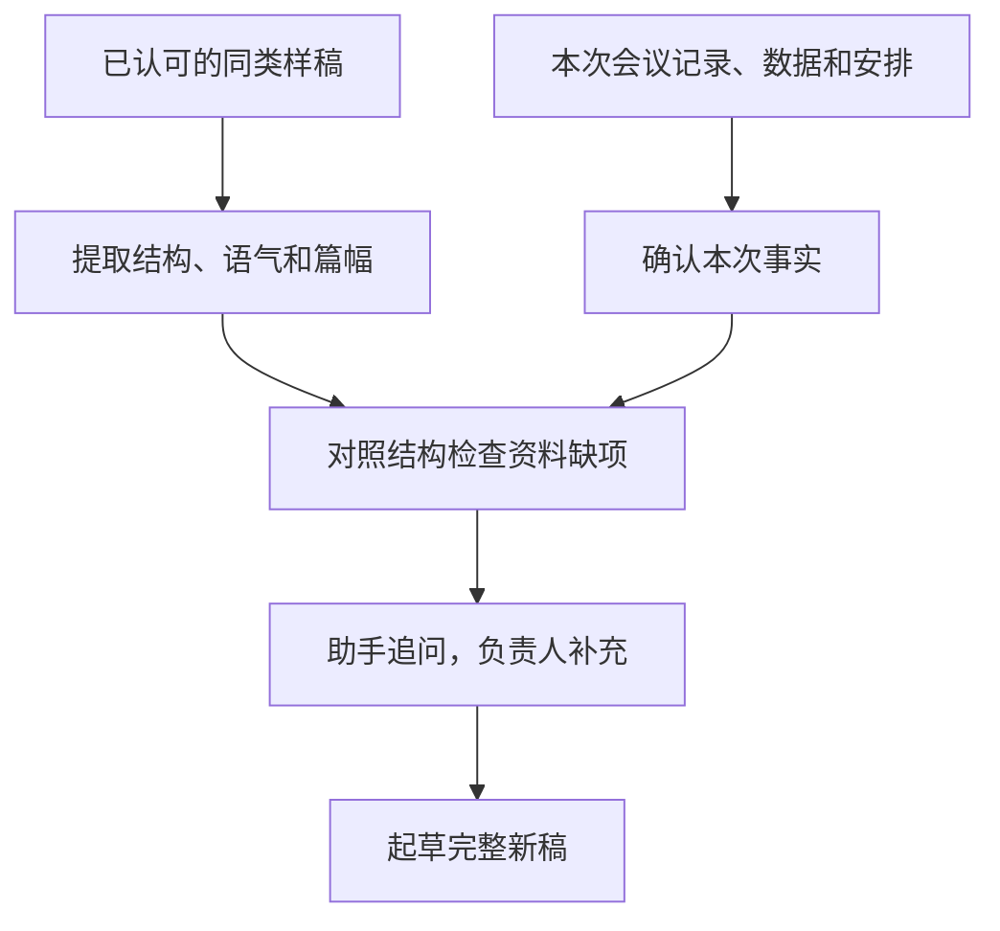

# 第九章　「你学学」

**参考一份已认可的文稿，按本次工作情况起草同类新稿**

**本章目录**

- [怎样让助手参考旧稿](#怎样让助手参考旧稿)
  - [选择同类样稿](#选择同类样稿)
  - [把旧写法和新事实分开](#把旧写法和新事实分开)
  - [一段通用交代](#一段通用交代)
- [案例一：参考旧纪要起草新纪要](#案例一参考旧纪要起草新纪要)
  - [最终成品：窗口服务协调会会议纪要](#最终成品窗口服务协调会会议纪要)
- [案例二：参考去年的总结起草年度工作总结](#案例二参考去年的总结起草年度工作总结)
  - [最终成品：办公室年度工作总结及安排](#最终成品办公室年度工作总结及安排)
- [案例三：参考上一季度报告起草经营分析简报](#案例三参考上一季度报告起草经营分析简报)
  - [最终成品：三季度经营运行情况简报](#最终成品三季度经营运行情况简报)
- [案例四：参考往年讲话起草新会议开场](#案例四参考往年讲话起草新会议开场)
  - [最终成品：年度经营工作会开场讲话](#最终成品年度经营工作会开场讲话)
- [怎样把「你学学」用好](#怎样把你学学用好)
- [学稿四步：选样稿、提写法、供新料、补缺项](#学稿四步选样稿提写法供新料补缺项)
- [当次练习](#当次练习)
- [相关章节](#相关章节)

不少单位每年都要写会议纪要、年度总结、经营简报或领导讲话，文稿通常有稳定的结构和表达习惯。手头有一份已经审定的同类文稿时，可以请助手提取它的标题层级、段落安排、用词和篇幅，再根据本次新材料起草新稿。

「你改改」修改现有文稿；「你学学」借鉴旧稿的写法，根据本次材料起草同类新稿。

党政机关公文中的「纪要」用于记载会议主要情况和议定事项，起草时应依据本次会议记录及确认的决定。[《党政机关公文处理工作条例》第八条](https://www.miit.gov.cn/xwdt/szyw/art/2020/art_6afb8ee6d07540dcacccbeb47dbc0fd4.html)

> **原文摘录 · 纪要的用途**
>
> 记载会议主要情况和议定事项
>
> 来源 [《党政机关公文处理工作条例》第八条](https://www.miit.gov.cn/xwdt/szyw/art/2020/art_6afb8ee6d07540dcacccbeb47dbc0fd4.html)

## 怎样让助手参考旧稿

### 选择同类样稿

优先选择已经审定、与新稿用途相同的文稿。年度总结参考年度总结，会议纪要参考同类会议纪要，讲话稿参考同一场合或同一发言人的讲话稿。样稿太多时，挑一到三份最接近的材料，避免结构相互冲突。

### 把旧写法和新事实分开

交代时，说明旧稿提供写法参考，本次事实以新材料为准。请助手先概括样稿的标题层级、段落安排、常用表达和篇幅，再根据新会议记录、数据表或任务清单起草。

把已经确定的数字、日期、责任部门和下一步安排列入新材料。样稿中有、本次材料未提供的信息，应列为待核事项；缺少关键事实时，由负责同志补充后再定稿。

### 一段通用交代

把方括号中的内容换成实际文件和要求，再提供两类材料：一份已审定的旧稿，以及本次使用的事实或任务清单。

> **使用者**
>
> 你学学这份【同类旧稿】的写法，再用这次的材料写一份【新稿】，给【对象】在【场合】使用。先看看新材料够不够，缺什么再问我。

本章案例为虚构教学情境，人物、单位、材料内容和数据均为教学设定，用于练习怎样借鉴旧稿的写法并起草新稿。

**图9-1　样稿写法与本次事实怎样形成新稿**

## 案例一：参考旧纪要起草新纪要

**工作情境**

青岚市政务服务局办公室副主任周敏负责整理窗口服务协调会纪要。她手头有一份去年审定的同类会议纪要，格式和用词符合本局习惯；记录员已整理本次会议时间、出席范围和讨论内容。

本次会议于2026年11月6日召开，由青岚市政务服务局副局长赵明主持，政务服务中心、数据管理处和法规处的负责人参加。会议明确了三项安排。

- 政务服务中心在11月12日前完成六个高频事项的窗口办理指引更新，逐项写清申请材料、办理步骤和窗口答复口径，供窗口工作人员使用。
- 数据管理处在11月16日前核对部门间共享的数据目录，重点检查字段名称、使用部门和更新频率，列出需要部门协商的问题。
- 办公室在11月20日前收集更新后的指引和数据目录核对结果，汇总尚未解决的问题，安排复盘会。

会上还提出建立跨窗口疑难事项跟进台账，便于了解转办后的处理进展，但跟进人员和具体分工尚待明确，这项工作还没有形成执行安排。

**怎样向助手交代**

周敏上传《2025年窗口服务协调会会议纪要（已审定）》和《2026年11月6日会议记录》，并交代：

> **周敏**
>
> 你学学去年这份纪要的写法，再根据这次会议记录写一份新的纪要。格式和行文习惯沿用旧稿，会议内容按这次的记录来。

**助手可能给出的思路**

助手参照样稿，按会议基本情况、议定事项和待议事项起草了一版纪要。

> **助手**
>
> **青岚市政务服务局窗口服务协调会会议纪要**
>
> 2026年11月6日，青岚市政务服务局副局长赵明主持召开窗口服务协调会。政务服务中心、数据管理处和法规处负责人参加会议。
>
> **会议议定事项**
>
> 一、政务服务中心于11月12日前完成六个高频事项的窗口办理指引更新。
>
> 二、数据管理处于11月16日前核对部门间共享的数据目录。
>
> 三、办公室于11月20日前收集办理情况并安排复盘会。
>
> **待议事项**
>
> 建立跨窗口疑难事项跟进台账。

**怎样继续追问和调整**

第一轮，周敏觉得助手把会议纪要总结得太简略，部门拿到纪要后还难以据此办理，于是提出：

> **周敏**
>
> 这几条写得太简略了。指引到底改哪些内容，数据目录要核对什么，复盘前要交哪些材料，把记录里的要求写完整，方便各部门照着办。

助手回到会议记录，将各项内容展开说明。

> **助手**
>
> 指引更新要逐项写清申请材料、办理步骤和窗口答复口径。数据目录要核对字段名称、使用部门和更新频率，同时列出需要协商的问题。办公室收集的材料包括新版指引和目录核对结果，并据此汇总复盘会上要讨论的问题。
>
> 还有一项需要确认。会议记录提到建立疑难事项跟进台账，跟进人和具体分工仍待明确。这项工作目前只能保留为讨论事项，建议在下次会议上继续研究人员和分工，再形成执行安排。

第二轮，周敏确认这项工作仍未明确跟进人，要求：

> **周敏**
>
> 台账这件事确实还没定谁跟，先列到下次会议继续讨论。已经定下来的三项，把要做什么、由哪个部门办、什么时候交写清楚，给我一份完整纪要。

**采用前要核对什么**

- 六个事项的指引更新内容、数据目录核对范围及复盘材料，与会议记录逐项对应。
- 三项已明确安排分别由政务服务中心、数据管理处和办公室承担，时限分别为11月12日、16日和20日。
- 跟进台账另列为下次继续讨论的事项，跟进人员和具体分工由后续会议明确。
- 主持人、出席单位和会议时间以本次记录为准。

### 最终成品：窗口服务协调会会议纪要

> **教学案例成品**

**青岚市政务服务局窗口服务协调会会议纪要**

2026年11月6日，青岚市政务服务局副局长赵明主持召开窗口服务协调会。政务服务中心、数据管理处和法规处负责人参加会议。会议研究了窗口办理指引更新、部门间数据共享及后续复盘安排，明确以下事项。

**一、更新窗口办理指引**

由政务服务中心于11月12日前完成六个高频事项的窗口办理指引更新。各项指引应写清申请材料、办理步骤和窗口答复口径，供窗口工作人员使用。

**二、核对部门间共享数据目录**

由数据管理处于11月16日前完成目录核对，重点检查字段名称、使用部门和更新频率。对需要相关部门协商的问题，逐项列明，供复盘会研究。

**三、收集办理结果并组织复盘**

由办公室于11月20日前收集更新后的窗口办理指引和数据目录核对结果，汇总尚未解决的问题，安排复盘会。

**下次会议继续讨论的事项**

关于建立跨窗口疑难事项跟进台账的建议，跟进人员和具体分工留待下次协调会继续讨论，明确后再形成执行安排。

## 案例二：参考去年的总结起草年度工作总结

**工作情境**

青岚市政务服务局办公室主任陈立负责起草2026年度办公室工作总结和2027年工作安排。办公室有一份2025年经局领导审定的总结，章节安排和语气可以沿用；2026年的会议服务、文稿审核和督办数据已经由综合科核定，2027年的三项重点任务也已列入年度安排。

2026年，办公室组织服务会议46场，审核文稿138件，登记督办事项41项，其中36项已办结，5项需继续跟进。2027年的工作安排已确定为完善会议服务清单、统一常用文稿核对要点、每周汇总督办进展。初次提供的材料没有列出会务材料报送情况，也没有说明5项未办结事项的具体进展。

**怎样向助手交代**

陈立上传《2025年度办公室工作总结（审定稿）》和《2026年工作数据及2027年安排》，并交代：

> **陈立**
>
> 你学学去年办公室工作总结的写法，按今年的数据和明年安排写一份新稿。我把这次的材料也放进来了，缺什么你再问我。

**助手可能给出的思路**

助手先参照旧稿的结构，根据已有数据起草工作完成情况和下一年安排。

> **助手**
>
> **一、2026年主要工作**
>
> 办公室全年组织服务会议46场，审核文稿138件，登记督办事项41项，其中36项已办结，5项仍在办理。
>
> **三、2027年工作安排**
>
> 完善会议服务清单，统一常用文稿核对要点，每周汇总督办进展。

**怎样继续追问和调整**

第一轮，助手发现会务部分只有会议场次，缺少材料准备情况。旧稿中「存在问题」一节需要今年的具体情况作依据，于是向陈立提问：

> **助手**
>
> 今年服务了46场会议，会前材料准备得是否及时，数据里还没写。有没有材料晚交的情况？有几次、是什么原因？请补充有记录的情况，我再把这部分写完整。

陈立查过会务记录后补充：

> **陈立**
>
> 2026年有3次会议材料没能在会前一天送到，都是承办部门提交得比较晚。把这项情况写进存在的问题，明年在会议服务清单里，把材料报送和会前准备的要求写清楚。

助手据此补充了问题和改进安排，又回到督办数据查看未办结事项。

第二轮，助手发现5项未办结工作只记录了状态，缺少具体进展，于是询问是否已有关键成果，并建议把剩余工作衔接到明年安排。

> **助手**
>
> 这5项还没办结，今年具体推进到了哪一步？已经形成的关键成果可以写进今年总结，剩余工作接到明年的安排里。请补充具体进展，也确认一下明年还要继续做什么。

陈立与承办部门确认后补充：

> **陈立**
>
> 其中3项是跨部门数据共享，已经完成数据目录核对和接口联调，明年由承办部门继续推进正式上线。另外2项是窗口服务流程优化，已经梳理完流程、形成试行方案，明年开展试运行和评估。这些进展都经过承办部门确认。5项继续放在督办清单里，办公室每周汇总进展。请把今年已经做成的部分和明年接着做的事都写清楚，整理成完整稿。

**采用前要核对什么**

- 46场会议、138件文稿、41项督办任务，以及36项办结、5项继续跟进，与综合科数据一致。
- 3次材料报送延迟及原因来自会务记录，问题表述限定在这些具体情况。
- 5项未办结工作分为3项数据共享和2项流程优化，阶段成果与承办部门确认的进展对应。
- 今年的阶段成果与明年继续推进的工作衔接清楚，正式上线、试运行及评估均按后续安排表述。

**5项跨年工作的成果与后续安排**

| 工作类别 | 数量 | 2026年已完成的部分 | 2027年继续推进 |
| --- | ---: | --- | --- |
| 跨部门数据共享 | 3项 | 数据目录核对、接口联调 | 正式上线 |
| 窗口服务流程优化 | 2项 | 流程梳理、形成试行方案 | 试运行和评估 |

来源为本案例陈立向承办部门确认后补充的虚构资料。

### 最终成品：办公室年度工作总结及安排

> **教学案例成品**

**2026年度办公室工作总结和2027年工作安排**

**一、2026年主要工作**

办公室全年组织服务会议46场，审核文稿138件，登记督办事项41项，其中36项已办结，5项继续跟进。

5项未办结工作已经取得阶段性成果。其中，3项跨部门数据共享事项已完成数据目录核对和接口联调，为后续正式上线做好准备；2项窗口服务流程优化事项已完成流程梳理，形成试行方案，后续转入试运行和评估。办公室继续跟踪承办部门办理情况，记录已完成环节和剩余工作。

**二、存在的问题**

全年有3次会议材料未能在会前一天送达，原因是承办部门提交较晚。材料报送与会前准备的时间衔接仍需完善，相关要求将在下一年会议服务清单中进一步明确。

**三、2027年工作安排**

一是完善会议服务清单，写清材料报送和会前准备要求，做好承办部门与办公室之间的衔接。

二是统一常用文稿核对要点，供承办人员在文稿审核时逐项检查。

三是每周汇总督办进展，将5项跨年事项继续纳入清单管理。跟踪3项数据共享事项的正式上线，以及2项服务流程优化事项的试运行和评估，并根据承办部门反馈的实际办理结果更新状态。

## 案例三：参考上一季度报告起草经营分析简报

**工作情境**

真知集团经营管理部副总经理李宁负责起草2026年三季度经营分析简报。二季度审定稿按主要经营指标、指标差异原因、重点项目进度、下一季度安排四部分组织，李宁希望延续这一体例，方便领导连续阅读。

本次指标表列明，营业收入86.4亿元，完成季度计划的96%；利润总额4.2亿元，完成季度计划的91.3%。重点项目表列明，三个设备改造项目中，两项按计划完成，一项因设备尚未到货而延期。初步汇总的四季度安排包括跟进延期项目、做好年末回款和组织安全检查。

本次材料尚未附收入、利润与季度计划差异的原因说明。二季度简报曾提出智能仓储项目预计年底投用，三季度设备改造项目表未包含这项工程，仓储项目的最新进度也需补充。

**怎样向助手交代**

李宁提供《二季度经营分析简报（审定稿）》《三季度经营指标表》《重点项目进度表》和《四季度工作安排》，并交代：

> **李宁**
>
> 你学学二季度简报的结构，帮我写一份三季度经营简报。这次的指标、项目进度和四季度安排都在附件里，缺什么再问我。

**助手可能给出的思路**

助手参照四部分结构，先整理能够确定的内容，并指出两处信息缺项。

> **助手**
>
> 三季度营业收入86.4亿元、利润总额4.2亿元，分别完成季度计划的96%和91.3%。三个设备改造项目中，两项按计划完成，一项等待设备到货。
>
> 上季度设有指标差异原因一节，本次材料还缺对应说明。另外，二季度提到智能仓储项目计划年底投用，需补充最新进度，再衔接四季度安排。

**怎样继续追问和调整**

第一轮，助手围绕本次结构中尚缺的资料向李宁询问：

> **助手**
>
> 收入和利润都还没达到季度计划，这部分原因说明还没给我。业务和财务部门有没有确认过具体情况？补充后，我就能把指标和后面的安排接起来。

李宁查阅会前分析材料后补充：

> **李宁**
>
> 业务和财务已经核过。收入主要是两笔原计划三季度交付的订单，经客户确认改到四季度交付。利润还受到原材料采购价格上涨的影响。具体影响金额这次还没有单独测算，按确认过的情况说明原因就行。

助手将已确认原因写入分析，再检查上季度提出的后续工作。

第二轮，助手继续追问智能仓储项目：

> **助手**
>
> 二季度说仓储项目预计年底投用，现在到哪一步了，原来的计划还适用吗？这次的项目表只有设备改造情况，还需要你补一下仓储项目的进展和后续安排。

李宁向项目部了解后答复：

> **李宁**
>
> 仓储项目三季度已经完成设备安装，正在系统联调。年底投用仍是计划，验收还没做，项目部四季度继续联调并组织验收。把它和三个设备改造项目分开写，四季度安排里也接上这项工作，给我完整简报。

**采用前要核对什么**

- 营业收入、利润及计划完成比例与本季度指标表一致。
- 订单交付调整和采购价格影响来自业务、财务确认的说明。
- 三个设备改造项目与另列的智能仓储项目分别呈现，数量和状态各自对应。
- 仓储项目的年底投用按计划表述，联调、验收与四季度安排衔接。

### 最终成品：三季度经营运行情况简报

> **教学案例成品**

**真知集团2026年三季度经营运行情况简报**

**一、主要经营指标**

三季度营业收入86.4亿元，完成季度计划的96%；利润总额4.2亿元，完成季度计划的91.3%。两项指标均低于季度计划。

**二、指标差异原因**

经业务和财务部门核实，两笔原计划三季度交付的订单，经客户确认调整至四季度交付，是收入与季度计划存在差距的主要原因。利润同时受到原材料采购价格上涨影响。

**三、重点项目进度**

三个设备改造项目中，两项按计划完成，一项因设备尚未到货而延期。

智能仓储项目已完成设备安装，正在系统联调，项目部计划四季度继续联调并组织验收。年底投用仍按项目计划推进。

**四、四季度工作安排**

跟进延期设备改造项目的到货及后续实施，继续推进智能仓储项目联调和验收，做好年末回款，组织安全检查。

## 案例四：参考往年讲话起草新会议开场

**工作情境**

真知集团董事长罗明将在年度经营工作会上作开场讲话。办公室提供去年经本人审定的讲话，以及本次会议安排和发言要点。往年讲话先说明会议要解决的问题，再提出发言和落实要求，罗明希望延续这种写法。

本次议程为听取前三季度经营情况，分析年度目标完成情况，研究四季度重点工作。发言要点要求各单位使用已核定数据，说明偏离年度计划事项的现状和已采取的措施，承办部门记录会议议定事项的责任人和完成时间。材料还没有说明罗明希望开场重点强调哪些问题。

**怎样向助手交代**

罗明上传《2025年经营工作会开场讲话（审定稿）》和《2026年经营工作会议议程及发言要点》，并交代：

> **罗明**
>
> 你学学往年这份开场讲话，按这次会议安排写一篇新的，我要在经营工作会上用，三分钟以内。

**助手可能给出的思路**

助手先整理出开场结构，并提出需要罗明确认的内容。

> **助手**
>
> 可以沿用去年先讲会议目的、再提发言要求、最后衔接讨论的顺序。这次会议更希望各单位把哪些问题拿到会上讲清楚？请补充一下，我再把开场写得更有针对性。

**怎样继续追问和调整**

第一轮，罗明补充会议重点：

> **罗明**
>
> 重点是把偏离年度目标的事项摸清楚。现状是什么，已经采取什么措施，还有哪些需要跨部门协调，都要讲具体。四季度怎么接着干，也要结合这些问题讨论。

助手据此将会议重点组织为一段开场。

> **助手**
>
> 本次会议将对照年度目标，分析偏离计划事项的现状、已采取措施及跨部门协调需求，并据此研究四季度工作安排。

第二轮，罗明希望讲话更像现场交流，继续要求：

> **罗明**
>
> 再口语化一些。开头就说今天想和大家一起弄清楚哪几件事，后面再交代怎么汇报、怎么讨论，方便我直接讲。

**采用前要核对什么**

- 会议重点和发言要求与罗明补充的内容一致。
- 本次数据、项目状态及工作要求均来自当次材料。
- 讲话把现状、已采取措施、协调需求和四季度工作衔接清楚。
- 上台前结合实际议程试读，调整语气和时长。

### 最终成品：年度经营工作会开场讲话

> **教学案例成品**

**在真知集团年度经营工作会上的开场讲话**

同志们：

今天开这个会，想和大家一起把前三季度的情况理清楚，也把四季度的工作商量好。尤其是和年度目标还有差距的事项，现在到了哪一步，已经采取了哪些措施，还有什么需要大家一起协调解决，都请讲具体。

各单位汇报时用核定过的数据，把实际情况和问题摆出来。需要其他部门配合的，也一并提出来，大家在会上讨论，接着研究四季度怎样推进。

会上议定的工作，请承办部门记清谁来负责、什么时间完成，便于会后跟进。下面按议程听取汇报。

## 怎样把「你学学」用好

- **选同类样稿。** 周敏使用的是本局上一份会议纪要，标题和议定事项的写法能直接参照；不相干的文体只能提供有限参考。
- **先分清样稿和新材料。** 陈立用2025年总结作写法样本，再以2026年数据和2027年任务起草新稿。样稿提供结构与表达参考，新稿事实以本次材料和已确认内容为准。
- **对照结构补齐资料。** 李宁补充本季度差异原因，并追问上季度项目的后续进展。罗明确认本次会议重点后，助手才把开场写得更有针对性。

选择样稿前，按照第二章检查文件是否可以交给当前工具处理。单位内部的旧稿仍按原有保密和数据要求管理。替换姓名或单位名称后，文件仍按原规定管理。

## 学稿四步：选样稿、提写法、供新料、补缺项

1. **选样稿**：挑一份已经认可、文体和用途与新稿相同的材料。
2. **提写法**：让助手说明样稿的标题层级、结构、常用表达、语气和篇幅。
3. **供新料**：提供本次工作的事实、数据、决定和要求，并说明使用对象。
4. **补缺项**：对照样稿结构检查本次资料是否齐全，追问上次安排的进展，再把确认的内容写入新稿。

新材料缺少关键事实时，由责任人补充后再定稿。

## 当次练习

开始练习前，按第二章确认样稿和新材料的处理范围。

可以先这样交代。

> **使用者**
>
> 你学学这份旧稿，按我这次的材料写一份新的，缺什么再问我。

1. 找一份已经审定的会议纪要、年度总结或简报，再准备一份本次新工作的要点。
2. 请助手概括样稿的标题结构、语气和段落安排，然后根据新要点起草一份同类文稿。
3. 对照样稿的结构查看本次资料是否齐全，列出需要补充的数据、进展和安排。
4. 新稿缺少重要事实时，请业务负责人补充后再继续修改。
5. 补齐本次事实后，让助手重新整理完整新稿，再通读一遍。

## 相关章节

- 需要根据现有文稿调整内容、结构、篇幅或文体，参阅[第八章「你改改」](08-gaigai.md)。
- 需要检查新稿是否符合上级文件、会议决定或事实依据，参阅[第七章「你看看」](07-kankan.md)。
- 需要对两份以上同类方案或文稿逐项比较，后续可学习第十章「你比比」。
