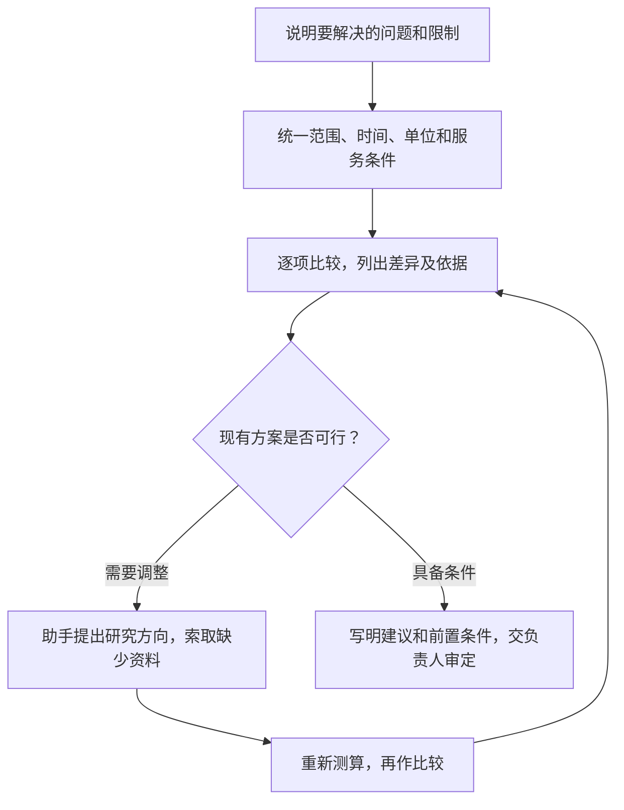

# 第十章　「你比比」

**把两份以上成形方案放在同一口径下，找出差异和取舍**

**本章目录**

- [怎样把方案放在一起比较](#怎样把方案放在一起比较)
- [案例一：政务服务大厅怎样安排高峰窗口](#案例一政务服务大厅怎样安排高峰窗口)
- [案例二：排队叫号系统采购需求怎样比较](#案例二排队叫号系统采购需求怎样比较)
- [案例三：三家设备供应商的报价怎样比较](#案例三三家设备供应商的报价怎样比较)
- [案例四：生产线检修安排怎样比较](#案例四生产线检修安排怎样比较)
- [怎样把「你比比」用好](#怎样把你比比用好)
- [比选五步：定目标、齐口径、列差异、核依据、留决策](#比选五步定目标齐口径列差异核依据留决策)
- [相关知识点](#相关知识点)
- [当次练习](#当次练习)
- [相关章节](#相关章节)
- [资料来源](#资料来源)

领导干部作决策前，经常会收到两份以上已经成形的方案、报价或工作安排。材料各有重点，数字的统计口径也可能不同。此时可以请助手把共同条件和差异列清楚，说明各方案的适用条件、资源要求和待核事项，再由负责同志结合实际作决定。

「你想想」从任务出发，请助手提出可供选择的思路；「你比比」需要先有两份以上具体材料，再按共同标准进行比较。「你看看」侧重检查一份材料与依据是否相符；「你比比」侧重把多份材料并列，找出差异会怎样影响选择。需要查找外地做法时先用第五章「你找找」，收集到材料后再进行比选。

## 怎样把方案放在一起比较

**先说清要作什么决定**

交代比较的目的、待选方案、使用对象和限制条件。助手需要知道负责同志最终要决定什么，例如采用哪种服务安排、是否修改采购需求，或把检修安排放在哪个时间段。

比较标准尚未明确时，可以请助手根据任务列出候选维度，再由负责同志确认。涉及采购或考核的正式评分时，评分因素和权重按现行规定及已发布的采购文件执行。

**统一比较口径**

比较前先核对方案的范围、统计期间、单位和测算条件。金额要分清含税与否，工期要确认起算点，成效数字要看统计期间和测算方法。两份材料的口径不一致时，助手应把差别标出来，再判断哪些项目可以直接比较。

根据工作需要，可以使用表格并列比较成本、工期、服务范围、人员投入、实施条件和风险。各项指标不必硬凑成一个总分；负责同志没有确定权重时，助手应保留每项差异，并说明建议所依据的条件。

**区分事实、估算和建议**

方案列出的金额、期限、范围和现状属于材料记录，预测效果属于估算，助手提出的取舍属于建议。比较结果要把三类内容分开标注。缺少共同口径、关键数据或实施条件时，先列出需要补充的内容。

**一段通用交代**

把方括号内容换成本次任务，并提供要比较的材料及已确定的要求：

> **使用者**
>
> 你比比这几份【方案或报价】，我准备解决【事情】，还有【已知限制条件】。先看看主要差别和各自的条件，再帮我整理一份供讨论的意见。

**图10-1　多份方案的比较与进一步研究**

## 案例一：政务服务大厅怎样安排高峰窗口

**工作情境**

青岚市政务服务局副局长沈倩，需要在下月业务高峰到来前调整大厅窗口安排。大厅最近四周的叫号记录显示，上午9时至11时的办件量占全天的58%。目前大厅有八个窗口，其中两个低频事项窗口日均各办理五件左右。沈倩手上有两份经业务处室讨论过的窗口调整方案，要求一个月内试行，不增加编制，保留专业窗口和线下服务，现金支出控制在1.5万元以内。

方案A提出，把两个低频事项窗口改为综合窗口，安排六名工作人员参加三周交叉培训，完成后试行四周。方案预算为1.2万元，测算称高峰等候时间预计下降18%，测算依据为最近四周的叫号记录和模拟排队数据。方案保留两个专业窗口。

方案B提出，现有窗口类型保持不变，在每周四个业务高峰日的9时至10时30分增加两个潮汐窗口，安排现有工作人员轮班，每周增加12人时，连续试行四周。业务处室预计等候时间下降15%，该数字来自工作人员经验估算。方案可以在一周内启动，不增加现金支出。

**怎样向助手交代**

沈倩提供《窗口调整方案A》《窗口调整方案B》和最近四周的叫号统计，并交代：

> **沈倩**
>
> 你比比这两套窗口调整方案。下个月就是高峰，我想一个月内先试起来。两套都得用现有编制，专业窗口和线下服务还要留，现金支出最多一万五。你帮我看看哪套能快点开起来、各得抽多少人、花多少钱，等候时间可能少多少。效果数字是怎么算的，还是凭经验估的，顺手标一下。我拿去会上讨论，再定先试哪套。

**助手可能给出的思路**

助手先把两份方案的启动条件和投入列在一起。

> **助手**
>
> 方案A需先培训三周，预算1.2万元，之后试行四周。方案B一周内可启动，现有人员轮班，每周增加12人时，不增加现金支出。A的18%来自排队模拟，B的15%来自工作人员估算，效果可在试行后用实际数据检验。
>
> 要确定优先方案，还需要明确这次更看重尽快应对下月高峰，还是为后续综合窗口建设作准备。

**怎样继续追问和调整**

沈倩看过对照后，明确了本次工作的重点：

> **沈倩**
>
> 先解决下个月的高峰，能快点启动、人手排得过来就行，综合窗口培训以后再说。

助手据此进一步整理了方案B的试行条件，并问：

> **助手**
>
> 方案B需要连续四周安排轮班，建议同时确定怎样观察效果。试行前后的等候时间、窗口办件量和新增人时，准备由谁汇总？

沈倩补充：

> **沈倩**
>
> 把记录数据这件事写进试行建议。看上午9点到11点平均等多久、各窗口办了多少件、每周多用了多少人时。四周后看实际情况，再商量要不要做交叉培训。比选意见写完整，安排我来审。

**采用前要核对什么**

- 58%来自最近四周的叫号记录，统计期间和办件范围应与方案附件一致。
- 方案A的1.2万元属于测算预算；方案B的12人时是每周投入，不能与现金支出混为一项。
- 18%与15%都只是预计效果，测算方法不同，实际效果要用试行数据核验。
- 试行期间应保留专业窗口和线下服务，窗口权限及事项分工由业务部门确认。

### 最终成品：高峰窗口方案比选意见

> **教学案例成品**

**青岚市政务服务大厅高峰窗口调整方案比选意见**

**一、比较条件**

本次比较以最近四周叫号记录为基础，重点解决上午9时至11时的窗口高峰。两份方案均按四周试行，不增加编制，保留专业窗口和线下服务，现金支出控制在1.5万元以内。

**二、方案对照**

| 比较项目 | 方案A：改设综合窗口 | 方案B：增设潮汐窗口 |
| --- | --- | --- |
| 启动准备 | 六名工作人员交叉培训三周后试行 | 一周内可启动 |
| 人员投入 | 六人参加培训，之后按综合窗口分工 | 每周增加12人时，现有人员轮班 |
| 现金支出 | 预算1.2万元 | 不增加现金支出 |
| 专业事项 | 保留两个专业窗口，其他事项转由综合窗口办理 | 现有窗口类型不变 |
| 预计效果 | 等候时间预计下降18%，依据为叫号记录和模拟排队数据 | 等候时间预计下降15%，依据为工作人员经验估算 |
| 主要条件 | 业务权限划分清楚，培训后工作人员具备相应办理能力 | 高峰日有可轮班人员，持续安排每周12人时 |

**三、建议和待定事项**

考虑到下月高峰临近，建议先按方案B试行四周，并记录高峰时段平均等候时间、各窗口办件量和新增人时。18%和15%来自不同测算方法，暂作方案估算参考。四周试行结束后，再结合实际数据决定是否开展方案A所需的交叉培训。

窗口权限、保留的专业事项和线下服务安排，由业务部门在试行前确认。最终安排由局领导审定。

## 案例二：排队叫号系统采购需求怎样比较

**工作情境**

青岚市政务服务局信息化负责人邢琳，正在准备大厅排队叫号系统更新项目。技术处形成了两份采购需求方案，局领导已明确项目覆盖六个大厅，预算上限为35万元，系统须在60天内投入使用；现有设备能继续使用的，应优先评估利旧方案。

方案A拟更新六个大厅的硬件和软件，预算68万元，实施期90天，提供两年运维服务，验收条款要求六个大厅的叫号和屏幕显示功能正常运行。

方案B拟升级软件并在六个大厅中的四个大厅利旧现有设备，本期不覆盖另外两个大厅，预算29万元，实施期35天，提供一年运维服务。验收条款写为「系统稳定、操作方便」，没有列明稳定运行时间和具体验收项目。

**怎样向助手交代**

邢琳提供两份方案初稿和局领导已确定的项目要求，并交代：

> **邢琳**
>
> 你比比这两份叫号系统更新方案，我要拿去做采购需求审核。先按同一个要求看：六个大厅都得覆盖，预算不能超过三十五万，六十天内要用起来，旧设备能用就尽量留。两份差在哪儿？特别看看费用、工期、哪些设备还能用、到时候怎么验收。方案上有依据的就指给我看，拿不准的我再找技术处。你先提怎么改，正式评审还是按采购文件办。

**助手可能给出的思路**

助手按覆盖范围、预算和工期列出共同条件。

> **助手**
>
> 方案A覆盖六个大厅，预算超出33万元，实施期比要求长30天。方案B预算和工期在限制内，但现有内容只覆盖四个大厅。技术处需要说明A的预算、工期能否调整，以及B补足两个大厅后的成本和时间。
>
> B的设备利旧条件、两份方案的具体验收项目，也需要补充资料后继续比较。

**怎样继续追问和调整**

邢琳看过比较后，觉得两份方案都难以按现有要求推进，继续追问：

> **邢琳**
>
> 两份都不太行，你再想想怎么调，六个大厅都得做，钱和时间也尽量控制住。

助手提出进一步研究的思路：

> **助手**
>
> 可以分别看看两份方案还有哪些调整空间。A覆盖范围够，但费用高、工期长，可以先拆开预算，查清钱主要花在哪里，再评估哪些设备还能继续用，能否通过调整改造方式减少支出、缩短实施时间。B已有利旧思路，可以测算扩到六个大厅的费用和工期，再与调整后的A比较。
>
> 请补充A的分项预算和现有设备检查情况，以及B的费用明细。我先据此测算。B若直接按四个大厅的29万元推算，六个大厅约需43.5万元，其中共用软件等可能只需支付一次，拆开后才能算得更准确。

> **邢琳**
>
> 技术处把两份的分项给我了，我贴在下面。
>
> | 费用项目 | 方案A原预算 | 方案B原预算 |
> | --- | --- | --- |
> | 硬件设备 | 46万元 | 四个大厅设备适配及实施，每个大厅5万元，共20万元 |
> | 共用软件平台 | 12万元 | 9万元 |
> | 安装调试 | 6万元 | 已计入每个大厅费用 |
> | 两年运维 | 4万元 | 原方案提供一年运维，费用已包含在上述预算中 |
> | 合计 | 68万元 | 29万元 |
>
> 技术处初步看了，A有些设备还能用，只换不兼容或影响使用的。硬件先估18万元，安装调试4万元，软件和两年运维不变。B加两个大厅，每个先按5万元估，共用软件不用重复买。接口还得逐个核。按这个再算算，工期也让技术处重新看看。

助手据此计算：

> **助手**
>
> A调整后暂估18＋12＋4＋4＝38万元，比原方案减少30万元，仍超预算3万元。B扩至六个大厅暂估9＋5×6＝39万元，超预算4万元。两份方案的服务期限不同，后续还要统一比较条件。A原来的90天和B原来的35天，都需要按调整后的实施范围重新确认。

邢琳最后要求：

> **邢琳**
>
> 原来的和调整后的放一起，看看还超多少。估的钱和有明细的分清楚，还得问什么也列一下，整理成比选意见，我们拿去跟技术处讨论。

**采用前要核对什么**

- A原预算68万元，调整后暂估38万元，减少30万元，仍超过35万元预算上限3万元。
- B的9万元共用软件费用只计算一次；按每个大厅5万元估算，覆盖六个大厅共需39万元，超过预算上限4万元。
- 调整后的金额是基于教学设定的初步测算，需结合设备检查、接口测试和正式报价确认。
- A调整改造方式后、B增加两个大厅后，均须重新评估工期，不能直接沿用原方案的90天和35天。
- 两份方案的运维期限不同，需统一服务要求，并形成具体、可测试的验收条款后继续比较。
- 采购需求和后续评审标准需由采购、业务、财务及相关部门按本单位程序审核。

### 最终成品：采购需求方案比选意见

> **教学案例成品**

**青岚市政务服务局排队叫号系统采购需求方案比选意见**

**一、项目要求与比较依据**

本项目须覆盖六个政务服务大厅，预算上限为35万元，系统应在60天内投入使用，现有设备优先评估利旧。此次在两份原方案的基础上，结合技术处补充的费用明细和初步利旧评估，比较调整改造方式、补足覆盖范围后的成本及实施条件。调整金额均为初步测算，尚待正式报价确认。

**二、原方案与调整测算对照**

| 比较项目 | 方案A | 方案B |
| --- | --- | --- |
| 原方案范围与预算 | 六个大厅，全部更新，68万元 | 四个大厅利旧升级，29万元 |
| 费用构成 | 硬件46万元、软件12万元、安装调试6万元、两年运维4万元 | 共用软件9万元，四个大厅设备适配及实施各5万元 |
| 进一步研究的改造方式 | 保留可用设备，仅更换不兼容或影响使用的部分 | 沿用利旧升级方式，补足另外两个大厅 |
| 调整后的成本测算 | 硬件18万元＋软件12万元＋安装调试4万元＋两年运维4万元＝38万元 | 共用软件9万元＋六个大厅各5万元＝39万元 |
| 与预算上限的差额 | 超出3万元，较原方案减少30万元 | 超出4万元，较四个大厅原方案增加10万元 |
| 工期 | 原为90天，调整改造方式后需重新排期 | 原为35天，增加两个大厅后需重新排期 |
| 运维服务 | 两年 | 一年，需按共同服务要求补充报价 |
| 主要待确认条件 | 利旧设备清单、替换范围、调整报价及60天内实施的条件 | 六个大厅接口兼容性、新增大厅的实际费用及工期 |

**三、进一步比较的判断**

方案A通过部分利旧暂估38万元，较原方案减少30万元，仍比35万元上限高3万元。应先核实设备利旧清单及报价，确认是否还能减少非必要更换，并由技术处重排60天内实施的条件。

方案B按共用软件一次计费、六个大厅分别实施暂估39万元，比上限高4万元。新增大厅的接口和工期需逐一核实，运维期限也需与A统一。两份均可继续研究，目前仍需取得覆盖六个大厅、满足预算与工期要求的正式方案后再选定。

**四、下一步讨论事项**

请技术处按六个大厅逐项列出可利旧设备、必须更换的设备和接口适配工作，向方案编制方取得分项报价及实施进度安排。重点确认能否通过减少非必要更换、优化安装方式等措施，将费用控制在35万元以内，同时满足60天投入使用的要求。

信息化部门会同使用部门统一运维服务要求，提出功能测试、稳定运行和故障处理等具体验收条款。取得同范围、同服务条件的报价和进度安排后，再更新对照结果，按本单位程序送审。

## 案例三：三家设备供应商的报价怎样比较

**工作情境**

真知集团所属装备公司计划采购12台便携式测振仪。设备管理部已经确定采购要求：单价不超过2.3万元，合同签订后20个日历日内交货，质保期不少于12个月，每台设备配套提供校准报告，售后响应时间不超过24小时。采购中心按照集团制度收集了三家供应商的书面报价，采购中心主任蒋文希望先看清报价差异和需要核实的条款。

询价摘要列明：供应商甲单价2.16万元，18天交货，质保24个月，提供校准报告，售后8小时内响应；供应商乙单价1.98万元，30天交货，质保12个月，提供校准报告，售后24小时内响应；供应商丙单价2.23万元，15天交货，质保12个月，售后8小时内响应，报价中没有说明校准报告。

**怎样向助手交代**

蒋文将供应商名称改为甲、乙、丙，并在单位批准的采购工作环境中提供询价摘要和采购要求，交代：

> **蒋文**
>
> 你比比这三家测振仪的书面报价，采购会前我想先把差别弄清楚。照同一份采购要求，先算十二台各多少钱，再看交货、质保、校准报告和售后响应。哪条不合要求、哪条人家没写清楚，把报价里原话和算式带上，我好核对。要追问供应商的单列。后续正式评审按采购文件来。

**助手可能给出的思路**

助手先整理报价差异，并列出需要澄清的内容。

> **助手**
>
> 12台总价分别为甲25.92万元、乙23.76万元、丙26.76万元。乙的交货期比采购要求长10天；丙的报价尚未说明校准报告。建议向乙确认按期交货的条件，向丙确认每台设备是否配校准报告，并保留澄清记录。

**怎样继续追问和调整**

蒋文看过对照后，要求将问题落实到后续沟通：

> **蒋文**
>
> 把要问乙、丙两家的问题分别写清楚。乙能不能20天交货，丙有没有校准报告，哪些要等书面回复，都放进清单。

> **助手**
>
> 需向两家书面澄清。
> 
> - 乙能否在合同签订后20个日历日内交货，延期如何处理？
> - 丙是否每台随附校准报告，由哪家机构出具？
> 
> 按采购会前了解情况整理，先列差别和待澄清事项，正式评审另按采购程序办理。

蒋文确认后交代：

> **蒋文**
>
> 你整理成一份说明，对照表附后，报价和算式保留。正式评审按采购文件来。

**采用前要核对什么**

- 甲总价为2.16万元×12台＝25.92万元；乙为1.98万元×12台＝23.76万元；丙为2.23万元×12台＝26.76万元。
- 采购要求的单价上限对应总金额27.6万元，三家总价都未超过该金额。
- 乙的30天交货期超过采购要求；丙的报价未说明校准报告，须按采购程序核实。
- 报价表中写明的质保期和售后响应时间按原文保留，不擅自扩大成服务承诺。
- 真实供应商报价和采购文件按第二章的安全要求处理；正式评审由评审人员依据采购文件和单位制度完成。

### 最终成品：便携式测振仪采购会前情况说明

> **教学案例成品**

**便携式测振仪采购会前情况说明**

本次采购12台测振仪，三家报价总额分别为25.92万元、23.76万元和26.76万元，均在27.6万元最高限额以内。甲的书面报价列明了当前各项采购要求。乙的30天交货期超过20个日历日的要求，丙尚未说明是否提供每台设备的校准报告。

现有书面报价比较如下，需澄清的问题及后续办理要求附后。

**真知集团所属装备公司便携式测振仪报价对照表**

采购数量：12台　单价上限：2.3万元　交货期：20个日历日内

| 比较项目 | 供应商甲 | 供应商乙 | 供应商丙 | 采购要求及说明 |
| --- | --- | --- | --- | --- |
| 单价 | 2.16万元 | 1.98万元 | 2.23万元 | 均未超过2.3万元 |
| 12台总价 | 25.92万元 | 23.76万元 | 26.76万元 | 最高限额为27.6万元，均在限额内 |
| 交货期 | 18天 | 30天 | 15天 | 乙超过20天要求 |
| 质保期 | 24个月 | 12个月 | 12个月 | 均达到12个月要求 |
| 校准报告 | 报价列明提供 | 报价列明提供 | 报价未说明 | 请按采购程序核实丙的承诺 |
| 售后响应 | 8小时内 | 24小时内 | 8小时内 | 均符合24小时要求 |

**需向供应商书面澄清的问题**

- 请乙确认合同签订后20个日历日内交货的可行性及延期处理方式，并书面回复。
- 请丙确认每台是否随附校准报告、出具机构及报告对应设备，并书面回复。

**待核事项**

采购部门应按采购文件和集团制度核实乙的交货安排、丙的校准报告，并完成资格审查及正式评审。本表只整理报价信息，不形成成交排序或采购决定。

## 案例四：生产线检修安排怎样比较

**工作情境**

真知集团装备公司分管生产的副总经理高远，要在下月为M-2生产线安排一次检修。设备和检修范围已经由设备管理部确认，两份计划覆盖相同的检修项目。生产部门按同一测算口径估计了停机对产量的影响，安全管理部门还需逐项核实作业审批、能量隔离和复机确认要求。

方案A安排一次连续停机18小时，投入12名检修人员，生产部门预计影响产量310吨，计划在检修结束后集中复机检查。

方案B安排三次停机，每次6小时，总停机时间也是18小时，每次投入8名检修人员，生产部门预计影响产量280吨。该方案需要进行三次停机隔离和三次复机确认。

**怎样向助手交代**

高远提供两份检修计划和生产部门的产量测算，并交代：

> **高远**
>
> 你比比M-2生产线的两份检修计划。两份修的是同一批项目，产量影响按生产部门给的同一口径看。哪套怎么停、要多少人、估计少多少产量，现场隔离和复机又差在哪儿，你帮我理一下。产量怎么算的也带上，安全上还有哪些没确认，给我留个单子。我跟设备、安全部门核完再定时段。

**助手可能给出的思路**

助手先列出两份检修计划各自需要的组织条件。

> **助手**
>
> 两份方案总停机时间均为18小时。方案A需要一个连续18小时的生产窗口，安排一次集中复机检查。方案B需协调三个6小时窗口，预计少影响产量30吨，同时需要分别完成三次隔离和复机确认。
>
> 还需结合下月订单安排，确认可用生产窗口，并请安全管理部门核实每次作业的条件。

**怎样继续追问和调整**

高远与生产部门确认可用窗口后补充：

> **高远**
>
> 下个月两种停法都排得开，一次18小时，或者三次、每次6小时。产量测算口径也核过了，一样的。少影响产量和少停机复机，怎么取舍，你说说，会上讨论。

> **助手**
>
> A为12人乘18小时，共216人时；B为8人乘6小时乘3次，共144人时，少72人时，预计少影响产量30吨。不过B多两次停机隔离和复机确认，人工与产量节省还要结合安全组织条件比较。我会把每次作业需准备的审批、隔离和复机确认事项列入比选意见，具体时段待安全部门确认后再定。

**采用前要核对什么**

- 两份计划的检修范围相同；总停机时长均为18小时。
- 预计产量影响分别为310吨和280吨，相差30吨，属于生产部门估算；实际产量结果还未发生。
- 方案B包含三次停机和三次复机确认，检查清单应覆盖每次作业。
- 作业审批、能量隔离和复机确认由专业部门按规定核验，助手只整理方案差异。
- 具体检修时段还要与生产排程和安全审核结果协调。

### 最终成品：M-2生产线检修方案比选意见

> **教学案例成品**

**真知集团M-2生产线检修方案比选意见**

**一、共同条件**

方案A和方案B的检修范围相同，总停机时间均为18小时。生产部门采用同一口径估算产量影响。

**二、方案对照**

| 比较项目 | 方案A | 方案B |
| --- | --- | --- |
| 停机安排 | 一次连续停机18小时 | 三次停机，每次6小时 |
| 检修人员 | 12人 | 每次8人 |
| 检修人工 | 216人时 | 144人时 |
| 预计产量影响 | 310吨 | 280吨 |
| 停机、复机次数 | 一次停机、一次集中复机检查 | 三次停机、三次复机确认 |
| 主要组织条件 | 需要一次连续18小时的生产窗口 | 需要协调三个6小时窗口，并重复完成隔离和复机确认 |

**三、比选意见**

按生产部门的估算，方案B预计少影响产量30吨；方案A只需安排一次连续停机和一次集中复机检查。两份方案的生产窗口均在下月订单安排允许范围内。安全管理部门需按制度审核最终选择的每次检修作业；方案B的三次停机还要分别核对作业审批、能量隔离和复机确认。

- 对产量影响更敏感时，可在安全审核通过后进一步论证方案B。
- 更重视减少停机复机次数时，可评估方案A的一次连续检修安排。

**四、安全管理部门需确认的事项**

- 作业审批。核对每次检修的范围、人员资格、审批材料及现场条件，确认具备实施条件后安排作业。
- 能量隔离。核对各次作业的能量源、隔离方案、执行人员和现场验证记录。
- 复机确认。核对设备检查、试运行条件、签认人员及恢复生产前需满足的要求。

方案A按一次作业准备，方案B按三次作业分别准备和确认。具体要求由安全、生产和设备部门按制度审核。

最终检修方案和时间由生产、安全、设备部门会商后报分管领导审定。

## 怎样把「你比比」用好

- **根据要作的决定选择比较维度。** 要赶进度，就看启动条件和人手，要控制费用，就看分项金额，涉及检修安排时还需比较停机复机次数。
- **核实效果数字的形成方式。** 模拟测算、经验估计和实际统计分别标注，先核适用范围，再讨论差异。
- **不同投入分别列示。** 现金支出、人时和运维年限各有含义，比较时同时呈现，避免用单一成本概括全部取舍。
- **先明确共同条件，再看差异。** 范围、期限和计量单位一致的项目写在表前，后续调整时也据此复核。
- **推荐方案时，说清实施前还要解决什么。** 请助手列出实施前尚需确认的条件和资料，供相关部门继续研究，例如利旧方案的兼容性和扩容费用。

## 比选五步：定目标、齐口径、列差异、核依据、留决策

1. **定目标**：说明要作什么决定，以及已有哪几份方案。
2. **齐口径**：确定共同的范围、时间、单位和比较标准；涉及法定评审时按既定文件执行。
3. **列差异**：把成本、时间、人员、服务范围、效果估算和风险逐项对照。
4. **核依据**：标注原始数据出处，区分事实、估算和建议，补齐关键信息。
5. **留决策**：提出有依据、有适用条件的建议，把审批、专业判断和最终选择交给责任人。

## 相关知识点

在政府采购正式评审中，评审委员会按采购文件载明的标准比较和评价，评审因素应与采购需求对应并细化量化。

内部研究方案时，可以围绕本次决定选择比较维度，例如启动需要多少时间、后续怎样维护。讨论中可按需要补充维度。涉及正式采购评审时，仍应按已公布的采购文件及规定程序办理。

## 当次练习

选择两份已经成形、可用于练习的方案或报价，约用五分钟比较其中一个具体决定。

> **使用者**
>
> 你比比这两份方案，我要定先试哪一套，主要看启动时间、要多少人和花多少钱，先把差别列个表。

1. 写出本次要作的决定，并说明已定限制。
2. 请助手先列共同条件，检查覆盖范围、期限和单位是否一致。
3. 选取表中一个效果数字，核对它来自统计、测算还是估计，以及能否直接比较。
4. 检查建议是否说明选择条件和待确认事项，再请助手整理完整讨论材料。

## 相关章节

- 需要从头提出可选思路，参阅[第四章「你想想」](../01-oral/04-xiangxiang.md)。
- 需要查找政策原文、外地公开做法或资料来源，参阅[第五章「你找找」](../01-oral/05-zhaozhao.md)。
- 需要按文件依据检查一份方案或初稿，参阅[第七章「你看看」](07-kankan.md)。
- 需要参考往年样稿起草同类新稿，参阅[第九章「你学学」](09-xuexue.md)。
- 需要把获准录制的会议音频整理成可核对的纪要素材，可继续阅读[第十一章阶段二进阶课「会议录音与转写」](11-advanced-audio.md)。

## 资料来源

- [财政部令第87号《政府采购货物和服务招标投标管理办法》](https://tfs.mof.gov.cn/caizhengbuling/201707/t20170718_2652603.htm)，第五十五条规定评审因素应与采购需求对应并细化量化。
