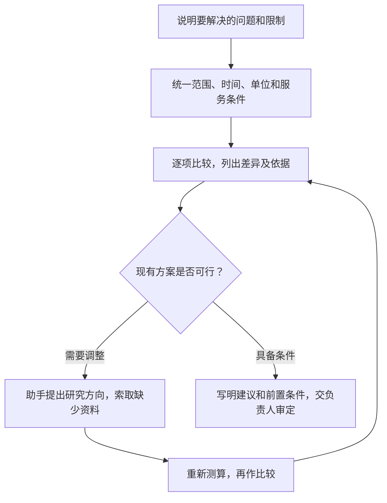
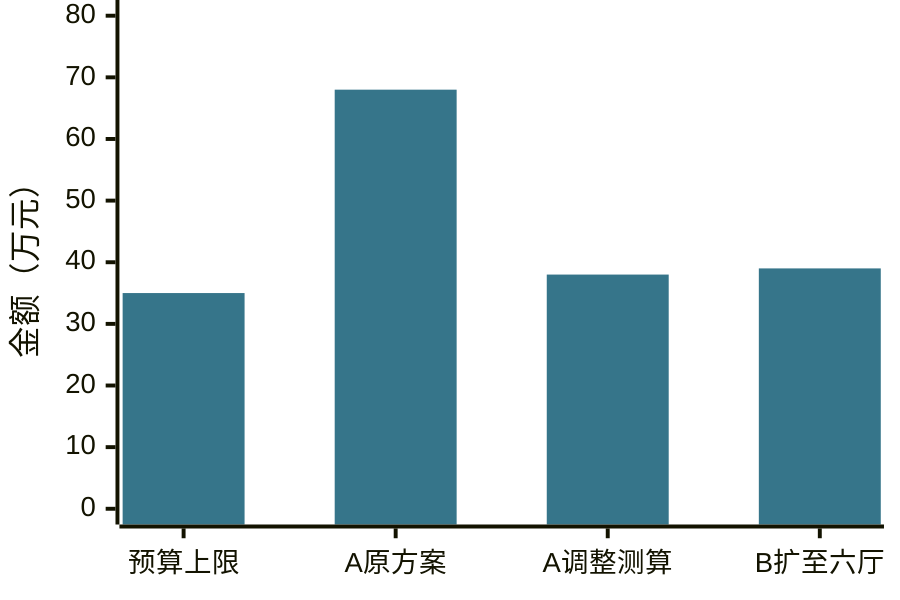

# 第十章　「你比比」

**把两份以上成形方案放在同一口径下，找出差异和取舍**

**本章目录**

- [怎样把方案放在一起比较](#怎样把方案放在一起比较)
  - [先说清要作什么决定](#先说清要作什么决定)
  - [统一比较口径](#统一比较口径)
  - [区分事实、估算和建议](#区分事实估算和建议)
  - [一段通用交代](#一段通用交代)
- [案例一：政务服务大厅怎样安排高峰窗口](#案例一政务服务大厅怎样安排高峰窗口)
  - [最终成品：高峰窗口方案比选意见](#最终成品高峰窗口方案比选意见)
- [案例二：排队叫号系统采购需求怎样比较](#案例二排队叫号系统采购需求怎样比较)
  - [最终成品：采购需求方案比选意见](#最终成品采购需求方案比选意见)
- [案例三：三家设备供应商的报价怎样比较](#案例三三家设备供应商的报价怎样比较)
  - [最终成品：便携式测振仪采购会前情况说明](#最终成品便携式测振仪采购会前情况说明)
- [案例四：生产线检修安排怎样比较](#案例四生产线检修安排怎样比较)
  - [最终成品：M-2生产线检修方案比选意见](#最终成品m-2生产线检修方案比选意见)
- [怎样把「你比比」用好](#怎样把你比比用好)
- [比选五步：定目标、齐口径、列差异、核依据、留决策](#比选五步定目标齐口径列差异核依据留决策)
- [当次练习](#当次练习)
- [相关章节](#相关章节)

领导干部作决策前，经常会收到两份以上已经成形的方案、报价或工作安排。材料各有重点，数字的统计口径也可能不同。此时可以请助手把共同条件和差异列清楚，说明各方案的适用条件、资源要求和待核事项，再由负责同志结合实际作决定。

「你想想」从任务出发，请助手提出可供选择的思路；「你比比」需要先有两份以上具体材料，再按共同标准进行比较。「你看看」侧重检查一份材料与依据是否相符；「你比比」侧重把多份材料并列，找出差异会怎样影响选择。需要查找外地做法时先用第五章「你找找」，收集到材料后再进行比选。

## 怎样把方案放在一起比较

### 先说清要作什么决定

交代比较的目的、待选方案、使用对象和限制条件。助手需要知道负责同志最终要决定什么，例如采用哪种服务安排、是否修改采购需求，或把检修安排放在哪个时间段。

比较标准尚未明确时，可以请助手根据任务列出候选维度，再由负责同志确认。涉及采购或考核的正式评分时，评分因素和权重按现行规定及已发布的采购文件执行。

### 统一比较口径

比较前先核对方案的范围、统计期间、单位和测算条件。金额要分清含税与否，工期要确认起算点，成效数字要看统计期间和测算方法。两份材料的口径不一致时，助手应把差别标出来，再判断哪些项目可以直接比较。

根据工作需要，可以使用表格并列比较成本、工期、服务范围、人员投入、实施条件和风险。各项指标不必硬凑成一个总分；负责同志没有确定权重时，助手应保留每项差异，并说明建议所依据的条件。

### 区分事实、估算和建议

方案列出的金额、期限、范围和现状属于材料记录，预测效果属于估算，助手提出的取舍属于建议。比较结果要把三类内容分开标注。缺少共同口径、关键数据或实施条件时，先列出需要补充的内容。

### 一段通用交代

把方括号内容换成本次任务，并提供要比较的材料及已确定的要求：

> **使用者**
>
> 你比比这几份【方案或报价】，我准备解决【事情】，还有【已知限制条件】。先看看主要差别和各自的条件，再帮我整理一份供讨论的意见。

**图10-1　多份方案的比较与进一步研究**

## 案例一：政务服务大厅怎样安排高峰窗口

**工作情境**

青岚市政务服务局副局长沈倩，需要在下月业务高峰到来前调整大厅窗口安排。大厅最近四周的叫号记录显示，上午9时至11时的办件量占全天的58%。目前大厅有八个窗口，其中两个低频事项窗口日均各办理五件左右。沈倩手上有两份经业务处室讨论过的窗口调整方案，要求一个月内试行，不增加编制，保留专业窗口和线下服务，现金支出控制在1.5万元以内。

方案A提出，把两个低频事项窗口改为综合窗口，安排六名工作人员参加三周交叉培训，完成后试行四周。方案预算为1.2万元，测算称高峰等候时间预计下降18%，测算依据为最近四周的叫号记录和模拟排队数据。方案保留两个专业窗口。

方案B提出，现有窗口类型保持不变，在每周四个业务高峰日的9时至10时30分增加两个潮汐窗口，安排现有工作人员轮班，每周增加12人时，连续试行四周。业务处室预计等候时间下降15%，该数字来自工作人员经验估算。方案可以在一周内启动，不增加现金支出。

国务院办公厅关于「高效办成一件事」的意见提出，政务服务中心应统筹线上与线下服务，并根据需要通过预约分流、错峰服务和潮汐窗口调配资源；湖北省2026年政务服务中心改革方案也提出动态设置综合窗口和专业窗口。[国务院办公厅相关意见](https://www.mee.gov.cn/zcwj/gwywj/202507/t20250708_1123095.shtml)、[湖北省政务服务中心综合改革方案](https://jxt.hubei.gov.cn/fbjd/xxgkml/gysyjs/hmhnhq/hmzc/202605/t20260518_5938245.shtml)

**怎样向助手交代**

沈倩提供《窗口调整方案A》《窗口调整方案B》和最近四周的叫号统计，并交代：

> **沈倩**
>
> 你比比这两套窗口调整方案。下个月就是高峰，我想一个月内先试起来。两套都得用现有编制，专业窗口和线下服务还要留，现金支出最多一万五。你帮我看看哪套能快点开起来、各得抽多少人、花多少钱，等候时间可能少多少。效果数字是怎么算的，还是凭经验估的，顺手标一下。我拿去会上讨论，再定先试哪套。

**助手可能给出的思路**

助手先把两份方案的启动条件和投入列在一起。

> **助手**
>
> 方案A需先培训三周，预算1.2万元，之后试行四周。方案B一周内可启动，现有人员轮班，每周增加12人时，不增加现金支出。A的18%来自排队模拟，B的15%来自工作人员估算，效果可在试行后用实际数据检验。
>
> 要确定优先方案，还需要明确这次更看重尽快应对下月高峰，还是为后续综合窗口建设作准备。

**怎样继续追问和调整**

沈倩看过对照后，明确了本次工作的重点：

> **沈倩**
>
> 先解决下个月的高峰，能快点启动、人手排得过来就行，综合窗口培训以后再说。

助手据此进一步整理了方案B的试行条件，并问：

> **助手**
>
> 方案B需要连续四周安排轮班，建议同时确定怎样观察效果。试行前后的等候时间、窗口办件量和新增人时，准备由谁汇总？

沈倩补充：

> **沈倩**
>
> 把记录数据这件事写进试行建议。看上午9点到11点平均等多久、各窗口办了多少件、每周多用了多少人时。四周后看实际情况，再商量要不要做交叉培训。比选意见写完整，安排我来审。

**采用前要核对什么**

- 58%来自最近四周的叫号记录，统计期间和办件范围应与方案附件一致。
- 方案A的1.2万元属于测算预算；方案B的12人时是每周投入，不能与现金支出混为一项。
- 18%与15%都只是预计效果，测算方法不同，实际效果要用试行数据核验。
- 试行期间应保留专业窗口和线下服务，窗口权限及事项分工由业务部门确认。

### 最终成品：高峰窗口方案比选意见

> **教学案例成品**

**青岚市政务服务大厅高峰窗口调整方案比选意见**

**一、比较条件**

本次比较以最近四周叫号记录为基础，重点解决上午9时至11时的窗口高峰。两份方案均按四周试行，不增加编制，保留专业窗口和线下服务，现金支出控制在1.5万元以内。

**二、方案对照**

| 比较项目 | 方案A：改设综合窗口 | 方案B：增设潮汐窗口 |
| --- | --- | --- |
| 启动准备 | 六名工作人员交叉培训三周后试行 | 一周内可启动 |
| 人员投入 | 六人参加培训，之后按综合窗口分工 | 每周增加12人时，现有人员轮班 |
| 现金支出 | 预算1.2万元 | 不增加现金支出 |
| 专业事项 | 保留两个专业窗口，其他事项转由综合窗口办理 | 现有窗口类型不变 |
| 预计效果 | 等候时间预计下降18%，依据为叫号记录和模拟排队数据 | 等候时间预计下降15%，依据为工作人员经验估算 |
| 主要条件 | 业务权限划分清楚，培训后工作人员具备相应办理能力 | 高峰日有可轮班人员，持续安排每周12人时 |

**三、建议和待定事项**

考虑到下月高峰临近，建议先按方案B试行四周，并记录高峰时段平均等候时间、各窗口办件量和新增人时。18%和15%来自不同测算方法，暂作方案估算参考。四周试行结束后，再结合实际数据决定是否开展方案A所需的交叉培训。

窗口权限、保留的专业事项和线下服务安排，由业务部门在试行前确认。最终安排由局领导审定。

## 案例二：排队叫号系统采购需求怎样比较

**工作情境**

青岚市政务服务局信息化负责人许岚，正在准备大厅排队叫号系统更新项目。技术处形成了两份采购需求方案，局领导已明确项目覆盖六个大厅，预算上限为35万元，系统须在60天内投入使用；现有设备能继续使用的，应优先评估利旧方案。

方案A拟更新六个大厅的硬件和软件，预算68万元，实施期90天，提供两年运维服务，验收条款要求六个大厅的叫号和屏幕显示功能正常运行。

方案B拟升级软件并在六个大厅中的四个大厅利旧现有设备，本期不覆盖另外两个大厅，预算29万元，实施期35天，提供一年运维服务。验收条款写为「系统稳定、操作方便」，没有列明稳定运行时间和具体验收项目。

政府采购的采购需求、评审因素和评分标准需要相互对应。财政部令第87号规定，综合评分法的评审因素应当与采购需求相关、细化量化，并在采购文件中规定。许岚此次要比较的是采购需求方案，后续采购评审仍按正式采购文件和法定程序办理。[财政部令第87号](https://tfs.mof.gov.cn/caizhengbuling/201707/t20170718_2652603.htm)

> **原文摘录 · 采购评审因素**
>
> 评审因素应当细化和量化
>
> 来源 [《政府采购货物和服务招标投标管理办法》第五十五条，财政部](https://www.mof.gov.cn/zcsjtsgb/gztsgb/201707/t20170711_3578382.htm)

**怎样向助手交代**

许岚提供两份方案初稿和局领导已确定的项目要求，并交代：

> **许岚**
>
> 你比比这两份叫号系统更新方案，我要拿去做采购需求审核。先按同一个要求看：六个大厅都得覆盖，预算不能超过三十五万，六十天内要用起来，旧设备能用就尽量留。两份差在哪儿？特别看看费用、工期、哪些设备还能用、到时候怎么验收。方案上有依据的就指给我看，拿不准的我再找技术处。你先提怎么改，正式评审还是按采购文件办。

**助手可能给出的思路**

助手按覆盖范围、预算和工期列出共同条件。

> **助手**
>
> 方案A覆盖六个大厅，预算超出33万元，实施期比要求长30天。方案B预算和工期在限制内，但现有内容只覆盖四个大厅。技术处需要说明A的预算、工期能否调整，以及B补足两个大厅后的成本和时间。
>
> B的设备利旧条件、两份方案的具体验收项目，也需要补充资料后继续比较。

**怎样继续追问和调整**

许岚看过比较后，觉得两份方案都难以按现有要求推进，继续追问：

> **许岚**
>
> 两份都不太行，你再想想怎么调，六个大厅都得做，钱和时间也尽量控制住。

助手提出进一步研究的思路：

> **助手**
>
> 可以分别看看两份方案还有哪些调整空间。A覆盖范围够，但费用高、工期长，可以先拆开预算，查清钱主要花在哪里，再评估哪些设备还能继续用，能否通过调整改造方式减少支出、缩短实施时间。B已有利旧思路，可以测算扩到六个大厅的费用和工期，再与调整后的A比较。
>
> 请补充A的分项预算和现有设备检查情况，以及B的费用明细。我先据此测算。B若直接按四个大厅的29万元推算，六个大厅约需43.5万元，其中共用软件等可能只需支付一次，拆开后才能算得更准确。

许岚向技术处了解后，补充了费用明细和初步评估结果。以下金额均为本教学案例的模拟测算，尚未取得调整后的正式报价。

| 费用项目 | 方案A原预算 | 方案B原预算 |
| --- | --- | --- |
| 硬件设备 | 46万元 | 四个大厅设备适配及实施，每个大厅5万元，共20万元 |
| 共用软件平台 | 12万元 | 9万元 |
| 安装调试 | 6万元 | 已计入每个大厅费用 |
| 两年运维 | 4万元 | 原方案提供一年运维，费用已包含在上述预算中 |
| 合计 | 68万元 | 29万元 |

许岚继续交代：

> **许岚**
>
> 技术处初步看了，A有些设备还能用，只换不兼容或影响使用的。硬件先估18万元，安装调试4万元，软件和两年运维不变。B加两个大厅，每个先按5万元估，共用软件不用重复买。接口还得逐个核。按这个再算算，工期也让技术处重新看看。

助手据此计算：

> **助手**
>
> A调整后暂估18＋12＋4＋4＝38万元，比原方案减少30万元，仍超预算3万元。B扩至六个大厅暂估9＋5×6＝39万元，超预算4万元。两份方案的服务期限不同，后续还要统一比较条件。A原来的90天和B原来的35天，都需要按调整后的实施范围重新确认。

许岚最后要求：

> **许岚**
>
> 原来的和调整后的放一起，看看还超多少。估的钱和有明细的分清楚，还得问什么也列一下，整理成比选意见，我们拿去跟技术处讨论。

**采用前要核对什么**

- A原预算68万元，调整后暂估38万元，减少30万元，仍超过35万元预算上限3万元。
- B的9万元共用软件费用只计算一次；按每个大厅5万元估算，覆盖六个大厅共需39万元，超过预算上限4万元。
- 调整后的金额是基于教学设定的初步测算，需结合设备检查、接口测试和正式报价确认。
- A调整改造方式后、B增加两个大厅后，均须重新评估工期，不能直接沿用原方案的90天和35天。
- 两份方案的运维期限不同，需统一服务要求，并形成具体、可测试的验收条款后继续比较。
- 采购需求和后续评审标准需由采购、业务、财务及相关部门按本单位程序审核。

**图10-2　覆盖六个大厅后的预算测算**

35万元为预算上限；68万元为A原预算；38万元、39万元为本案例调整后的模拟测算。B原来的29万元仅覆盖四个大厅，此图采用扩至六个大厅的39万元。调整测算尚待正式报价和设备检查确认。

### 最终成品：采购需求方案比选意见

> **教学案例成品**

**青岚市政务服务局排队叫号系统采购需求方案比选意见**

**一、项目要求与比较依据**

本项目须覆盖六个政务服务大厅，预算上限为35万元，系统应在60天内投入使用，现有设备优先评估利旧。此次在两份原方案的基础上，结合技术处补充的费用明细和初步利旧评估，比较调整改造方式、补足覆盖范围后的成本及实施条件。调整金额均为初步测算，尚待正式报价确认。

**二、原方案与调整测算对照**

| 比较项目 | 方案A | 方案B |
| --- | --- | --- |
| 原方案范围与预算 | 六个大厅，全部更新，68万元 | 四个大厅利旧升级，29万元 |
| 费用构成 | 硬件46万元、软件12万元、安装调试6万元、两年运维4万元 | 共用软件9万元，四个大厅设备适配及实施各5万元 |
| 进一步研究的改造方式 | 保留可用设备，仅更换不兼容或影响使用的部分 | 沿用利旧升级方式，补足另外两个大厅 |
| 调整后的成本测算 | 硬件18万元＋软件12万元＋安装调试4万元＋两年运维4万元＝38万元 | 共用软件9万元＋六个大厅各5万元＝39万元 |
| 与预算上限的差额 | 超出3万元，较原方案减少30万元 | 超出4万元，较四个大厅原方案增加10万元 |
| 工期 | 原为90天，调整改造方式后需重新排期 | 原为35天，增加两个大厅后需重新排期 |
| 运维服务 | 两年 | 一年，需按共同服务要求补充报价 |
| 主要待确认条件 | 利旧设备清单、替换范围、调整报价及60天内实施的条件 | 六个大厅接口兼容性、新增大厅的实际费用及工期 |

**三、进一步比较的判断**

方案A的硬件和安装调试原预算合计52万元，是进一步研究费用调整的重点。根据技术处初步评估，采取部分利旧的方式，项目总费用有望从68万元降至38万元，降幅约44.1%。这一测算说明改变改造方式具有进一步研究的价值，但设备能否利旧、18万元硬件费用能否落实，还需检查和询价确认。

方案B不能直接将29万元按大厅数量放大为43.5万元，因为其中9万元共用软件费用无需重复支付。按现有分项条件，六个大厅暂估39万元。新增两个大厅是否具备相同的实施条件，仍需逐一检查。

按当前测算，两份调整方案均覆盖六个大厅，预算分别超出3万元和4万元，工期均待重新确认。A暂估低1万元，同时包含更长的运维服务，但报价基础、利旧范围和服务要求还需统一，现阶段可将两份方案一并交技术处继续研究。

**四、下一步讨论事项**

请技术处按六个大厅逐项列出可利旧设备、必须更换的设备和接口适配工作，向方案编制方取得分项报价及实施进度安排。重点确认能否通过减少非必要更换、优化安装方式等措施，将费用控制在35万元以内，同时满足60天投入使用的要求。

信息化部门会同使用部门统一运维服务要求，提出功能测试、稳定运行和故障处理等具体验收条款。取得同范围、同服务条件的报价和进度安排后，再更新对照结果，按本单位程序送审。

## 案例三：三家设备供应商的报价怎样比较

**工作情境**

真知集团所属装备公司计划采购12台便携式测振仪。设备管理部已经确定采购要求：单价不超过2.3万元，合同签订后20个日历日内交货，质保期不少于12个月，每台设备配套提供校准报告，售后响应时间不超过24小时。采购中心按照集团制度收集了三家供应商的书面报价，采购负责人希望先看清报价差异和需要核实的条款。

询价摘要列明：供应商甲单价2.16万元，18天交货，质保24个月，提供校准报告，售后8小时内响应；供应商乙单价1.98万元，30天交货，质保12个月，提供校准报告，售后24小时内响应；供应商丙单价2.23万元，15天交货，质保12个月，售后8小时内响应，报价中没有说明校准报告。

国务院国资委和国家发展改革委印发的中央企业采购指导意见提出，中央企业应按程序组织采购，并通过询价比价等方式开展采购寻源；采购评审和成交确定按企业采购制度办理。[《关于规范中央企业采购管理工作的指导意见》](https://wap.sasac.gov.cn/n2588035/c31372608/content.html)

**怎样向助手交代**

采购负责人将供应商名称改为甲、乙、丙，并在单位批准的采购工作环境中提供询价摘要和采购要求，交代：

> **采购负责人**
>
> 你比比这三家测振仪的书面报价，采购会前我想先把差别弄清楚。照同一份采购要求，先算十二台各多少钱，再看交货、质保、校准报告和售后响应。哪条不合要求、哪条人家没写清楚，把报价里原话和算式带上，我好核对。要追问供应商的单列。后续正式评审按采购文件来。

**助手可能给出的思路**

助手先整理报价差异，并列出需要澄清的内容。

> **助手**
>
> 12台总价分别为甲25.92万元、乙23.76万元、丙26.76万元。乙的交货期比采购要求长10天；丙的报价尚未说明校准报告。建议向乙确认按期交货的条件，向丙确认每台设备是否配校准报告，并保留澄清记录。

**怎样继续追问和调整**

采购负责人看过对照后，要求将问题落实到后续沟通：

> **采购负责人**
>
> 把要问乙、丙两家的问题分别写清楚。乙能不能20天交货，丙有没有校准报告，哪些要等书面回复，都放进清单。

助手将两家供应商需澄清的事项分开列出，并询问这份材料的使用场合。

采购负责人说明：

> **采购负责人**
>
> 采购会前看的，你整理成一份说明，对照表附后，报价和算式保留。正式评审按采购文件来。

**采用前要核对什么**

- 甲总价为2.16万元×12台＝25.92万元；乙为1.98万元×12台＝23.76万元；丙为2.23万元×12台＝26.76万元。
- 采购要求的单价上限对应总金额27.6万元，三家总价都未超过该金额。
- 乙的30天交货期超过采购要求；丙的报价未说明校准报告，须按采购程序核实。
- 报价表中写明的质保期和售后响应时间按原文保留，不擅自扩大成服务承诺。
- 真实供应商报价和采购文件按第二章的安全要求处理；正式评审由评审人员依据采购文件和单位制度完成。

### 最终成品：便携式测振仪采购会前情况说明

> **教学案例成品**

**便携式测振仪采购会前情况说明**

本次采购12台测振仪，三家报价总额分别为25.92万元、23.76万元和26.76万元，均在27.6万元最高限额以内。甲的书面报价列明了当前各项采购要求。乙的30天交货期超过20个日历日的要求，丙尚未说明是否提供每台设备的校准报告。

会前需按采购程序核实乙的交货安排及丙的校准报告承诺。资格审查、正式评审及成交确定由采购程序继续办理。现有书面报价的比较结果如下。

**真知集团所属装备公司便携式测振仪报价对照表**

采购数量：12台　单价上限：2.3万元　交货期：20个日历日内

| 比较项目 | 供应商甲 | 供应商乙 | 供应商丙 | 采购要求及说明 |
| --- | --- | --- | --- | --- |
| 单价 | 2.16万元 | 1.98万元 | 2.23万元 | 均未超过2.3万元 |
| 12台总价 | 25.92万元 | 23.76万元 | 26.76万元 | 最高限额为27.6万元，均在限额内 |
| 交货期 | 18天 | 30天 | 15天 | 乙超过20天要求 |
| 质保期 | 24个月 | 12个月 | 12个月 | 均达到12个月要求 |
| 校准报告 | 报价列明提供 | 报价列明提供 | 报价未说明 | 请按采购程序核实丙的承诺 |
| 售后响应 | 8小时内 | 24小时内 | 8小时内 | 均符合24小时要求 |

**待核事项**

采购部门应按采购文件和集团制度核实乙的交货安排、丙的校准报告，并完成资格审查及正式评审。本表只整理报价信息，不形成成交排序或采购决定。

## 案例四：生产线检修安排怎样比较

**工作情境**

真知集团制造板块分管生产的副总经理高峰，要在下月为M-2生产线安排一次检修。设备和检修范围已经由设备管理部确认，两份计划覆盖相同的检修项目。生产部门按同一测算口径估计了停机对产量的影响，安全管理部门还需逐项核实作业审批、能量隔离和复机确认要求。

方案A安排一次连续停机18小时，投入12名检修人员，生产部门预计影响产量310吨，计划在检修结束后集中复机检查。

方案B安排三次停机，每次6小时，总停机时间也是18小时，每次投入8名检修人员，生产部门预计影响产量280吨。该方案需要进行三次停机隔离和三次复机确认。

应急管理部发布的工贸企业安全生产工作提示要求检维修作业落实能量隔离和挂牌上锁；《中央企业安全生产监督管理办法》要求央企明确各职能部门的安全生产管理职责。本例的作业审批和复机安排由集团专业部门按内部制度审核。[应急管理部工贸企业安全生产工作提示](https://www.mem.gov.cn/xw/yjglbgzdt/202608/t20260810_680113.shtml)、[《中央企业安全生产监督管理办法》](https://wap.sasac.gov.cn/n2588035/n2588320/n2588335/c29970110/content.html)

**怎样向助手交代**

高峰提供两份检修计划和生产部门的产量测算，并交代：

> **高峰**
>
> 你比比M-2生产线的两份检修计划。两份修的是同一批项目，产量影响按生产部门给的同一口径看。哪套怎么停、要多少人、估计少多少产量，现场隔离和复机又差在哪儿，你帮我理一下。产量怎么算的也带上，安全上还有哪些没确认，给我留个单子。我跟设备、安全部门核完再定时段。

**助手可能给出的思路**

助手先列出两份检修计划各自需要的组织条件。

> **助手**
>
> 两份方案总停机时间均为18小时。方案A需要一个连续18小时的生产窗口，安排一次集中复机检查。方案B需协调三个6小时窗口，预计少影响产量30吨，同时需要分别完成三次隔离和复机确认。
>
> 还需结合下月订单安排，确认可用生产窗口，并请安全管理部门核实每次作业的条件。

**怎样继续追问和调整**

高峰与生产部门确认可用窗口后补充：

> **高峰**
>
> 下个月两种停法都排得开，一次18小时，或者三次、每次6小时。产量测算口径也核过了，一样的。少影响产量和少停机复机，怎么取舍，你说说，会上讨论。

助手整理两种取舍后，进一步列出安全管理部门需确认的事项。

高峰接着交代：

> **高峰**
>
> 安全还没审完，作业审批、能量隔离、复机确认这些要准备什么，你也列一下。等安全部门确认了再定时段，整理进比选意见。

**采用前要核对什么**

- 两份计划的检修范围相同；总停机时长均为18小时。
- 预计产量影响分别为310吨和280吨，相差30吨，属于生产部门估算；实际产量结果还未发生。
- 方案B包含三次停机和三次复机确认，检查清单应覆盖每次作业。
- 作业审批、能量隔离和复机确认由专业部门按规定核验，助手只整理方案差异。
- 具体检修时段还要与生产排程和安全审核结果协调。

### 最终成品：M-2生产线检修方案比选意见

> **教学案例成品**

**真知集团M-2生产线检修方案比选意见**

**一、共同条件**

方案A和方案B的检修范围相同，总停机时间均为18小时。生产部门采用同一口径估算产量影响。

**二、方案对照**

| 比较项目 | 方案A | 方案B |
| --- | --- | --- |
| 停机安排 | 一次连续停机18小时 | 三次停机，每次6小时 |
| 检修人员 | 12人 | 每次8人 |
| 预计产量影响 | 310吨 | 280吨 |
| 停机、复机次数 | 一次停机、一次集中复机检查 | 三次停机、三次复机确认 |
| 主要组织条件 | 需要一次连续18小时的生产窗口 | 需要协调三个6小时窗口，并重复完成隔离和复机确认 |

**三、比选意见**

按生产部门的估算，方案B预计少影响产量30吨；方案A只需安排一次连续停机和一次集中复机检查。两份方案的生产窗口均在下月订单安排允许范围内。安全管理部门需按制度审核最终选择的每次检修作业；方案B的三次停机还要分别核对作业审批、能量隔离和复机确认。

- 对产量影响更敏感时，可在安全审核通过后进一步论证方案B。
- 更重视减少停机复机次数时，可评估方案A的一次连续检修安排。

最终检修方案和时间由生产、安全、设备部门会商后报分管领导审定。

## 怎样把「你比比」用好

- **比较前先定目标。** 沈倩要解决下月的窗口高峰；许岚要判断两份采购需求能否进入下一步；采购负责人要核对报价与已定要求；高峰要统筹生产安排和检修窗口。目标不同，比较维度也不同。
- **查清数字从哪里来，能不能放在一起比。** 比较时要查看原方案、统计表或测算说明，弄清数字的来源、计算方法和适用范围。例如，四个大厅的总价与六个大厅的总价，需要按相同覆盖范围重新测算后再比较。
- **推荐方案时，说清实施前还要解决什么。** 例如，采用利旧方案前，要确认现有设备能否兼容、扩到六个大厅需要多少钱、能否按期完成。请助手把这些问题和需要补充的资料列清楚，供相关部门继续研究，再按本单位程序确定方案。

政府采购的评审方法和量化因素，应按采购文件及规定程序执行；评审委员会按采购文件载明的标准开展比较和评价。[财政部令第87号《政府采购货物和服务招标投标管理办法》](https://tfs.mof.gov.cn/caizhengbuling/201707/t20170718_2652603.htm) 中规定，评审因素应与采购需求对应并细化量化。

## 比选五步：定目标、齐口径、列差异、核依据、留决策

1. **定目标**：说明要作什么决定，以及已有哪几份方案。
2. **齐口径**：确定共同的范围、时间、单位和比较标准；涉及法定评审时按既定文件执行。
3. **列差异**：把成本、时间、人员、服务范围、效果估算和风险逐项对照。
4. **核依据**：标注原始数据出处，区分事实、估算和建议，补齐关键信息。
5. **留决策**：提出有依据、有适用条件的建议，把审批、专业判断和最终选择交给责任人。

## 当次练习

选择两份已经成形的工作方案、预算安排或服务报价，按以下步骤练习：

可以先这样交代。

> **使用者**
>
> 你比比这两份方案，我准备开会讨论，先帮我看看差别和各自的条件。

1. 先写明要作的决定、限制条件和比较标准。
2. 请助手核对两份材料的范围、时间和统计口径，制作逐项对照表。
3. 检查表中的数据是否能回到原材料，标明估算、缺项和待核问题。
4. 让助手根据已确认的标准提出建议，再由负责同志作决定。
5. 核实比较条件后，请助手把对照结果和有条件的建议写成完整的会议讨论材料。

处理政府采购评审材料、涉密事项和单位内部敏感信息前，应按第二章确认工具是否获批及材料处理范围。

## 相关章节

- 需要从头提出可选思路，参阅[第四章「你想想」](../01-oral/04-xiangxiang.md)。
- 需要查找政策原文、外地公开做法或资料来源，参阅[第五章「你找找」](../01-oral/05-zhaozhao.md)。
- 需要按文件依据检查一份方案或初稿，参阅[第七章「你看看」](07-kankan.md)。
- 需要参考往年样稿起草同类新稿，参阅[第九章「你学学」](09-xuexue.md)。
- 需要把获准录制的会议音频整理成可核对的纪要素材，可继续阅读[第十一章阶段二进阶课「会议录音与转写」](11-advanced-audio.md)。
