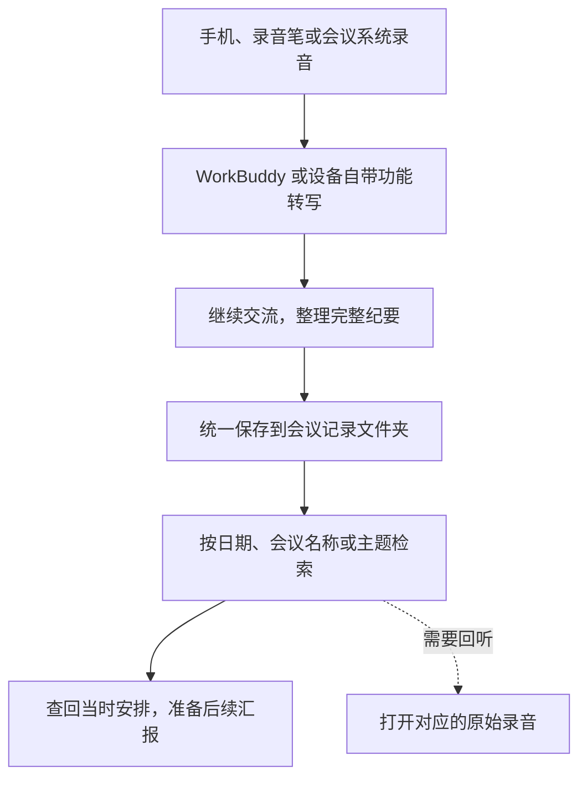

# 第十一章　阶段二进阶课｜会议录音与转写

**用手机留下会议记录，整理纪要，积累自己的工作知识库**

领导干部参加会议时，既要听取情况、思考问题，也要参与讨论。遇到信息密集、发言较快的会议，低头记笔记容易跟不上讨论；只凭脑子记，会后又可能想不起某个数字、某项分工，或当时为什么作出这样的安排。

手机、录音笔和会议录音设备，可以帮助我们留下完整的声音记录。会后请人工智能助手转写、整理，形成会议纪要，再将适合留存的内容放进自己的工作知识库。以后想了解某次会议谈了什么、某项工作是怎样定下来的，可以让助手随时找到当时的记录，必要时回听对应录音。

这节课练习从录音到查回资料的完整过程。养成会后整理和归档的习惯，会议内容就能逐步积累下来，成为随时可以查阅的工作资料。

**图11-1　会议记录怎样保存和再次使用**



## 开会时怎样用手机录音

日常使用手机录音，准备和操作都比较方便。也可以根据使用习惯，选择录音笔、录音背夹、智能办公本等设备。录音笔便于随身携带，录音背夹可以配合手机使用，智能办公本则方便把手写笔记与录音一起保存。选购和使用时，可以重点了解收音效果，以及录音和文字能否导出，方便后续交给助手整理。多人会议或较大的会场，还可以使用会议麦克风或会场已有的录音系统。

1. 打开手机自带的录音应用，录一小段再回放，确认声音清楚。有外接麦克风时，也要检查实际收音效果。
2. 会前检查电量和存储空间，将设备放在能够收清主要发言的位置，避开空调出风口、投影设备和容易被碰到的桌边。较大的会场可使用会议拾音设备。
3. 开始录音后，确认计时正常。会上可以只记自己特别关心的问题、临时想到的意见和需要立即处理的事项，完整发言留到会后整理。
4. 会议结束后停止录音，回放开头、中间和结尾，检查声音是否收录。文件及时命名，例如「2026-11-09_企业信息变更服务协调会_录音」。

同一天有多场会议时，最好每场单独保存。这样转写、整理和日后查找都更方便。

## 视频会议也可以录制并转写

使用腾讯会议开会时，可以开启云录制并同时启用录制转写，会后导出文字，交给助手整理纪要、存入知识库。以电脑端为例：

1. 会议创建者会前进入「设置」→「录制」，勾选「同时开启录制转写」。
2. 会中主持人开启「云录制」。也可以先在「录制」旁的菜单中勾选「同时开启录制转写」，再开始云录制。
3. 会后在「录制」→「我的录制」中打开本次记录，查看「逐字稿」。漏开转写时，创建者可在详情页的「逐字稿」中点击「立即生成」。
4. 创建者或有下载转存权限的人员，可通过「更多」→「另存为」→「下载至本地」→「逐字稿文本」导出，再交给 WorkBuddy 整理。

> **官方界面文字 · 腾讯会议转写开关**
>
> 同时开启录制转写
>
> 来源 [腾讯会议录制转写说明](https://meeting.tencent.com/support/topic/1865/)

这套操作需要账号具有云录制和录制转写权益，具体可用功能以账号套餐、管理员设置和当前界面为准。[腾讯会议录制转写说明](https://meeting.tencent.com/support/topic/1865/) · [录制文件管理说明](https://meeting.tencent.com/support/topic/1840/index.html)

## 把录音文件交给 WorkBuddy 转写

会后将手机或录音笔中的录音文件导出到电脑，保存到本次会议的文件夹，再将文件发送给 WorkBuddy，请它完成转写和整理。

WorkBuddy 支持通过本地音频文件或音频链接进行转写，也可以根据录音总结会议内容、提取待办事项。具体支持的格式、时长和计费方式，以使用时的帮助页和界面提示为准。[WorkBuddy 音频转文字说明](https://www.workbuddy.cn/docs/workbuddy/From-Beginner-to-Expert-Guide/Function-Description/Task-Bar)

将录音提供给助手后，可以这样说：

> **使用者**
>
> 你理理这段会议录音，先转成文字，按讨论的事情分段，保留对应的录音时间。我想看看会上谈了什么、定了什么、接下来要做什么。听不清的地方标出来，方便我回听。

助手整理后，先看会议的主要议题，再回听自己关心的内容。文字稿保留时间位置，以后查到一句话，也能找到它在录音中的上下文。


手机自带录音转写功能的，也可以先在手机上转成文字，再将文字复制或导出给 WorkBuddy，继续总结会议内容、整理纪要，并将有用信息存入知识库。原始录音保留，方便需要时回听。

## 继续沟通，形成完整的会议纪要

拿到转写稿后，可以接着请助手整理成纪要：

> **使用者**
>
> 按这份转写稿帮我写个会议纪要，把定下来的事和后面怎么安排说清楚，没定的单独列一下。

助手可能会提出需要补充的信息。例如，会上明确要请几个部门提供业务数据，却没有确定由谁汇总，助手可以进一步询问：

> **助手**
>
> 各部门需要提供的资料已经列出，但录音里还没有明确由谁汇总，也没有约定提交时间。这两项需要会后确认，纪要中先列为待确定事项吗？

这时可以根据会议实际情况继续交代：

> **使用者**
>
> 没定的我再问主持人。企业重复填表那块多写点，后面研究办法要用。

确认负责人、时间等信息后，再告诉助手补进纪要，并请它输出完整稿。正式会议纪要按本单位程序审定；自己留用的会议记录，也可以整理出关注的问题、相关安排和需要跟进的事情。

## 把会议资料存进自己的知识库

会议纪要整理好后，顺手保存到平时使用的工作知识库。知识库可以是本地笔记软件、单位内部资料库，或已经在使用的知识管理工具。先建立一个固定的「会议记录」目录，就能开始积累。

会议纪要和转写稿建议保存为 Markdown（.md）或纯文本（.txt）格式，便于人工智能助手读取、检索和修改。Word 文档也可以使用，不过在一些工具中需要先解析文档，检索和修改会稍麻烦一些。

每次会议可以建立一份记录，放入以下内容。

| 保存内容 | 以后怎样使用 |
| --- | --- |
| 会议名称、日期、相关专题 | 按时间、项目或工作主题找到这次会议 |
| 完整会议纪要或个人会议记录 | 回顾主要讨论、确定的安排和后续工作 |
| 文字转写稿及音频位置 | 查看发言上下文，回听具体内容 |
| 自己要跟进的事项 | 准备下次汇报，检查工作进展 |

归档时可以继续交代：

> **使用者**
>
> 这次资料存到“会议记录”里，文件名带日期和会议名。打开先能看到纪要和我要跟的事，录音、转写稿放哪儿也带上，好找。

使用具备文件读写权限的助手时，可以让它直接保存到指定位置；也可以先让助手整理好，再自行导入常用知识库。录音、转写稿和纪要尽量保持关联，文件移动后及时更新链接。

当某项工作开过多次会议，还可以按专题建立索引，把相关记录放在一起。例如「企业信息变更服务优化」下面，依次列出前期讨论、部门协调和进度研究的会议，后续便于查清工作是怎样推进的。

**会议资料文件夹示例**

```text
会议记录/
├── 2026-11-09_企业信息变更服务协调会_纪要.md
├── 2026-11-09_企业信息变更服务协调会_转写.txt
└── 音频/
    └── 2026-11-09_企业信息变更服务协调会.m4a
```

这是归档结构示例。实际文件名带上日期和会议名称，纪要中保留转写稿和音频位置。

## 以后想不起来，就回到知识库里找

平时把可以归入同一知识库的会议纪要统一放在一个固定文件夹里，例如「会议记录」，文件名带上日期和会议名称。查找时，把这个文件夹的位置告诉助手，让它集中检索其中的纪要。资料存放集中、命名清楚，有助于助手更快、更准确地找到相关记录。

会议记录积累起来后，即使只记得一个大概，也可以请能够访问这些资料的助手查找：

> **使用者**
>
> 前段时间讨论企业重复填表那次会，你帮我找找，当时提了什么办法，最后定了先干什么？对应记录也给我。

准备下一次汇报时，还可以进一步问：

> **使用者**
>
> 这个专题最近几次会交办的事帮我汇总一下，谁负责、什么时候完成。记录里有进展的接上，没有的我再问。

有了会议记录和后续补充，查阅时就能看到当时的讨论，也能接着梳理后来的进展。会议结束后及时转写、整理、归档，下一次再用到这些内容时，就有资料可查。

## 当次练习

选择一段三至五分钟的模拟会议录音，练习完成一次整理和归档。

1. 用手机或录音笔录制一段讨论，内容包括一个已经确定的安排和一个还需要继续研究的问题。
2. 请助手转写，并保留对应的录音时间。
3. 继续与助手沟通，将内容整理成完整的会议纪要，补充需要确认的信息。
4. 将纪要、转写稿和录音位置存入自己的练习知识库，写清会议名称和日期。
5. 换一种说法询问这次会议的内容，检查能否找到相应记录和录音位置。

## 记忆方法

开会时录下来，会后转成文字，整理成纪要，再存进知识库。以后记不清时，可以按主题、日期或大致内容查回来。

## 怎样把会议录音与转写用好

**先了解会议规定，尊重参会人员的权利。** 录音前向会议组织者了解是否允许录音，并按要求向参会人员说明用途、保存和使用方式，依法履行告知、取得同意等适用义务。规定不得录音的场合和会议，按规定执行；涉及个人隐私的内容也要尊重相关人员的意愿和权利。[《中华人民共和国个人信息保护法》](https://fgk.chinatax.gov.cn/zcfgk/c100009/c5211776/content.html)

**涉密会议按保密要求办理。** 涉密会议的录音设备、录制范围和资料处理方式，由主办单位按保密要求确定。个人手机、普通录音笔及通用人工智能服务的使用，必须遵守相应限制。[《中华人民共和国保守国家秘密法实施条例》](https://www.samr.gov.cn/zw/zfxxgk/fdzdgknr/bgt/art/2024/art_8f6dddff03bf45eb907697833dab7eb9.html)

**根据资料性质选择工具和保存位置。** 单位内部会议资料、个人信息和经营数据，按本单位要求处理。录音上传、转写和归档分别确认允许的环境、接触人员及保存期限，个人工作知识库也应使用单位允许的工具和存储位置。

**重要内容回听确认，资料按要求保管。** 人名、数字、日期、决定和分工，需要结合原录音确认；缺少的负责人、期限等信息，由相关人员补充。讨论建议与正式决定分别写清，个人记录注明用途，正式纪要按程序审定。保存的资料定期备份，按规定到期清理，查阅权限随工作需要管理。

## 相关章节

- 请助手阅读已有会议材料并审阅文稿，可参阅第七章「你看看」。
- 根据旧稿的写法起草本次会议文件，可参阅第九章「你学学」。
- 整理多个会议的任务和后续进展，可参阅第十二章「你理理」。
