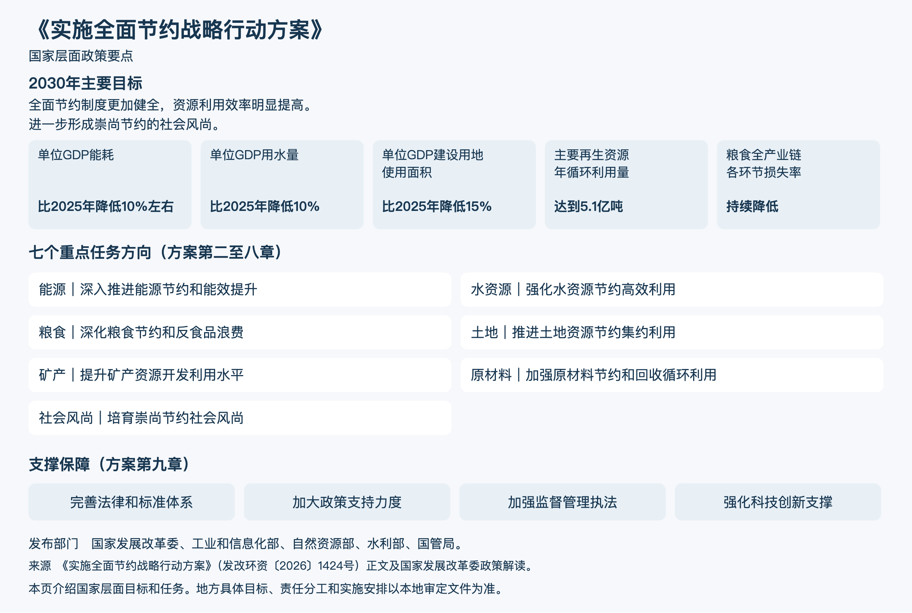
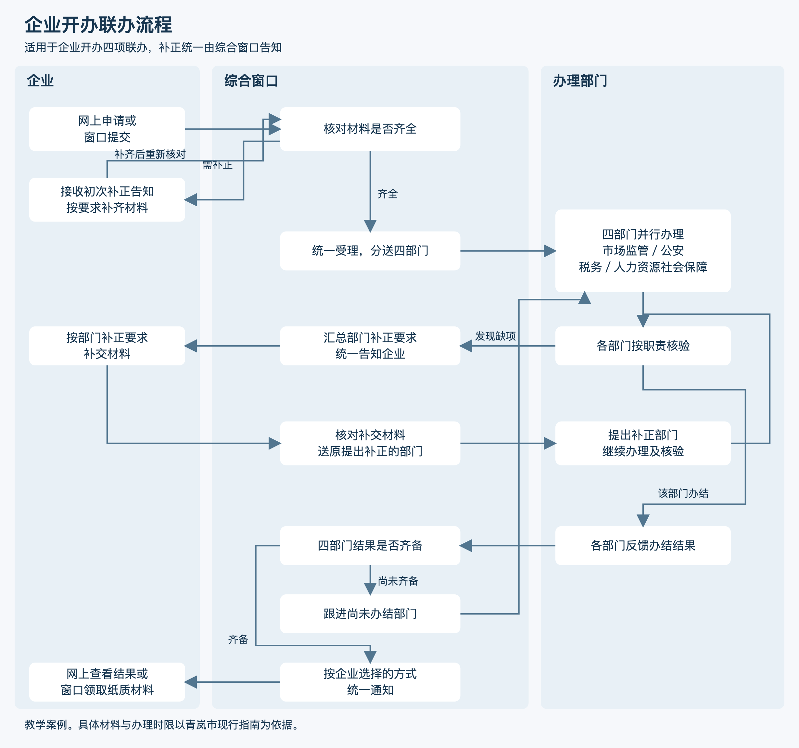
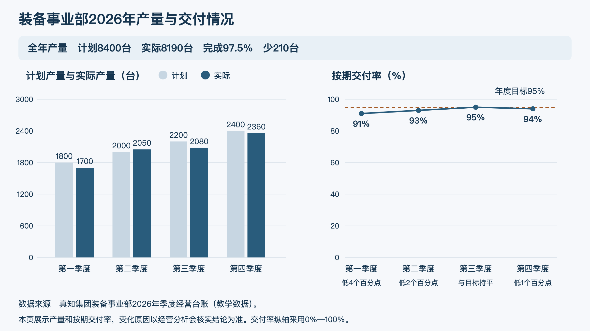

# 第十七章　「你画画」

**把已经核实的文字、数据和流程做成图表、流程图或配图**

**本章目录**

- [先确定要表达什么](#先确定要表达什么)
  - [一张图只承担一个主要任务](#一张图只承担一个主要任务)
  - [图表要带着口径一起交代](#图表要带着口径一起交代)
  - [流程图要列清节点和分工](#流程图要列清节点和分工)
  - [生成图片时，把画面要求说具体](#生成图片时把画面要求说具体)
  - [一段通用交代](#一段通用交代)
- [案例一：把政策要点做成一页图解](#案例一把政策要点做成一页图解)
  - [最终成品：全面节约战略行动方案培训图解](#最终成品全面节约战略行动方案培训图解)
- [案例二：把跨部门办事流程画清楚](#案例二把跨部门办事流程画清楚)
  - [最终成品：企业开办联办流程图](#最终成品企业开办联办流程图)
- [案例三：用图表汇报季度经营情况](#案例三用图表汇报季度经营情况)
  - [最终成品：装备事业部季度经营图表](#最终成品装备事业部季度经营图表)
- [案例四：为安全会议制作背景图](#案例四为安全会议制作背景图)
  - [最终成品：安全生产专题会背景图](#最终成品安全生产专题会背景图)
- [怎样把「你画画」用好](#怎样把你画画用好)
- [制图五步：定受众、选形式、列素材、说要求、核成品](#制图五步定受众选形式列素材说要求核成品)
- [相关知识点：图表、流程图和生成图片各有用途](#相关知识点图表流程图和生成图片各有用途)
- [当次练习](#当次练习)
- [资料来源](#资料来源)
- [相关章节](#相关章节)

领导干部准备专题汇报、政策培训和安全宣传时，经常需要把文字或数据整理成图。读者要了解一项政策的重点，可以看一页图解；跨部门事项涉及多个办理环节，流程图能标明谁在何时接手；季度经营数据需要在会上汇报，图表便于比较计划与实际进度。会议背景图、宣传配图则可以帮助确定整体视觉风格。

「你画画」处理已经明确的信息。领导干部要提供准确的政策内容、流程节点、统计数据和使用场合，再说明希望读者看到什么。助手可以设计图的结构、提出图表类型或生成配图。

## 先确定要表达什么

### 一张图只承担一个主要任务

先说明谁会看这张图、在哪里看、看完后需要理解或记住什么。工作汇报图表适合突出比较关系和变化趋势；办事流程图要说明先后顺序、部门分工和条件分支；政策图解需要呈现政策目标、重点任务和适用范围；会议配图则重在营造合适的视觉氛围。

同一张图里放入太多信息，读者很难找到重点。可以先请助手给出两个版式方案，选定之后再补充视觉细节。

### 图表要带着口径一起交代

提供数据时，应写明统计时间、对象、单位、计划值或目标值、数据来源，以及每项指标的定义。要求助手保留原数值并检查标签。需要计算的内容，先按「你算算」核对，再请「你画画」呈现；制图过程中不要顺手改动数字或补写原因。

### 流程图要列清节点和分工

把流程的起点、办理人、办理事项、条件判断、流转方向和结束状态交代清楚。需要并行办理的事项应画出并行支路；需要退回补充材料的，应说明退回对象和回到哪个节点。助手负责把已确认的流程画清楚，实际步骤和办理时限由主管部门核定。

### 生成图片时，把画面要求说具体

说明图片用途、横竖比例、主体、构图、色彩、风格和需要留白的位置。涉及中文标题、日期、机构名称或标识时，最好先生成不含文字的背景，再用办公软件排入已经审定的文字。

### 一段通用交代

在 WorkBuddy 或其他具备相应制图能力的工具中，可以按下面的方式说明任务：

> **使用者**
>
> 你画画，把这份【文字、流程或数据】做成一张图，给【读者】在【场合】看，重点让大家看清【内容】。先给我两个布局，我选好后再做成图。

## 案例一：把政策要点做成一页图解

**工作情境**

青岚市机关事务服务中心副主任周静准备给市直机关处级干部做节约工作培训，已提供《实施全面节约战略行动方案》正文和国家发展改革委解读。材料同时包含主要目标、重点任务和支撑保障，周静希望用一页帮助听众建立全貌，再由讲授补充具体措施。

**怎样向助手交代**

> **周静**
>
> 你画画，把这份节约战略方案做成一页培训图，给市直机关的处级干部看。让大家先看清国家要求和重点任务，给我两个排法看看。

**助手可能给出的思路**

> **助手**
>
> 可以用上中下三层：上层主要目标、中层任务、下层保障；也可以按目标、任务、保障从左到右排。横向更适合逐项对照，三层更便于投影时按层讲解。
>
> 2030年目标段包含能耗、用水、建设用地、再生资源及粮食损失率五项指标，粮食损失率采用“持续降低”的定性表述。段首还有“全面节约制度更加健全，资源利用效率明显提高”，段末还有“进一步形成崇尚节约的社会风尚”。图上应同时交代这些总体目标。

**怎样继续追问和调整**

> **周静**
>
> 用三层那个。五项指标都放，总体目标和定性的也照原话写。市里的指标还没分解，这页就讲国家要求。

> **助手**
>
> 标题用文件全称，副题标“国家层面政策要点”。能耗保留“比2025年降低10%左右”，单位GDP用水量和建设用地使用面积分别保留比2025年降低10%、15%，再生资源保留5.1亿吨，粮食损失率保留“持续降低”。七项任务用方向词配原文短句，底部按第九章列法律和标准、政策支持、监管执法、科技创新，可以吗？

> **周静**
>
> 行。但一页这么多，哪些要放图上，哪些我讲的时候再解释？条件要保留完整。图和备注分开给我，出处也留好。

> **助手**
>
> 图上完整保留总体目标、五项指标和限定词。七项任务采用“能源、水资源、粮食、土地、矿产、原材料、社会风尚”加原文任务短句；每项下面的具体措施、实施背景放讲授备注，例如能源节约措施、原材料回收实施安排。保障保留第九章四条举措的名称，细目随原文讲解。

**采用前要核对什么**

- 总体目标及五项指标与原文逐项核对，限定词及基期完整保留。
- 图与讲授备注职责清楚，文件全称及来源可查。

### 最终成品：全面节约战略行动方案培训图解

教学案例成品

[可编辑图示源文件](../assets/ch17/conservation-policy-round3.svg)

**标题**：《实施全面节约战略行动方案》  
**副标题**：国家层面政策要点  
**用途**：市直机关处级干部培训课件

**上层｜2030年主要目标**

全面节约制度更加健全，资源利用效率明显提高。进一步形成崇尚节约的社会风尚。

- 单位国内生产总值能耗：比2025年降低10%左右
- 单位国内生产总值用水量：比2025年降低10%
- 单位国内生产总值建设用地使用面积：比2025年降低15%
- 主要再生资源年循环利用量：达到5.1亿吨
- 粮食全产业链各环节损失率：持续降低

**中层｜七个重点任务方向**

| 方向 | 图解标签 |
| --- | --- |
| 能源 | 深入推进能源节约和能效提升 |
| 水资源 | 强化水资源节约高效利用 |
| 粮食 | 深化粮食节约和反食品浪费 |
| 土地 | 推进土地资源节约集约利用 |
| 矿产 | 提升矿产资源开发利用水平 |
| 原材料 | 加强原材料节约和回收循环利用 |
| 社会风尚 | 培育崇尚节约社会风尚 |

**下层｜四类支撑保障**

完善法律和标准体系　｜　加大政策支持力度　｜　加强监督管理执法　｜　强化科技创新支撑

**发布部门**：国家发展改革委、工业和信息化部、自然资源部、水利部、国管局。  
**来源**：《实施全面节约战略行动方案》（发改环资〔2026〕1424号）正文及国家发展改革委政策解读。  
**说明**：本页介绍国家层面目标和任务。地方具体目标、责任分工和实施安排以本地审定文件为准。

**讲授备注**

| 讲授方向 | 原文指标或措施摘要 | 原文位置 | 讲授建议 |
| --- | --- | --- | --- |
| 能源 | 到2030年，规模以上工业单位增加值能耗比2025年降低10%以上。重点领域节能措施涉及既有建筑、公共机构及机房等。 | 第二章第（二）条 | 可结合机关建筑、机房和用能设备，讨论哪些改造适合本单位。 |
| 水资源 | 推进农业节水、工业节水及城镇节水。到2030年，农田灌溉水有效利用系数提高到0.60。 | 第三章第（四）条 | 按当地农业、工业及公共机构用水特点选择例子。 |
| 粮食 | 加强生产、储存、运输、加工及餐饮消费环节节约；公共机构加强机关食堂反食品浪费工作成效评估和通报。 | 第四章第（五）至（七）条、第八章第（十六）条 | 可从机关食堂按需供餐、小份餐品及剩餐情况讨论减损办法。 |
| 土地 | “十五五”期间新增建设用地规模控制在2600万亩以内，并推进存量土地盘活及低效用地再开发。 | 第五章第（八）、（十）条 | 结合本地已有用地情况，分别介绍增量控制与存量盘活。 |
| 矿产 | 到2030年，持证在产大型矿山90%以上、中型矿山80%以上达到绿色矿山标准。 | 第六章第（十一）条 | 说明该指标的对象和年份，再讨论当地涉及的管理工作。 |
| 原材料 | 推进绿色设计、回收及再利用。到2030年，大宗固体废弃物年利用量达到45亿吨左右。 | 第七章第（十三）至（十五）条 | 可选择本地产业的回收利用案例，说明生产和消费环节如何衔接。 |
| 社会风尚 | 公共机构示范引领、推广绿色生活方式、深化宣传教育引导。 | 第八章第（十六）至（十八）条 | 结合绿色采购、绿色办公及日常生活说明各类主体怎样参与。 |

上述指标均保留原定对象、基期和适用条件；本地任务分解以审定文件为依据。图示及备注依据方案全文整理。[《实施全面节约战略行动方案》正文](https://www.ndrc.gov.cn/xxgk/zcfb/tz/202611/P020261103357525186534.pdf)

## 案例二：把跨部门办事流程画清楚

**工作情境**

青岚市政务服务中心副主任赵宇准备给窗口人员培训企业开办试点。材料包括已审定的流程和部门职责：网上、窗口均可申请，综合窗口核对并受理，四个部门按职责办理，结果由窗口汇总。材料还写有一次性告知和补正要求，具体退回路径需结合职责表核对。

**怎样向助手交代**

> **赵宇**
>
> 你画画，把企业开办这套流程画出来，给窗口人员培训用。企业、窗口和几个部门怎么接上，补材料和拿结果的地方也带上。

**助手可能给出的思路**

> **助手**
>
> 按企业、综合窗口和办理部门分成三条泳道。两个申请入口汇到窗口核对，材料齐全后受理并分送四部门；初次核对需补材料时，窗口告知企业，补齐后回到核对。结果汇总后提供网上查看及窗口领取。
>
> 还有一处需确认：部门办理中发现材料有问题，图中是退回综合窗口还是直接联系企业？现有流程主文没有画出这条路径。

**怎样继续追问和调整**

> **赵宇**
>
> 统一回窗口，这个我们定过了，你画上。两个入口进来以后一样走，四个部门同时办。补材料那里分个岔，补完再核。

> **助手**
>
> 将部门发现缺项统一退回窗口，由窗口告知企业，补齐核对后送相应部门继续办理。四部门并行，完成后汇总结果。领取方式是否按申请时选择的渠道通知？

> **赵宇**
>
> 对，按企业选的方式通知。结果网上能看，也能来窗口拿纸质材料。

> **助手**
>
> 还要确认一个培训时会遇到的问题：四部门并行办理，一个先办完，是先通知企业，还是等全部办完后由窗口统一通知？图中需要画出结果齐备的判断。

> **赵宇**
>
> 等四个部门都办完，由窗口统一通知。先办完的结果先交窗口，窗口继续跟没办完的。

**采用前要核对什么**

- 入口、部门并行及补正路径以赵宇确认和审定材料为据。
- 具体材料与办理时限按现行指南。

### 最终成品：企业开办联办流程图

教学案例成品

[可编辑图示源文件](../assets/ch17/business-opening-flow-round3.svg)

| 泳道 | 节点 | 流转 |
| --- | --- | --- |
| 企业 | 网上申请或窗口提交 | 两个入口进入综合窗口材料核对 |
| 综合窗口 | 核对材料 | 材料齐全：统一受理；需要补正：一次性告知缺项和提交方式 |
| 企业 | 补齐材料 | 返回“综合窗口核对材料”节点 |
| 办理部门 | 市场监管、公安、税务、人力资源社会保障部门按职责并行办理 | 各部门完成后向综合窗口反馈结果 |
| 办理部门、综合窗口 | 部门办理中发现需补正 | 部门将缺项退回综合窗口，窗口统一一次告知企业；补齐后核对并送相应部门继续办理 |
| 综合窗口 | 判断四部门结果是否齐备 | 齐备后按企业选择的方式统一通知；尚未齐备时跟进未办结部门 |
| 企业 | 网上查看结果／综合窗口领取纸质材料 | 流程结束 |

图中四个部门并行办理，补正材料回到核对节点。办理时限和具体材料以青岚市现行办事指南为准。

## 案例三：用图表汇报季度经营情况

**工作情境**

真知集团装备事业部负责人顾明准备在2027年一季度经营分析会上汇报2026年数据。财务和生产已核过季度台账：计划产量依次1800、2000、2200、2400台，实际1700、2050、2080、2360台；交付率91%、93%、95%、94%，年度目标95%。图表需兼顾投影和纸质阅读。

**怎样向助手交代**

> **顾明**
>
> 你画画，把经营台账做成一页会上的图，给大家看产量完成情况和交付率跟目标差多少。先给我看看怎么排。

**助手可能给出的思路**

> **助手**
>
> 左侧用同一刻度比较计划和实际产量，右侧单独画交付率及95%目标线。产量轴从0开始，交付率轴采用0%—100%的完整范围，两张图分别标单位，交付率各点另标数值及与目标的差距。建议采用深浅或线型区分，方便黑白打印。标题用“装备事业部2026年产量与交付情况”。

**怎样继续追问和调整**

> **顾明**
>
> 就这个布局，横版，会上投影，也要黑白打印发下去。来源写经营台账，注明教学数据。

> **助手**
>
> 图中保留各季度数值及来源。还可以增加全年合计：计划8400台，实际8190台，少210台，完成97.5%。各季度差额依次－100、＋50、－120、－40台。交付率距目标依次低4、低2、持平、低1个百分点。

> **顾明**
>
> 这个要带上。交付率能不能也给个全年数？

> **助手**
>
> 四个季度比例的简单平均为93.25%，但全年交付率需从全年按期交付量除以总交付量计算，现有表缺各季交付件数。建议先展示季度与目标对照，正式全年指标请生产部门补明细后核算。

> **顾明**
>
> 生产刚确认，交付明细另给。先用季度数据讲，全年产量合计加上，差额表放图后面。原因会上再核。

**采用前要核对什么**

- 产量全年合计与原季度台账一致。
- 交付率季度简单平均与正式全年率用途分别注明。
- 图中季度数值、95%目标线和图后年度合计逐项对照；产量轴从0开始，深浅及线型便于黑白阅读。

### 最终成品：装备事业部季度经营图表

教学案例成品

**标题**：装备事业部2026年产量与交付情况

**数据来源**：真知集团装备事业部2026年季度经营台账（教学数据）。  
**图下注**：本页展示产量和按期交付率，变化原因以经营分析会核实结论为准。交付率纵轴采用0%—100%。  
图表采用16:9横版，计划与实际产量用深浅颜色区分，交付率单独标出年度目标线。全年产量合计已标在图上，季度差额见下表。

**全年与季度对照**

| 项目 | 第一季度 | 第二季度 | 第三季度 | 第四季度 | 全年合计 |
| --- | ---: | ---: | ---: | ---: | ---: |
| 计划产量（台） | 1800 | 2000 | 2200 | 2400 | 8400 |
| 实际产量（台） | 1700 | 2050 | 2080 | 2360 | 8190 |
| 实际减计划（台） | －100 | ＋50 | －120 | －40 | －210 |
| 产量计划完成率 | 94.4% | 102.5% | 94.5% | 98.3% | 97.5% |

| 季度交付率比较 | 第一季度 | 第二季度 | 第三季度 | 第四季度 |
| --- | --- | --- | --- | --- |
| 与95%目标的差距 | 低4个百分点 | 低2个百分点 | 持平 | 低1个百分点 |

全年产量计划完成率8190÷8400＝97.5%。本页按顾明确认只列季度交付率。四个季度交付率的简单平均为93.25%，各季交付量不同，该值无法代表正式全年交付率；全年指标需用全年按期交付量除以总交付量计算。变化原因由经营分析会结合业务材料核实。

## 案例四：为安全会议制作背景图

**工作情境**

真知集团安全环保部负责人沈怡准备2026年11月13日四季度安全专题会，各所属单位主要负责人参会。办公室已提供审定标题“真知集团四季度安全生产专题会”、日期及主办部门“真知集团安全环保部”。沈怡希望图像适合严肃的安全部署氛围，办公室再用审定文字和标识排入演示稿。

**怎样向助手交代**

> **沈怡**
>
> 你画画，周五安全专题会各单位主要负责人都来，背景稳重一点，横版，深蓝配一点橙色。右边放些厂房轮廓，左边留给标题，先看两种构图。

**助手可能给出的思路**

> **助手**
>
> 第一种将厂房集中在右侧，左侧形成连续标题区；第二种沿下缘排设备轮廓，中央放标题。建议第一种，留白较完整，后续标题、日期和标识容易排入。背景采用抽象轮廓，文字与标识用办公室审定素材另排。

**怎样继续追问和调整**

> **沈怡**
>
> 用第一种。设备画抽象些，留给字的地方大一点。

> **助手**
>
> 右侧保留厂房轮廓，左侧深蓝留白。按16:9页面试排，标题用60磅白字、日期36磅、主办部门28磅。左上深蓝区适合放标题，日期紧跟标题时较长文字可能接近右侧橙色轮廓，建议移至左下深蓝区。左上标题区已满，右下也有厂房和橙色光带。建议在左下主办部门同一行的右侧留标识位置，带字示意先画一个虚线框，办公室后续置入审定素材。

> **沈怡**
>
> 行，就这样排。标题长就分成两行，日期放左下，先给我一张能看到标题效果的示意。标识就放左下主办部门右边，示意上标出位置，正式稿再由办公室换成审定的。

> **助手**
>
> 标题拆成“真知集团四季度”“安全生产专题会”两行，日期和主办部门在左下，与橙色光带分开。标识框放主办部门右侧。我把带字示意、字号表和无字底图一起给你，正式演示稿的文字还能改，后排可读性请办公室到会场试投影确认。

**采用前要核对什么**

- 背景用已有图，标题日期及主办信息与办公室审定内容一致。
- 标题、日期、主办信息逐字核对；字号按试排表设置，正式投影再检查后排可读性。

### 最终成品：安全生产专题会背景图

教学案例成品

**会议文字试排稿**

| 元素 | 审定内容 | 位置 | 可编辑演示稿建议字号 | 排版检查 |
| --- | --- | --- | --- | --- |
| 标题 | 真知集团四季度安全生产专题会 | 左上深蓝区，两行 | 60磅，白色粗体 | 与右侧厂房分区，深蓝与白字对比明显，标题完整可读 |
| 日期 | 2026年11月13日 | 左下深蓝区 | 36磅，白色 | 避开橙色线条，与主办部门对齐 |
| 主办部门 | 真知集团安全环保部 | 日期下方 | 28磅，白色 | 与日期保持间距 |
| 集团标识 | 办公室提供的审定素材 | 左下主办部门同一行右侧 | 按标识规范 | 虚线框仅示意预留位置，与主办文字、厂房和光带分开；正式排入后复核 |

示意图用于审阅内容和构图，表中字号为可编辑演示稿的设置建议。正式稿由办公室以审定标识替换虚线框，并现场检查投影及后排可读性。

**交付用无字底图**

## 怎样把「你画画」用好

- **政策图解要把原文层次画出来。** 全面节约战略行动方案案例把国家目标、七个重点任务和支撑保障分层呈现；本地目标、办理规则和工作安排以审定材料为准。
- **流程图要让每个节点找到责任人。** 企业开办案例把申请人、综合窗口和办理部门分成泳道，材料补正和结果领取都有明确去向。
- **经营图表要保留统计口径。** 装备事业部案例分别展示产量和按期交付率，标题、刻度、目标线和数据来源都能对照经营台账。
- **生成图片适合解决构图和氛围。** 安全会议案例让工具制作背景，把会议文字和标识留给办公室排版，便于审校和后续修改。

制图前，确认当前工具已开放所需的图表、流程图或图片生成功能。图片输入、图片生成和组件导出各有对应入口，使用时按客户端功能选择。[WorkBuddy 模型配置说明](https://www.workbuddy.ai/docs/zh/workbuddy/From-Beginner-to-Expert-Guide/Function-Description/Model-Configuration)

## 制图五步：定受众、选形式、列素材、说要求、核成品

1. **定受众**：说明谁看图、在哪里看、看完要理解或记住什么。
2. **选形式**：根据内容选择政策图解、流程图、数据图表或场景配图。
3. **列素材**：提供审定文本、准确数据、流程节点、指标口径和来源。
4. **说要求**：交代版式、尺寸、阅读顺序、颜色、留白和输出格式。
5. **核成品**：对照原文检查文字、数字、单位、流程分支、箭头方向和来源，再由责任部门审定。

## 相关知识点：图表、流程图和生成图片各有用途

图表适合呈现数据的比较和变化。医疗保障信息平台的界面规范建议用图表直观展示统计信息和数据关系，并举例说明柱状图、环形图和进度条可用于呈现周期、对比或比例信息；这项规范适用于医疗保障信息平台界面，其他业务仍应遵循本领域的数据展示要求。[《医疗保障信息平台用户界面规范》](https://www.nhsa.gov.cn/module/download/downfile.jsp?classid=0&filename=47f296b40d6e4267b30bca0c7ffb2d31.pdf)

流程图强调步骤、分工和条件。政策解读图解需要依据已审定的文字材料制作。辽宁省《政策文件解读工作规范（试行）》把图表图解列为解读形式之一，要求说明政策背景、依据、目标和任务；涉及具体办理事项时，还要交代办理程序等内容。具体要求以本地现行制度为准。[辽宁省政策解读工作规范](https://www.ln.gov.cn/web/zwgkx/zcjd/zcjd/D8EDC8944EB74717BB3A93286F59E2E3/)

生成图片擅长呈现氛围、构图和视觉素材。它适合制作背景图或插画；精确的中文信息、数据和流程节点仍应使用可编辑文本、图表或流程图表达。WorkBuddy 的当前说明区分了图片输入和图片生成能力；官方帮助文档也提示，图表组件保存或复制为图片的操作受客户端功能影响，移动端暂不支持相关操作。使用前应以当前客户端的功能说明为准。[模型配置说明](https://www.workbuddy.ai/docs/zh/workbuddy/From-Beginner-to-Expert-Guide/Function-Description/Model-Configuration)、[任务对话与组件说明](https://www.workbuddy.cn/docs/workbuddy/Conversation)

## 当次练习

选一份已经审定的工作方案、业务流程或统计表，完成一张适合会议或培训使用的图。

可以先这样交代。

> **使用者**
>
> 你画画，把这些内容做成一张图，会上用，先给我看看怎么排。

1. 说明读者、使用场合和希望传达的重点。
2. 让助手判断适合用图解、流程图还是图表，并说明理由。
3. 提供原文、流程节点或数据表，明确需要保留的口径和来源。
4. 让助手先给版式，再按选定方案制作。
5. 对照原始材料逐项检查内容，完成后由相应部门审定。

## 资料来源

- [政策原文](https://www.ndrc.gov.cn/xxgk/zcfb/tz/202611/t20261103_1408504.html)
- [国家发展改革委“一图读懂”](https://www.ndrc.gov.cn/xxgk/jd/zctj/202611/t20261103_1408536.html)
- [江苏省政府实施意见](https://www.jiangsu.gov.cn/art/2023/1/6/art_84418_10720791.html)
- [中央企业一季度经济运行情况通报会报道](https://wap.sasac.gov.cn/n2588020/n2588057/n26823304/n26823341/c35411325/content.html)
- [国有企业经济运行情况栏目](https://wap.sasac.gov.cn/n16582853/n16582888/index.html)
- [深圳市应急管理局宣传海报栏目](https://yjgl.sz.gov.cn/xjkp/xchb/index.html)

## 相关章节

- 需要先确定汇报或培训的内容重点时，参阅[第四章「你想想」](../01-oral/04-xiangxiang.md)。
- 需要核对政策原文和出处时，参阅[第五章「你找找」](../01-oral/05-zhaozhao.md)。
- 需要审阅图解使用的文稿时，参阅[第七章「你看看」](../02-materials/07-kankan.md)。
- 图表涉及比例、单耗或预算数据时，参阅[第十四章「你算算」](../03-analysis/14-suansuan.md)。
- 需要将审定后的内容整理成演示文稿、表格或会议议程时，继续学习下一章「你做做」。
