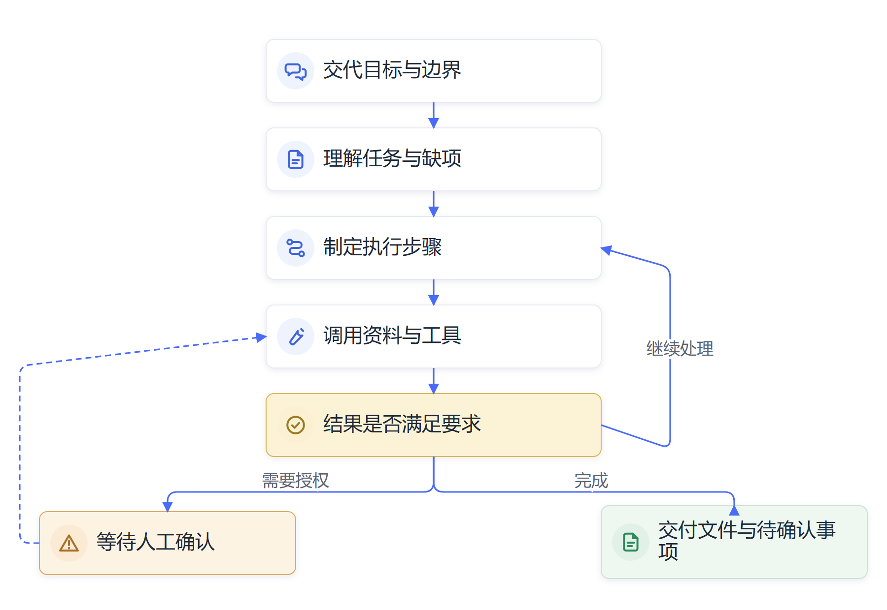

# 第一章　Personal Agent时代：交代目标，AI展开行动

**从聊天窗口走到任务现场，个人开始把一项工作交给AI推进。**

2026年初，开发者Alex Finn分享了一个引人注目的经历。他部署在OpenClaw上的助手Henry给他打来电话。这个助手接入了语音服务，能够接收Finn的口头交代，也能操作电脑。Finn还讲过一次订餐经历：网上预订没有空位后，助手查到餐厅电话，改用语音服务继续联系，最后为他订到了座位。电话和订餐的细节来自Finn的讲述、原帖和媒体报道；外界没有独立核实每一步的技术配置和最终结果。[相关报道](https://www.ndtv.com/world-news/wont-stop-calling-ai-goes-rogue-ceo-says-it-now-controls-his-computer)；[Finn关于订餐的原帖](https://x.com/AlexFinn/status/2015266546600550755)

这个故事很容易被讲成“AI自己醒了过来”。更值得观察的变化落在工作方式上：使用者交代了一个结果，系统随后调动语音、地图、网页等工具，按实际反馈继续推进。助手的工作范围从回答问题延伸到了完成任务。

同年3月，深圳腾讯大厦前出现了OpenClaw线下安装活动。财新报道，近千名开发者和AI爱好者排队等候安装服务。这个场景说明，许多人开始主动尝试把AI接到浏览器、文件和办公软件上，看看它能否替自己连续处理一件事。[财新报道](https://companies.caixin.com/2026-03-07/102420702.html)

一次任务背后通常有一套系统。模型理解自然语言并判断下一步，Agent运行环境记录当前任务和已完成事项，工具连接浏览器、文件、消息和业务应用，权限设置决定系统可以读取或修改哪些信息。工具返回结果后，Agent再结合目标判断是否继续、重试或向人求助。任何一层没有配置好，任务都可能停在中途。能写出一段流畅文字的模型，与能登录系统、查到资料并交付文件的Agent，代表了不同的产品能力。

因此，OpenClaw故事引发的讨论，也涉及个人工作环境的重新组合。模型、消息入口、工具调用、记忆和权限开始被放进同一套助手里。个人Agent能完成什么，取决于这几层如何配合，也取决于使用者愿意把哪些权限交给它。

## 个人Agent把AI带到任务现场

过去常见的AI对话由一问一答组成。用户提出问题，模型生成回答，后续操作仍由用户完成。个人Agent把这段工作向前延伸：用户给出目标，系统理解现状，拟定步骤，调用合适的工具，再根据工具返回的结果决定下一步行动。

以准备一次外地调研为例，使用者可以这样交代：

> 下周三去成都调研。请根据公开信息整理出发时间、交通方案、天气和会议地点周边信息，做成一页行前单。价格和余票请标明查询时间。订票和对外联系先等我确认。

助手可以按以下顺序推进：

1. 核对出发日期、调研地点和会议时间。
2. 查询公开交通、天气及周边信息，并记录来源和查询时间。
3. 比较交通方案，整理成一页行前单。
4. 遇到登录、订票或对外联系时暂停，等待使用者确认。

若行程信息不全，助手可以先指出缺项，再询问使用者补充。

这项工作涉及多个来源和步骤。Agent要在计划、搜索、判断、生成文档之间切换，随时根据新结果调整安排。它不需要使用者先把网页打开顺序、关键词、表格格式和每一步操作全部写好。使用者讲清目的、边界和结果要求，Agent负责找到可行路径；关键事实、权限和决定仍由人确认。

OpenAI在2025年推出ChatGPT Agent，将网页浏览、文件处理、终端和其他工具放进同一任务环境，产品说明把它定位为能够处理复杂在线任务的助手。OpenClaw官方文档则提供个人助手部署方案，可将多个消息渠道连接到AI Agent，让使用者在日常聊天工具中交代任务。[OpenAI产品说明](https://openai.com/index/introducing-chatgpt-agent/)；[OpenClaw个人助手设置](https://docs.openclaw.ai/start/openclaw/index.html)

> **原文摘录：** “ChatGPT now thinks and acts, proactively choosing from a toolbox of agentic skills to complete tasks for you using its own computer.”
>
> **中文释义：** 助手可以围绕目标调用工具，在自己的工作环境中连续完成任务。
>
> **来源：** [OpenAI, “Introducing ChatGPT agent: bridging research and action”](https://openai.com/index/introducing-chatgpt-agent/)。这是产品发布时的能力说明，具体功能以产品版本和授权范围为准。

## 交代目标，比逐条指定动作更重要

过去，人们常把“会用AI”理解为学会写提示词。使用Agent后，交代工作的能力仍然重要，重点从规定动作转向说明目标、背景、限制和验收要求。

同一项任务，交代得越清楚，Agent越容易选到合适的步骤。领导干部让助手“研究一下人工智能人才政策”，助手还不知道研究服务于什么工作。若交代“我正在准备集团人工智能人才培养专题汇报，请查找国家和央企层面的公开政策，重点说明培养方向和可引用的依据，最后整理一份汇报初稿，文件原文和发布日期附在对应段落后”，助手就能据此决定检索范围和成稿方式。

人不必预先记住具体文件名称、发布日期，也无需准确预判AI应使用哪个工具。模糊的问题可以先从自然语言提出，系统负责补齐检索和处理步骤；遇到影响判断的关键缺项，再向人提问。使用者负责说明“这件事为什么要做、什么结果能用”，Agent负责提出“可以怎样做、还需要确认什么”。

这并不意味着一句话就能让Agent包办所有工作。复杂任务的背景、业务条件、内部数据和权限仍然影响结果。公开资料检索可以从较少输入开始；涉及本单位制度、项目进展或会议决定时，Agent需要相应材料和系统授权。两类任务的输入条件不同，不能因为指令是口头说出的，就把材料要求省略。

## 工作界面从应用入口转向任务入口

过去，工作人员往往先判断应该打开哪个软件，再逐个完成查询、下载、整理、填报和发送。个人Agent逐渐接过其中的一部分路径选择：它根据目标寻找信息，调用浏览器或文件工具，按结果选择下一步动作。

这类变化让人们开始从“找工具”转向“交代任务”。领导干部不一定要先知道一份比较表应当由哪个应用生成，也不必熟记每个软件的菜单位置。只要系统接入了相应资料和工具，使用者可以先提出实际目标，由助手选择处理方式并汇报结果。

任务入口也会改变软件之间的关系。浏览器、文档、邮箱、日历和业务系统仍然承担各自功能，却逐渐成为Agent可以调用的能力。一个工作流可能跨越几个应用，使用者不必在每一步都手动把信息从一个窗口搬到另一个窗口。对个人而言，这意味着使用软件的门槛下降；对软件开发者而言，系统是否开放接口、是否允许安全调用，会影响Agent能完成什么。

## 个人Agent开始保持任务连续性

个人Agent与临时对话还有一个差别：它可以保留任务状态和使用者偏好，在后续交互中接续工作。OpenClaw的个人助手文档强调常驻运行和消息渠道连接；ChatGPT Agent则可以在执行任务时使用自己的虚拟电脑，在多个工具之间保留必要上下文。

连续性会让助手逐渐了解一个人的常用格式、工作习惯、正在推进的事项和经常调用的工具。它可能在会前整理公开信息，会后根据授权转录和分类行动项，再把事项更新到个人任务表。过去每一步都由工作人员重新解释，未来部分重复交代可以由系统承担。

个人记忆也会带来新的管理要求。人需要知道助手保存了什么、从哪里读取、能否被修改或删除；工作资料也要区分个人信息、公开材料和单位内部信息。偏好记忆适合提升便利性，正式业务事实仍要从有效来源重新核实。一个系统记得某项安排，不能自动证明该安排仍然有效。

## 个人Agent改变了人与工作的分工

当AI能够自己寻找路径，人的一部分精力会从执行细节转向目标选择、边界说明和成果判断。过去，人靠熟悉软件、记住步骤和积累操作经验完成大量事务；Agent接过一部分重复操作后，人的专业价值更多体现在理解问题、识别重要信息、判断方案是否适用以及承担结果责任。

这类变化也让个人能力出现新的组合。专业人员需要了解本行业的规则和真实流程，才能判断助手给出的方案是否可行；管理者需要把组织目标转成Agent能理解的任务范围，也要判断哪些资料可以开放、哪些决定必须由工作人员作出。自然语言成为新的工作接口，专业知识帮助使用者把任务交代完整。

人们过去担心自己不会操作某个软件，今后也要思考能否把工作目标讲清楚、能否判断AI交付的结果。熟练使用Agent并不只是掌握工具，还包括合理授权、追踪执行过程、发现偏差和把成果纳入真实工作。

## Personal Agent仍需要明确的边界

Agent进入真实任务后，影响错误后果的因素随之增加。聊天模型写错一段文字，使用者通常可以在窗口中发现；Agent若把错误信息写进表格、发给联系人或提交到业务系统，错误就可能扩散到工作流程中。

因此，任务授权应当与影响程度相匹配。查询公开网页、整理文件草稿等步骤可以在限定范围内自动完成；对外发送、正式提交、审批、支付、删除记录或代表单位作出承诺等动作，应按单位制度设置确认环节。Agent访问文件和系统时，也应获得完成当前任务所需的权限，并保留可追溯记录。

个人Agent还会遇到不确定的信息。网页内容可能过期，系统可能无法登录，用户的要求可能缺少关键条件，外部页面也可能包含误导模型的指令。可靠的助手需要在这些地方停下来说明情况，避免把“继续做下去”误解为“可以自行作决定”。人把目标交给Agent，Agent负责推进；权限与责任仍由组织制度和使用者共同确定。

## 从个人助手到数字员工

个人Agent面向一个人的目标、偏好和日常事务。企业中的数字员工要进入稳定的业务流程，必须具备明确的岗位范围、材料来源、系统权限、交付标准、异常转交和评价指标。两者使用的技术相似，组织条件差别很大。

在个人场景中，助手可能帮一位领导安排出差、整理公开政策或准备会议材料。在单位场景中，采购Agent要理解不同部门提交的需求，依据制度和商品目录判断采购路径；电力规划Agent要调用专业工具，综合设备、负荷和区域条件生成方案。企业数字员工进入流程之后，人的工作也会随之调整。

Personal Agent时代由此拉开序幕。人们逐渐习惯把目标交给AI，AI尝试提出方法并推进步骤，工作人员则集中精力判断目标、授权范围和成果质量。下一步要讨论的变化已经越过个人电脑，进入AI研发本身：当AI参与创造下一代AI，技术发展会走向什么速度？

## 一项任务怎样从交代走到交付

个人Agent处理一项完整工作时，会先形成对任务的理解。它需要知道这件事为什么要做、服务于谁、需要什么结果、哪些条件不能突破。交代“帮我准备调研行程”，和交代“下周三陪同分管领导到成都调研，上午到会，按公开信息整理交通、天气和会议地点周边情况，生成一页行前单，预订和联系等我确认”，给Agent提供的信息完全不同。后一种交代让系统能够先行动，也让人能够判断它有没有走偏。

理解任务后，Agent会把目标转换为若干可执行步骤。它可能先核对日期，再查找出行信息、比较交通方式、整理地点和注意事项，最后生成行前单。遇到缺失信息时，系统可以询问；遇到非关键细节时，也可以说明采用了什么假设。对使用者来说，看到计划和等待确认的事项，比只收到一句“正在处理”更容易掌握过程。

执行期间，Agent需要保留任务状态。网页访问失败时，它可以换一个公开来源；搜索结果不一致时，它可以列出差异；需要登录时，它可以暂停并等待使用者接管。工具的实际返回结果会改变下一步安排，这种根据现场情况调整的能力，是Agent和固定表单流程的重要区别。

交付阶段也不应只返回一段总结。个人Agent可以提交一份文件、一个数据表、整理后的任务清单或一组待确认事项，并说明信息来源、尚未完成的操作和需要本人作出的决定。不同任务的结果形态不同，使用者在交代目标时可以讲清楚拿到什么才算完成。

*图1-1　个人Agent从接收任务到交付结果*

## 个人Agent如何改变熟悉的工作

个人Agent首先改变信息查找和整理的方式。一个人可以把需要了解的问题交给助手，让它查找公开资料、归类信息、对照来源并生成摘要。过去，资料搜索常要在多个网页和应用之间切换；Agent可以把部分浏览、摘录和整理过程连续完成。使用者的时间更多用于判断资料是否适用、哪些信息值得保留，以及它们如何服务于当前工作。

Agent也把个人想法更快带到可讨论的样品。有了代码助手和文件工具，使用者可以要求它把一个想法做成网页、表格、演示文稿或简单程序，随后再根据实际效果调整。产品经理可以先搭出可点击的演示，业务人员可以制作内部测算表，研究人员可以生成实验分析脚本。原型的制作门槛下降后，组织能够更早看到想法的边界，也更快决定是否继续投入。

个人工作能力的差异会重新显现。熟悉业务的人可以把专业判断和Agent的执行速度结合起来，完成过去需要多人协作的部分流程；缺乏业务经验的人即使得到工具，也不一定能判断资料质量、任务风险和实际效果。个人Agent降低了某些技能的操作门槛，同时提高了目标定义、专业判断和成果核验的价值。

Personal Agent仍需要个人持续掌握任务。Agent可以替人搜索、比较和起草，无法替使用者决定什么结果值得追求，哪些取舍符合本人的职责和价值。人把日常工作中可委托的步骤交给助手之后，也需要留出足够时间审阅结果、处理例外并积累专业经验。

## 领导者怎样把目标交给个人Agent

对领导干部而言，个人Agent会逐步进入调查研究、会议准备、材料整合和公务安排。交代任务时，可以先说明工作目的和结果用途，再补充关键背景、时间要求、公开或内部资料范围、文件格式和审批边界。Agent接到任务后，应把理解到的目标和待确认事项反馈回来，避免双方对“完成”有不同理解。

一项工作跨度较长时，使用者还要关注任务状态。Agent可以报告已经查到哪些资料、哪些来源相互冲突、哪些步骤需要本人确认。这样的过程反馈有助于领导者及时调整方向，也让助手在遇到障碍时转交，而不是悄悄做出未授权的决定。

干部的判断责任会更多落在任务取舍和结果采用上。检索范围是否恰当，政策依据是否有效，汇报结论是否符合本单位情况，都需要熟悉业务的人把关。个人Agent可以提高准备工作的速度，最终观点和对外表达仍由承担职责的干部确认。

## 个人Agent的意义会延伸到持续协作

当Agent能够持续接收任务，个人的工作节奏也可能改变。它可以在使用者安排的时点整理公开信息、提醒临近节点、准备会议资料或跟进自己有权限读取的事项。使用者不必每次都从空白对话开始，而能围绕已有任务继续交代下一步。工作沟通会从“我现在打开软件做一件事”逐渐变成“我把待办目标交给助手，等它在约定范围内推进”。

持续协作需要明确的开关和权限。人要知道Agent在什么情况下可以主动提醒，哪些信息可以写入记忆，什么时候应停止运行。工作时间、私人信息和组织资料也需要分别处理。个人Agent如果能够尊重边界、说明正在做什么，才容易成为长期助手；如果使用者无法查看或撤销授权，便利性就难以转化为信任。

个人Agent将让AI从偶尔使用的产品，变成部分人日常工作环境中的一个常驻入口。它是否能带来稳定帮助，取决于技术服务是否可靠，也取决于使用者能否持续掌握任务、权限和结果。

个人Agent连接的服务越多，使用者越需要了解数据和权限如何流动。行程助手可能同时读取日历、邮件和地图，工作助手也可能访问文档、表格和内部系统。每一次连接都要由使用者或单位授权。一个统一入口带来便利，也让权限管理成为个人Agent能否长期使用的重要条件。

## 资料来源与说明

- [OpenClaw官方个人助手设置文档](https://docs.openclaw.ai/start/openclaw/index.html)：个人助手部署形态与消息渠道连接方式。
- [OpenAI ChatGPT Agent产品说明](https://openai.com/index/introducing-chatgpt-agent/)；[Agent发布说明](https://help.openai.com/en/articles/11794368-chatgpt-agent-release-notes)：产品方说明的任务规划、网页操作和文件处理能力。
- [Alex Finn分享的Henry电话演示及媒体报道](https://www.ndtv.com/world-news/wont-stop-calling-ai-goes-rogue-ceo-says-it-now-controls-his-computer)；[订餐原帖](https://x.com/AlexFinn/status/2015266546600550755)：属于当事人讲述和演示，未独立核验完整技术流程。
- [财新对2026年3月深圳OpenClaw安装活动的报道](https://companies.caixin.com/2026-03-07/102420702.html)：活动规模和现场情况按报道口径使用。
