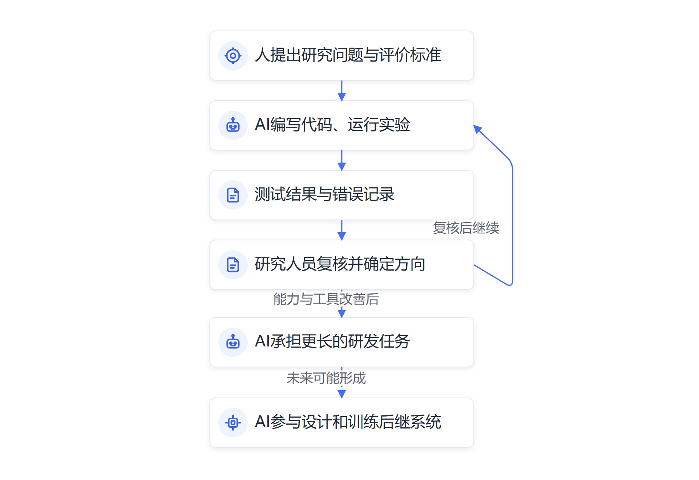
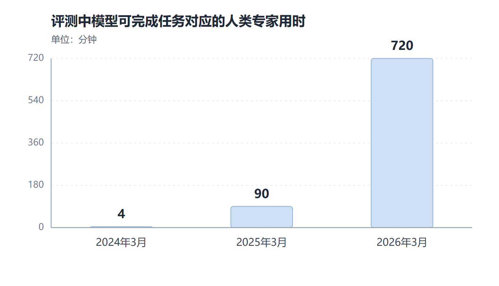

# 第二章　技术奇点已经到来：AI开始参与自我迭代

**当AI参与构建下一代AI，技术发展的速度开始受到反馈回路影响。**

2021年前后，Anthropic的工程师主要靠自己编写代码、搭建训练环境和记录实验。2023年以后，聊天模型开始生成代码片段，工程师把代码复制到编辑器里再继续工作。到了2025至2026年，编程Agent能够直接修改代码文件、运行程序、检查结果，甚至把数小时的工作交给多个Agent并行处理。Anthropic研究院把下一阶段称作“闭环”：AI系统自己设计和训练后续模型，再由后续模型继续改进系统。[Anthropic《When AI builds itself》](https://www.anthropic.com/institute/recursive-self-improvement)

> **原文摘录：** “we are delegating a growing share of AI development to AI systems themselves”
>
> **中文释义：** Anthropic正在把越来越多的AI研发工作交给AI系统承担。
>
> **来源：** [Anthropic, “When AI builds itself”](https://www.anthropic.com/institute/recursive-self-improvement)。这段话描述该公司的研发实践。

这条时间线改变了一个重要前提。长期以来，人类创造人工智能，下一代模型的设计、训练和评估都由人主导。现在，AI开始进入这项工作本身：它可以写开发代码、运行实验、分析结果、查找错误，再把更快的工具交给研究人员。技术进步开始反过来影响技术研发的速度。

## 从“AI帮人做AI”到“AI参与改进AI”

人工智能研发包含许多具体工作。工程师需要维护训练代码和数据管道，研究人员要提出实验、运行模型、分析表现，团队还要比较方案、排查故障并决定下一步投入。过去，这些步骤主要由专业人员手工推进。现在，Agent可以承担其中越来越多的实施工作。

Anthropic公开过一个代码优化测试：研究人员给Claude一份训练小模型的代码和明确的正确性标准，要求它在不改变结果的前提下提高运行速度。模型会修改代码、运行测试、记录用时，再根据结果重复尝试。Anthropic称，Claude Opus 4在2025年5月平均实现约3倍加速；到2026年4月，内部预览模型在同类测试中达到约52倍。这个数字只适用于特定的优化任务，起始代码越容易改进，倍数就越大，不能换算成真实模型训练快了52倍。它说明AI已能在目标和评分标准由人确定时，独立执行多轮实验。[Anthropic研究说明](https://www.anthropic.com/institute/recursive-self-improvement)

AI开始触及更开放的研究任务。Anthropic称，2026年4月，研究人员把一个人工智能安全问题交给Claude驱动的Agent团队，让它们提出假设、并行开展测试、交流发现并继续迭代。团队报告称，Agent累计运行约800小时，缩小了参考上限与基线表现之间约97%的差距；两名人类研究人员一周左右缩小了约23%。研究人员选择了题目并制定评分标准，模型的结果也没有直接迁移到生产规模的系统。这个案例展示了AI参与研究循环的早期能力，问题选择和结果解释仍由人把关。

## 研发开始出现自我加速的反馈回路

当AI能处理研发中的更多步骤，可能出现一条连续的反馈路径：

**AI协助改进代码和实验工具 → 人类团队用更短时间完成更多研发 → 新模型获得更强的编码、实验和分析能力 → AI继续接手更多研发工作。**

这条路径让“AI帮助改进AI”具有了积累效应。第一轮加速来自代码生成和错误排查；第二轮加速来自运行更多实验、比较更多方案；下一轮模型又可能提高实验效率，让同一支研究团队在相同时间里覆盖更大的问题范围。只要反馈收益高于数据、算力、能源、评估和组织协调等方面的限制，技术研发就可能显著提速。

2026年11月，独立评估机构METR发布了对Anthropic内部研发加速的评估。METR估计，截至2026年10月，Anthropic在定义清楚的任务上的模型能力提升速度，可能约为2024年3月至2025年10月期间的两倍；模型基准表现的增长速率估算为1.9倍，95%置信区间为1.5至2.8倍。评估团队认为，AI的广泛使用很可能是加速因素之一，同时明确指出估算存在很大不确定性，且部分内部数据经公司删节后公开。[METR独立评估](https://metr.org/blog/2026-11-05-anthropic-ai-rd-acceleration-assessment/)

Anthropic也披露，截至2026年5月，超过80%合入其代码库的代码由Claude编写；2026年第二季度，典型工程师每天合入的代码量约为2024年的8倍。这个统计来自公司内部，衡量的是合入代码数量。代码越多，并不自动代表系统质量、用户价值和整体研发效率同比例增加。METR与Anthropic从不同角度提供的证据都指向一个事实：AI已经成为AI研发流程中的重要参与者，技术团队正在尝试把更多工作交给AI处理。

*图2-1　AI参与研发后形成的反馈回路；闭环自我改进仍是需要逐步验证的阶段*

## 本书把这一阶段称为“技术奇点已经到来”

“技术奇点”常用于描述一种技术变化进入自我加速阶段后，社会很难沿用过去的速度直觉预测未来。在本书中，我把2026年视为技术奇点已经到来的起点：AI进入人工智能研发过程，开始影响下一代AI系统的开发速度；技术发展因此具备了自我加速的机制。

这个判断建立在一个可观察的变化上。过去，AI主要帮助人类操作已有工具；现在，AI能修改AI研发所用的代码、优化实验、协助运行研究任务。系统能力的提升，会提高它下一轮参与研发的能力。我们已经走进反馈回路的入口，后续进展会越来越受到“AI能帮研发人员做多少研发工作”的影响。

完整的自我改进闭环还在前方。Anthropic明确表示，AI完全自主地设计并开发自己的后继模型尚未实现。METR的评估也认为，AI尚未在模型训练中最重要的环节作出高度自主、完全独立的贡献。研究人员仍然设定关键目标、选择有价值的问题、判断结果是否可靠，并决定何时训练、发布或停止。技术奇点的“到来”在这里指自我加速机制已经启动，社会需要据此更新对技术速度的估计。

## 为什么反馈回路可能带来指数级变化

指数增长描述的是同一指标按固定比例累积。假设一个任务完成能力每隔一段时间翻倍，起点是1，经过五轮就会变成32；经过十轮会变成1024。每一轮看起来只比上一轮增加相同倍数，长期累积后的差异却很大。人类容易按线性经验理解下一步，而反馈系统的变化会越来越快。

AI研发已经出现适合形成反馈的若干条件。代码生成降低了实验工具的编写成本，Agent可以并行测试多种方案，自动化评估帮助团队更快筛选结果。METR任务跨度研究显示，前沿模型在编码和机器学习等定义清楚的任务上的自主完成能力，近年增长很快；研究人员估计的任务跨度曾呈现数月级翻倍趋势。但这类评测集中在软件、机器学习和网络安全任务，长任务数据在当前测试集上也存在饱和问题，不能代表所有知识工作。[METR任务跨度研究](https://metr.org/time-horizons/)

指数增长的关键并非“模型每次都比上次聪明一倍”，而在于一轮改进能否创造更多改进机会。AI帮助人类更快试验，试验结果让人类更快确定方向；更强的AI再承担更多任务，下一轮实验由此提前开始。发展速度取决于每个环节是否顺利衔接，也取决于人类能否发现值得解决的问题、实验结果是否可信、芯片和能源供应能否跟上。

技术加速常先出现在某一类任务中。模型可能在编程、数学、资料检索或实验优化上迅速跨过能力门槛，随后才逐渐进入机构流程。社会感受到的变化还要经过软件采购、系统改造、人员培训和制度审查。某项研究能力翻倍，不等于所有行业的产出或经济总量同步翻倍；组织采用的节奏，常常比实验室里的能力进步更慢。

同时，研发也受多种实际条件影响。训练芯片需要建设和供电，实验要有可信的数据，结果需要独立验证，产品还要面对成本、可靠性和安全要求。模型参与研发后，研究资源调度可能加快，计算资源和工程基础设施仍然决定每轮试验能否真正完成。技术奇点带来的冲击会先改变研发速度和预期，再逐步传到组织运行和社会生活。

因此，指数曲线应当作为值得严肃对待的可能路径，而非对每个模型和每个产业都适用的定律。模型性能可能在某项任务上快速提升，也可能受数据、算力、系统架构和评价方法限制，逐渐转入增速下降的阶段。不同能力曲线的起点和斜率也并不相同。认清这些条件，才能既看见技术加速的力量，也看见它将在哪里受到限制。

## 人类在AI研发中的位置正在变化

AI接手执行步骤后，人类研究人员的工作重心会逐渐转向更高层次的问题：哪些研究方向值得投入，成功标准应当怎样定义，实验结果是否值得相信，模型带来的风险能否接受。AI写出更多代码后，团队需要足够的审核能力；Agent运行更多实验后，研究人员要从大量结果中找出真正重要的发现。

Anthropic研究院指出，当前AI在执行目标明确的工程任务和实验任务方面进步显著，在决定研发目标和判断哪些问题值得研究方面仍有明显差距。METR的独立评估同样认为，AI提升了研发效率，但完全自主贡献尚未成为主要研发模式。两项材料的观察口径不同，结论都提示人类的方向判断和组织管理仍发挥关键作用。

这个变化同时提出了新的风险问题。更快的研发速度可能加快药物发现、材料设计和科学研究，带来公共利益；同样的能力也会让系统开发和部署速度超过治理、验证和安全评估的准备速度。若AI参与构建后继系统，研究人员需要知道系统使用了哪些资料、执行了哪些代码、如何评价结果，以及何时触发了人工干预。

## 组织需要按加速后的节奏更新判断

过去，组织可以按年度制定技术规划，按阶段引进工具，再用数年评估一次生产流程。当前的模型能力和Agent产品变化很快，某项任务在半年后可能出现新的自动化路径。领导干部需要建立常态化的技术观察机制，关注任务能力、实际运行条件、数据安全和业务成效的变化，避免将一次产品演示当成长期判断，也避免因为旧经验而忽视新能力。

对党政机关和央国企而言，技术加速会影响多个层面。研究机构会用AI协助整理资料、编写程序和运行实验；产业单位需要重新设计设备维护、工艺优化和服务流程；治理部门要评估Agent进入公共服务和关键业务后产生的风险。制度、岗位、人才规划都需要随着技术变化更新。

当AI参与生产下一代AI的工作，技术进步便不再只是工程师的专业话题。它会影响组织制定计划的周期、岗位需要的能力和制度治理的速度。我们已经进入这一变化的起点，之后每一轮技术进步都可能扩大下一轮研发能力。理解反馈机制，是判断AI时代速度变化的第一步。

## AI参与研发，有不同的自主层次

判断AI是否开始改进自身，可以沿着研发工作中的自主程度来观察。最初的一层是AI帮助人类完成执行任务，例如写一段训练代码、修复软件错误、生成分析脚本。人提供目标，AI完成部分操作，研究人员检查结果。

下一层是AI按明确目标独立规划和重复实验。系统根据实验标准修改代码，运行测试，比较表现，再尝试另一种方法。人设定了问题、约束和成功指标，Agent决定具体的实现路径。Anthropic的代码优化测试和安全研究演示都进入了这一层。

更深的一层是AI主动选择值得研究的问题，设计合适的实验，训练新的模型，评价结果并把下一代系统部署到研发过程中。这个循环完整后，AI的研发成果会直接提升下一轮AI研发能力，模型因此开始持续设计自己的后继者。当前公开证据说明AI已经参与研发并加速部分流程，完整的自主闭环仍需逐项验证。把不同层次分开，能避免把“AI写了很多代码”直接解释成“AI已能独立创造自己”。

## 指数曲线对人的直觉提出挑战

Anthropic援引METR任务跨度评测展示过软件任务能力的快速变化：2024年3月，Claude Opus 3能够完成的人类软件任务约需4分钟；一年后，Claude Sonnet 3.7所处理的任务约需一个半小时；再过一年，Claude Opus 4.6被评为能完成约12小时的任务。这里的时长指专家完成任务所需时间，不是AI连续工作了这么久；测量对象也集中在软件工程、机器学习和网络安全等任务。[Anthropic对任务跨度的整理](https://www.anthropic.com/institute/recursive-self-improvement)

当系统处理任务的能力跨过某个门槛，人类感受到的变化会突然放大。过去一项任务还需要专家手把手拆解，Agent如今可能自主运行代码、调用工具、检查错误。只要下一轮模型可以承担更多研发工作，研发团队就能把更多时间投向方案判断和重要决策。这种变化可能先发生在有限任务集，再扩展到更多领域，外部观察者却容易把能力跨越的速度低估为缓慢直线。

组织也不能只看单个模型的分数。模型表现提高后，产品是否接入了权限、系统和真实资料？员工是否知道如何使用？出了错误能否发现、暂停和恢复？这些条件决定了实验室能力需要多久才转化为业务变化。技术奇点给人的警示之一，是社会适应能力也要主动加速，不能等到所有影响都显现后才开始准备。

*图2-2　任务跨度变化。用时指人类专家完成相应任务所需时间，不代表模型连续运行时长；任务范围主要涉及软件工程、机器学习和网络安全。来源：[Anthropic对METR任务跨度评测的整理](https://www.anthropic.com/institute/recursive-self-improvement)。*

## 判断技术奇点，要观察反馈回路走到哪一步

观察AI自我改进，可以看几个相互关联的问题。AI写了多少研发代码，反映它承担的工程工作；AI能否自己运行和复现实验，反映它执行科研任务的能力；人类任务跨度测试，反映Agent能独立完成多长的工作；模型是否能选择研究方向和评价结果，则更接近研发决策能力。

现有证据在这些指标上并不同步。代码贡献和实验执行的进展较快，研究方向选择仍然需要人类更多参与。公开报告也来自不同来源：实验室披露内部工程统计，外部评估机构分析部分共享数据，任务跨度研究则使用公开模型和特定测试集。把这些证据放在一起看，可以判断加速反馈正在形成；单一百分比还不足以说明所有环节都已经自主化。

本书使用“技术奇点已经到来”描述这一历史阶段，强调AI已经进入人工智能研发，研发速度开始受AI参与程度影响。这个定义便于领导干部理解变化的性质，也提醒组织开始准备。未来要判断反馈回路是否进一步增强，需要继续观察AI的研究自主性、人工监督比例、评估方法和研发效率，而不能只追踪模型排行榜。

## 技术进步与社会变化之间存在时间差

实验室的能力曲线提高后，组织要部署技术还需经过产品化、成本测算、数据治理、系统集成和人员培训。城市道路、能源管网、政务流程和产业设备都有各自的建设周期，AI增加认知和计算能力后，也不能让这些实体条件瞬间改变。社会会同时经历上游研发提速和下游组织适应缓慢的阶段。

这段时间差既带来机会，也带来压力。组织有机会先改造流程、培养人才、完善制度；若技术进步速度持续超过制度和治理准备，风险也会累积。领导干部应把两种速度都纳入判断，既关注下一代模型能力，也关注本单位有哪些流程、数据和责任机制需要提前调整。

## 研发数据需要按指标含义解释

代码占比、合入代码量、实验加速倍数和任务成功率分别衡量不同事情。AI写了多少代码，说明它承担了多少工程实施；代码能否长期维护，要看缺陷率、可读性和后续修改成本；实验优化倍数反映某个具体目标下的方案改进空间；任务跨度则估计模型能完成何种时长的定义清楚的任务。把这些数据混为一个“AI研发效率”，容易夸大进展。

METR的最新评估提供了外部分析，也说明评估本身仍然有不确定性。机构得到的部分数据来自Anthropic共享，若干敏感细节经过删节，模型基准分数还可能受到题目分布和评测方法影响。谨慎阅读这些材料，不会削弱趋势本身；反而能让组织清楚地区分已经观察到的加速、合理推断的反馈机制和仍需验证的完整闭环。

## 资料来源与说明

- [Anthropic研究院《When AI builds itself》](https://www.anthropic.com/institute/recursive-self-improvement)：公司披露的AI研发流程、内部代码数据、自主研究实验及完整自我改进的现状。
- [METR《Independent Assessment of AI R&D Acceleration at Anthropic in October 2026》](https://metr.org/blog/2026-11-05-anthropic-ai-rd-acceleration-assessment/)：独立评估机构对研发加速的估算、置信范围和数据访问限制。
- [METR前沿模型任务跨度数据](https://metr.org/time-horizons/)：任务跨度指标的定义、评测领域和方法限制。
- 本章所称“技术奇点已经到来”，是依据“AI开始参与研发下一代AI并可能形成加速反馈回路”所作的阶段判断。严格意义上的全自主递归自我改进尚未实现；速度外推仍受评测范围、研究者判断、算力、数据和安全验证能力影响。
