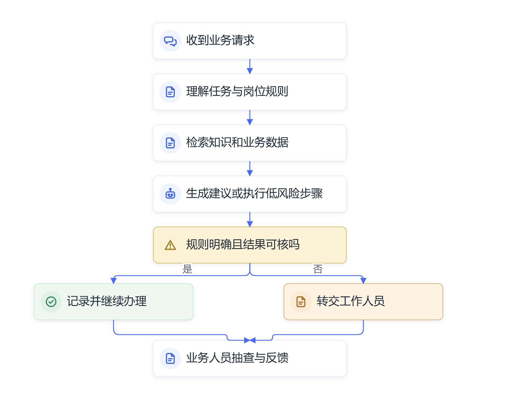
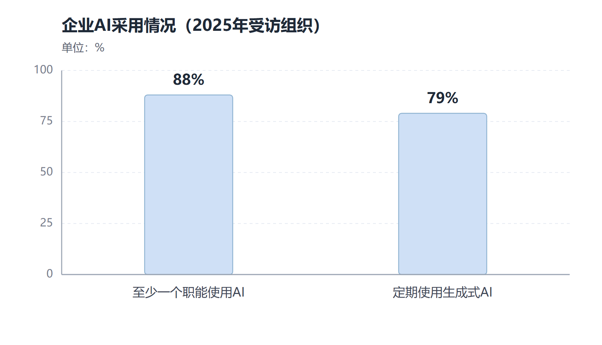

# 第三章　数字员工进入组织：Agent接手重复性工作

**从整理资料、填写表单到协助现场规划，Agent开始进入真实业务流程。**

2026年世界人工智能大会期间，南方电网展示了一款配电网规划智能体。根据新华社刊载的公开报道，这个Agent可以理解规划任务，调用电力专业工具，协助完成问题诊断、方案生成、仿真校核和投资评估。中远海运展示的智能供应链管家则把订舱处理时间缩短到5秒。这些案例分别来自项目方介绍和大会现场展示，公开材料没有提供完整的评估方法，具体效果应按项目披露口径理解。[国务院国资委转载新华社报道](https://wap.sasac.gov.cn/n2588025/n2588139/c35659709/content.html)

从电网规划到船舶订舱，AI开始进入过去由专业岗位反复完成的工作。Agent读取任务和业务条件，选择工具，调用系统，处理返回的信息，再把下一步结果交给工作人员。它逐渐从“能回答业务问题”走向“能承担流程中的一部分任务”。

## 组织里的数字员工正在从回答转向办理

很多单位已经用AI整理会议记录、搜索制度、生成文稿或回答员工问题。这些助手减轻了信息处理负担，业务人员仍需亲自进入系统完成后续步骤。Agent进一步接入业务工具后，能够把判断与操作连起来。

以采购为例，员工提出“我要采购一批定制礼品”，采购人员还要了解数量、用途、预算和到货时间，确认商品是否在商城目录内，判断应走标准采购还是个性化采购，必要时补全申请单。接入采购系统的Agent可以先理解自然语言需求，找出缺少的条件，查询制度和商品目录，再按规则引导员工补充信息或形成申请草稿。人确认无误后，申请进入原有审批程序。

贝壳闹海PLUS采购专家智能体提供了一个企业应用案例。该系统可以识别员工采购需求、检索制度和商品信息、判断采购路径，并减少反复沟通和手工填单。项目介绍中的效率估算属于案例口径，不能直接当作所有单位都能达到的节省水平。这个案例把对话、制度查询、商品目录和采购流程连在一起，展示了AI进入真实工作任务的一种方式。

Agent可接手的流程通常包括几个连续动作：理解任务，查找所需信息，按规则选择下一步，填写或生成业务材料，检查结果是否满足要求，遇到缺项时向员工追问。系统需要接入组织知识、应用和身份权限，才能让这些步骤在实际业务中运行。

*图3-1　数字员工在组织流程中的基本工作链*

## 为什么重复性工作先出现数字员工

组织工作中有大量重复发生、规则相对稳定的任务。员工每周汇总报表、核对材料字段、跟进订单状态、整理客服工单、查询采购制度、录入设备检查结果，都需要反复经过相似步骤。每一次单独看都不复杂，累积起来却会占用大量时间，也容易在复制、转录和遗漏中出错。

Agent适合从这样的任务开始，通常因为工作目标较清楚，所需信息能够查到，流程存在稳定规则，结果也有检查办法。相较于开放式战略决策，检查表单是否缺项、汇总工单是否重复、提醒项目状态是否逾期，更容易设置系统验收标准。Agent先处理相对稳定的部分，遇到规则冲突、资料缺失或后果较大的事项，再转交给工作人员。

“重复”也不等于“简单”。电网规划、设备维护、供应链调度和政策咨询都包含反复出现的任务，但背后需要专业知识、历史数据和具体环境判断。Agent可能快速整理信息、运行计算、生成候选方案；工程师、采购人员和业务负责人仍要判断方案是否符合现场条件、预算和安全要求。

## 数字员工要有岗位边界和工作条件

“数字员工”是便于理解的说法，指按照一定工作范围配置的AI系统。它需要模型、业务知识、可调用工具、任务规则、权限控制和异常处理机制共同支撑。单独接入一个大模型，通常还不具备稳定履行业务工作的条件。

数字员工进入岗位前，组织需要明确以下事项：

- **工作目标：**它负责完成什么任务，交付结果是什么。
- **资料与权限：**可以读取哪些资料、调用哪些系统，哪些操作需要批准。
- **交付标准：**结果应采用什么格式，怎样判断完成。
- **异常转交：**遇到缺项、冲突或高风险情况时转给谁。
- **运行记录：**系统和工作人员分别留下哪些操作、复核和修改记录。

目标越重要，权限与复核要求就越细。

例如，负责会议材料初审的Agent可以检查标题、日期、附件、数据表和流程字段，列出缺项并生成修改建议；工作人员再核对事实和政策要求。负责设备告警整理的Agent可以归并重复报警、查询检修记录、标出高优先级事项；现场负责人决定是否停机或派员检查。Agent承担资料处理和流程提示，专业人员保留对业务结果的判断。

经济体层面的调查也显示，AI在组织中的采用面正在扩大。Stanford HAI《2026 AI Index》引用McKinsey 2025年企业调查称，88%的受访组织在至少一个业务职能中使用AI，79%定期使用生成式AI；但智能体部署在几乎所有职能上仍处于个位数。这里的“组织采用”来自受访者自报，Agent部署数据也按调查口径理解。公众接触AI和组织开始使用AI的速度都很快，数字员工在组织中形成成熟规模还需要继续建设。[Stanford HAI《2026 AI Index》经济章节](https://hai.stanford.edu/ai-index/2026-ai-index-report/economy)

*图3-2　数据来自受访组织自报；Agent在几乎所有职能中的部署比例仍为个位数。来源：[Stanford HAI《2026 AI Index》经济章节](https://hai.stanford.edu/ai-index/2026-ai-index-report/economy)。*

OECD 2026年对多国组织的访谈发现，Agent已经进入会议摘要、项目建议书草拟、数据准备、客户服务、供应链和现场调度等工作。一些案例处在试点阶段，一些已经嵌入日常流程。研究同时记录了Agent误调用工具、错误写入数据、权限过宽和人工监督不足等问题。访谈展示的是正在形成的实践图景，不能替代各行业的规模化采用统计。[OECD《Agentic AI in organisations》](https://www.oecd.org/en/publications/agentic-ai-in-organisations_1257a26f-en.html)

## 数字员工正进入组织中的不同工作任务

在党政机关，Agent可以辅助政策信息检索、事项材料完整性检查、热线工单分类、办事进度整理和会议任务跟踪。具体业务涉及法定职责、个人信息或内部材料时，系统只能在经批准的数据范围和工作流程中运行，工作人员仍需核对原文、状态与依据。

在中央企业和国有企业，AI助手与数字员工开始进入电力规划、生产运维、供应链、研发、采购和行政管理等环节。南方电网规划智能体提供了一个由数据、专业工具和流程规则共同支撑的例子；中远海运的订舱案例则显示，Agent可以处理物流服务中的信息交互与业务操作。国资委在2026年发布第二批央企人工智能战略性高价值场景，并推进高质量数据集和智能软件工厂等工作，反映出AI应用正在由单点试验走向体系化建设。[国务院国资委2026年系列成果](https://wap.sasac.gov.cn/n2588020/n2588072/n2590902/n2590904/c35690985/content.html)

数字员工承担的工作也不只出现在办公室。生产设备接入传感数据后，AI可以协助分析异常趋势；质检系统可以比对图像和技术标准；供应链Agent可以更新运单状态、整理异常订单并向调度人员提示冲突。AI从屏幕里的文稿扩展到设备、现场和业务网络，组织需要同时考虑模型能力、设备安全和人的现场经验。

国务院国资委2025年介绍中央企业“AI+”专项行动进展时披露，央企已在能源、制造、通信等16个重点行业打造800多个应用场景，并建设行业数据集和自主可控的行业模型。这些数据反映央企应用布局的广度，不能直接说明所有场景都已经进入常态运行，也不能由场景数量推算业务收益。[国务院国资委相关发布](https://app.www.gov.cn/govdata/gov/202509/17/536855/article.html)

专业场景里的数字员工通常要同时使用业务规则、设备状态、历史记录和专业计算工具。以配电网规划为例，工作人员需要查看区域负荷、设备容量和建设约束，再比较多个规划方案。Agent能够帮助整理信息、调用计算工具、生成候选方案，工程师仍要核查数据、解释方案取舍并确认投资安排。由此可见，AI进入组织流程之后，会把规则执行和信息加工速度推高，也会提高组织对数据质量、专业复核和现场经验的要求。

## 多个数字员工可以接力完成一项工作

复杂任务可以拆成不同岗位职责，让多个Agent分别负责资料检索、数据汇总、方案撰写和质量检查。软件研发就是常见例子：需求Agent梳理功能，设计Agent生成原型，编码Agent编写程序，测试Agent运行用例，再由工程师审阅并决定是否发布。

一个多Agent软件开发案例以“为北大研一新生做一个微信查课表小程序”为目标，设置产品、设计、开发、测试和运维等智能体分工接力。案例呈现了多Agent的协作方式，适合用来观察任务怎样拆分、结果怎样交接。它属于示例情境，不能据此认定学校已经建成并运行软件工厂。真实项目还要确认程序可运行、数据合规、功能符合需求，并由有权限的人员决定是否上线。

分工增加后，系统之间的交接也会增多。第一个Agent提取错了字段，后续系统可能沿用错误；两个Agent使用不同版本的制度，最后输出也可能冲突。因此，团队需要为每个环节设定输入、输出和交接条件，再对整体工作流程进行测试。Agent数量越多，并不自动意味着任务完成得越快。

## 人的岗位从重复操作转向过程管理

数字员工进入流程后，员工开始从重复操作中抽出一部分精力，转向处理例外、复核输出、解释规则、优化流程和服务对象。采购人员可能少花时间回答重复咨询，多花时间审查供应商、解决非标准需求和维护采购目录；客服人员减少复制粘贴，增加复杂投诉沟通；工程师从逐项整理告警转向分析设备状态和安排现场处置。

这种变化先发生在任务上，再逐渐影响岗位。岗位名称可能仍然保留，日常工作的比例和技能要求却会变化。新员工过去靠处理基础任务熟悉业务，如果这类任务逐渐由AI承担，组织就要重新安排新人怎样学习制度、理解流程和建立判断力。

数字员工因此既是技术部署，也是业务分工调整。组织要问清哪些工作交给AI后更快、更稳定，哪些工作仍需要现场经验、法律责任或人际沟通，哪些环节需要增加复核和异常管理。接下来，组织需要据此调整岗位说明、协作关系、数据权限和人才培养。

## Agent进入组织，依靠几项条件同时成熟

大模型能够理解自然语言，让员工可以用平常说话的方式交代任务；工具调用让模型可以查询目录、读取文件、操作浏览器和填写表单；Agent运行环境又使系统能够保留任务状态、处理多轮步骤并根据执行结果调整计划。组织知识库和业务系统把专业规则与运行条件提供给Agent，权限机制则限定它能做什么。

其中任何一项缺失，数字员工都可能只能提供局部帮助。模型不会自动知道组织内部的制度版本，系统没有接口时也难以稳定操作业务流程；任务规则不清楚时，模型就无法判断哪些结果可以交付。组织把Agent引入日常工作，需要同时整理数据、流程、工具、身份和责任。

## 从一项任务到一个流程

一个Agent完成单项重复任务，往往还不够。完整业务会涉及任务接收、信息补充、条件校验、负责人确认、系统操作和结果归档。数字员工要真正进入流程，需要与现有岗位和系统衔接。员工提交申请后，Agent可以检查字段、提示缺项、查询目录并生成草稿；审核人员确认后，原有系统继续完成审批和记录。这样，Agent参与流程的范围可以逐步扩大。

组织还要记录每一步的状态和异常类型。哪些任务由Agent独立完成，哪些需要补充资料，哪些转交人工，哪些操作因权限不足暂停，都应该能够查到。业务人员据此判断Agent是否减少了等待和重复录入，技术团队也能发现接口故障、规则过期和模型误判。没有这些记录，组织很难分辨使用量增加是否改善了业务结果。

数字员工的日常运营也需要维护人员。制度更新后，知识库要及时更新；系统字段调整后，Agent的工具调用需要重新测试；员工指出某类判断经常出错时，业务负责人要决定规则是否需要修订。数字员工进入组织之后，系统维护、业务运营和质量管理会形成持续工作。

## Agent与传统自动化各有适用条件

传统自动化适合规则固定、字段统一、步骤稳定的任务。系统可以按预设流程读取表格、核对必填项、提醒期限或同步数据，运行结果容易预测。Agent面对的是更自然的输入和更复杂的情境，它能理解员工的口头描述、发现信息缺口、结合规则选择下一步，再根据工具返回的结果调整计划。

组织中的许多任务会把两种技术结合起来。员工用自然语言提出采购需求，Agent识别商品种类、数量和用途；审批金额、采购目录和财务规则由业务系统进行确定性校验；Agent根据校验结果补全表单并提示员工确认。模型负责处理表达差异和任务计划，系统规则负责控制明确的业务条件。这样的组合更适合复杂流程，也便于组织定位错误来源。

组织还可以按任务复杂度安排自动化程度。固定格式的信息归档可以由流程自动完成；带有少量缺项的申请由Agent追问补充；规则冲突或可能产生较大后果的事项转给业务人员。权限、人工接管和系统校验共同决定Agent可以走多远。组织需要在运行中记录这些转交情况，找出规则漏洞、资料缺口和员工遇到的真实问题。

Agent进入组织之后，衡量重点也会从“模型能回答多少问题”转向“工作是否顺畅地从请求走到可用结果”。业务人员通常关心等待时间、返工、客户体验和风险；技术团队还要了解系统调用失败、算力成本和版本变化。围绕同一个任务建立共同的评价口径，业务和技术团队才有依据讨论下一步是否扩大应用。

## 组织应区分演示、试点和日常运行

一段Agent演示能够说明某个任务路径可行，不能单独证明系统适合大规模工作。试点项目会在有限部门、数据范围和权限下反复测试；进入日常运行后，组织还要看系统是否稳定，员工遇到例外时能否顺利接管，技术团队是否可以及时处理故障。运行成效还需要与原有流程的基线比较。

这些阶段应当用清楚的证据描述。项目发布的功能清单说明系统可以做什么，现场演示说明某次任务完成过，试点记录说明限定范围内运行情况，长期业务数据才能帮助组织理解质量、成本、风险和维护投入。即使项目方披露了很高的自动化比例，也要继续了解统计周期、任务定义、人工介入和异常范围。

党政机关和央国企在介绍案例时尤其需要保持这种区分。Agent已经开始在各类组织中承担重复信息处理和流程操作，成熟度因行业、数据、系统和风险要求而异。准确描述应用阶段，能让决策者既看到技术进展，也能据此判断本单位还需补足哪些条件。

办公室Agent的结果通常体现在信息整理、材料准备和流程周转上，生产现场Agent还要满足设备可靠性、工艺约束和安全条件。两类项目需要不同的测试环境和验收口径。评估数字员工时，单位应围绕实际业务建立指标，不能把文稿生成质量直接换算成生产安全或经营收益。

数字员工形成稳定贡献后，员工的注意力会更多落到异常判断和服务沟通上。组织要为这些任务安排合适的岗位能力，并把处理结果反馈给Agent维护团队。数字员工的持续改进来自业务人员发现问题、技术团队修正工具、管理者调整流程，三方面共同参与。

## 资料来源与说明

- [国务院国资委转载新华社《从实验室到生产线 央企AI应用新成果纷至沓来》](https://wap.sasac.gov.cn/n2588025/n2588139/c35659709/content.html)：南方电网和中远海运案例按公开报道口径使用，未将项目披露数据推广为行业普遍效果。
- [国务院国资委2026年央企人工智能系列成果](https://wap.sasac.gov.cn/n2588020/n2588072/n2590902/n2590904/c35690985/content.html)：高价值场景、数据集和智能软件工厂建设。
- [OECD《Agentic AI in organisations: Early insights from practitioner interviews》](https://www.oecd.org/en/publications/agentic-ai-in-organisations_1257a26f-en.html)：采用多国组织访谈，案例成熟度和部署范围各不相同。
- [Stanford HAI《2026 AI Index》经济章节](https://hai.stanford.edu/ai-index/2026-ai-index-report/economy)：AI和Agent在组织中的采用数据来自调查，按受访组织自报口径说明。
- 贝壳闹海PLUS采购专家智能体的流程与效率估算按项目案例材料口径呈现；查课表小程序为示例情境，用于说明多Agent分工，不能视为已经上线的真实系统。
