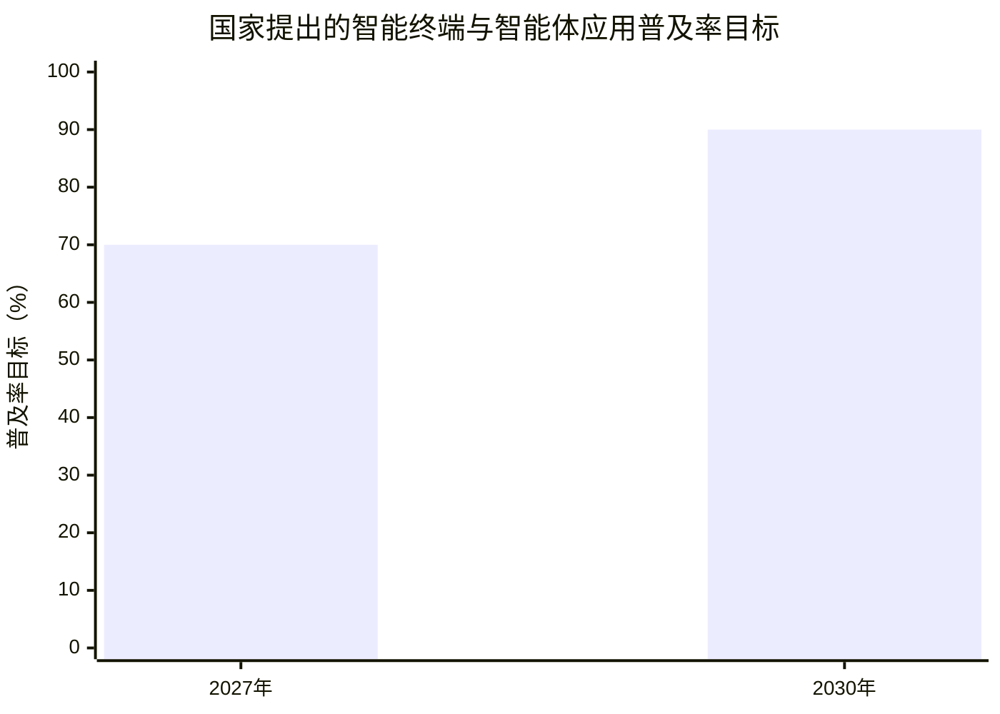
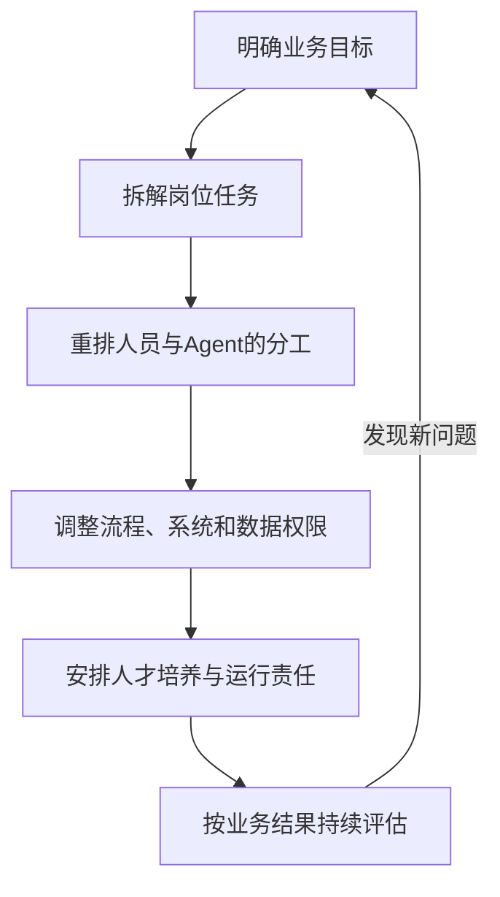

# 第四章　组织怎样迎接Agent时代：岗位、结构与治理

**岗位要重新设计，组织结构、数据治理和人才规划也要跟上。**

一项任务由多个Agent接力完成后，管理者会发现传统组织设计遇到了新问题：这项工作现在由谁负责？Agent能够读取哪些资料、调用哪些系统？哪个环节必须由人审批？出错后由谁解释、修正并承担责任？这些问题涉及岗位、流程、组织结构、数据权限和人才培养，购买一套新软件无法单独解决。

前几章呈现的案例说明，Agent正从个人电脑走进业务现场。南方电网的配电网规划智能体能够调用专业工具，中远海运的智能供应链管家处理订舱任务，企业办公Agent开始协助检索、汇总、填单和跟进工作。随着Agent可以持续运行并接入更多系统，组织需要把“人员和岗位”拓展为“人员、数字员工和数据系统”共同完成工作的整体安排。

国务院《关于深入实施“人工智能+”行动的意见》提出推动人工智能与经济社会各行业各领域广泛深度融合，并提出到2027年新一代智能终端、智能体等应用普及率超过70%的目标。这是国家发展的目标要求，反映了政策方向；各类组织的实际应用程度还要按行业、单位和业务流程分别观察。[国务院国发〔2025〕11号](https://www.cac.gov.cn/2025-08/27/c_1758018277755538.htm)

> **原文摘录：**“新一代智能终端、智能体等应用普及率超70%。”
>
> **来源：**[国务院《关于深入实施“人工智能+”行动的意见》](https://www.cac.gov.cn/2025-08/27/c_1758018277755538.htm)，政策提出的2027年目标。

*图4-1　政策目标值为“超过70%”和“超过90%”，图中以70、90标示下限；实际完成情况需以届时统计为准。*

## 岗位要从职位名称拆回具体任务

许多组织按照职位名称安排工作。岗位说明写着“负责采购管理”“负责政策研究”“负责设备运维”，实际工作却包含信息收集、数据整理、系统录入、沟通协调、风险判断和审批等不同任务。Agent的能力不会以同样速度覆盖整个岗位，它会先进入其中某些环节。

管理者需要把岗位工作拆开观察。哪些任务反复出现，输入和输出比较明确？哪些任务必须结合现场经验、法律职责或部门协商？哪些工作可以由AI先准备，哪些决定须由责任人员作出？拆分到任务层面之后，组织才能判断AI带来的变化。

例如，政策研究岗位可能包含公开资料检索、文件版本核对、条款摘录、跨文件比较、形成报告初稿和提出适用性判断。Agent可以协助搜索、标注原文、比较条款和整理成稿；研究人员仍需核实政策适用范围，联系实际情况，判断材料能否支撑结论，并对正式报告负责。采购岗位也可能把重复问答、目录查询和申请表初填交给Agent，把供应商审核、特殊采购判断和正式审批留在对应职责岗位。

岗位重构因此会从任务比例开始。工作人员可能减少机械录入和重复查询，增加流程设计、异常处理、质量控制和对外沟通。职位名称短期内可以保持不变，工作内容、绩效指标和必备能力需要逐步更新。组织要重新说明一个岗位对业务结果承担什么责任，不能只统计一个人管理了多少个Agent。

## 组织结构要围绕任务和流程调整

Agent可以跨越传统部门边界处理资料和状态信息。一次行政审批可能涉及前台受理、材料审核、内部会签、信息录入和结果告知。过去，各部门在自己的系统中处理其中一段；Agent接入多个环节后，工作可以围绕一项完整服务重新安排。

这种变化为组织形成更灵活的工作单元创造条件。一个业务负责人可以根据任务调度检索Agent、数据Agent和文稿Agent，组成短期项目小组；专业部门维护政策规则、数据口径和审查要求；技术团队提供模型、接口、日志和身份管理能力。任务结束后，人员和数字员工可以转向下一项工作。企业也可能形成“一个业务骨干统筹多个Agent”的工作形态。

这一形态不意味着所有组织都要压缩层级或撤并部门。党政机关和央国企有明确的职责体系、审批流程和安全要求，相关责任要继续落实到具体单位和岗位。组织结构调整的重点，是减少工作交接中的重复输入和等待，把跨部门事项按业务目标组织起来，同时保留清楚的决策、复核和问责关系。

较可行的组织安排可以同时保留统一治理与业务自主探索。组织层面确定数据分类、身份权限、采购标准、模型准入、监控和事故处置要求；业务部门围绕实际工作提出场景，定义交付标准，安排人员复核并跟踪结果。安全、数据、法务、人力资源和技术部门需要及时参与，避免业务团队在缺少专业支持时独自承担复杂治理工作。

## 数据和系统决定数字员工能走多远

Agent要接手一项工作，必须找到准确、及时、可用的数据。企业内部制度可能有多个版本，系统字段可能缺少统一口径，部门职责也可能没有写入流程说明。模型接入越多资料，越需要组织先确认哪些信息有效、由谁维护以及适用范围是什么。

数据治理要从现有资产做起。组织可以梳理政策文件、业务规则、设备记录、产品目录和历史表单，标明来源、版本、更新责任人和访问范围。系统还要提供可靠的接口或经过批准的操作路径，让Agent能读取业务状态、执行有限任务并留下操作记录。数据基础薄弱时，Agent会把错误信息组织得更流畅，系统连接不足时，Agent则只能生成建议，无法推进业务。

数据和权限治理也需要覆盖Agent本身。每个Agent要有可识别的身份，组织应明确它能读哪些目录、查询哪些数据库、修改哪些字段、在哪些时段运行、能否向外发送信息。权限按任务需要设置，任务结束后可以撤销；对资金、审批、公共服务结果、设备控制和数据删除等高影响操作，应设定人工审批和复核环节。系统还要记录模型、工具、数据来源、任务步骤、人工修改和异常处理，便于追溯。

技术风险会随着工具连接而变化。外部网页可能嵌入误导模型的指令，Agent也可能把不完整的信息写进系统，多个Agent交接时还可能传播错误。组织需要在上线前测试常见任务、异常输入和恶意指令，运行期间监测工具调用和输出质量，并准备暂停、回滚和人工接管办法。对关键业务，仅检查单个模型输出远远不够，还要检查从输入、权限、工具到最终操作的整个流程。

《网络数据安全管理条例》第十五条规定，国家机关委托他人建设、运行、维护电子政务系统或存储、加工政务数据，应履行批准程序，明确受托方的数据处理权限和保护责任，并监督其履责情况；第十六条对服务国家机关和关键信息基础设施运营者的网络数据处理者提出保护要求。党政机关和公共服务系统使用外部Agent或平台时，需结合适用法规、主管部门要求和本单位制度安排审批、权限及责任。[《网络数据安全管理条例》](https://app.www.gov.cn/govdata/gov/202409/30/520076/article.html)

## 人才规划要从“会不会用”延伸到“能不能管理人机协作”

Agent进入组织之后，人才规划需要同时考虑现有岗位怎么变、新能力从哪里来、年轻员工如何积累经验，以及谁能管理数字员工。培训一个通用工具可以帮助员工入门，持续应用还要求员工了解业务规则、理解数据条件、识别异常并判断结果质量。

未来组织会需要几类互相协作的人才。业务专家提供领域知识并确认规则；流程负责人把组织目标转成可检查的任务；数据和技术人员维护接口、知识库、模型和运行环境；安全与合规人员审查风险、权限和日志；管理人员组织人机协作并对业务结果负责。很多单位不会为每一类工作都另设新岗位，但必须在现有岗位职责中明确相应责任。

人才规划也要考虑职业成长。过去，新员工常从收集资料、整理数据、起草文稿和跟进流程开始熟悉业务。Agent接手部分基础任务后，组织要提供新的训练路径，让员工仍有机会接触真实业务、比较方案、处理例外和向有经验的人学习。OECD对组织的访谈指出，一些受访者担心过度依赖Agent会削弱批判性思考、降低经验积累机会；也有组织安排员工定期独立完成部分任务，以维持专业判断能力。[OECD《Agentic AI in organisations》](https://www.oecd.org/en/publications/agentic-ai-in-organisations_1257a26f-en.html)

绩效和人才评价也需要随工作方式变化。单看处理件数、生成内容数量或Agent部署数量，无法说明组织获得了真实价值。组织应综合看任务质量、服务时效、返工率、复核投入、系统运行成本、风险事件和员工能力变化。对承担关键判断的专业人员，还要考察其能否解释AI结果、发现错误、调整流程并对实际结果负责。

## 组织需要建立跨部门的Agent管理机制

Agent一旦连接多个系统，就同时涉及业务、技术和治理。业务部门需要定义岗位目标和验收规则；信息化团队要管理模型、工具接口、系统身份和运行日志；数据管理部门负责数据目录、质量和权限；人力资源部门需要更新岗位职责、人才标准和培训路径；保密、安全、法务和审计部门则根据任务风险参与审查。

领导层要明确人工智能发展方向和资源安排，决定哪些业务优先改造，哪些风险组织能够接受。业务部门不能把“用了AI”作为目标，应当说明流程结果希望如何改善。技术部门也需要理解业务后果，不能把Agent接入系统后就算完成项目。跨部门协作能让组织在一开始就把数据、权限、流程和责任纳入设计。

运行中的Agent需要有人持续维护。制度更新后，知识库和任务规则要同步调整；业务流程改变后，接口和提示规则要重新检查；模型升级后，系统还要评估输出变化。单位需要知道每个数字员工的负责人、版本、使用范围、暂停方式和退役条件，防止Agent成为无人维护的后台程序。

*图4-2　组织迎接Agent时代的调整关系*

## 从增配工具转向重新设计工作

组织迎接Agent时代，需要在业务流程中重新安排人、Agent和系统。先把工作任务、材料来源和岗位职责说明清楚，再选择适合AI参与的环节；随后调整权限、系统接口和复核规则，安排相应人员负责上线后的维护；运行一段时间后，组织还要根据质量、成本、风险和人员反馈决定是否扩大使用范围。

这一变化会逐步改变单位内部的管理对象。管理者过去主要安排岗位、人员和工作流程，今后还要统筹模型、Agent、数据权限和自动化任务。人力规划开始与算力、系统和数字员工配置发生联系，组织结构也会逐渐出现人类岗位与数字岗位共同参与流程的形态。

党政机关和央国企在这一变化中承担不同责任。机关要在提升治理能力和公共服务质量的同时，守住法定程序、保密要求和责任边界；国有企业要把AI应用与主责主业、安全生产、数据管理和产业协同结合起来。组织是否适合Agent，最终取决于业务价值、数据基础、技术条件和治理能力能否同时满足要求。

Agent时代不只改变员工怎样完成任务，也会改变组织怎样设计岗位、配置人才、连接系统和承担责任。完成这些调整之后，组织才能让数字员工稳定参与工作，让员工把专业能力投入到更需要判断、协调和创新的任务中。

## 不同组织的变革重点各有侧重

党政机关使用Agent时，首先要把公共职责、法定程序、群众权益和信息安全放进流程设计。政务服务助手可以帮助群众查找办事条件、检查材料完整性和了解办理状态，决定事项和正式答复仍须由承担职责的工作人员依规处理。系统接入政务数据时，需要明确委托关系、数据访问范围、审批程序和服务责任。

央国企要把Agent应用同主责主业、生产安全、经营质量和产业链协同结合起来。电网规划智能体需要工程师核验模型输入和方案约束，采购Agent要遵守采购制度，生产调度系统要考虑现场安全与设备运行条件。组织需要按照业务后果决定自动化程度，让高价值场景、专业判断和安全要求同时进入项目设计。

两类组织都要处理权限、审计、人员能力和结果责任。单位性质不同，适用规则和流程有所区别；管理原则相通：Agent执行的任务要有明确依据，能够追踪，发生异常后有人接手。

## 评价Agent要回到业务结果

组织有时容易用Agent数量、活跃人数、生成文稿数量或自动处理率来代表应用成效。这些数据可以观察推广覆盖面，无法独立说明服务质量是否提高、业务成本是否下降或风险是否可控。每个项目都需要在运行前记录原有流程，再用一致口径观察Agent接入后的变化。

例如，材料审查Agent可以关注漏项率、复核时间、退回率和办理周期；采购助手可以观察需求沟通时长、申请单退回次数、商品信息准确率和审批责任；生产运维Agent可以跟踪异常识别准确率、误报率、人工接管、设备安全和维护成本。组织还要把模型服务费、接口建设、数据治理、人员培训和持续维护纳入总投入，综合判断是否值得推广。

运行指标也要反馈到岗位和人才管理。若Agent处理了更多基础信息工作，专业人员是否因此更快完成判断？新员工是否仍然有渠道学习制度和形成经验？管理者是否掌握了Agent带来的质量变化？业务、技术和人力部门共同评估这些问题，才能让组织变化朝着长期能力建设推进。

## 每个数字员工都要有明确的组织负责人

Agent进入业务流程后，组织要为它安排清楚的责任关系。业务负责人说明岗位目标、工作规则和验收办法；数据负责人确认资料版本、分类和访问范围；技术团队维护模型、工具接口、运行环境和日志；安全、保密、法务或审计人员根据业务影响参与审查；流程审批人员确认哪些动作需要人工批准。

数字员工上线后，责任仍要持续落实。业务规则更新时，由业务部门确认规则并安排系统同步；数据发生变化时，数据管理人员确认来源和质量；模型升级后，技术和业务人员共同检查输出是否改变；发现异常时，使用者要能暂停任务、报告问题并恢复人工流程。任务量下降、风险变高或业务条件发生变化时，组织还要决定是否调整、暂停或退役Agent。

这一套管理关系需要写入岗位职责、流程说明和系统配置。Agent本身不会承担行政责任或经营责任，组织需要明确由谁监督它的运行、谁确认输出、谁有权批准关键操作。把负责人落实到流程，数字员工才能成为组织能力的一部分，而不是无人维护的系统组件。

## 人才培养要避免基础工作断层

组织使用Agent后，许多员工会减少复制粘贴、资料汇总和状态录入等基础操作。新人过去通过这些工作了解业务资料、岗位交接和制度运行；基础任务减少后，主管要重新设计学习路径，让新人仍有机会观察真实流程、接触业务对象、练习判断并接受有经验员工指导。

经验丰富的员工也需要调整工作方式。他们要从反复处理同类材料转向识别异常、修订规则和指导数字员工；同时也应保留对重要业务的直接了解，避免管理者只看系统汇总就失去现场判断。组织可以把AI辅助和人工独立完成结合起来，让员工有机会发现模型的局限并保持专业能力。

人才规划因此需要与岗位调整同步。培训内容既包括模型和Agent的基本使用，也包括数据安全、结果审查、流程设计、例外处理和专业知识。不同岗位的课程侧重可以不同，业务部门承担领域能力培养，技术与安全部门提供相应支撑。

## 资料来源与说明

- [国务院《关于深入实施“人工智能+”行动的意见》](https://www.cac.gov.cn/2025-08/27/c_1758018277755538.htm)：国家层面的发展方向和2027、2030年应用目标。
- [《网络数据安全管理条例》](https://app.www.gov.cn/govdata/gov/202409/30/520076/article.html)：国家机关委托处理政务数据、服务国家机关和关键信息基础设施的相关规定。
- [国务院国资委2026年央企人工智能战略性高价值场景等系列成果](https://wap.sasac.gov.cn/n2588020/n2588072/n2590902/n2590904/c35690985/content.html)：央企场景、数据集和软件工厂建设的公开信息。
- [OECD《Agentic AI in organisations: Early insights from practitioner interviews》](https://www.oecd.org/en/publications/agentic-ai-in-organisations_1257a26f-en.html)：多国组织应用实践、治理挑战和人才能力观察。
- [NIST人工智能风险管理框架](https://www.nist.gov/itl/ai-risk-management-framework)：组织治理参考框架；中国党政机关和国有企业应以国内法律法规、主管部门要求及单位制度为准。
