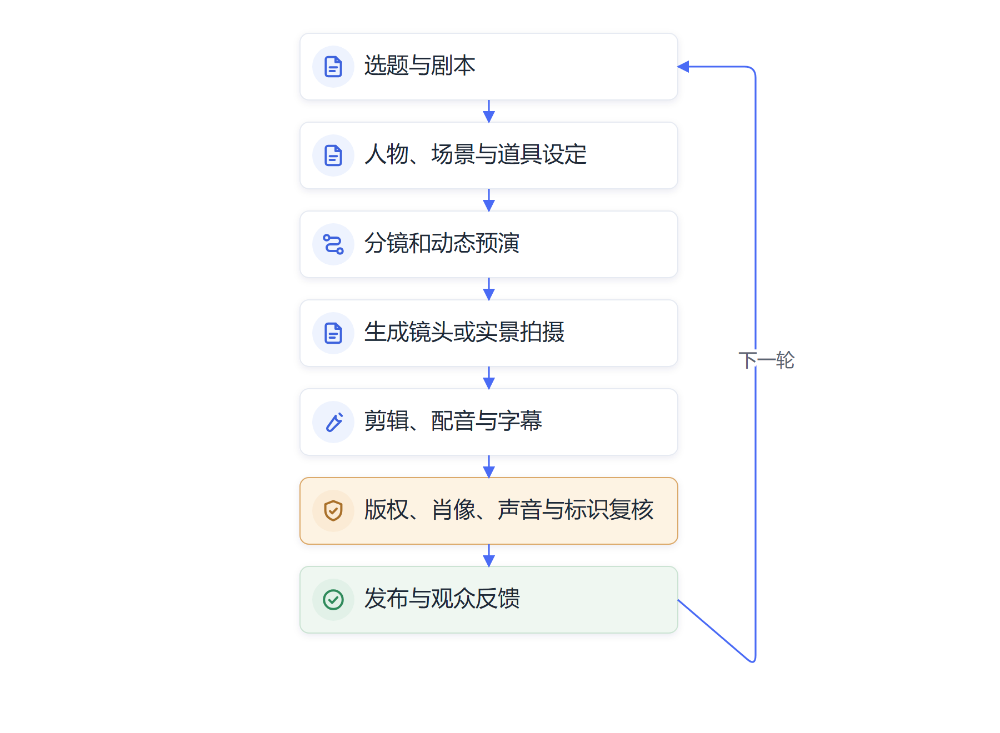

# 第九章　微短剧：生成式AI进入内容生产

**从剧本、人物和镜头到成片，生成式AI正在改变内容制作的速度与分工。**

一部微短剧能否吸引观众，过去很大程度上取决于故事、演员、场景和拍摄周期。随着生成模型进入剧本和视频制作，团队可以更快做出人物设定、场景草图、分镜和动态镜头，也能以较低成本测试不同创意。广电总局2026年发布会上介绍，前八个月全国上线微短剧约43万部，其中超过九成使用了AI技术；11月的中国广播电视精品创作大会上，相关负责人又表示当年上线微短剧中AI剧占比超过94%。两次公开信息没有完整说明“使用AI”和“AI剧”的统计定义，数据说明技术进入创作流程的范围迅速扩大，不能据此判断作品全部由AI生成，也不能推导观看量和营收同步增长。[国务院新闻办公室发布会报道](https://english.scio.gov.cn/pressroom/2026-09/20/content_118704506.html)；[国家广播电视总局大会致辞](https://www.nrta.gov.cn/art/2026/11/5/art_112_74402.html)

| 公开信息 | 数据 | 统计说明 |
| --- | ---: | --- |
| 2026年前八个月上线微短剧 | 约43万部 | 发布会称其中超过九成使用AI |
| 2026年大会公布的AI剧占比 | 超过94% | “AI剧”与“使用AI技术”的统计定义不同 |

*表9-1　两组数据来自不同场合、统计表述与时间范围，不能直接比较。来源见[国务院新闻办公室发布会报道](https://english.scio.gov.cn/pressroom/2026-09/20/content_118704506.html)和[国家广播电视总局大会致辞](https://www.nrta.gov.cn/art/2026/11/5/art_112_74402.html)。*

“AI短剧”并不只有一种生产方式。有的作品仍由编剧完成剧本、演员实景表演，AI只用于抠像、配音或字幕；有的作品用AI制作部分角色、场景和镜头；还有团队从剧本、人物图像到视频镜头都采用生成工具。统计中“使用AI技术”和“AI剧”所覆盖的作品范围可能不同，不能把它们直接理解为完全无人参与的自动创作。制作流程中人工参与多少，也会影响成本、速度和作品风格。

微短剧具有短周期、强节奏和高更新频率。一个故事可能需要连续呈现大量场景、人物造型和情绪变化，团队要在较短时间里完成剧本、拍摄、剪辑和发布。制作能力有限的小团队，往往很难同时承担多套布景、专业摄影、演员调度和后期合成的成本。生成式AI先降低了部分创意可视化和素材制作的门槛，让编剧和导演更快看到设想的画面。

当制作人构思一个新题材时，可以先让文本模型列出故事走向和人物关系，再由编剧筛选并修改。图像生成工具可以制作人物造型、场景概念图和道具草图；视频模型可以把分镜转成动态片段，帮助团队测试构图和镜头调度；语音工具能够制作临时配音或多语言版本；后期软件还可以辅助字幕、配乐建议和画面修复。这些内容可能成为最终成片的一部分，也可能只是沟通创意的草图，具体取决于团队的制作方法。

平台数据和观众反馈会影响下一轮制作。团队可以用小范围样片测试开场节奏、人物设定和画面风格，再根据观看完成率、互动和评论决定后续修改方向。模型能帮助快速生成多个版本，制作团队还要理解平台推荐和观众评价背后的原因。若只追逐短期点击，作品容易复制高刺激情节，忽略人物关系和内容价值。

微短剧产业本身也在迅速扩大。广电总局新闻发布会披露，2025年国内微短剧市场规模超过千亿元，短视频平台和网络视听平台不断推出作品。行业增长吸引制作公司、网络平台、广告主和地方影视基地进入，供给量随之上升。AI加入后，单个团队可以在较短时间内试做更多版本，创作竞争更加密集。制作门槛下降之后，故事质量、审美判断、人物塑造和观众留存会变得更加关键。

上海市2026年出台支持AI微短剧的政策措施，提出发展算力、数据、创作者服务、产业集聚和国际发行，并鼓励探索全流程AI创作。政策说明地方开始围绕工具、场景和产业服务建设配套条件，政策目标仍需与实际项目数量、制作质量、就业结构和市场收入分开观察。[上海市支持AI微短剧高质量发展的措施](https://english.shanghai.gov.cn/en-Policies/20260529/3518c6540488435e99c1bdab4f049976.html)

## 一部作品如何逐步接入AI工具

团队从一个题材开始，可以先把创作流程拆成若干可检查的环节。

| 制作环节 | AI可以承担的工作 | 创作者需要把关的内容 |
| --- | --- | --- |
| 题材与故事 | 提供故事方向、人物关系和情节候选 | 题材价值、因果关系和人物动机 |
| 剧本开发 | 生成对白、情节分支和不同版本 | 人物声音、叙事节奏、逻辑和情感 |
| 视觉设计 | 绘制人物、场景、服饰和道具草图 | 造型一致、文化准确和授权范围 |
| 分镜与预演 | 生成镜头草图和动态预览 | 景别、运动、节奏和表演意图 |
| 画面与声音 | 生成视频片段、配音、音乐或音效 | 肖像声音授权、表演质量和整体风格 |
| 剪辑与发布 | 辅助字幕、转场、多语版本和素材整理 | 成片质量、标识、平台要求和受众反馈 |

制作流程的起点通常是项目定位。团队需要确定目标观众、播出平台、单集时长、整体集数和预算，再判断故事适合实景拍摄、传统动画、AI生成镜头，还是几种方式混合。创作目标越明确，模型生成的候选方案越容易筛选；若输入只有“做一部爆款短剧”，模型会给出大量熟悉套路，却无法替团队确定观众需求和制作风格。

一段短剧可能从一页故事梗概开始。编剧先让模型生成不同开场，再根据目标观众、集数和时长筛出一条主线；导演确认人物设定后，视觉团队制作场景参考图；生成工具按镜头描述生成片段，制作人员挑选连续性较好的镜头，再通过剪辑、配音和人工补拍形成一集。这个流程节省了部分试错时间，也把大量候选画面的筛选工作交给人完成。创作过程中，人物设定表会成为跨环节的参照。编剧说明人物年龄、性格和关系，导演与美术团队把这些内容转成服饰、发型、色彩和表演要求；生成工具在每个镜头中读取相同参考信息，制作人员再比较前后画面是否一致。团队还要标记素材对应哪一集、哪个镜头、使用了哪些参考图和模型版本，方便返工时追查来源。

人物和场景越多，保持风格一致越费工。一个配角在前几集穿着工作服，后续画面若突然换成完全不同的衣着，观众会觉得故事不连贯。美术设计人员可以建立角色图谱、表情参考和场景样板，镜头生成工具按这些资产制作候选画面。导演还要确认色彩、视线方向、构图和人物关系是否服务剧情。

故事仍要经过专业判断。模型可以写出符合常见套路的冲突，却可能让人物动机前后矛盾，或把情节推进写得过于机械。专业编剧知道观众何时需要信息、何时产生期待，也会根据演员的表演和拍摄条件调整对白。AI可以快速列出可能性，创作者需要决定哪些内容值得保留、怎样让故事形成自己的表达。

生成工具还改变了前期沟通方式。过去，编剧可能用文字描述一个场景，导演和美术团队各自想象画面，再通过开会、草图和搭景确认。现在，团队可以先生成参考画面和动态预演，较早发现人物造型、光线和构图是否符合故事意图。模型把抽象设想变得可视，减少了沟通中的误解，也让制作人员更早讨论哪些画面能实现、哪些会增加成本。

传统拍摄把摄影机、演员、场地和灯光作为主要生产条件，AI视频则把提示文本、参考图、模型和后期控制纳入镜头制作。制作团队可以通过描述镜头运动、光线、人物动作和场景环境，生成若干画面候选。工具版本升级后，人物动作和镜头连续性持续改善，短片、广告和片头动画的制作成本有机会下降。

单个镜头生成成功，距离一集短剧完整可看还有很长的工作。人物脸型、服饰、发型和年龄要在不同镜头中保持一致；动作要与前后剧情衔接；人物拿起的物品不能突然消失；场景空间还要符合镜头方向。视频模型目前仍可能产生动作错位、手部畸形、物体变化和时序断裂。导演和剪辑人员需要逐帧检查，重生成不合格镜头或通过人工后期修正。镜头之间的连续性需要额外的制作办法。团队可以先确定主要角色和场景的参考图，固定画面比例与色彩范围，再用关键帧控制人物动作的起止状态。模型生成的片段若与前一镜头的空间关系不一致，剪辑人员可能调整镜头顺序、补一段过场，或重新生成局部画面。关键情节仍可能需要真人拍摄与视效合成结合。

同一条提示词也可能在不同时间返回不同结果，素材制作需要记录模型版本、提示文本、参考图和修改过程。团队若只保存最终画面，后续难以复现镜头或确认素材来自哪里。对较长作品而言，人物设定表、场景图、颜色规范、镜头记录和生成素材库都逐渐成为制作基础设施。

单个镜头的生成时间与整部作品的制作周期，分别反映局部操作速度和完整交付效率。即使模型在几秒钟内生成片段，团队还要筛选画面、修复动作、统一人物、剪辑节奏、检查声音并进行平台适配。若镜头反复生成，使用次数和人工挑选时间会快速增加；若使用外部平台，还要计算订阅、算力、版权审核、存储和后期成本。AI可能把部分固定拍摄成本转为软件、算力和质量控制投入，项目预算需要按完整流程核算。

AI不会让创作团队里的每项工作同时消失。部分环节的操作时间缩短，团队会把更多精力投入创意判断、素材筛选、镜头衔接、情绪控制和发行测试。熟悉摄影、视效和叙事的人，能够更准确地描述所需画面，也更容易发现模型结果的缺陷。生成工具增加了候选内容，人的专业经验决定哪些内容可以进入作品。

AI也会改变项目成本结构。过去，一场室内戏可能要租用场地、搭建布景、调度演员和灯光组；生成工具可以先把多个场景设计成草图和预演视频，制作方在确定方案后再选择实景拍摄或生成镜头。制作团队节省了部分前期试错和素材制作时间，但需要购买软件、算力、版权授权和后期审核服务。成本从传统拍摄设备转移到模型调用、创意筛选、内容治理和合成质量控制。

制作团队的规模可能发生变化。一名编剧可以借助模型快速查看情节分支，导演能先在预演画面中比较镜头方案，小团队也能制作以往需要较多实景和后期资源的内容。另一方面，作品数量增加会抬高平台筛选和观众选择的成本。AI制作效率上升不保证作品更受欢迎，也不保证制作团队获得更多收入。市场结果仍由故事吸引力、发行策略、用户反馈和平台机制共同决定。

AI还可能改变从业者积累经验的路径。初级创作者原本通过整理素材、制作分镜和反复修改画面练习基本技能；这些任务交给工具后，单位要重新安排带教和质量反馈，帮助新人理解镜头、叙事和后期制作，也训练问题识别、审美判断和团队协作。真正有价值的创作能力包括识别问题、形成方案、判断画面、与团队沟通和承担作品后果。

*图9-1　生成式AI进入微短剧制作后的主要环节*

## 版权、肖像和内容标识成为制作流程的一部分

AI短剧可能使用真实演员的面部、声音、形象和表演片段，也可能基于受版权保护的小说、影视作品和画作生成新内容。制作方需要确认素材来源和授权范围，约定可使用的平台、地域、期限和再次训练用途。生成画面的外观经过改动，素材来源、肖像和声音使用仍要按照授权范围审查。具体项目应由责任人员依据适用法律和合同确认。

2025年9月起施行的人工智能生成合成内容标识办法，对生成合成内容的显式、隐式标识以及传播平台责任作出规定。微短剧使用AI生成或合成内容时，制作方应按规定和平台要求标识，并留存素材与制作记录。标识既是合规要求，也能让观众了解作品中哪些内容经过生成或合成。[国家互联网信息办公室等部门《人工智能生成合成内容标识办法》](https://www.cac.gov.cn/2025-03/14/c_1743654684782215.htm)

> **原文摘录：**“应当主动声明并使用服务提供者提供的标识功能进行标识。”
>
> **来源：**[《人工智能生成合成内容标识办法》第十条](https://www.cac.gov.cn/2025-03/14/c_1743654684782215.htm)。

## 微短剧呈现的是更广泛的创意生产变化

AI微短剧的意义不只在于一集能否更便宜地制作。它展示了生成式AI进入内容产业后的完整变化：创意可以迅速变成画面方案，修改成本下降，制作资源向少数关键人员集中，内容产量和筛选压力同步上升。制作团队需要把AI放进流程，记录工具使用、授权来源、人工修改和质量审核。

内容创作者也要重新认识自己的优势。模型能一次生成许多常见表达，人的观察、审美、社会经验和真实情感仍然会影响作品能否打动观众。工具把过去稀缺的制作能力推向更多团队，差异会更多来自选题、叙事判断、艺术风格和制作管理。微短剧因此成为观察AI怎样影响文化产业、创意岗位和组织协作的一扇窗口。

## 不同项目需要不同的人机分工

生成式工具进入内容制作，不意味着所有项目都要采用同一种流程。现实题材、历史题材、动画风格和品牌宣传片，对演员表演、场景真实性、人物连续性和制作周期的要求各不相同。团队可以先判断作品最难解决的问题，再选择模型参与的环节。

如果作品最依赖真实人物的表演和细腻情绪，AI可以用于剧本比较、场景预演、字幕和后期整理，演员与导演继续承担核心创作；如果项目需要大量难以实拍的奇幻场景，生成图像和视频可以先制作概念片段，团队再决定采用实拍、视效还是生成镜头；如果作品面向多种语言市场，语音合成和字幕翻译可以帮助制作不同版本，专业人员仍需核对语气、文化含义和法律表达。

项目负责人可以把制作效果拆成几项分别评估：故事能否吸引观众，镜头能否连贯，人物是否稳定，制作成本是否下降，团队返工是否减少，授权和标识是否清楚。某个环节更快，不代表整部作品的成本、质量和传播效果都同步改善。制作团队要依据完整流程决定AI投入范围，并在片头、片尾、制作记录或平台所需位置按规范保留信息。

这种分工也会改变创作团队的协作。编剧、导演、美术、剪辑和模型操作人员需要共享人物设定、视觉规范和镜头记录；创作负责人要能判断模型给出的候选画面是否符合故事意图。提示词写得熟练有帮助，真正决定作品质量的仍是叙事、审美、表演和剪辑判断。

## 资料来源与说明

- [国务院新闻办公室关于2026年微短剧产业的发布会报道](https://english.scio.gov.cn/pressroom/2026-09/20/content_118704506.html)：前八个月上线数量和AI技术使用比例，按发布会披露口径说明。
- [国家广播电视总局2026年中国广播电视精品创作大会致辞](https://www.nrta.gov.cn/art/2026/11/5/art_112_74402.html)：AI剧占当年上线微短剧比例；公开讲话未详列统计定义。
- [上海市支持AI微短剧高质量发展的措施](https://english.shanghai.gov.cn/en-Policies/20260529/3518c6540488435e99c1bdab4f049976.html)：地方产业支持方向。
- [人工智能生成合成内容标识办法](https://www.cac.gov.cn/2025-03/14/c_1743654684782215.htm)：生成合成内容标识与平台责任要求。
