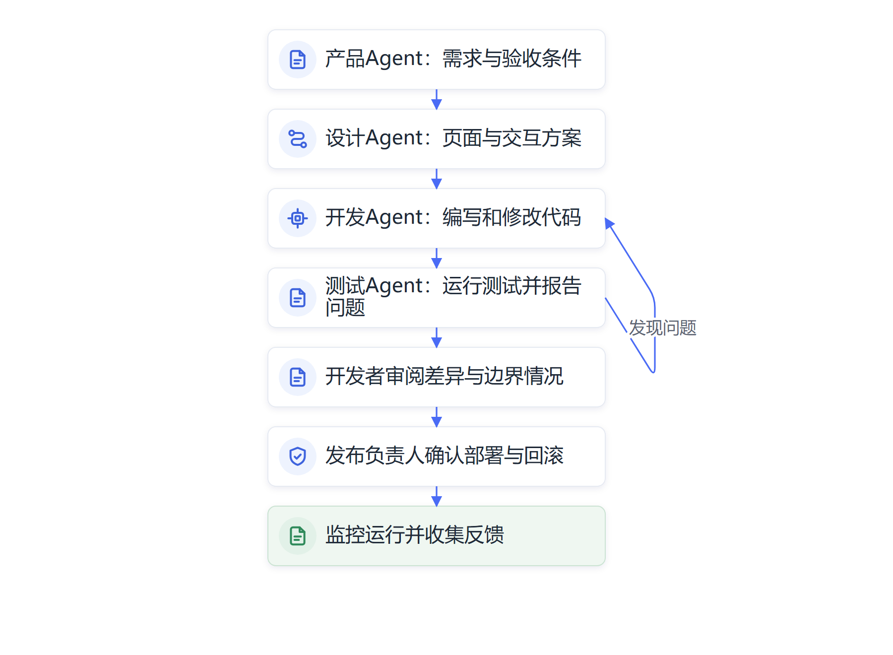

# 第十章　AI编程：多智能体接力开发软件

**从输入一段需求到修改代码、运行测试，Agent正在接手软件生产中的连续任务。**

一个多Agent软件开发案例以“为北大研一新生做一个微信查课表小程序”为目标，设置产品、设计、开发、测试和运维等智能体分工接力。产品Agent先梳理需求，设计Agent生成界面，开发Agent编写程序，测试Agent检查运行结果，运维Agent讨论发布方案。这个案例把“AI编程”从补全一行代码扩展成一条任务链，展示了多Agent如何协作。

这个案例用于呈现多Agent协作方式，不能据此认定真实学校已经部署了相关系统。将小程序原型扩展成正式产品，还要连接可信课表数据、确认学生身份、处理课程变更、保护个人信息、检验高并发访问，并经过学校信息化和业务部门审批。学校还要说明课表数据来自哪个系统、课程变动由谁更新、学生如何登录、访客能看到哪些信息，以及程序怎样处理冲突课程和临时调课。页面属于界面层，后端接口、身份认证、数据同步、异常提示和技术支持也要一并设计。案例中的产品、设计、开发、测试和运维角色，展现了软件生产的协作链。

## AI编程从补全代码发展到操作代码库

程序员使用代码编辑器、编译器和版本控制工具已有几十年。过去，程序员逐行编写代码，再通过编译、测试和调试发现问题。代码补全工具后来能够根据当前文件推荐变量名、函数和语句；大语言模型进一步支持自然语言问答、代码解释、单元测试生成和错误定位。编程助手开始帮助开发者处理多种任务。

新一代编码Agent可以在经过授权的工作区里读取项目文件、理解错误报告、修改多份源代码、调用终端运行测试，再根据结果继续修正。开发者不必每次都手动复制代码片段，Agent能在限定环境里推进若干步骤。它需要获得代码库结构、项目说明、依赖配置和测试命令，才能理解当前修改会影响哪些部分。Agent首先会读取任务单，搜索相关代码和项目文档，找到已有实现方式；之后在隔离分支里修改文件，执行指定测试，并把差异和测试结果交给开发者。若测试失败，它可以读取错误日志再改一次；若任务要求修改多个模块，它还要检查不同接口是否一致。开发者可以查看变更记录，决定哪些修改可合并，哪些需要退回。

编码Agent的工作环境通常包括仓库权限、文件读写、终端命令、测试数据和版本控制。团队要先决定它可以访问哪些目录、能够运行哪些命令、是否可以访问互联网、能否安装依赖。生产凭证和线上数据库应与开发环境隔离，Agent不应因为“完成任务方便”就获得全部系统权限。

OpenAI在介绍内部编码Agent实践时，把工程师职责的变化描述为：更多时间用于说明目标、设计Agent工作环境和反馈机制。Anthropic也公开介绍其团队使用Claude进行日常软件开发，并调整源代码管理和持续集成以适应大量自动生成的变更。它们是技术公司的实践披露，说明企业内部的软件生产流程正在变化，不能直接外推到所有开发组织。[OpenAI Harness Engineering](https://openai.com/index/harness-engineering/)；[Anthropic源代码管理调整说明](https://www.anthropic.com/research/redesigning-source-control)

## 需求和验收条件决定Agent能否写对程序

软件任务往往以一句话开始，真正交付却需要一组能够检查的条件。比如“做一个查课表小程序”，还没有说明课表如何导入、临时调课怎样更新、不同校区如何区分、学生能否查看同学信息，以及网络中断时界面应该显示什么。产品人员要先把使用对象、主要流程、数据来源和异常情况写清楚，再让Agent进入代码库工作。

需求说明也不必一次写成几十页。团队可以用一张任务卡说明用户、目标、输入、期望结果、禁止事项和验收办法，然后由Agent复述理解并列出待确认问题。这样的往返能较早发现模型把“查课表”误解成“展示静态课表”之类的偏差。开发者再把较大需求拆成可独立验证的修改，便于回滚和定位问题。

验收标准要覆盖正常路径和边界情况。查课表功能可以测试空课表、课程冲突、节假日、临时调课、身份失效、无网络和数据更新失败；办公系统则要检查并发访问、权限越界、日志记录、错误提示和版本兼容。自动测试能验证预设情况，业务人员还要检查界面是否符合工作习惯、内容是否容易理解。Agent通过测试，只能说明它满足现有测试条件；若测试本身遗漏了用户需要，程序依然可能做错。

## 一项软件任务怎样经过Agent接力

一项相对完整的软件开发任务，通常经历以下阶段：

1. **理解需求**：从用户描述、产品文档和问题单中提取目标、使用者、边界条件和验收要求。
2. **检查代码库**：浏览现有文件、接口和项目约定，确认哪些模块可能受到影响。
3. **拟定修改计划**：列出需要调整的组件、数据结构、页面行为和测试内容。
4. **修改程序**：在工作分支或隔离环境中变更代码，避免直接影响正式版本。
5. **运行测试**：调用单元测试、集成测试、静态分析和构建工具，依据实际输出继续修复。
6. **人工审阅**：由开发者核对业务逻辑、边界情形、安全影响和代码可维护性。
7. **发布和监控**：按照组织的代码评审、部署和回滚流程上线，再观察运行状态。

这组环节中，Agent可以负责读取资料、生成候选实现、执行重复测试和整理修改摘要；业务负责人需要明确产品应该做什么，开发者需要判断程序结构是否合理，发布负责人要确认版本和运行风险。Agent生成了一个测试能通过的补丁，并不代表它已经满足全部用户需求。

*图10-1　多Agent软件开发的接力关系。查课表小程序属于示例情境，图示说明协作方式，不代表已上线产品。*

## 从原型到正式系统，中间还有工程化工作

生成式AI让制作原型更容易，正式系统仍需要考虑部署环境、身份认证、数据备份、日志监控、版本升级和故障恢复。查课表小程序的原型可以先用模拟数据展示页面和交互。真正接入校园系统前，学校还要核对接口授权、学期与学年规则、跨校区数据、个人信息保护和高峰期负载。原型用于讨论协作流程，工程验收则要证明系统在真实条件下可以持续运行。

组织的软件开发还要保留可追溯的变更链。每次任务需要关联需求单、代码差异、测试结果和评审意见；自动生成的代码由谁审查、发现缺陷如何回滚、部署后谁看监控，都要有明确岗位。若一个Agent先写代码、另一个Agent负责测试，团队应检查测试角色是否拿到独立需求，避免它只验证程序“按当前实现运行”，没有检查程序是否解决了原问题。

团队还要区分代码生成和软件维护。一个新功能能在演示时运行，不代表其他工程师以后容易读懂和修改。代码应符合现有架构和命名约定，接口文档要同步，依赖项应经过安全和许可检查。若每次新增功能都由模型另起炉灶，短期速度可能很快，长期却会形成重复模块和难以升级的系统。

## 多智能体接力如何工作

多Agent系统把一项复杂任务拆成若干职责。产品Agent分析需求，架构Agent规划模块，编码Agent修改文件，测试Agent编写并运行测试，审查Agent寻找边界缺陷，最终由协调程序合并各阶段成果。不同Agent可以使用不同提示、工具和上下文，也可以并行处理互不冲突的任务。

软件开发适合展示多Agent协作，因为代码天然分成文件、模块和任务单，测试工具还能提供比较明确的反馈。一个Agent读取代码，另一个Agent运行测试，它们可以通过文件差异、测试日志和版本控制记录交换结果。然而，多Agent增加了接口和交接条件：需求Agent漏掉一个边界，编码Agent就可能实现错目标；两个编码Agent同时改一个文件，合并时会出现冲突；审查Agent如果沿用同一份错误需求，也可能漏掉同一处缺陷。

团队应先判断任务能否清楚拆分，再决定是否增加Agent角色。若一项小修改由单个Agent在现有测试框架内完成，多个角色只会增加协调成本；若任务涉及多个互相独立的模块，分工和并行处理可能带来收益。实际效果要看总耗时、代码质量、返工率和人工审阅成本。

## 基准进步迅速，真实软件仍需完整验收

SWE-bench等基准测试把GitHub上的真实软件问题交给模型，让它在代码库中修改程序，再依据项目测试判断补丁是否解决问题。Stanford HAI《2026 AI Index》把软件工程评测从代码片段推进到代码库任务，并指出不同测试集的题目和评估方法各不相同。模型在选定基准上的高分，说明它能够处理该测试范围内的一批问题；长期维护系统、理解复杂业务和避免安全漏洞还需要更多验证。[Stanford HAI《2026 AI Index》技术表现章节](https://hai.stanford.edu/ai-index/2026-ai-index-report/technical-performance)

公开基准还有题目是否曾出现在模型训练资料中的问题。新研究不断提出更近期的代码仓库任务和更严格的评测方案，以减少题目泄漏、答案记忆和测试集饱和的影响。基准分数能够比较指定模型和任务，不能代替单位内部的软件发布流程。真实项目中的需求经常不完整，代码库可能缺少测试，系统依赖和用户行为也比单个问题复杂。软件开发中的每项任务还会受到历史架构和兼容要求影响。一个看似简单的界面调整，可能牵涉移动端适配、国际化、数据库字段、监控指标和旧版本客户端。基准题目通常给出问题描述和可运行代码库，企业项目还要理解客户习惯、系统约束和未来维护成本。Agent根据现有测试改代码时，也可能只让测试通过，却留下更难维护的实现。

[SWE-bench原始研究](https://arxiv.org/abs/2310.06770)；[SWE-rebench动态评测研究](https://arxiv.org/abs/2505.20411)

## 程序员的工作重点正在迁移

当Agent可以编写和修改更多代码时，软件工程师会把更多时间用于判断需求、规划系统、设计接口、检查实现和协调上线。输入给Agent的要求越清楚，测试和项目文档越完善，开发者就越容易发现模型哪里理解错了。程序员的专业性会体现在对软件整体结构和业务目的的理解上，不只在于打字速度。

对于初级程序员，基础代码操作减少后，学习路径需要调整。新人仍要读懂代码、理解数据结构、定位错误、写测试并通过实际运行验证结论。若团队让Agent包办全部基础任务，又不给新人安排代码审阅和小模块维护，他们可能少了建立工程直觉的机会。组织应在效率和人才培养之间作出设计，让新人逐渐承担可以检查的真实任务。

AI编程项目可以用几类指标评价。功能指标看用户需求是否完成，质量指标看缺陷率和回归测试，安全指标看依赖漏洞、权限和数据处理，效率指标看从需求确认到上线的总时间，成本指标还要计算模型调用、代码审阅和维护工时。上线后出现故障的频率和修复时间，也能说明代码是否真正稳定。

AI编程也让非专业人员更容易制作表单、内部查询页面和流程工具。业务人员能先把想法做成原型，开发团队再检查数据安全、系统接口、访问控制和维护成本。这扩大了软件创新的参与范围，也会增加未经管理的应用。组织需要规定哪些工具可以连接业务系统，原型怎样经过评审才能投入生产，代码由谁负责长期维护。

## 软件安全和知识产权需要进入Agent工作区

编码Agent如果能够读取所有项目文件、执行任意命令并访问网络，一次错误的指令就可能暴露凭证、删除数据或引入恶意依赖。开发团队可将Agent放进隔离工作区，只开放完成任务所需的代码和命令；把生产环境凭证与开发工作区分离；限制对外网络访问；对写入、发布和变更基础设施的操作设置人工审批。

AI生成代码还可能存在漏洞、错误依赖、过度授权和不适当的数据处理。代码评审要检查代码逻辑、依赖许可、数据传输、身份验证和异常恢复；静态分析、软件成分分析、自动化测试和独立安全审查能够提供额外检查。模型给出的代码注释和解释不能替代真实测试结果。

开发者也要了解所使用模型和工具的服务条款、代码发送范围和数据保留规则。涉及未公开产品、客户数据、政务系统或央企核心业务的项目，使用外部编码服务前应按照单位要求评估数据路径与授权。Agent写代码的效率只有在组织能够理解并控制其运行环境时，才可能转化为可持续的研发能力。

## AI编程的价值要看整个研发系统

评价编码Agent可以记录从需求提交到可审阅补丁的时间、人工改动比例、测试覆盖情况、回归缺陷、审查耗时和上线后故障。指标要按任务类型分别观察：修复文档中的错字与改造核心数据接口，不能放在同一组里比较；模型解决容易任务的速度，也不能代表复杂任务的整体研发效益。

研发流程可能出现一种新的瓶颈：代码生成变快以后，产品确认、代码评审、安全审查和测试环境排队反而占用更多时间。组织应观察整条交付链，适度增加自动化检查、改进测试环境和明确合并责任。软件工程师的专业价值会更多体现在需求澄清、架构选择、质量把关和系统运行责任上，团队也要为初级人员保留读代码、写测试和逐步维护模块的成长机会。

## 软件生产正在从写代码扩展到管理智能体

AI编程改变了技术团队分配工作的方法。需求文档、代码库说明、测试用例、运行环境和反馈机制开始构成Agent工作的“生产环境”。软件工程师需要为Agent准备清楚的任务入口，让修改范围、运行命令和验收条件可供检查；项目负责人则要跟踪任务分配、变更质量和人机协作成本。

未来的软件团队仍需要理解业务、维护架构、管理数据、评估安全和承担发布责任。Agent将负责越来越多的代码操作，工程师则要安排它在何种条件下工作、何时需要停止、怎样证明修改有效。开发效率上升后，软件组织面临的新问题是怎样把更多实现能力变成可靠、可维护、真正解决业务问题的产品。

## 资料来源与说明

- “查课表小程序”属于多Agent示例情境，用于说明分工方式，不能作为已上线系统的案例。
- [OpenAI Harness Engineering](https://openai.com/index/harness-engineering/)：工程团队围绕编码Agent调整工作环境、目标说明和反馈机制的公开实践。
- [Anthropic源代码管理调整说明](https://www.anthropic.com/research/redesigning-source-control)：企业内部自动化代码变更规模及相关工程调整，按公司披露口径使用。
- [Stanford HAI《2026 AI Index》技术表现章节](https://hai.stanford.edu/ai-index/2026-ai-index-report/technical-performance)：软件工程基准及其他领域能力测评。
- [SWE-bench原始研究](https://arxiv.org/abs/2310.06770)：基于真实GitHub软件问题评测模型的基准。
- [SWE-rebench动态评测研究](https://arxiv.org/abs/2505.20411)：通过持续收集较新的代码任务研究模型基准评估问题。
