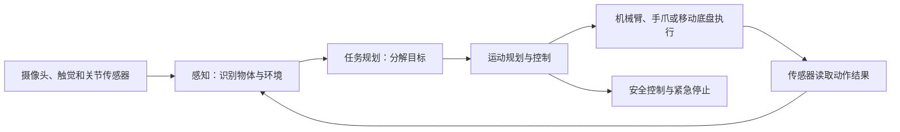

# 第十一章　具身智能：机器人走进生产现场

**当人工智能连接摄像头、传感器和机械臂，模型开始从描述世界走向改变世界。**

过去几十年，工业机器人主要在工厂围栏里执行重复动作。工程师要精确设定工件位置、机械臂轨迹、夹具状态和停止条件；生产线稍有改变，就可能需要重新调整程序。现在，视觉模型和大语言模型开始帮助机器人理解环境、解释人类指令并选择动作。人工智能由屏幕里的文字和图像扩展到真实空间，具身智能由此成为新的技术方向。

具身智能让算法通过身体与环境持续交互。机器人的摄像头、力传感器、触觉和关节编码器收集现场信息，模型结合任务目标形成动作方案，控制系统再让电机、手爪和移动底盘完成动作。机器人会读取动作后的环境变化，判断任务有没有完成，随后继续下一步或请求人工协助。这种“感知—判断—行动—再感知”的循环，连接了大模型和物理世界。

具身智能经常使用“视觉—语言—动作模型”（VLA）这个名称。视觉模块把摄像头图像转换为环境线索，语言模型理解人给出的任务，动作模块输出机器人需要执行的运动序列。RT-2研究将网页中学到的物体与概念知识同机器人动作数据结合，试图让机器人把文字里的语义迁移到真实操作中。这类研究说明模型可以为机器人提供更灵活的任务理解，落地时仍要针对机器人结构、可操作物体和安全区域进行训练。

机器人学习的动作数据往往需要人工遥操作采集。操作人员戴着设备或使用控制器操纵机器人，系统记录摄像头画面、关节状态、手爪位置、执行动作和环境反馈。机器人学习成功示范后，可以尝试在相似环境复现；若想适应新的桌面高度、物体形状和光照，需要更多样的样本和新的训练。真实机器人采集一次数据的时间和成本远高于从网页下载文字，因此高质量的现场数据成为具身模型的重要资源。

## 机器人需要把语言理解变成身体动作

大模型可以从文字中理解“把红色零件放进左边的料盒”，机器人还要确认现场哪个物体是红色、料盒在哪里、手爪能否抓住它、移动时会不会碰撞，并在放置后确认零件是否稳固。每一步都涉及空间位置、物体属性和运动控制，语言能力只是任务链的入口。

机器人系统通常包括几个相互配合的部分：感知模型识别物体、人员和环境状态；空间模型表示位置、方向和可操作区域；任务规划模块把目标拆成动作步骤；运动规划和控制系统计算关节轨迹、速度与力；安全控制负责限制碰撞和危险操作。大模型可以帮助理解开放式指令、解释视觉信息或规划较长任务，执行层还需要精确控制器把计划转换成可行的动作。

2023年公布的RT-2研究展示了视觉—语言—动作模型的一种路径。研究团队将网络图片和文字中学到的知识，与机器人动作数据结合，让模型直接输出机器人动作指令。研究结果说明，大规模图像和语言预训练可能帮助机器人把部分语义知识迁移到操作任务；实验环境和任务范围有限，不能据此推断机器人已经能在任意家庭或工厂里工作。[RT-2原始研究](https://arxiv.org/abs/2307.15818)

> **原文摘录：** “we express the actions as text tokens and incorporate them directly into the training set”
>
> **中文释义：** 研究把机器人动作表示为文本词元，并纳入模型训练。
>
> **来源：** [Brohan等，《RT-2: Vision-Language-Action Models Transfer Web Knowledge to Robotic Control》](https://arxiv.org/abs/2307.15818)。

具身模型的动作输出与文字回答有明显差异。模型把“拿起杯子”误解为“移动到杯子上方”，语言层面看起来只差一个动作，机械臂却可能碰倒杯子或撞到旁边的人。机器人动作需要即时反馈，控制系统要在很短时间内更新状态；语言模型生成计划的速度和稳定性不一定满足实时控制要求。因此，许多系统采用分层方式：高层模型理解任务和安排步骤，低层控制器持续修正姿态和力量。

## 机器人开始从展台走向真实工位

机器人研发人员近年将注意力转向真实工作场景。工厂、仓库、能源设施、医院和应急现场各自需要不同操作。人形机器人能够利用为人类设计的楼梯、扶手和工具；轮式机器人可以在平整地面高效移动；固定机械臂适合重复装配。机器人外形和控制方式应当服从任务需要，行业仍在比较不同形态的成本和适用范围。

小米在公开材料中介绍，机器人已在汽车工厂自攻螺母上件工位连续自主运行3小时，成功率为90.2%；随后公司报告部分工位试验成功率提升到98%，并公布了长时间作业视频。相关指标来自企业披露和公开视频，公开信息没有提供完整第三方测试条件、产量基准和人工介入统计。这些试验让人看到机器人正在进入生产流程，也说明评估现场能力要同时看成功率、节拍、故障恢复和持续运行情况。[小米2026年中期报告](https://ir.mi.com/static-files/6d468667-c943-4753-a0e0-2e5cb11575df)

2026年，工业和信息化部与国务院国资委联合开展人形机器人与具身智能实景实训专项行动，要求各省级地区遴选不少于20个重点场景单元，各央企结合行业特点遴选不少于10个；文件提出到2026年底，形成百个以上高价值应用场景并带动万台级规模落地能力。这些是专项行动目标，表示主管部门准备以真实场景训练和验证机器人能力，实际完成情况需要后续数据确认。[工信部、国务院国资委2026年专项行动通知](https://www.miit.gov.cn/zwgk/zcwj/wjfb/tz/art/2026/art_f291ccd3da4c47ce95741de63cc088e6.html)

从展厅演示走到生产任务，评估方式也会变化。演示通常选择光线、物体、人员和动作都准备好的环境，展示机器人完成一次任务；实训要把设备放进真实工位，让它持续面对交接、等待、变更和故障；常态部署则要证明机器人能够在多个班次中运行，维护人员能在故障时及时恢复，现场职工也能理解它的状态和安全边界。专项行动提出实景训练、验证和常态部署，正是从真实使用条件检验系统能力。

设想一台机器人在汽车工厂为装配线准备零件。它先识别储料箱与零件类型，再按指令抓取并放入指定位置；如果箱子移动或零件被遮挡，系统要重新感知环境，避免按旧坐标直接下手。机器人还要控制抓取力度，确认零件没有滑落，并与工位人员保持安全距离。只有当它反复完成任务、节拍达到产线要求、异常状态可处理，工厂才可能将其作为稳定工序的一部分。

真实场景能帮助研发团队积累机械臂轨迹、传感器状态、环境变化、物体属性和异常处置数据。实验室里摆放整齐的零件，与生产现场里受光照、磨损、遮挡和人员流动影响的物体不同。机器人只有持续在不同条件下训练和测试，团队才能看出模型是否会泛化，是否遇到罕见情况就失去控制。

*图11-1　具身智能把语言目标转化为身体动作，并通过传感器持续校正*

## 真实环境会放大每一次判断错误

数字模型在屏幕上产生错误，通常还能撤销或重新生成；机器人动作会产生物理影响。机械臂过度用力可能损坏设备，移动机器人可能碰撞工人，温度和粉尘会影响传感器，电池和电机也会限制连续工作时间。现场负责人需要明确可操作区域、速度和力的边界、紧急停止方式和人工接管流程。

仿真可以让机器人反复练习，提高训练效率，开发者还要处理仿真与现实之间的差异。模拟环境里的材质、摩擦力、光线和物体重量往往比真实环境简单。模型在虚拟环境学会抓取一个箱子，转到现实中可能因为纸箱变形、表面打滑或箱子装载不均而失败。研究团队需要把仿真、真实轨迹和现场测试结合起来，再逐步扩大任务范围。

机器人还要应对任务中断和恢复。设备正在搬运零件时，附近有人突然进入区域，系统应当停止动作并重新评估空间；传感器被遮挡时，机器人应降低动作速度或等待人工确认；停电或网络中断后，系统应保存当前状态，避免恢复运行时重复执行危险动作。故障恢复能力常比理想环境下的演示更能说明产品成熟度。

判断具身智能的现场表现，要建立完整指标。成功率说明任务按目标完成的比例，节拍衡量单位时间产出，持续运行时间显示设备是否能长期工作，人工介入频次反映系统独立程度，恢复时间体现故障处理能力。还要记录安全事件、维护工时、易损部件更换和能源消耗。只报告一个成功率，无法说明机器人是否能够替代或协助某个岗位。

传统自动化和具身智能也有不同适用条件。流水线设备适合在零件、工具和动作固定时使用，运行速度快、重复精度高；具身模型更适合环境和任务有一定变化、需要识别对象并调整动作的场景。若任务本身完全固定，采用成熟机械臂或专用搬运设备可能更经济；若现场物体变化较多、人工调整频繁，机器人理解场景和重规划动作的能力可能带来价值。单位要比较全部维护与部署成本，选择合适技术。

## 哪些场景适合机器人先进入

机器人比较适合任务重复、环境可描述、步骤容易检查、操作边界清楚的工作。仓储搬运、巡检、上下料、简单分拣和固定工位装配，往往可以先划出小范围进行测试。危险、高温、高压、狭小或对人身安全要求极高的环境，也可能适合机器人承担部分探测和搬运任务，前提是设备通过相应验证，并能在异常时及时停止。

对于党政机关和央国企，机器人可以参与站点巡检、物资搬运、园区维护和应急探测；林业和农业组织还可以探索林区巡护、苗木搬运、果园作业和山地环境数据采集。不同场景的地形、天气、通信条件和维护能力差别很大。选用人形机器人之前，单位应先比较专用设备、机械臂、无人机和现有自动化设备的成本与适用范围。林区巡护任务需要机器人或无人机识别道路、坡度、植被遮挡、通信盲区和危险区域；它采集的图像还要与地图、火险信息和巡护计划结合。果园采摘则要识别不同成熟度的果实，控制抓取力度，避开枝叶并把果实放入容器。山地和农业环境有天气、泥土、地形和生物变化，固定厂房内训练的控制策略未必直接适用。应用前应在相应地形、季节和设备条件下开展验证。

经济性还要计算设备之外的投入。机器人单价只是第一项费用，项目还包括场景测绘、工位改造、网络和充电设施、动作训练、现场安全评估、维护备件和人员培训。项目收益则要看机器人每天有效作业时间、人工接管频率、故障停机、产出质量和安全改善。设备连续演示数小时，不代表它已经满足长期运转；试用阶段还要测算全周期维护和折旧。

将机器人部署到工位，还需要调整周边环境和人员分工。设备可能需要专用充电点、隔离区域、地面标识、储物位置和远程监控网络；员工需要学习任务下发、异常上报、人工接管和安全处置。技术人员和现场职工要共同确定哪些工作由机器人完成，哪些任务依靠人的经验，故障由谁诊断，设备维护是否能在本地完成。

## 具身智能正在形成新的产业组织方式

具身智能的产业链包括机器人本体、关节与执行器、传感器、控制器、算法模型、数据采集、仿真平台、系统集成和运维服务。机器人厂商不能只提供一台设备，还要帮助用户整理作业任务、适配工位、训练技能、测试安全并维护长期运行。模型开发者、硬件厂商、现场单位和科研机构需要围绕同一项任务协作。

主管部门开展实景实训行动，也把数据和应用验证列为重点。用户单位提供任务要求、工作流程和场景数据，整机企业适配机器人本体和模型，科研院所与零部件厂商协同改进感知和控制能力。这样的联合方式有助于把机器人从样机推向可验证系统，相关目标仍需以试验记录和部署情况评价。

未来的人形机器人可能承担更多跨场景任务，专用机器人也会继续发挥优势。仓库搬运可以采用移动机器人，狭窄管道巡检适合小型履带设备，精细装配可以由固定机械臂完成。设备形态应依据任务中的稳定性、成本和安全要求选择。

## 人机协作要围绕同一套现场规则设计

机器人能否进入生产现场，和周围人员怎样理解它的状态密切相关。现场员工要知道机器人当前执行哪项任务、何时会移动、遇到什么情况会停下，怎样发起人工接管。状态灯、声音提示、区域标识、控制面板和操作规程需要保持一致；当机器人暂停或等待补充信息时，工作人员也应能看出原因。

工作站设计要考虑人与机器人交接的位置、物料摆放、紧急停止装置和安全距离。机器人接手搬运后，员工可能转而负责补料、抽检和异常处理；新的分工应写进班组流程，避免工作人员以为设备会自动完成尚未覆盖的步骤。系统记录人工接管的时间、原因和最终处理结果，能够帮助研发人员发现模型能力缺口，也能帮助管理者评估岗位负荷变化。

部署前需要按现场条件进行风险评估和分阶段验证。团队可以先在隔离工位测动作精度，再在低速、有人监护的条件下完成有限任务，随后测试不同班次、物料和环境变化。安全人员、设备维护人员和一线员工共同参与验收，能够发现实验室测试难以覆盖的情况。具身智能进入现场后，任务定义、设备维护和人员培训会成为生产系统的一部分。

在林区和农业场景中，组织还要比较机器人的体型与任务环境。多旋翼无人机能快速获取山林图像，地面机器人可以近距离巡检设备，履带底盘适合部分崎岖道路，采摘机械臂要根据树形与果实分布调整抓取路径。没有一种设备适合所有地形和季节。基层维护队伍能否及时到达、能否更换零件、通信中断时怎样安全停车，也会决定设备是否值得投入。

## 资料来源与说明

- [RT-2原始研究](https://arxiv.org/abs/2307.15818)：视觉—语言—动作模型将图像、语言和机器人动作训练结合。
- [工信部、国务院国资委2026年度实景实训专项行动](https://www.miit.gov.cn/zwgk/zcwj/wjfb/tz/art/2026/art_f291ccd3da4c47ce95741de63cc088e6.html)：场景遴选、训练、验证和部署目标；目标按政策计划说明。
- [小米2026年中期报告](https://ir.mi.com/static-files/6d468667-c943-4753-a0e0-2e5cb11575df)：机器人工厂工位运行情况，按企业披露口径说明。
