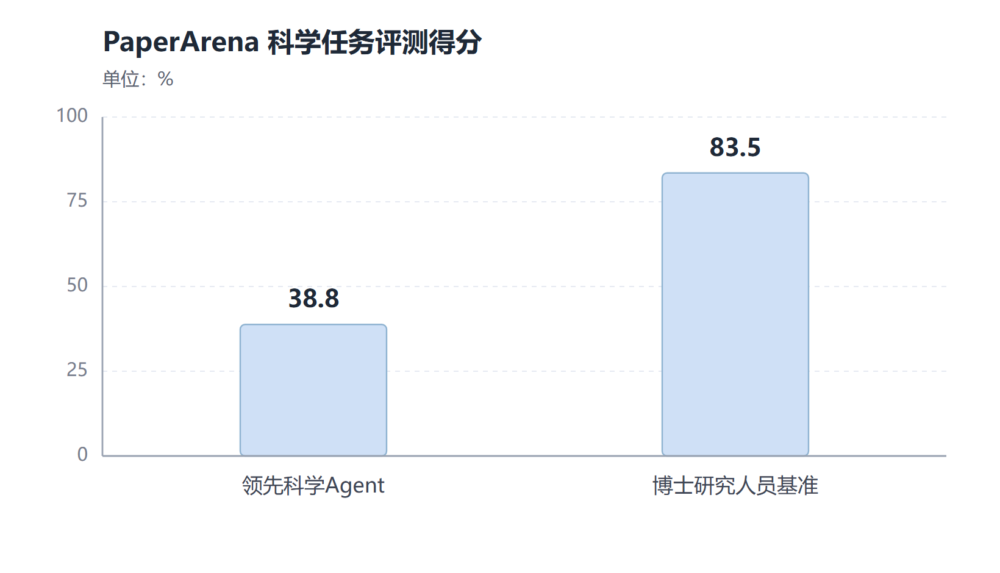
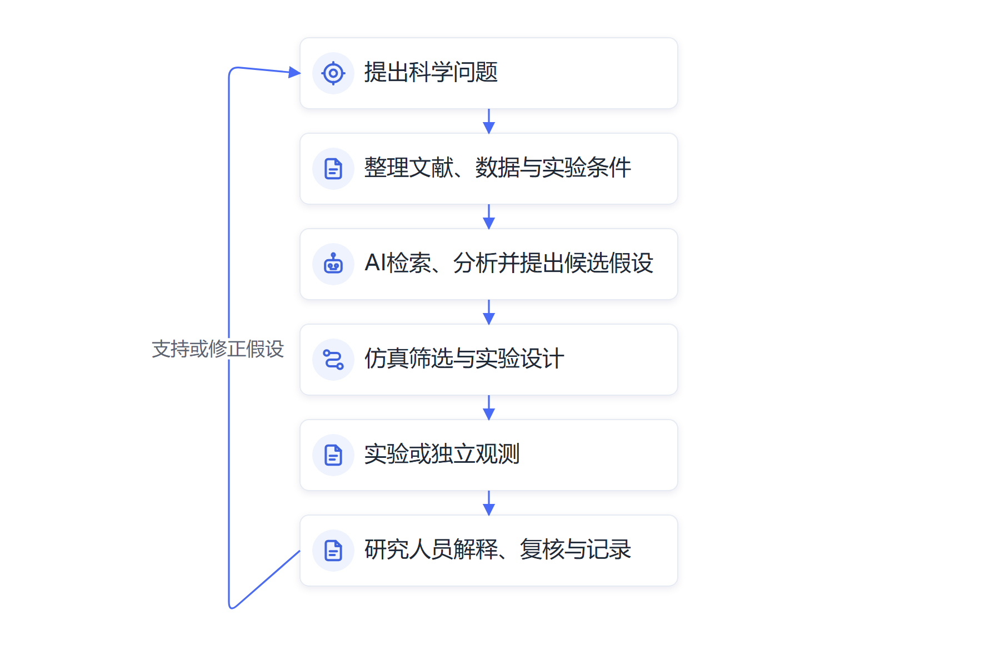

# 第十二章　AI for Science：从蛋白质结构走向新问题

**人工智能正在帮助科学家整理证据、预测结构、提出候选方案，并把研究问题推向实验验证。**

蛋白质由氨基酸链折叠成复杂的三维结构，结构会影响它怎样与其他分子结合、参与细胞活动。几十年来，研究者通过实验确定蛋白质结构，既耗时又需要昂贵仪器。人工智能进入这一问题后，科学家能够更快获得候选结构，研究工作随之从“怎样测出结构”扩展到“怎样利用结构理解生命过程、设计新的分子”。

2020年，DeepMind的AlphaFold2在蛋白质结构预测竞赛中取得显著进展。2021年，团队与欧洲生物信息学研究所合作开放AlphaFold蛋白质结构数据库，数亿条预测结构成为研究人员可以查询的资源。AI因此不只提高某个实验室的速度，还扩大了全球科研共同体获取结构预测的能力。

2024年诺贝尔化学奖的一半授予Demis Hassabis和John Jumper，以表彰其蛋白质结构预测研究；另一半授予David Baker，以表彰计算蛋白质设计工作。诺贝尔奖把“预测自然界中已有结构”和“设计新的蛋白质”两条路线同时推到公众面前。模型帮助科学家提出候选结构，实验仍要验证它能否按预期折叠、结合或发挥作用。[诺贝尔奖对2024年化学奖的介绍](https://www.nobelprize.org/prizes/chemistry/2024/popular-information/)

## AlphaFold让长期研究问题出现新入口

传统结构生物学依靠X射线晶体学、冷冻电镜和核磁共振等实验手段观察蛋白质。不同蛋白质的样品制备和测量难度差异很大，复杂结构可能需要团队投入多年。AlphaFold2根据氨基酸序列预测蛋白质三维结构，缩短了从序列到结构假设的时间，使更多研究人员能够先查看模型预测，再决定值得优先实验验证的问题。

预测结果可以帮助团队筛选候选位点、比较不同蛋白质之间的结构联系、提出突变实验方案。研究者能够借此关注疾病相关蛋白、酶功能和分子相互作用。预测降低了探索入口的成本，也扩大了待验证假设的数量；它不会自动回答模型给出的结构在细胞环境中是否稳定，也不等于已经找到安全有效的治疗方法。

AlphaFold 3把预测范围从单个蛋白质结构扩展到蛋白质与DNA、RNA、小分子、离子等分子间相互作用。研究者可以借它观察候选结合方式，为实验设计提供线索。论文团队指出，与特定预测任务相关的分子结构准确度有所提高；科学家使用时仍要查看模型适用范围、数据条件和不确定性，并通过实验检验候选结果。[AlphaFold 3原始论文](https://www.nature.com/articles/s41586-024-07487-w)

结构预测提供的是一张可能的分子地图。研究人员能够用它比较蛋白质不同区域的形状，寻找可能与药物结合的口袋，分析突变会不会改变稳定性，也可以据此调整实验中需要观察的位置。过去没有结构信息的蛋白质，现在可能先获得一个计算假设；研究者再决定是否开展冷冻电镜、晶体学或生化实验。模型把实验路线从“先收集全部信息”推进到“根据候选假设优先安排实验”。

这样的变化会影响实验室的资源分配。一个课题可能有几十种候选蛋白质，模型先筛选出值得研究的少数目标，实验团队就能把试剂、培养时间和仪器机时投入到更有希望的方向。筛选模型也可能漏掉少数特殊结构，因此研究人员仍要保存候选来源、评估失败样本并安排必要的对照实验。AI改进的是科研人员探索问题的入口，实验设计和结论仍由证据决定。

## AI正在进入不同科学流程

AI for Science已经扩展到多个领域。材料科学研究人员用模型预测晶体结构和材料性质，再通过计算模拟或实验合成验证候选物；药物研究团队用模型预测靶点、生成候选分子并筛选药物性质；气象学团队用机器学习模型处理历史观测和数值模拟结果，缩短天气预报计算时间；天文学家用视觉模型识别星系、瞬变天体和望远镜观测数据中的异常信号。

不同学科采用AI时，研究对象和验证手段各有区别。

| 研究领域 | AI可以协助的工作 | 关键验证环节 |
| --- | --- | --- |
| 生物与医学 | 预测蛋白质结构、筛选分子、分析影像和基因数据 | 细胞、动物、临床或结构实验 |
| 化学与材料 | 预测材料性质、生成候选结构、筛选反应路径 | 合成、测量、稳定性和可制造性测试 |
| 气象与地球科学 | 处理卫星、雷达和长期观测，生成天气或环境预测 | 观测站、历史事件和极端天气回测 |
| 物理与天文学 | 识别天体、分析实验信号、筛选异常样本 | 仪器标定、独立观测和理论检验 |

表中这些应用都嵌入科学工作流程，不只是把AI当作一个问答窗口。科学家会先明确研究对象、整理可用数据、选择合适模型，再比较模型预测和现有知识。若预测结果与理论不一致，研究者可能发现新现象，也可能发现数据错误或模型失准。实验、仿真和专业解释共同决定新结论能否成立。

斯坦福HAI《2026 AI Index》统计显示，2025年自然科学领域约有80,150篇与AI相关的论文，比上一年增加26%；AI相关研究在生物、化学、物理、地球和天文学领域持续增长。该报告也指出，AI已经进入天气预报、材料设计和实验流程等研究环节，但在端到端科学任务评测中，AI Agent仍明显低于博士研究人员水平。[Stanford HAI《2026 AI Index》科学章节](https://hai.stanford.edu/ai-index/2026-ai-index-report/science)

其中一个引人关注的进展来自天气预报。研究团队使用机器学习模型连接数据准备、预测和产品生成环节，展示了由AI运行完整天气预测流程的可能性。AI天气模型在某些速度和精度指标上具有竞争力，业务气象部门仍要比较不同地区、天气类型、预报时效和极端事件中的可靠表现。预测结果要通过真实观测、同行评议和预报业务检验。

## 科学研究把AI推向更长的任务链

过去，AI经常被安排完成一个明确步骤：识别图像、整理数据或预测一个分子性质。现在研究人员开始搭建能连接文献检索、代码分析、假设生成、实验规划和结果比较的科学Agent。系统可以先阅读论文和数据说明，再写分析代码，提出下一步实验方案，调用实验设备或仿真程序，最后整理结果供研究人员检查。

科研问题本身往往没有标准答案。研究者可能需要先界定科学概念，寻找可靠数据，选择适合的统计方法，排除替代解释，再根据证据修改理论。Agent可以并行查找信息、生成代码、比较候选假设和记录实验过程，但现有系统在长任务中仍会误读数据、犯统计错误或生成无法复现的结果。Stanford HAI《2026 AI Index》中的PaperArena测试里，领先Agent得分约为38.8%，博士研究人员基准约为83.5%；这类评测只覆盖选定的科学任务，却显示科研过程仍需要大量专业判断。

*图12-1　该评测覆盖选定科学任务，不能代表所有科研流程。来源：[Stanford HAI《2026 AI Index》科学章节](https://hai.stanford.edu/ai-index/2026-ai-index-report/science)。*

AI提出的结果要进入科学知识体系，需要其他团队能够复现实验、检查数据和方法。论文要说明模型版本、训练数据、参数、实验设备、失败样本和统计方法；科研机构还要处理数据权利、病人隐私、生物安全和研究伦理。模型生成一份看起来完整的报告，不会自动满足科学证据的要求。

## AI改变科研人员的工作节奏和合作方式

科研人员过去可能花很多时间整理文献、筛选候选材料、编写分析脚本和检查图表。AI可以缩短一部分技术性操作，使研究者更快比较方案、处理规模更大的数据。科研人员会投入更多精力定义问题、评估证据、设计实验和解释结果。不同学科之间的合作也可能增加，机器学习专家、实验科学家和数据管理员要共同确定数据格式、评价指标和可复现流程。

这类变化对科研训练提出新要求。学生需要会用模型写代码，也要能够理解代码在计算什么、判断统计假设、发现数据泄漏并复现实验。若基础统计和实验训练缺位，研究者就可能把模型输出误当成正确结论。导师要把AI工具的使用记录、代码审查和结果复现纳入科研培养，让新人学习完整的研究过程。

人工智能的作用还取决于科学数据的开放程度。许多重要数据来自国家设施、大学实验室、医院、气象台和长期观测项目，采集成本高且格式复杂。数据所有者需要安排访问权限、元数据、质量标准和许可方式；研究团队则要明确数据能否用于训练、共享和二次分析。数据质量和共享制度决定模型能否跨学科、跨机构发挥作用。

AI科研工具还需要连接研究人员使用的真实软件和实验设备。生物信息学Agent可以调用序列比对和统计分析工具；材料研究Agent可以提交计算化学模拟，再整理结果；自动化实验平台能够把候选方案写入实验流程，控制液体处理设备并记录传感数据。每增加一个工具接口，研究团队就要验证参数、单位、运行环境和结果文件，避免Agent把一个实验的材料用量误写到另一组样本里。

“AI科学家”系统开始尝试从论文中提出假设、生成代码、运行分析和撰写报告。有些AI生成的研究论文进入了同行评审工作坊，也有科学Agent在生物医学研究中辅助提出候选解释。学术会议接收作品说明研究群体愿意讨论这类系统，不能替代正式期刊对新发现的认定。研究者还需要检查AI是否复用了既有结论、代码是否真实执行、实验数据是否支持报告中的判断。

## 从模型预测到实验发现，研究对象要逐层收窄

蛋白质结构预测展示了AI怎样让科研人员更快进入问题。研究人员能够先用模型生成候选结构，再检查置信度、结合区域和已知实验资料，选择更值得验证的目标。模型减少了部分候选探索时间，实验室仍要决定哪些结构值得合成、是否能够稳定表达、在细胞或组织中是否产生预期作用。候选数量增加以后，实验设计和验证能力也要跟上。

类似的工作流程也出现在新材料研究中。模型可以根据目标性质提出大量晶体结构或化学组成，计算系统先筛除明显不稳定的候选，再由实验人员合成材料并测量导电、强度、耐热或成本等指标。若理论计算和测量结果不符，团队需要查找原因：模型是否忽略杂质，实验制备是否偏离方案，测量仪器是否校准，或既有理论是否需要修订。科学发现常由这种反复比较推动。

研究团队可以把AI放在证据链的不同位置：用模型检索和整理文献，用分类器筛选影像或样品，用生成模型提出候选，用仿真评估可能结果，再把最值得研究的假设送入实验。每个环节都应保留原始数据、处理脚本、模型版本、参数和人工判断。这样，当结果不能复现时，团队才能定位是数据、算法、实验条件还是解释过程造成差异。

*图12-2　AI参与科研后形成的证据循环；模型预测需要经过实验、观测或独立复现*

## 评价科研AI要区分效率、可重复性和新知识

模型帮助研究者节省整理数据的时间，说明工作效率可能提高；候选材料更快进入实验，说明研究流程可能缩短；发现了此前未知的机制，才涉及科学贡献。三者有关联，却不能互相替代。项目评估可以记录筛选速度、实验成功率、预测与实测差距、独立团队复现结果的比例，以及结果对后续研究产生的影响。

科学模型的优势还要与专业人员、传统算法和实验设备比较。某项系统在小型数据集上准确率很高，放到不同机构、不同仪器和不同人群上可能失准。科研团队应开展外部验证，公开适用条件和已知局限，并记录失败实验。负结果同样具有价值，它能防止其他团队重复走入无效方向。

跨学科合作是AI for Science的重要条件。计算机研究者熟悉模型结构，实验科学家理解对象与测量方法，统计人员检查不确定性，数据管理员保障资料来源和权限。若各方只在项目后期短暂沟通，模型任务可能与真实科学问题脱节。从问题定义阶段共同设计，AI更容易进入真实研究循环。

## 多源数据推动跨学科研究

科研团队还可以用模型开展跨领域的证据比对。例如，气候研究可能把卫星观测、地面气象站、历史档案和数值模拟组合起来；模型发现异常趋势后，研究人员要核查不同来源是否采用相同时间尺度、空间分辨率和测量定义。数据整合看似是工程工作，实际上会影响研究问题如何被表述，也可能决定某个异常是否值得进一步调查。

## 从预测到发现需要经历证据链

模型表现还受训练资料与研究条件之间的距离影响。医学模型可能在某家医院的数据上准确，却在其他医院的仪器、病人结构和标注习惯中失准；天文模型遇到未曾出现的异常信号时，也可能把真实新现象归入噪声。研究团队应选择不同机构、不同时间段的数据开展外部验证，记录不确定范围，并在模型不熟悉的领域降低自动化程度。

科学工作中常见的模型幻觉也值得警惕。语言模型可能把相近论文标题拼接成不存在的引用，或把模拟数据总结成实验结果；模型生成的代码看起来合理，却可能计算了错误指标。科研人员需要追查原始数据、运行代码、核对文献DOI、复算关键数字，并保留能够复现研究的材料。透明记录让同领域团队能够检查假设和结论。

模型可以发现数据中的相关模式，却不会仅凭相关性确认因果关系。候选材料的预测性质优良，仍需实验确认其稳定性、可制造性和环境影响；模型预测某种分子能够结合靶点，还要开展细胞、动物和临床研究；天气模型在平均误差上表现良好，也要检验极端降雨、台风路径和区域预报的误差。科学发现必须经过证据链检验。

组织在评估科研AI项目时，可以观察候选筛选速度、实验周期、测量成本、预测准确度、复现实验比例和新知识贡献。某个模型提高了论文撰写效率，并不等同于提高了科学发现质量；候选分子增加，也不保证药品会更快上市。管理者要确认项目阶段、数据来源、实验条件和后续验证计划，再判断其科研价值。

AI for Science的深层变化，是机器开始进入科学工作本身。模型帮助科学家扩大搜索范围、压缩计算时间并生成新假设；人类研究者负责判断哪些问题重要、哪些证据可信、哪些结果可以解释。科学发现仍需要观察、计算、实验、反驳和修正，AI让这个循环运行得更快，也让科研组织更需要保持记录透明、验证严格和学科协作。

## 资料来源与说明

- [诺贝尔奖对2024年化学奖的介绍](https://www.nobelprize.org/prizes/chemistry/2024/popular-information/)：蛋白质结构预测和计算蛋白质设计获奖背景。
- [AlphaFold 3原始论文](https://www.nature.com/articles/s41586-024-07487-w)：蛋白质、DNA、RNA和小分子相互作用预测。
- [Stanford HAI《2026 AI Index》科学章节](https://hai.stanford.edu/ai-index/2026-ai-index-report/science)：科学论文、AI气象系统和科学Agent评测。
- [Stanford HAI《2026 AI Index》科学章节PDF](https://hai.stanford.edu/assets/files/ai_index_report_2026_chapter_5_science.pdf)：物理、化学、材料、天文和实验AI的发展及限制。
