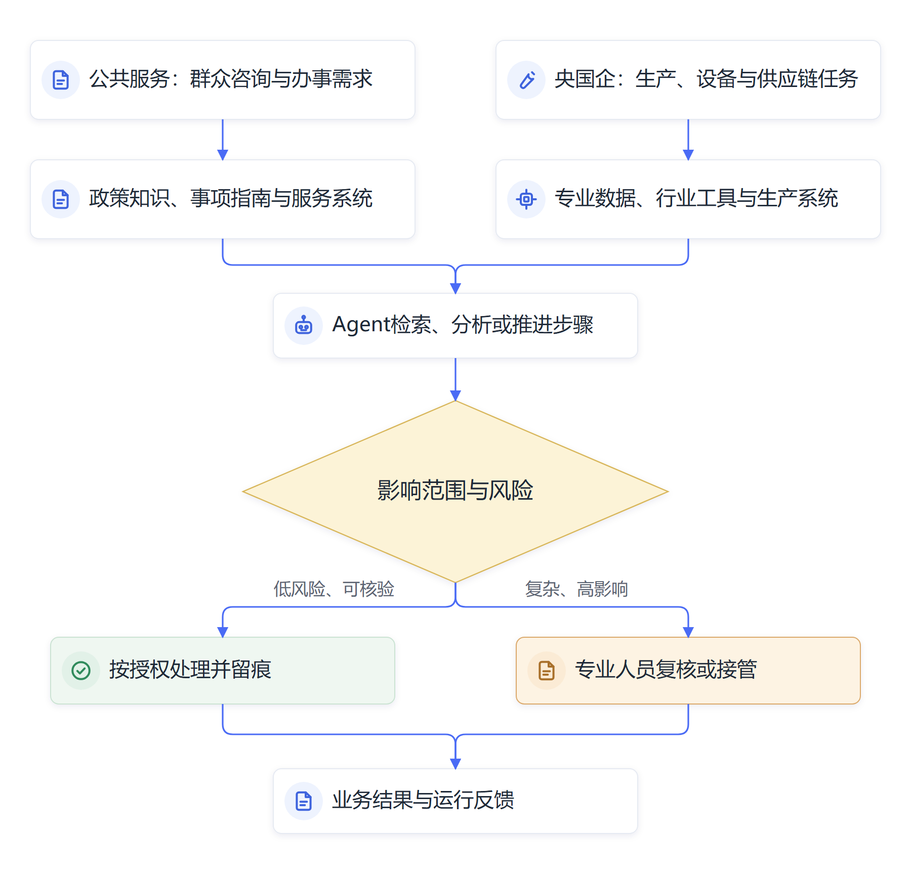

# 第十三章　政务服务与央国企：AI进入公共服务和产业

**从办事问答、能源规划到供应链操作，人工智能开始进入具有真实业务责任的系统。**

人工智能从写作助手走进公共服务和央国企生产流程后，工作方式发生了变化。系统开始使用政策文件、办事指南、设备数据、采购规则和业务接口，为群众、企业员工和专业人员提供咨询或执行任务。AI的价值不再只看它能不能写出答案，还要看它是否使用了适用的信息，能否把服务办完，错误出现后又由谁处理。

政务服务和央国企场景各有特点。政府部门依据法定职责为群众和企业提供服务，需要尊重程序、公平、公开和隐私要求；中央企业和国有企业围绕行业主责、生产经营和公共服务运行，既要提升效率，也要考虑生产安全、供应链稳定和资产责任。人工智能可以进入这两类组织，实际部署范围和审核要求仍由各自的制度与业务后果决定。

## 政务服务从查找指南走向对话办理

群众办事常见困难，是不知道事项名称、材料要求、办理部门和流程顺序。传统政务网站通常按行政事项分类，群众要理解专业术语，再逐页查询相关指南。AI助手可以接受自然语言描述，识别群众的办事目的，再从事项库、办事指南和政策材料中检索相关信息，告诉群众下一步应准备什么。

国家发展改革委2026年介绍贵州“贵人智办”AI助手：系统依托贵州政务服务网建设，使用开源大模型、向量数据库和多模态识别技术，形成“问、导、办、查、评”等功能。公开介绍称，助手可回答5087个标准化事项相关问题，累计响应问答超过121万次，并把“边聊边办”连接到350个事项。报道还称项目已累计服务企业群众133万余次。这些数字来自省级项目公开介绍，说明系统已经投入运行；评估服务质量还要查看统计口径、成功办件率、转人工情况、群众反馈和独立评价。[国家发展改革委：贵州“贵人智办”AI助手](https://www.ndrc.gov.cn/fggz/fgfg/dfxx/202601/t20260121_1403373.html)

> **原文摘录：**“已累计服务企业群众133余万次。”
>
> **来源：**[国家发展改革委《贵州：深化“贵人智办”AI助手应用》](https://www.ndrc.gov.cn/fggz/fgfg/dfxx/202601/t20260121_1403373.html)。数据按公开介绍口径引用。

| 贵人智办公开指标 | 已披露数据 | 对应内容 |
| --- | ---: | --- |
| 标准化事项问答 | 5,087项 | 可回答事项相关问题 |
| 累计响应问答 | 121万余次 | 反映交互规模 |
| “边聊边办”接入事项 | 350项 | 申请人可在对话中办理 |
| 累计服务企业群众 | 133万余次 | 项目方披露的累计服务量 |
| 相关事项申报效率 | 提升2—3倍 | 项目方与传统方式的比较口径 |

*表13-1　项目数据由主管部门公开介绍，仍需结合办件成功率、转人工比例和独立评价理解。来源：[国家发展改革委](https://www.ndrc.gov.cn/fggz/fgfg/dfxx/202601/t20260121_1403373.html)。*

这类项目的主要技术路线，是先整理事项知识，再让大模型理解群众表述，并从可信指南中检索答案。助手可以对“我想开个餐馆，需要办什么”这类自然语言问题进行意图识别，匹配食品经营、营业执照、消防等可能相关事项；它还可以询问地区、经营场所和业务类型等条件，再返回对应指南。知识库由业务部门维护，指南更新后要及时同步，否则模型可能给出旧要求。

如果助手进一步连接办事系统，就可以帮助群众选择事项、预填表单、查看进度或提交材料。每增加一个操作环节，系统就要核验身份、检查表单字段、记录提交状态并为出错准备恢复方式。模型能够解释流程，业务系统负责确认申请是否真正提交；群众是否完成办理，仍要看后台记录、材料审核和法定程序。

## 服务对象的表达要进入系统设计

政务服务的入口面对的是群众自然表达，制度文件则通常使用规范术语。两者之间存在转换工作。群众可能只说“公司地址变了要怎么处理”，系统要判断他是在问登记变更、税务信息、许可证还是补贴资格；回答之前还可能需要了解所在地、企业类型和变更内容。助手应先识别信息是否充分，必要时继续询问，再从适用指南中找依据。

窗口和热线人员可以帮助项目组建立真实问题样本。团队在获得合规授权并做好个人信息保护后，按事项整理去标识化的问题，区分常见问法、信息不足、跨部门事项、政策例外和投诉情形。测试集不应只有标准化提问，还要包括口语表达、错别字、多个事项混在一起以及政策刚刚更新的情况。评估结果可以帮助主管部门决定哪些问答适合自助，哪些应由工作人员直接接管。

AI也可以帮助部门观察服务流程中反复出现的问题。若群众持续询问同一项材料，原因可能是指南解释不清、线上表单字段含义模糊，或部门间信息不一致。项目组把高频问题返回业务部门后，部门可以改进办事指南、调整页面提示或协调数据共享。AI在这里既是服务入口，也可能成为发现流程堵点的观察工具；群众数据的使用范围和留存方式需要受到管理。

## 央国企将AI接入生产和服务环节

中央企业已在电力、石油化工、通信、制造、交通、建筑和金融等领域推进人工智能应用。生产单位掌握设备数据和专业知识，业务系统连接采购、检修、调度、物流与客户服务，AI可以支持故障分析、质量检查、研发试验和生产计划。项目效果往往取决于数据治理、接口改造、现场安全和员工是否愿意调整工作流程。

2025年，国务院国资委公开介绍中央企业已在能源、制造、通信等16个重点行业布局800多个人工智能应用场景，并持续推进高质量数据集、行业模型和算力建设。2026年世界人工智能大会期间，国资委发布第二批央企人工智能战略性高价值场景及行业数据集，并启动智能软件工厂联合筑基工程。这些发布显示央企正把人工智能从独立试点推进到场景、数据和工具的体系建设；场景数量和项目名录不能直接说明各项应用已常态运行或产生了相同收益。[国务院国资委2026年人工智能领域系列成果](https://wap.sasac.gov.cn/n2588020/n2588072/n2590902/n2590904/c35690985/content.html)；[国务院关于央企AI+应用场景的报道](https://app.www.gov.cn/govdata/gov/202509/17/536855/article.html)

南方电网展示的配电网规划智能体可以读取规划任务、调用电力专业工具，辅助完成问题诊断、方案生成、仿真校核和投资评估。中远海运展示的智能供应链管家则将订舱处理时间缩短到5秒。公开报道没有提供完整评估方法、对照周期和人工介入数据，现阶段应按项目和大会展示口径理解。这些案例提示，Agent正在尝试处理专业流程中的多个步骤，业务人员仍要核对数据、比较方案并作出最终决定。[国务院国资委转载新华社报道](https://wap.sasac.gov.cn/n2588025/n2588139/c35659709/content.html)

## 央国企项目要接入专业系统和生产责任

在电网规划、设备巡检、供应链管理或质量检测中，Agent需要读取业务系统提供的实时或历史数据，调用计算、检索和仿真工具，再将结果返回专业人员。工程师要知道系统用的是哪个数据时间点、适用哪类设备和工况，供应链人员要确认订单、库存和运输状态的来源。工作系统之间的数据口径一致，Agent才不容易把旧库存当成当前库存。

生产场景可以采用分级授权。观察阶段只读取数据、生成分析报告；建议阶段可以提出告警、检修或规划方案，由专业人员确认；经过严格验证后，系统才可在限定条件下自动完成低风险操作。调度、设备控制和资金支付等高影响操作，应按业务制度设置审批、联锁、日志和人工接管。Agent的权限跟随任务范围逐步开放，运行记录则帮助组织回看每次决策的依据和动作。

同一个Agent还可能连接多个系统，数据源更新时间、接口失败和权限边界会成为业务风险。系统应能报告信息来源和更新时间，发现关键数据缺失时停止给出确定性判断；工具接口也要返回执行状态，区分“请求已发出”和“业务处理已成功”。工作人员可以据此判断是继续等待、重新提交还是转人工处理。

*图13-1　公共服务与产业流程使用Agent时的共同治理环节*

## 应用项目如何从一个工具变成运行流程

人工智能项目需要从真实任务出发。电力规划团队可以先选出数据条件较好的一类设备规划任务，整理负荷、设备容量和建设要求，再确认哪些专业计算工具可以调用。Agent生成候选方案后，工程师逐项检查假设、设备数据、约束条件和投资结果。项目组记录错误类型、审查工时和修改原因，才能判断系统在什么条件下可以参与规划工作。

政务服务也可以沿着相似步骤推进。事项部门先确定助手回答范围，信息化团队接入正式发布的办事指南，服务窗口整理群众真实提问，测试团队设计不同地区和不同申请对象的边界问题。试运行时，系统可以把问题转给人工坐席，工作人员核对答案并记录缺少的条件。这样积累的运行记录可以帮助完善指南、补充知识库和调整服务流程。

国家发展改革委、工业和信息化部及国资委等部门发布的政策，正在把人工智能应用推进到公共服务和产业流程。国务院2025年“人工智能+”行动提出围绕科学技术、产业发展、消费提质、民生福祉、治理能力和全球合作等领域组织应用；工信部制造业应用指南则要求单位结合业务基础、数据条件、数字化水平和经济性选择场景。[国务院“人工智能+”行动意见](https://www.cac.gov.cn/2025-08/27/c_1758018277755538.htm)；[工信部《制造业企业人工智能应用指南》](https://www.miit.gov.cn/cms_files/filemanager/1226211233/attach/20261/735011cb05584824b3cb2a45666a58ce.pdf)

## 公开案例要区分展示、试点和常态运行

宣传材料中的“落地”“应用”“赋能”可能指不同阶段。展台演示说明系统在某次展示中完成过任务；有限范围试点说明它在指定部门、数据和权限条件下运行；常态应用需要系统持续稳定，员工能够处理异常，组织能够维护数据和接口；成效评估还要比较应用前后的业务基线，并记录质量、成本和风险变化。

在政务服务场景中，累计问答次数说明群众向助手提出了多少问题，不能单独证明答复准确、问题解决或办事时间缩短。若助手把用户引导到错误事项，问答量越大可能带来更多重复咨询。评估时应进一步查看首问解决率、答复准确度、转人工比例、办件成功率、投诉和复核记录。

在央国企生产经营场景中，设备识别准确率、方案生成时间或订舱处理秒数都需要结合业务条件理解。单位应了解统计周期、处理任务范围、人工复核比例、系统故障和样本变化。设备报警减少后，检修工作是否更及时；方案计算加快后，工程师是否提高了决策质量；订舱缩短后，客户等待与整体物流环节是否同步改善，都需要业务数据支持。

## 公共服务和产业运行中的治理条件

政府部门需要明确哪些数据可以进入模型，涉及个人信息、身份信息和敏感业务材料时要按照权限和数据安全要求处理。群众可以查看办事指南，但系统不能未经授权将申报信息传给不相关部门或外部平台。政府组织如果委托第三方处理政务数据，还要明确处理目的、范围、访问控制、日志留存和事件报告责任。

央国企也要建立分层的数据和模型权限。生产系统、设备运行参数、商业秘密和供应链资料应按业务需要提供给AI组件，模型供应商或开发团队不得默认获得全部信息。涉及安全生产、资金安排、设备控制和合同签署的Agent操作，应设置权限隔离和审批机制，保留可追溯的执行记录。

行业组织应把AI项目与现有制度、系统和职工岗位衔接起来。项目上线后，业务部门负责确认规则和结果，技术团队维护模型与接口，数据管理岗位保障资料质量，安全和合规人员检查风险。遇到系统停机、模型输出异常或数据源更新，责任人要知道怎样暂停服务并恢复原有流程。

## 行业模型、通用模型与既有系统各有位置

央国企面对复杂业务时，经常需要综合使用通用大模型、行业知识库、传统算法和业务软件。通用模型适合理解多样表达、整理材料和组织步骤；行业模型可能更熟悉特定术语和任务；知识检索帮助回答关联到组织当前文件；传统算法处理边界清楚、需要高精度计算的问题；业务系统负责身份、审批、交易和数据状态。组合设计时要明确各组件的职责，避免把计算结果交给语言模型凭空生成。

项目选择本地部署、行业云或外部服务时，也要结合数据类型、模型能力、运维人员和更新频率。敏感数据需要严格控制访问路径；需要频繁使用前沿能力的任务，可能评估经批准的外部服务；业务连续性要求高的系统需要备用方案和故障响应机制。架构决策应由业务、技术、数据和安全岗位一起完成，采购人员还要把更新、数据迁移、退出和服务保障写入合同。

从政务大厅到生产班组，人工智能要先理解真实工作，再进入相应系统和责任链。群众需要知道答案从何而来、复杂事项如何找到人工人员；工程师需要知道建议由哪些数据和工具生成、发生异常时怎样安全接管。技术部署越贴近真实业务，组织就越要把透明、可靠、连续服务和责任落实纳入产品设计。

## 业务变化需要进入系统维护

数字系统还要适应政策调整和业务季节性。办事指南更新、专项行动启动、汛期或迎峰度夏都会改变群众咨询和生产数据的分布。部门可以建立版本更新通知、定期抽样复核和节假日保障安排；当知识或数据没有及时更新时，助手应说明信息更新时间并转交工作人员。可靠服务依赖系统及时反映现实工作状态。

## 从“能回答”走向“能承担流程中的工作”

政务服务和央国企应用展现了不同层次的智能化。助手回答政策问题，可以降低查找成本；Agent接入表单和业务系统，可以帮助推进若干流程动作；智能机器人进入现场后，还需要感知和操作真实设备。不同系统都使用人工智能，运行风险和验收标准却不一样。

组织评价一个项目时，应从群众服务、生产运行或公共管理的实际结果出发。它减少了哪类等待，错误和返工是否下降，员工是否需要更多时间核对，数据和系统维护成本是否可承受，遇到复杂情况能否转交人工，这些问题能够说明AI是否改善工作。技术能力持续扩大，公共责任和生产责任也要随之进入系统设计。

## 资料来源与说明

- [国家发展改革委：贵州“贵人智办”AI助手](https://www.ndrc.gov.cn/fggz/fgfg/dfxx/202601/t20260121_1403373.html)：系统建设模式、服务范围和项目公开数据。
- [国务院国资委2026年人工智能领域系列成果](https://wap.sasac.gov.cn/n2588020/n2588072/n2590902/n2590904/c35690985/content.html)：第二批高价值场景、行业数据集和软件工厂工作。
- [中央企业“AI+”应用场景数据](https://app.www.gov.cn/govdata/gov/202509/17/536855/article.html)：16个行业和800余个应用场景，按主管部门披露口径使用。
- [新华社报道央企人工智能应用](https://wap.sasac.gov.cn/n2588025/n2588139/c35659709/content.html)：配电网规划Agent和订舱案例，项目披露缺少完整评估方法。
- [国务院“人工智能+”行动意见](https://www.cac.gov.cn/2025-08/27/c_1758018277755538.htm)：政策行动方向与目标。
- [工信部《制造业企业人工智能应用指南》](https://www.miit.gov.cn/cms_files/filemanager/1226211233/attach/20261/735011cb05584824b3cb2a45666a58ce.pdf)：制造业场景识别与项目评估参考。
