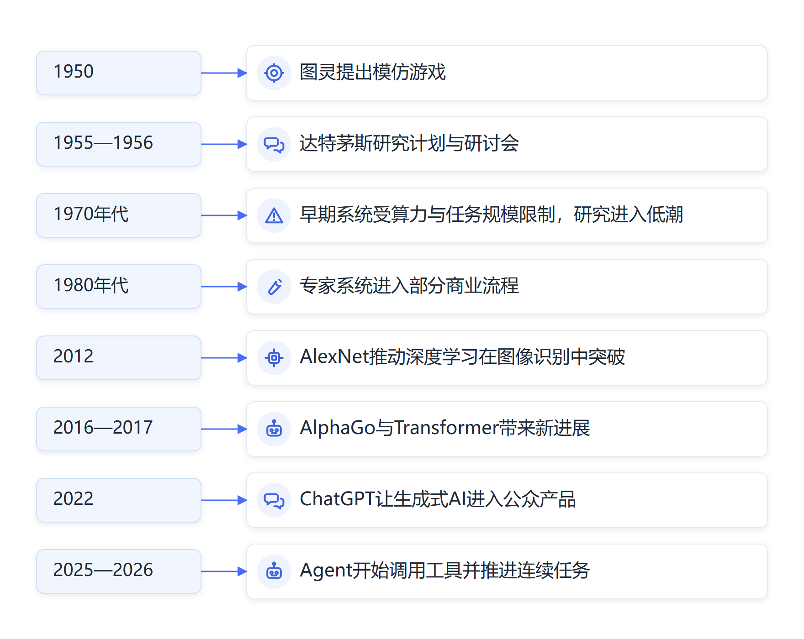

# 第五章　人工智能发展史：在曲折中快速进步

**从图灵提出“机器能否思考”，看到人工智能怎样在反复受挫中越走越快。**

1950年，英国数学家艾伦·图灵发表《计算机器与智能》，把一个容易引起争论的问题换成了可以讨论的实验：人通过文字与另一端交谈，如果无法稳定分辨对面是人还是机器，我们应当怎样判断机器表现出的智能？他将这个游戏称为“模仿游戏”。图灵没有用这项测试证明机器拥有人的意识。他把注意力放在机器的行为和学习能力上，还设想机器可以像儿童一样接受训练，在反馈中逐步进步。[图灵《计算机器与智能》](https://academic.oup.com/mind/article/LIX/236/433/986238)

图灵的设想比当时的计算机条件走得很远。那时的计算机体积庞大、存储有限，程序员要把每个步骤提前写好。图灵却已经在思考机器能不能学习、能不能根据经验改变行为。今天的大语言模型、强化学习和个人智能体，仍在追问这些问题：机器怎样利用样本形成能力，怎样把目标转成行动，又怎样从错误中调整。

## 人工智能从一个大胆设想变成研究领域

1955年，约翰·麦卡锡、马文·明斯基、克劳德·香农和内森尼尔·罗切斯特共同提交达特茅斯暑期研究计划。计划书把语言、抽象概念、问题求解和机器学习列入研究范围，设想只要把智能的某些方面描述得足够清楚，就可以让机器模拟它们。1956年夏天，研究人员在达特茅斯学院集中讨论这些问题。“人工智能”从此成为一个明确的研究名称，也形成了一个长期目标：让机器表现出需要智能才能完成的能力。[达特茅斯研究计划原文](https://www-formal.stanford.edu/jmc/history/dartmouth/dartmouth.html)

> **原文摘录：** “to find how to make machines use language, form abstractions and concepts”
>
> **中文释义：** 计划书把机器使用语言、形成抽象概念列为研究方向。
>
> **来源：** [达特茅斯暑期人工智能研究计划（1955）](https://www-formal.stanford.edu/jmc/history/dartmouth/dartmouth.html)。

最初几年的进展让研究者相当乐观。Logic Theorist能够证明部分数学命题，早期程序也开始处理棋类、符号运算和简单对话。研究者把复杂思维拆解成符号、规则和逻辑步骤，再让计算机依照程序推理。在边界清楚的问题里，这种办法确实有效。机器能够下棋、解题、按规则搜索，过去被认为只能由人完成的活动逐渐出现了可运行的程序。

早期研究里还有两种不同的想法持续交锋。一派把智能看作符号和规则，试图让计算机按逻辑推理；另一派尝试用神经网络模拟神经元连接，让系统从样本里调整参数。符号系统容易解释每一步，却需要人预先写出知识；神经网络能从数据中形成表示，却受限于当时的存储、算力和训练方法。人工智能后来的进展反复在两条路线之间取长补短。

早期的Logic Theorist就是一个生动例子。研究人员让它尝试证明《数学原理》中的逻辑定理，它找到的证明过程有些比原书中的写法更简洁。后来出现的General Problem Solver试图把“目标—操作—差距”的思路用于不同问题。人们很容易据此相信，只要找到足够通用的逻辑规则，机器就能解决各种复杂问题。这些项目在数学符号和人为设定的环境中取得进展，却没有解决系统如何获得常识、怎样理解开放世界的问题。研究环境中，程序员会规定符号的含义、限定可用操作和准备输入；现实环境里，机器要面对没有被提前列入规则的对象和情境。计算机可以在封闭题目里展现推理能力，却无法自动把这项能力迁移到新领域。早期研究者把“能够解决某个难题”与“具有广泛智能”联系起来，后来发现两者之间还有环境理解、知识获取和持续学习等难题。

20世纪60年代，研究者也开始试着让机器理解语言。Joseph Weizenbaum编写的ELIZA可以通过关键词和句式模板回应用户，有些使用者会把它当成有理解力的对话对象。ELIZA并没有建立深刻的语言理解，它展示的是人们容易从流畅回应中感受到智能。这个现象延续到今天：语言表达越自然，使用者越容易把能力范围想得过宽。评价人工智能，既要看它说得像不像人，也要看它能否持续完成任务、准确依据材料并应对变化。

困难也很快显现出来。研究者在实验室里设计的任务往往有明确规则、有限选项和干净数据；真实世界里的问题却充满例外。机器可以依照棋盘规则搜索很多步，却不理解棋手为何改变策略；它可以按输入句式回答，却难以处理语境、常识和含糊表达。规则一旦变多，彼此之间容易冲突。知识库也需要人不断补充和维护，机器不会自动知道哪些规则已经过时。

*图5-1　人工智能研究从规则系统走向数据学习与任务执行*

## 两次低潮让研究目标回到现实

20世纪70年代，英国数学家詹姆斯·莱特希尔受政府委托评估人工智能研究。他指出，早期系统在小规模示例中的成功，难以推广到更大、更复杂的问题；组合可能性迅速膨胀，计算量会超过当时设备能够承担的范围。英国政府和美国研究机构随后调整资助方向，人工智能研究进入一段低潮。不同国家和项目的时间并不完全相同，所谓“人工智能寒冬”主要概括资金、关注度和商业期待同时降温的时期。[英国议会人工智能发展史回顾](https://publications.parliament.uk/pa/ld201719/ldselect/ldai/100/10018.htm)

低潮没有让研究者停止探索。项目资金减少时，学术团队仍在研究机器学习、语音识别、计算机视觉和神经网络。每一种路线的成熟时间都受到数据、硬件、研究方法和可用问题的限制。人工智能寒冬主要表示投资者和政策部门降低了对短期成果的预期，研究人员则继续寻找能复用的技术与更合适的任务边界。

80年代，专家系统带来一轮热潮，把研究从“机器能不能推理”推进到“知识怎样进入业务”。这类系统把医生、工程师和设备维护人员的经验整理成规则，再让计算机根据用户提供的情况给出判断。R1（后称XCON）用于配置DEC公司的VAX-11/780计算机，并进入其制造部门的日常工作，展现了人工智能进入商业工作的早期应用。[McDermott，1982](https://www.sciencedirect.com/science/article/pii/0004370282900212)

专家系统的知识主要依靠人工整理。若专家难以讲清判断依据，知识工程师就难以把经验完整转成规则；新型号、新流程和新规定不断出现时，维护人员还要逐条检查规则、修改冲突并验证结果。系统规模越大，维护成本越高；任务稍微超出预设范围，判断能力也会明显下降。随着硬件成本和市场条件变化，专家系统市场在80年代末至90年代初降温，研究资金再次减少。

这一阶段让组织看到，人工智能落地既要解决算法问题，也要管理知识、流程更新和岗位责任。系统给出判断后由谁确认、规则更新由谁负责、错误如何处理，都会影响它能否长期使用。专家系统的边界也推动研究者转向统计学习、语音识别、计算机视觉和神经网络，让机器从更大规模的样本中寻找规律。

## 从手工规则走向让机器从数据中学习

规则系统的局限推动研究者寻找另一条路：减少人手工编写的判断，让机器从样本中归纳规律。统计学习、神经网络和概率模型逐步发展起来。机器学习把任务转成“根据样本调整参数”：研究人员提供例子和评价标准，算法根据预测误差修正模型，再用新的样本检验它是否学到了可迁移的规律。

1986年，Rumelhart、Hinton和Williams发表反向传播研究，说明神经网络可以根据输出误差逐层调整内部连接权重。它为训练多层网络提供了重要方法，但当时的数据规模、处理器速度和训练技巧仍有限，神经网络没有立即取代规则方法。[反向传播原始论文](https://www.nature.com/articles/323533a0)

1997年，IBM深蓝战胜国际象棋世界冠军加里·卡斯帕罗夫。深蓝的成绩主要来自专用硬件、大规模搜索和棋局评价函数。它并没有因此变成能理解语言、看图或处理业务的通用助手。这个胜利改变了公众对机器计算能力的认识，也让人看到，任务目标清楚、规则明确、计算资源充足时，机器能够在人类积累多年的领域达到极高水平。

在这段时期，统计学习方法逐渐用于语音识别、文字识别、检索和分类。搜索引擎、垃圾邮件过滤和推荐系统把学习算法放进了普通人每天使用的产品，人工智能开始以“搜索更快”“邮件分类更准”等方式进入日常生活。

公众注意力未必集中在这些技术上，研究和工程团队却由此积累了处理大规模数据、评估模型效果和维护线上服务的经验。技术的实际应用在低潮期间继续向前，为后来更大规模的深度学习系统准备了数据和工程条件。

这些系统通常只处理一个边界清楚的任务，任务范围和数据稍有变化就需要重新设计；日常产品里的机器学习应用与通用智能仍有很大距离。
互联网积累了文字、图片和代码，显卡发展为深度学习提供了更强的并行计算能力，研究者也改进了网络结构和训练方法。2012年，AlexNet在ImageNet图像识别竞赛中显著降低错误率，深层神经网络开始在视觉任务上展现优势。这一突破来自较深的网络、大规模标注图像、GPU计算和成熟训练技巧在同一时期结合。[AlexNet原始论文](https://proceedings.neurips.cc/paper/2012/hash/c399862d3b9d6b76c8436e924a68c45b-Abstract.html)

## 从图像识别到生成内容和Agent

2016年，AlphaGo以4比1战胜围棋世界冠军李世石。围棋的棋盘很大，每一步都会改变后续局面。AlphaGo将深度神经网络用于局面评价和落子选择，再结合搜索与强化学习。第二局第37手尤其令人印象深刻：职业棋手起初难以理解这步棋，DeepMind事后估计其概率约为万分之一。更重要的变化在于，机器开始用不同于人类直觉的方式寻找有效方案。2017年推出的AlphaGo Zero进一步从围棋规则出发，通过自我对弈持续改进，在特定棋类环境中展示了强化学习的威力。[DeepMind AlphaGo回顾](https://deepmind.google/research/alphago/)；[AlphaGo Zero研究](https://www.nature.com/articles/nature24270)

2017年发表的Transformer架构改变了语言模型处理长序列信息的方式。研究人员逐步扩大模型、训练数据和计算资源，再用指令示例与人类反馈调整模型回答。2022年11月，ChatGPT以对话产品的形式开放给公众。多年积累的模型研究一下子变成人人能试用的界面。用户不需要学习编程接口，直接描述问题，就能看到文本、代码和解释；这种交互方式把人工智能带入了普通人的日常工作。[Transformer论文](https://arxiv.org/abs/1706.03762)；[OpenAI ChatGPT发布说明](https://openai.com/index/chatgpt/)

之后，人工智能持续接入图像、语音、视频、代码和浏览器操作。模型开始识别多种信息，调用搜索、文档和业务系统，按步骤推进任务。个人智能体和数字员工代表着这条发展线索的最新阶段之一：机器能力从回答问题逐渐延伸到操作工具和协助完成流程。每一阶段都建立在早期研究、硬件与数据基础上，也带来了新的风险和治理要求。

## 曲折推动研究方式不断改进

人工智能发展经历多次高峰与低潮，整体呈现起伏上升的轨迹。人们多次把实验成果想象成即将到来的普遍能力，随后又发现系统受限于数据、算力、知识范围和实际环境。期待过高时，资金和关注度会快速回落；新的算法、硬件和数据条件成熟后，进展又会越过旧有边界。

今天的突破依然建立在前几轮留下的成果之上。过去，研究团队要针对不同任务设计不同算法和系统；如今，预训练模型可以从大量文本和图像中形成通用表示，再通过少量示例、检索资料或工具连接，适应新的工作。这种“先大范围学习、再面向任务调整”的路径提高了研究成果的复用能力。云计算让更多团队可以租用算力，开源框架缩短了工程搭建时间，产品反馈又帮助开发者发现真实使用中的问题。技术向前推进的速度，已经不只取决于某个实验室有没有提出新算法。

与此同时，训练和运行前沿模型需要昂贵的芯片、能源、数据中心和工程团队。世界各地的研究机构、企业和政府都在争取算力、数据与人才，技术竞争也延伸到产业链、标准、公共投入和国际合作。新技术的速度越快，社会越需要建立能够及时观察风险和实际成效的制度。把人工智能史讲给干部听，目的在于认识这种加速的来路，理解它还会带来的制度选择。

能力加快提升的同时，验证要求也在增加。大语言模型能写出流畅文字，却可能编造不存在的依据；Agent可以在受控环境里调用工具，却可能读错页面、填错字段或无法恢复错误。模型基准、演示视频和商业宣传说明某些能力已经出现，真实工作中的连续性、准确性和安全性还要通过实际流程检验。

这段历史还显示，人工智能不会沿着单一路线前进。规则推理试图把知识变成可执行符号；统计学习从数据估计概率；神经网络通过层层参数学习特征；深度强化学习让系统在反馈环境中尝试行动；大语言模型则用大规模预训练获得跨任务的语言能力。新方法通常不会把旧方法完全清除。导航、金融风控、生产控制和政务办理仍可能使用规则、统计模型与人工判断，系统建设者会根据任务要求组合工具。

公众对人工智能的感受也经历了几次变化。早年间，人们从棋类比赛看到机器的计算能力；搜索引擎、推荐系统和语音助手让算法悄悄进入日常服务；图像识别和自动驾驶把模型带到摄像头与车辆中；生成式AI则把语言、图像和代码生产能力直接摆在普通用户面前。每一次产品入口改变，都扩大了接触人群，也暴露出新的偏差、隐私和责任问题。技术史因此既是一段算法史，也是人类不断调整期待、使用方式和治理规则的历史。

这段历史给组织带来两点启示。第一，技术进步可能长期积累，在产品入口、硬件、数据和方法同时成熟时突然加速。第二，面对新一轮热潮，组织既要看见能力扩展，也要问清楚适用范围、运行成本、失败方式和责任人。人工智能的每一次低潮都留下研究方法和工程经验；如今这些积累正汇成更快的技术变化，组织应尽早学习判断并提前准备。

## 资料来源与说明

- [图灵《计算机器与智能》](https://academic.oup.com/mind/article/LIX/236/433/986238)：1950年提出模仿游戏，讨论机器行为与学习。
- [达特茅斯暑期人工智能研究计划](https://www-formal.stanford.edu/jmc/history/dartmouth/dartmouth.html)：1955年计划书和1956年研讨会。
- [英国议会人工智能委员会历史回顾](https://publications.parliament.uk/pa/ld201719/ldselect/ldai/100/10018.htm)：人工智能研究的早期起落和资助变化。
- [McDermott, “R1: A rule-based configurer of computer systems”](https://www.sciencedirect.com/science/article/pii/0004370282900212)：R1配置VAX-11/780计算机并在DEC制造部门使用的原始论文。
- [反向传播原始论文](https://www.nature.com/articles/323533a0)：多层神经网络依照误差调整连接参数的研究。
- [AlexNet原始论文](https://proceedings.neurips.cc/paper/2012/hash/c399862d3b9d6b76c8436e924a68c45b-Abstract.html)：ImageNet竞赛中的深度卷积神经网络成果。
- [DeepMind AlphaGo回顾](https://deepmind.google/research/alphago/)；[AlphaGo Zero论文](https://www.nature.com/articles/nature24270)：深度学习、搜索和强化学习的棋类应用。
- [Transformer论文](https://arxiv.org/abs/1706.03762)；[OpenAI发布ChatGPT](https://openai.com/index/chatgpt/)：现代大语言模型的重要架构与公众产品节点。
