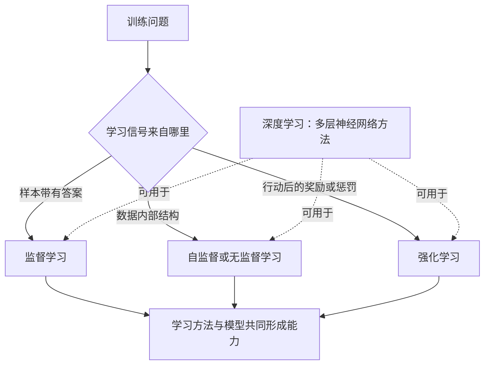

# 第六章　机器学习时代：机器怎样从样本中学会任务

**从人工编写规则到数据训练，再到在环境中试错，机器学习逐渐获得识别、预测和行动能力。**

早期计算机程序的逻辑很直接：人先把规则写出来，机器按步骤执行。规则清楚时，这种办法可靠；遇到复杂变化时，工程师必须不断补充条件。一个城市路口的“左转”规则，可能要按信号灯、时间、车型、施工和交通管制分别处理。规则越堆越多，程序越难维护。机器学习带来另一种思路：把大量已知例子交给计算机，让算法从中调整参数，逐渐学会在新例子上作出判断。

这次转向改变了软件的制作方式。传统程序的能力主要来自人写下的逻辑，机器学习系统的能力还来自训练样本、目标函数、模型结构和计算过程。开发者把工作重点转向设计学习过程，让机器从样本中找出相关模式。

## 机器学习把经验变成参数

监督学习是常见方式之一。研究人员准备输入和正确答案，例如一组带有“正常”“故障”标签的设备图像，再让模型反复预测。预测与答案之间的差异可以用损失函数表示。优化算法据此调整模型参数，让后续预测更接近训练样本中的正确结果。模型训练完成后，还要在没有参与训练的新样本上测试，观察它能否识别此前没见过的情况。

图像识别、邮件分类、语音转写和设备故障预测常能转化成这种形式。一个样本覆盖得越完整，模型越有机会识别不同环境、口音、设备状态和边界案例。如果训练资料只包括晴天拍摄的设备图像，模型遇到夜间、雨雪或镜头模糊的现场照片时，结果就可能变差。样本量很重要，样本是否代表真实工作也很重要。

无监督学习面对的是没有人工答案标签的数据。算法可以把相似记录归为一组、寻找异常点，或压缩数据中的结构。它不能直接告诉组织某一组代表什么业务问题，工作人员还要结合现场情况解释分组结果。自监督学习则从数据自身构造训练目标，例如把一段文字的后半部分遮住，让模型预测缺失内容。大语言模型的基础预训练大量使用这种办法，让模型从未标注的文字中学习语言规律。

训练过程还要防止模型“背熟练习题”。如果模型记住训练样本的细节，却没有学会可以迁移的规律，它在训练数据上分数很高，遇到新情形就会失准。这种过度拟合常通过单独保留验证集和测试集来发现。另一类风险是数据泄漏：答案或结果字段意外混入输入，模型表面上准确，实际没有学会预测任务。数据划分、指标选择和独立复核因此属于模型研发的基本工作。

一个故障预测模型还可能受到设备升级、季节变化和维修制度调整的影响。过去记录的故障规律与新设备运行情况不一致时，原模型就会逐渐失准。模型部署前的测试结果只能说明它在那批测试样本上的表现，不能永久保证未来结果。组织应持续记录运行中的误报、漏报、人工修改和数据变化，再决定是否重新训练或改用其他方法。

这些做法共同构成机器学习的基本过程：准备数据、定义目标、训练参数、评估泛化表现，再持续监测变化。模型从样本中学到统计规律，适用性会随着业务和数据变化。政策调整、制度更新、设备换型和服务对象变化都可能令原有样本失去代表性。模型上线以后仍需观察效果，必要时补充数据、修改流程或重新训练。

## 深度学习让机器自己提取更多层次的特征

在传统机器学习中，工程师常要先设计特征，再交给模型计算。识别车辆时，开发者会手工设计边缘、纹理、颜色和轮廓等特征。深度学习使用多层神经网络，将输入逐层转化成更适合当前任务的内部表示。网络底层可能学到线条和纹理，中间层组合出局部形状，更高层再形成物体、场景等抽象特征。模型在训练中调整连接权重，逐步提高预测准确度。

这里的“深”指神经网络具有较多层，并不表示模型自动理解了人类概念。每层处理信息的方式由训练过程形成，结果受样本、目标和模型结构影响。反向传播让模型能够把输出误差沿着网络向前层层传回，再调整参数；更大的数据集、更强的显卡和更稳定的训练方法，让研究者可以训练更深、更大的神经网络。[反向传播原始论文](https://www.nature.com/articles/323533a0)

2012年的AlexNet标志着深度学习在图像识别任务上取得突破。研究团队使用大规模ImageNet图像、GPU并行计算和深层卷积神经网络，让计算机视觉系统的竞赛成绩明显提升。人们后来常把这一刻称为深度学习的“转折点”，但它由多年积累的神经网络研究、互联网图像数据、显卡能力和工程经验共同促成。[AlexNet原始论文](https://proceedings.neurips.cc/paper/2012/hash/c399862d3b9d6b76c8436e924a68c45b-Abstract.html)

深度学习随后被用于语音识别、机器翻译、医学影像、工业质检、推荐系统和自动驾驶感知。模型可以从像素或声音片段中直接提取特征，减少人工设计中间步骤的工作。它也带来新的数据需求和计算成本。训练数据来源、标注质量、样本代表性、推理速度和模型维护，都会影响系统投入真实运行后的表现。

## 强化学习让机器在行动反馈中调整策略

前两种学习主要从既有样本中寻找规律，强化学习处理的是连续的行动问题。系统处在一个环境里，观察当前状态，选择动作，再根据环境反馈获得奖励或惩罚。它要通过多轮尝试，逐步学会哪些行动更有利于长期目标。训练过程中通常需要在探索新办法与利用已有经验之间作平衡。

强化学习把目标表示为奖励，再设计算法优化累计回报；系统由此学会依据环境反馈调整策略。一个奖励写得不准确，系统就可能绕开管理者真正关心的结果。配送算法只追求缩短路程，可能增加驾驶风险；服务系统只优化平均等待时间，可能让少数复杂个案长期得不到处理。任务环境、奖励指标和限制条件必须一起设计。

2015年，DeepMind发表DQN研究，让同一类深度强化学习系统从游戏画面和得分反馈中学习多款Atari游戏。它将卷积网络的视觉识别能力与强化学习的行动策略结合，展示了系统可以从像素输入中持续改进操作方案。[DQN原始论文](https://www.nature.com/articles/nature14236)

AlphaGo将深度学习、棋局搜索和强化学习组合起来。早期版本先学习人类棋谱，再通过自我对弈改进；AlphaGo Zero则从棋规出发反复自我对弈，在特定棋类环境中达到超越此前版本的水平。围棋规则明确、输赢清楚、每一步都能快速模拟，使其成为适合大量试错的环境。现实组织的工作通常没有这么清晰的终局，也很难让模型在实际业务中无成本地试错，因此棋类成绩不能直接推导出Agent能自主处理任意事务。[AlphaGo Zero研究](https://www.nature.com/articles/nature24270)

强化学习的试错还受到反馈速度和成本影响。游戏系统能够在几分钟里完成大量对局，得到清楚的输赢信号；医疗方案、公共服务处置或生产安全决策则可能等待很久才出现结果，一次错误也可能造成严重后果。延迟反馈让系统难以判断哪一步行动造成了最终结果，现实风险又限制了尝试次数。研究人员会借助仿真环境、历史数据和影子模式先做测试，让模型在暂不影响真实业务的条件下提出建议。

强化学习也用于机器人控制、资源调度、广告排序和复杂策略优化。训练时需要模拟环境、历史数据或可控试验；面对会影响人身安全、资金或公共服务的任务，组织必须设置严格边界，避免让系统以真实对象进行无监督探索。人类可以审阅训练目标、模拟结果和运行策略，也要保留随时停止或接管的能力。

## 生成式AI把几种学习方法接在一起

大语言模型的预训练通常采用自监督学习：模型读取大量文字，根据上下文预测下一个词元。这个过程让模型形成对语法、事实关联、写作模式和任务结构的统计表示。之后，开发者可以用人工编写的指令样例训练模型遵循要求，再通过人类偏好反馈或其他优化方法调整回答风格与有用程度。

InstructGPT研究曾对比不同训练阶段的模型。在该研究设置的人工偏好评测中，评测人员更偏好经过指令微调和人类反馈训练的较小模型回答。这说明模型参数规模很重要，训练目标和反馈方式同样会改变使用体验。研究结论只适用于其模型和评测条件，不应简化成“小模型普遍胜过大模型”。[InstructGPT研究](https://papers.neurips.cc/paper_files/paper/2022/hash/b1efde53be364a73914f58805a001731-Abstract-Conference.html)

用户在对话框中要求模型总结一份报告时，系统通常是在推理阶段根据上下文生成回答；它未必正在更新自己的模型参数。使用者提出追问、纠正错误或让Agent再次检索文件，可以改变当前任务的处理结果，却不等于底层模型当场完成了永久学习。训练、推理、上下文补充和系统记忆是不同环节，了解这一区别有助于管理者准确判断人工智能会记住什么、能改进什么。

现代机器学习的研究与应用还反复提醒人们，数据记录的是过去的工作方式。某单位用历史案例训练风险模型，过去哪些人得到复核、哪些问题被标为异常，都会影响模型学到的模式。若历史记录本身存在偏差，模型可能把不公平的做法继续放大。训练目标、样本来源和评价指标需要由业务人员与技术团队共同讨论，模型输出也要按职责和影响范围安排复核。

这种协作改变了专业人员的工作。专家不必亲手为每个样本设计复杂规则，却要判断训练资料是否覆盖真实任务、哪些错误可以接受、哪些群体会受影响，以及什么时候应暂停模型。算法可以帮助人发现统计相关性，组织仍要依据法律、制度和专业知识决定相关性是否可以用于实际决策。

在同一类业务中，训练目标的选择会改变模型学到什么。若目标是把投诉信分成“咨询、建议、投诉”，监督学习需要经审核的类别标签；若目标是找到从未见过的设备异常，无监督方法可以先寻找偏离常态的记录；若目标是让机器人学会抓取，则系统要在可控环境里试验动作并接收成功或失败反馈。团队应先定义希望模型做出的行为，再决定采用哪种数据和学习方法。

数据标签本身也含有判断。历史工单中把某类问题标成“已解决”，可能只说明工作人员关闭了记录，未必代表群众真正满意；设备故障记录可能漏掉没有造成停机的小问题。若组织没有复核标签定义，模型就会精确学习一个本来就不合适的目标。业务人员、数据团队和模型开发者要在训练前共同确认标签含义、样本代表性和结果评价方式。

## 三种学习方式各有适用范围

| 方法 | 学习材料或反馈 | 常见任务 | 主要限制 |
| --- | --- | --- | --- |
| 监督学习 | 已标注的样本和正确答案 | 分类、预测、识别 | 依赖标签质量和样本覆盖 |
| 自监督与无监督学习 | 未标注数据及数据内部结构 | 预训练、聚类、异常发现 | 模型发现的模式需由人解释 |
| 强化学习 | 行动、环境反馈和奖励 | 游戏、机器人控制、策略优化 | 奖励设计难，真实环境试错成本高 |
| 深度学习 | 多层网络与大量数据训练 | 图像、语音、语言、复杂模式识别 | 计算成本高，内部判断不容易解释 |

这些概念在同一业务里也可以连续出现。例如，供电单位要分析变压器异常，可以先用历史故障记录训练监督模型，再用无监督算法寻找不常见的传感器组合。工作人员确认一类新异常后，再把标签加入下一轮训练。若要让维护机器人根据现场反馈调整操作策略，研究人员还可能引入强化学习，在仿真环境里先测试控制方案。每种方法处理链条中的不同问题，彼此组合后才构成完整系统。

这些概念可以相互组合。深度学习是一类模型方法，可以用于监督学习、自监督学习，也能与强化学习结合。AlphaGo的突破恰好展示了这种组合：神经网络评估局面，搜索比较走法，强化学习根据胜负不断调整策略。理解人工智能的能力来源，需要看模型学习的数据、训练目标、行动环境和结果评价。

*图6-1　监督、自监督/无监督和强化学习描述学习信号；深度学习描述模型方法，可以与不同学习范式组合。*

## 从学习机制回到组织工作

组织通常不需要自己训练基础大模型，却需要理解每种学习方式会带来什么要求。设备故障分类需要稳定的历史标签；政策问答需要及时、可信的外部资料；机器人操作依赖真实场景中的传感信息和动作反馈；智能体完成业务流程还要连接工具、系统权限和人工复核。不同任务的输入、学习方式和验收标准各不相同。

机器学习让机器从数据中找到规律，深度学习扩大了模型处理复杂信息的能力，强化学习进一步把“看见信息”推进到“尝试行动”。在实际项目里，模型表现还受运行环境制约：政策更新可能改变分类边界，新的设备型号可能改变图像特征，用户表达方式也会随时间变化。团队应在上线后持续监测任务分布和错误类型，发现业务条件改变时调整流程和模型，并持续评估系统表现。每一次进展都需要合适的任务定义、足够的数据和有效的反馈。干部评价人工智能项目时，可以沿着这些环节追问：系统从什么材料学习，目标如何定义，结果怎样测试，环境变化后如何更新，错误出现时由谁接管。这些问题比单独询问模型有多少参数更能说明系统能否解决真实工作。

## 同一项任务会从不同数据里学到不同能力

机器学习系统依赖数据描述世界。图片识别模型看到的是像素，语音模型处理的是声音片段，业务预测系统读取的是表格字段，Agent可能同时读取文字、网页和工具返回值。模型只有在输入能够代表目标问题时才有机会学到有用规律。某些单位的数据看起来数量很多，却集中在少数地区、设备型号和业务类型，训练后的模型就可能只熟悉这一小块世界。

数据集建设要说明样本如何采集、由谁标注、标签含义是什么、哪些对象没有被纳入。标注人员对于“故障”“正常”“办结”“满意”的理解必须一致，否则模型面对的是一组相互矛盾的答案。专业人员要抽查标签并讨论边界案例；随着设备、政策和服务流程变化，标签规则也要重新确认。

当模型开始服务真实工作，组织还要观察错误分布。总体准确率相同的两个系统，可能一个常把简单任务分错，另一个只在某个地区或某类对象上出现严重偏差。业务人员需要把错误按对象、场景、时间和影响程度分类，再决定补充数据、修改模型、调整人工复核还是暂停特定用途。

## 资料来源与说明

- [反向传播原始论文](https://www.nature.com/articles/323533a0)：神经网络利用误差调整连接参数的方法。
- [AlexNet原始论文](https://proceedings.neurips.cc/paper/2012/hash/c399862d3b9d6b76c8436e924a68c45b-Abstract.html)：深层卷积神经网络与大规模图像识别。
- [DQN原始论文](https://www.nature.com/articles/nature14236)：从Atari游戏图像和奖励中学习策略。
- [AlphaGo Zero研究](https://www.nature.com/articles/nature24270)：自我对弈和强化学习在围棋中的应用。
- [InstructGPT研究](https://papers.neurips.cc/paper_files/paper/2022/hash/b1efde53be364a73914f58805a001731-Abstract-Conference.html)：指令微调和人类反馈的评测结果及适用范围。
