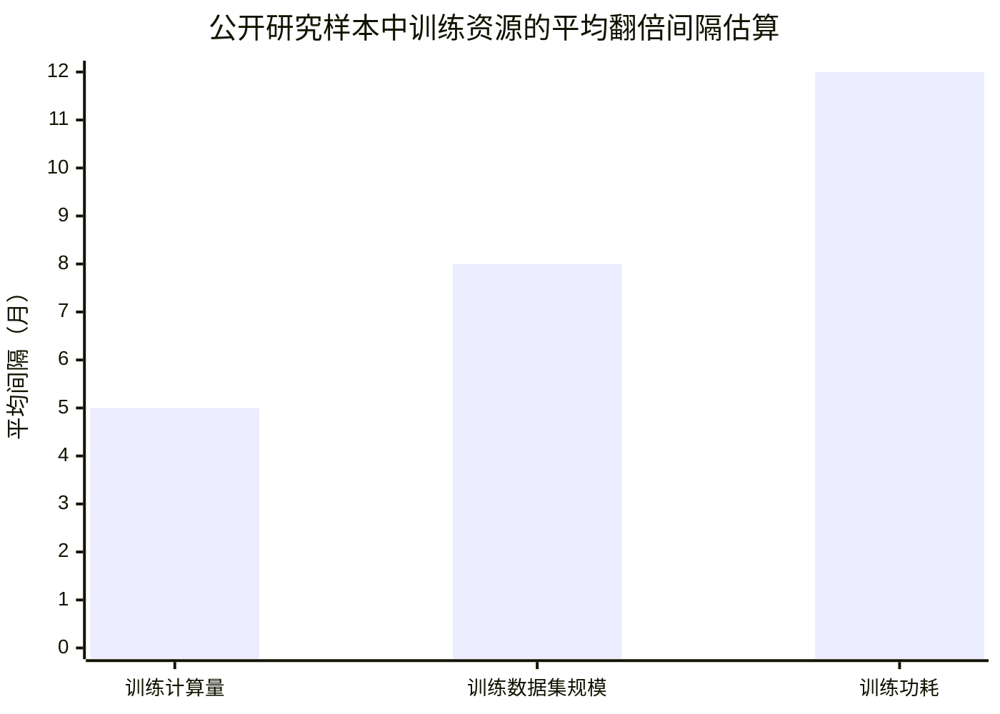
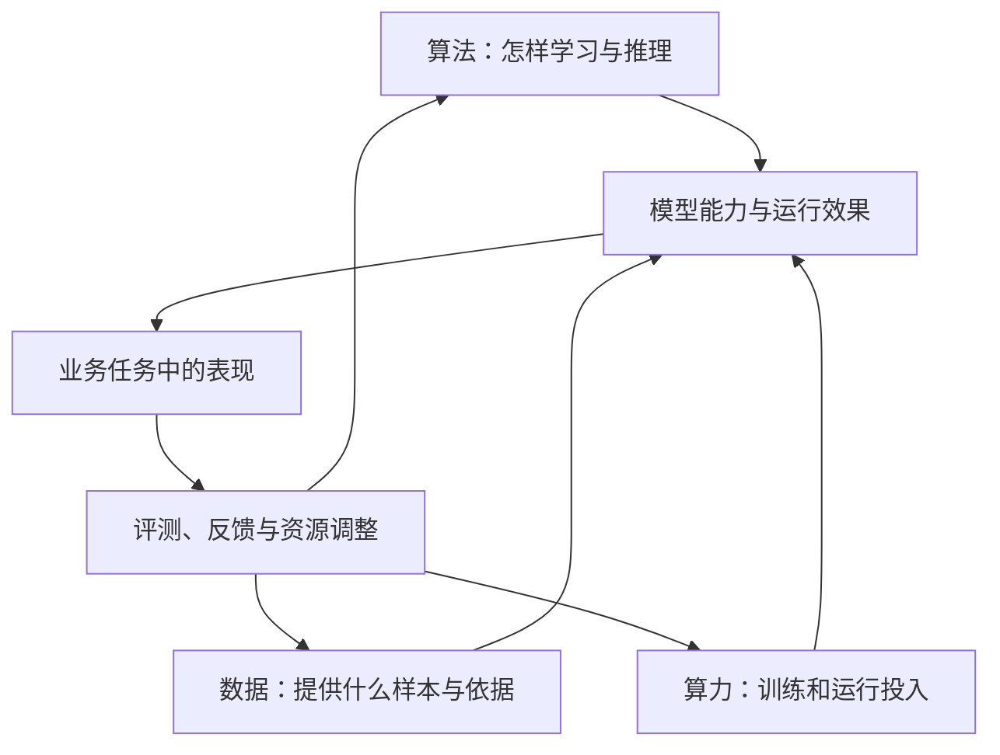

# 第七章　算法、算力与数据：AI进步的三条线索

**模型能力每一次跃升，背后都有算法改进、计算资源和数据积累的共同作用。**

2012年，AlexNet团队把深度神经网络用于ImageNet图像识别时，网络结构、训练数据和GPU计算同时发挥了作用。研究人员并没有只换一个公式，模型也没有凭空获得识别能力。神经网络负责从图像中学习层次特征，ImageNet提供了大量带标签的图片，GPU让训练在可接受的时间里反复进行。这个例子把人工智能发展的三条线索放在了一起：算法规定怎样学习，数据提供学习对象，算力支撑计算。

今天训练大语言模型、生成图像和视频、控制机器人，依然离不开这三者。只讨论模型参数，会忽略算法效率；只谈算力，会忽略数据质量和训练方法；只堆数据，也无法保证机器学到目标能力。人工智能的速度和成本，常常取决于三个条件怎样组合。

## 算法决定模型怎样学习和使用信息

算法是一套把输入转换成判断或行动的方法。早期专家系统把人写下的规则逐条执行；统计学习通过样本估计分类或预测规律；深度学习用多层网络自动提取特征；Transformer使用注意力机制处理序列关系，推动语言模型扩大规模；扩散模型通过逐步去噪生成图像和视频；强化学习则根据行动反馈调整策略。不同算法适合不同类型的问题，技术发展呈现多条路线并行。

Transformer的重要变化，是它可以用并行计算处理序列中的关系。传统循环网络需要按顺序传递信息，长序列训练和硬件并行受到限制。注意力机制可以计算序列不同部分之间的关系，使大规模训练更容易扩展。它并没有自动解决事实准确、逻辑一致和长期规划问题，却提供了一种适合扩大语言模型的基础架构。[Transformer原始论文](https://arxiv.org/abs/1706.03762)

> **原文摘录：** “The Transformer, based solely on attention mechanisms”
>
> **中文释义：** 论文提出的Transformer架构以注意力机制为基础。
>
> **来源：** [Vaswani等，《Attention Is All You Need》](https://arxiv.org/abs/1706.03762)。

算法的变化也改变了人和机器的分工。符号方法需要专家预先说清规则，统计方法开始从样本中估计关联，深度学习把特征提取也纳入模型训练，大语言模型进一步从海量文本中学习语言表达和跨任务的迁移能力。近年来出现的推理模型还会在回答前投入额外计算，让模型生成候选步骤、检查中间结论，再形成最后回答。这种测试时计算把一部分资源从训练阶段移到每次推理阶段，能改善部分复杂任务的结果，也会增加响应时间和调用费用。

算法性能要放在评测方式中理解。若模型在数学竞赛题上提高分数，说明它在该测试集上的表现进步；若它在客服问答中降低漏答，才说明它可能改善相关流程。不同基准的题目、答案、难度和污染风险并不相同。开发者也会为提高分数对模型和推理策略进行专门优化，因此组织不能用一个公开排行榜代替本地任务测试。

算法改进还发生在模型如何调用算力的细节中。混合精度、稀疏计算、模型压缩、量化、蒸馏和稀疏专家架构，都试图在有限资源下完成更多计算。推理阶段的优化可以减少响应延迟和调用成本；检索增强生成则让模型先从外部资料中取回相关信息，避免把所有内容都塞进参数。算法发展不只表现为模型变大，也表现为同样的硬件能够更高效地训练和运行模型。

## 算法创新需要变成可训练、可部署的系统

算法论文提出新结构之后，研究团队还要把它实现为稳定的软件，准备训练数据，编写分布式计算代码，并在硬件集群上反复运行。模型规模扩大，工程问题也随之增多：不同设备之间怎样分配参数，训练中断后怎样恢复，如何检测数值异常，怎样减少通信等待，怎样把训练好的模型部署给真实用户。算法、计算系统和软件工程彼此牵连。

Transformer的注意力机制使模型能够根据上下文关系处理序列信息，带来更适合并行训练的架构。它本身不会保证答案正确，也不会自动生成安全、稳定的产品。训练目标、语料质量、指令微调、推理策略、工具连接和产品交互都参与最终体验。一个模型在实验报告中表现突出，进入政务服务或生产系统前，仍要通过任务评测、权限检查和运行监测。

近年AI开发还受到芯片、数据中心网络、能源供应和供应链限制。先进加速器数量影响训练计划，网络互联影响大规模模型训练效率，能源和冷却影响长期运行成本。前沿研究因此依赖跨学科工程队伍、资本投入和基础设施建设。组织采购或部署模型时，也应把服务容量、响应延迟、峰值可用性和全周期费用纳入方案，而不只比较模型参数或单次回答价格。

## 算力从实验室设备发展成产业基础设施

算力的进步经历了从个人工作站、GPU服务器到大型云计算集群的变化。单台机器能完成的任务有限，模型规模扩大后，开发者要把训练拆到多张加速卡上，再通过高速网络交换参数和中间结果。芯片带宽、显存容量、机房网络和软件调度都会影响实际吞吐量；标称算力很高的芯片，如果系统无法充分调用，训练速度也达不到预期。

算力还需要持续稳定的供电、散热、网络和存储。数据中心建设会影响项目的交付周期和成本，电力资源也可能成为模型训练与部署的限制条件。前沿模型需要大规模集群，普通单位使用模型服务时则要考察响应速度、服务可用性、调用费用和数据是否离开本地。国产芯片、云服务、边缘设备和本地部署会形成不同的算力选择，技术方案应与任务规模和安全要求匹配。

训练模型需要大量矩阵运算。图形处理器原本用于并行处理图形，研究者发现它也适合神经网络中的大规模计算，于是GPU逐渐成为人工智能训练的重要硬件。之后，专用加速器、高速网络、分布式训练系统和大型数据中心相继发展。一个团队训练前沿模型，除了购买芯片，还要安排电力、冷却、存储、网络、软件框架和工程人员。

算力增长让研究者可以训练更大的模型、处理更丰富的数据，也让计算资源变成技术竞争的重要条件。斯坦福大学2025年《AI Index》引用研究估算，知名AI模型训练所用计算量平均约每五个月翻一倍，LLM训练数据集规模约每八个月翻一倍，训练功耗约每年翻一倍。这些估算来自可观察的模型样本，模型开发者对训练过程的披露并不完整，不能据此断定每个模型都按固定周期增长。[Stanford HAI《2025 AI Index》研发章节](https://hai.stanford.edu/ai-index/2025-ai-index-report/research-and-development)

*图7-1　翻倍间隔越短，估算中的增长速度越快。数值来自可观察模型样本，未披露的训练项目不在估算范围内。来源：[Stanford HAI《2025 AI Index》研发章节](https://hai.stanford.edu/ai-index/2025-ai-index-report/research-and-development)。*

算力规模扩大也会带来电力、芯片供应和环境压力。斯坦福大学《2026 AI Index》指出，训练前沿模型的功率需求已达到大型数据中心级别，模型训练排放随计算规模增加；硬件效率确有改善，但整体计算量增长更快。具体能耗还受芯片效率、训练时长、数据中心能源来源和利用率影响。组织采购或部署模型时，应同时评估性能、费用、能耗和服务稳定性。[Stanford HAI《2026 AI Index》研发章节](https://hai.stanford.edu/ai-index/2026-ai-index-report/research-and-development)

算力成本下降也在扩大技术使用范围。2022年以后，同等能力的模型调用价格在多个服务中大幅下降，轻量模型可以运行在更靠近用户的设备上，开源模型也让更多研究团队参与改进。前沿模型仍需要庞大基础设施，普通任务则可能由小模型、本地模型或检索系统完成。组织应根据任务需要匹配算力规模、模型能力和成本。

## 数据从网页文本扩展到多模态和专业记录

早期的机器学习依赖研究人员整理的小型数据集。互联网普及后，网页文本、图片、语音和代码成为预训练材料；企业和公共服务系统积累的业务记录、设备运行数据和科学实验结果，又为特定领域模型提供了专业样本。数据的种类增加，模型接触的任务也随之扩大。文本提供语言和概念联系，图片和视频提供视觉信息，语音资料记录发音和交互，程序代码体现机器指令与工程约定，传感器数据反映设备和环境状态。多模态模型把不同类型的信息放进同一训练过程，可以根据图片回答问题，也可以把文字描述转成图像、声音或视频。单位内部的制度、档案和业务记录则提供组织特有的条件，往往需要授权后通过检索或微调方式使用。

数据使用范围会受到来源和治理规则影响。公开可见不等于可以无限复制或用于任何训练；涉及个人信息、商业秘密、政务资料和科研数据时，组织要核对法律依据、授权范围、保存时间和共享方式。高质量语料的来源、标注方式和更新机制，也会影响模型的可追溯性。数据工程因此成为AI项目的重要组成部分，常常需要业务专家、档案人员、数据管理员和技术团队共同参与。

大规模文本预训练数据也不能直接等同于可靠知识。网页上的同一段话可能被转载多次，论坛观点可能过时，代码样例可能存在安全问题，语言模型则会把这些材料转成参数中的统计联系。训练团队要执行去重、筛选、分层抽样和质量检测；要做专业模型，还需要确认训练资料能否代表具体业务。专业人员参与标注，往往比简单扩大样本数量更能提升模型在关键任务上的准确度。

数据质量与数量同样重要。重复网页、错误标签、低质量图片和过期规定会让模型学到错误联系。训练样本还可能集中于某些国家、语言、职业和生活方式，使模型在代表性不足的群体或场景中表现较差。数据清洗、权利确认、标注规则、敏感信息处理和版本管理，都是模型训练和应用的基础工作。

大模型训练数据来源也面临可用性变化。网站开始限制自动抓取，受版权保护的内容需要明确授权，语言和专业领域的数据分布不均。研究人员正在使用合成数据、专业数据库、人工编写的任务和真实交互记录补充训练材料。斯坦福大学2026年《AI Index》指出，混合训练和特定任务的合成样本可能有用，但当前证据还不足以证明合成数据能够完全替代高质量真实数据。用AI生成的数据继续训练AI，还要检查错误是否会重复放大。若模型在缺少真实样本时反复学习机器生成的数据，错误模式可能在一轮轮训练中被复制；生成资料也可能集中在模型本来熟悉的内容，弱化少数经验和边缘场景。团队要记录合成数据的来源、比例和用途，并在独立真实测试集上验证模型是否仍能处理真实问题。[Stanford HAI《2026 AI Index》关于训练数据的分析](https://hai.stanford.edu/assets/files/ai_index_report_2026_chapter_1_research_development.pdf)

## 三项条件协同，才形成性能跃迁

研究者发现，在一定范围内，增大模型、增加训练数据和投入更多计算资源，通常能降低语言模型的预测损失。所谓“缩放规律”描述特定训练设置中的统计关系，为模型团队规划资源提供参考。模型结构、数据分布、训练目标、推理方法和评测任务变化时，相关结果也会变化。模型结构、数据分布、训练目标、推理方法和评测任务变化时，结果也会变化。[Kaplan等人的语言模型缩放规律研究](https://arxiv.org/abs/2001.08361)

资源配置还需要在模型大小和训练数据之间作权衡。DeepMind研究者在Chinchilla论文中指出，当时部分大语言模型的训练计算没有得到充分利用；在相同算力预算下，较小模型如果使用更多训练数据，也可能达到更好的效果。该研究影响了后续模型训练的资源安排，说明“模型越大越好”并不成立，数据规模、训练步数和计算成本需要共同优化。[Chinchilla研究](https://arxiv.org/abs/2203.15556)

当算法、算力和数据同时改进时，模型能力可能在短时间内跨过可见门槛。算法让计算资源转化为更有效的训练；数据提供足够多样的学习信号；算力则让训练规模不断扩展。三者中任何一项成为瓶颈，整体进展都会受到影响。新型芯片如果缺少训练数据，无法发挥全部能力；大量数据如果没有清楚的训练目标，也可能只增加噪声；模型规模继续扩大，如果部署成本过高，组织仍无法将它用于日常工作。

*图7-2　算法、数据和算力共同影响模型能力，业务评测再决定下一轮投入*

## 组织要把资源投入到具体任务上

国家层面需要统筹芯片、数据中心、电力、网络和人才，组织层面则要从具体业务问题倒推资源需求。一个档案分类项目可能只需要整理字段、训练小模型和建立检索界面；一个视觉质检系统可能要补采不同光照、角度和异常类型的图片；一项大型研发任务则可能需要专用模型、专业数据集和长期算力预算。技术路线应跟着任务走。

例如，某市希望用AI缩短群众查询办事指南的时间。算法决定助手如何识别问题、匹配事项和组织回答；数据决定它使用哪些最新指南、办理条件和地方差异；算力决定它能否同时服务大量咨询、是否响应过慢以及成本如何变化。三项条件还要与业务系统、查询日志、更新周期和人工坐席衔接。项目若只选一个大型模型，却没有核准指南版本，答复速度再快也可能误导群众。

党政机关和央国企在使用数据时，还需要明确来源、权属、保密级别、个人信息范围和访问权限。涉及内部数据的模型项目，不能只把资料送入外部服务，再依赖模型供应商说明安全承诺。项目组需要根据数据敏感程度选择模型部署方式，记录数据流向，评估日志和缓存中的信息，并确定成果能否用于后续训练。

算法、算力和数据也会影响不同地区、行业和组织获得人工智能能力的机会。大型机构可以投入自建算力、专门团队和定制模型；中小单位可能更适合采购经过评估的服务、共享公共平台或采用开源模型。管理者要计算整体拥有成本，包括训练或订阅费用、数据整理、接口开发、员工复核、维护、安全防护和退出迁移。模型推理成本下降之后，组织仍需对真实业务的总体投入负责。

理解三项条件的关系，可以让人更准确地判断技术宣传。模型的名字和参数说明不了数据是否合法、计算是否充足、算法是否适配任务；基准分数也不能单独证明真实工作的准确率。人工智能每次能力跃迁都可以追问三个问题：它采用了什么新方法，增加或改善了哪些数据，投入了多少计算与工程资源？组织再把这些回答放回本单位的任务、预算和风险中，才能决定是否采用。

## 资料来源与说明

- [Transformer原始论文](https://arxiv.org/abs/1706.03762)：注意力机制和并行序列建模架构。
- [Stanford HAI《2025 AI Index》研发章节](https://hai.stanford.edu/ai-index/2025-ai-index-report/research-and-development)：训练计算、数据集规模和硬件效率趋势估算。
- [Stanford HAI《2026 AI Index》研发章节](https://hai.stanford.edu/ai-index/2026-ai-index-report/research-and-development)；[训练数据专题PDF](https://hai.stanford.edu/assets/files/ai_index_report_2026_chapter_1_research_development.pdf)：训练成本、能源影响、数据限制和合成数据证据。
- [Kaplan等人《Scaling Laws for Neural Language Models》](https://arxiv.org/abs/2001.08361)：模型规模、训练数据和计算资源的经验关系。
- [Hoffmann等人《Training Compute-Optimal Large Language Models》](https://arxiv.org/abs/2203.15556)：Chinchilla计算最优模型训练研究。
