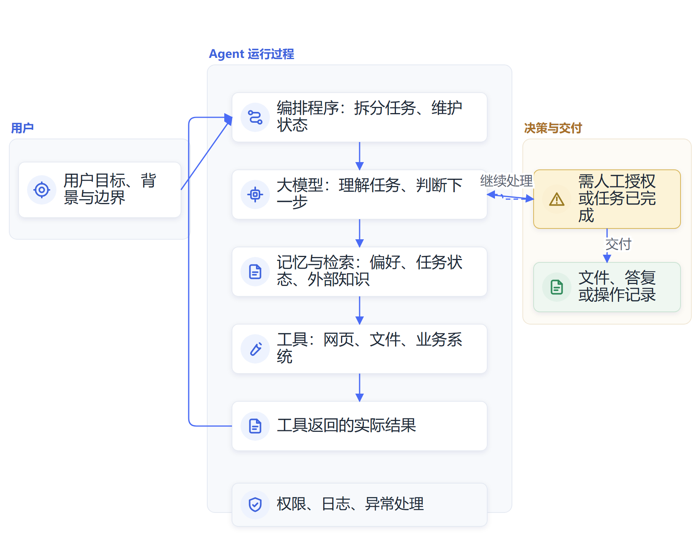

# 第八章　Agent技术架构：大模型、记忆与工具怎样协作

**Agent把大模型接入资料、工具和执行环境，让系统可以围绕目标连续推进任务。**

一个普通聊天机器人可以根据输入写一段答复。若要它查找制度、提取适用条款、比较不同版本、填写业务表单并把结果提交给工作人员，单靠文字生成远远不够。系统还需要记住当前任务做到哪一步，找到可信资料，调用业务工具，再根据返回结果决定是否继续。这样的组合构成了Agent。

Agent由大模型、记忆与检索、工具、编排程序和权限审核等组件组成。大模型负责理解和生成，记忆与检索提供相关背景，工具连接外部环境，编排程序管理步骤，权限和人工审核控制行动边界。理解这套架构，才能判断产品可以在什么条件下完成任务。

## 从生成答案到执行任务，需要一套循环

大语言模型接收文字、图像或其他输入后，计算下一段内容的概率并生成结果。它可以分析任务、拟定步骤、提取用户意图，也可以输出一个结构化的工具调用请求。模型本身不会因为写出“我已查询数据库”，就真的访问过数据库；它必须把请求交给外部程序，等待程序执行后再读取返回内容。

典型的Agent运行过程包括几个环节：

**用户交代目标 → 系统整理任务与权限 → 模型选择下一步 → 工具执行操作 → 系统返回结果 → 模型更新计划 → 人员确认或任务结束。**

例如，负责制度咨询的Agent先识别用户所问事项，检索内部知识库，取回相关条款，再按规定格式组织答复。若用户的问题缺少适用地区或人员类别，它可以继续追问；若检索到的两个文件版本冲突，系统应将冲突交给工作人员核实。模型一次生成的答案只是流程的一部分，检索、工具调用和结果检查共同决定服务质量。

学术研究常用“推理—行动”交替来描述这一过程。ReAct方法让语言模型先判断当前需要的信息，再调用外部工具，读到工具返回值后继续推理。它所展示的核心机制是模型可以把文本推理和外部行动串起来；在实际产品里，还需要工程系统处理状态、权限、超时、失败和人工确认。[ReAct原始研究](https://arxiv.org/abs/2210.03629)

> **原文摘录：** “We explore the use of LLMs to generate both reasoning traces and task-specific actions in an interleaved manner.”
>
> **中文释义：** ReAct让模型交替生成推理过程与具体任务动作。
>
> **来源：** [Yao等，《ReAct: Synergizing Reasoning and Acting in Language Models》](https://arxiv.org/abs/2210.03629)。

*图8-1　Agent架构：大模型负责理解与规划，记忆和工具提供上下文及行动能力，编排程序管理执行过程*

## 大模型负责理解任务和选择下一步

模型处在Agent架构的中心，但并不独自承担所有工作。它读入系统指令、用户请求、历史对话、工具描述、检索材料和当前任务状态，再生成文字或工具请求。上下文中的信息越相关，模型越容易按要求处理；资料太多、版本冲突或任务目标含糊，模型就更容易漏掉限制条件。

开发者通常会在指令中说明模型的角色、任务目标、输出格式和不得执行的操作。对复杂任务，系统还可以让模型先制订计划，把长任务拆成若干步骤。某些步骤由程序按照明确规则运行，另一些步骤交给模型判断。把判断交给模型不等于可以跳过测试；开发团队需要用代表性案例检验计划是否合理，观察模型在哪些情况下会误判。

模型的输出仍然可能不准确。它会把不确定的答案写得流畅，可能误解工具参数、遗漏用户要求，或者依据错误资料作出推断。系统应尽量让模型引用来源、提供检索段落，并对关键字段使用程序校验。模型在计划层面提出下一步，执行层仍要检查该动作是否可行、是否有权限、是否会产生外部影响。

## 记忆让任务跨越更长的时间

模型每次推理能看到的上下文有长度限制。长期任务若把所有聊天记录、资料全文和操作日志一股脑塞进上下文，模型可能遗漏关键内容，运行费用也会增加。Agent因此会维护不同层次的信息：

| 记忆层 | 保存什么 | 在任务中的作用 |
| --- | --- | --- |
| 当前上下文 | 这一轮任务、最近对话和正在处理的资料 | 帮助模型理解当前目标 |
| 任务状态 | 已完成步骤、待处理事项、失败记录和中间结果 | 让任务中断后可以继续 |
| 长期记忆 | 用户明确授权保留的偏好、常用规则和经验 | 减少重复交代背景 |
| 外部知识 | 制度文件、数据库、业务记录和专业资料 | 提供可更新、可追溯的依据 |

这些层次有时会被统称为记忆，但用途并不相同。当前对话中的上下文短期有效；任务状态记录的是某项工作进行到哪里；长期记忆保存跨任务有用的信息；外部知识库则提供需要检索和核对的资料。检索增强生成会在每次任务中找到相关文件，再将片段放入模型上下文。它能帮助模型使用外部材料，却不自动等于模型已经“记住”了这些材料。[RAG原始研究](https://arxiv.org/abs/2005.11401)

长期记忆也不能把所有内容永久保存。系统需要判断哪些信息值得保留，记录来源和时间，允许使用者查看、更正或删除。错误信息一旦写入记忆，后续任务可能反复引用；过时的制度、岗位和联系人也可能随着记忆跨会话传播。Anthropic对Agent记忆的研究将会话日志、记忆笔记、结构化知识和下次会话载入的上下文视为不同层次，并指出记忆可能发生错误或漂移，需要定期整理。[Anthropic《Agent记忆的组成》](https://www.anthropic.com/research/components-of-agent-memory)

在多轮任务里，记忆要同时解决“写入什么”和“下次读什么”。一份会议任务清单可能记录了责任人、期限、完成状态和来源；这些字段可在几天后继续用于跟踪。相反，模型一次猜测出的联系人、未经确认的偏好或临时试算结果，不适合自动写进长期记忆。系统可以把记忆分成已确认事实、待核信息、用户偏好和过期记录，并保留更新时间与原始出处。下一次读取时，按任务相关性取回所需部分，再让模型结合当前情况使用。

任务日志、记忆和知识库的管理方式也不同。任务日志要能还原某次运行发生了什么；长期记忆用于减少重复交代；知识库保留有权使用的制度和业务材料，更新责任通常归资料所有部门。若把三者混为一个聊天历史，单位很难判断哪条内容来自正式制度，哪条只是一次对话里的暂时说法。业务系统可以为每一类信息设定不同的保存周期、访问权限和更新流程。

## 工具让模型获得访问外部世界的能力

工具是Agent与环境交互的接口。搜索工具可以查找网页，文件工具可以读取文档，代码工具可以执行计算，日历工具可以创建会议，业务系统接口可以读取或更新记录。模型根据工具说明生成名称和参数；运行时程序检查请求、调用服务、接收结果，再把结果交回模型。

工具调用通常采用结构化请求。模型先输出类似“查询文件”“计算金额”或“更新记录”的动作名称和参数，程序再验证字段类型、用户身份和授权范围。模型生成请求并不等于操作已完成；只有外部工具返回成功结果，系统才能确认操作状态。比如模型把一项申请标记为“已提交”，如果业务系统没有回传记录编号或完成状态，界面就不能把它显示为已办结。

工具还要处理重复调用和执行中断。网络连接中断后，Agent可能不知道上一步操作是否已经成功。如果它盲目重试，就可能重复创建申请、重复发送通知或重复付款。关键接口需要提供可查询的执行状态、幂等控制和错误恢复方式。工程团队还要区分“参数有误”“权限不足”“系统暂不可用”和“业务条件不满足”，让Agent能够据此停止、追问或换用合规路径。

调用工具与生成一段文字的风险不同。检索网页通常只读，向业务系统提交数据则会产生现实后果。工具可以按照风险划分权限：查询权限用于读取，草稿权限用于准备内容，提交权限用于改变系统状态。删除记录、发送通知、付款或批准事项等操作，应设置明确授权和人工确认。最小权限可以限制错误调用的影响范围，也便于追溯究竟哪一步产生了问题。

Model Context Protocol（MCP）提供了一套连接AI应用和外部系统的开放协议。服务端可以向客户端提供资源、提示模板和工具，让不同的AI应用按照共同接口接入文件、数据库或业务服务。MCP解决的是连接方式的标准化问题，不能替代具体应用的身份验证、数据保护、权限审查和用户授权。[MCP官方规范](https://modelcontextprotocol.io/specification/2025-11-25)

工具本身也需要设计。名称和参数要让模型容易区分，返回值要说明执行成功、失败原因和可用结果；工具遇到超时、重复提交或数据缺项时，要提供清楚的错误信息。工具数量太多、功能重复或描述含糊时，模型可能选错接口。Anthropic的Agent工程建议强调，工具应当边界明确、执行可靠、返回有效信息；Agent依赖工具与环境交互，工具设计直接影响任务完成质量。[Anthropic《构建有效的AI Agent》](https://www.anthropic.com/research/building-effective-agents)

## 编排程序管理步骤、状态与人工接管

大模型生成下一步建议后，Agent运行环境需要决定怎样执行。编排程序维护任务状态，管理模型调用和工具调用，控制超时与重试，保存中间结果，并判断什么时候需要向用户提问。遇到同一工具连续失败，系统可以停止自动重试；收到内容不完整的结果时，可以要求补充资料或转人工处理。

长任务可以采用不同的编排方式。固定流程由程序规定步骤，模型只负责其中的分类、抽取或撰写；Agent流程则允许模型根据当前结果动态选择工具和下一步；多Agent系统把不同任务分配给专业角色，再通过协调程序传递信息。固定工作流的执行结果较易预测，动态Agent适合条件变化较多的任务，多Agent则增加了交接、重复工作和错误传播的机会。团队应以任务需要选择结构，不必为了追求“智能体数量”把一个清楚流程拆成许多角色。

固定流程、单Agent和多Agent各有不同的控制成本。固定流程适用于步骤清晰、业务规则稳定的工作，模型可以只承担文书理解或内容生成；单Agent适合在多个可选步骤间作判断；多Agent把专业任务分配给多个模型角色，便于并行检索和交叉检查，却需要协调器维护共享状态、控制重复调用并解决结果冲突。多个角色各自输出答案，并不会自动形成彼此独立的验证。组织应先试验单Agent能否完成主要任务，再根据工作量和质量需要增加协作层。

Agent还需要完整的运行记录。系统应保留模型收到的关键输入、工具请求和返回结果、人工确认、失败类型、完成状态和相关版本信息。结构化跟踪记录可以帮助开发者还原任务经过，发现模型误判、工具故障、权限不足和知识库过期等原因。只有保存了这些过程数据，单位才有基础改进系统，并判断任务量增长是否带来真实业务价值。[OpenAI Agents SDK关于运行跟踪的说明](https://developers.openai.com/api/docs/guides/agents/sdk)

## 一次政策资料整理任务的完整架构

假设某位负责人要准备一份政策汇报，要求助手查找国家和地方最新文件，核对生效时间，并形成可供修改的汇报草稿。用户交代目标后，编排程序识别任务类型，检查当前用户可以访问哪些公开或内部资料；模型据此规划检索主题；搜索工具返回候选网页，文件检索工具从授权知识库找出相关原文；系统把文件标题、发布日期、相关段落和链接送进上下文。

模型随后比较材料、标记可能冲突的时间和适用对象，再生成草稿。工作人员打开原文核对政策要求，确认汇报口径后，助手再按要求修改文本。若工作只要求写出草稿，系统就停在草稿交付；若还要写入正式业务平台，就要增加权限检查、审批和操作日志。相同的大模型可以出现在这两类流程里，外部工具、权限和人工确认会决定Agent能做到哪一步。

这套任务也说明记忆的作用边界。助手可以保留当前报告的检索进度、已经核对过的文件和待补事项；是否保留负责人长期偏好，应由用户授权并可查可改。工作所依据的政策全文应保存在可追溯的外部资料源，不能只依赖上次对话留下的一段概括。

Agent的执行轨迹可以被表示为一串可检查状态：收到任务、完成身份验证、计划步骤、调用某项工具、等待结果、校验返回内容、继续执行或暂停。系统在每一处转换时都要保留必要字段，例如任务编号、操作者、工具名称、输入摘要、返回状态和人工批准记录。日志无需无限保存所有敏感材料，但应足以重建关键决定并调查故障。

这种可观察性让组织能分辨“模型判断错了”和“接口没有返回数据”两类不同问题。若任务总体失败率上升，团队可以检查是制度版本更新导致答案不匹配，还是某个工具接口频繁超时；若人工确认环节经常驳回Agent的输出，业务负责人可以重新定义任务边界或补齐知识库。没有这些记录，团队就只能依靠用户投诉猜测系统出了什么问题。

## Agent的可靠性取决于整套系统

Agent的失误可能来自多个位置。模型可能误解目标，记忆可能载入旧内容，知识库可能漏掉新文件，工具接口可能返回过期结果，编排程序可能在重复请求时再次提交，权限设置也可能放得过宽。只换一个更强模型，未必能修复其他环节的问题。排查时要按日志逐步判断哪个组件出了差错。

风险还会从资料进入模型上下文。恶意网页或上传文件可能藏有诱导模型调用工具的指令；如果Agent同时具备读取敏感文件和向外发送内容的权限，模型就可能在错误引导下泄露数据。系统应隔离不可信输入与操作指令，对外发、写入和删除等动作进行授权，并将高影响操作交由人工确认。协议支持连接工具，并不意味着每个连接都适合获得全部权限。

运行中还会出现上下文逐渐变长、任务偏离目标、工具返回噪声、成本超出预算等问题。Anthropic的上下文工程研究建议为每一轮推理挑选少量高价值信息，因为上下文窗口虽然可以容纳更多文字，模型在长上下文中找准重点的能力仍可能下降。[Anthropic《Agent上下文工程》](https://www.anthropic.com/research/effective-context-engineering-for-ai-agents)

## 从架构拆解到组织判断

领导干部不必亲自编写Agent系统，但可以沿着架构检查项目方案：大模型具体负责哪些判断，知识来自哪里，任务记忆保存在哪里，工具具有什么读写权限，编排程序怎样处理失败，哪些环节需要人工批准，发生错误后能否追踪到具体步骤。回答这些问题后，Agent的能力和责任范围才会清楚。

一套成熟的Agent系统，把语言能力、外部知识、业务工具、流程控制和人工判断组织在一起。模型可以提出下一步，工具可以执行具体操作，记忆让任务跨越多轮，运行环境负责状态和权限。它们彼此协作后，AI才可能从生成回答走向完成任务。系统的能力由每个组件共同决定，任何一层的缺陷都可能沿着流程传到最后的结果。

## 资料来源与说明

- [ReAct原始研究](https://arxiv.org/abs/2210.03629)：语言模型在推理和工具行动之间交替。
- [RAG原始研究](https://arxiv.org/abs/2005.11401)：模型从外部资料检索相关内容并形成回答。
- [Anthropic《构建有效的AI Agent》](https://www.anthropic.com/research/building-effective-agents)：模型、工具、检索和记忆的基本组成及编排方式。
- [Anthropic《Agent上下文工程》](https://www.anthropic.com/research/effective-context-engineering-for-ai-agents)：上下文管理、工具设计和多轮Agent的工程考虑。
- [Anthropic《Agent记忆的组成》](https://www.anthropic.com/research/components-of-agent-memory)：短期日志、跨会话记忆、知识组织与错误修正的研究实践。
- [Model Context Protocol官方规范](https://modelcontextprotocol.io/specification/2025-11-25)：AI应用接入上下文、资源和工具的开放协议及安全考虑。
- [OpenAI Agents SDK文档](https://developers.openai.com/api/docs/guides/agents/sdk)：Agent循环、工具、多Agent协作、人工审核和运行跟踪。
