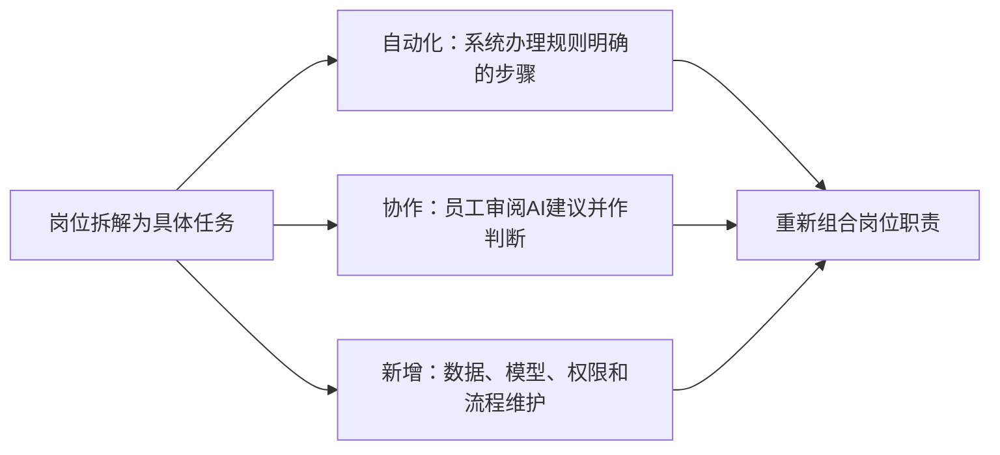
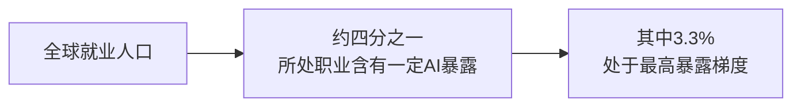

# 第十七章　任务先变：岗位中的工作重新分配

**人工智能通常先接手岗位中的部分任务，随后才推动工作流程和岗位职责调整。**

一个业务人员过去要自己搜索政策、摘录条款、比较版本、起草说明并核实出处。使用AI后，助手可能先搜索文件、整理候选条款和形成草稿；业务人员把更多时间用于判断文件适用范围、核对事实、解释政策和回应复杂问题。岗位名称暂时没有变化，岗位里的任务已经发生重新分配。

这种变化常比“一个职业会不会消失”的讨论更早出现。每个岗位都是多项任务的组合，里面既有重复、规则清楚的环节，也有需要经验、协商、现场判断和责任承担的工作。人工智能可以提高某些任务的速度，也可能让另一些任务变得更重要。了解任务如何变化，比给整个职业贴上“会被替代”或“不会被替代”的标签更有帮助。

## 岗位是任务组合，自动化影响各不相同

同一个岗位内部的任务差异很大。办公室工作人员可能要整理材料、校对数字、联系部门、解释制度并形成报告；人工智能较容易协助资料分类和初稿整理，难以自动承担对外沟通、判断政策边界和审批责任。设备工程师要阅读告警、查找历史记录、到现场检查、确定维修方案并确认设备状态；AI可以整理记录和提示可能原因，专业人员仍需要看现场、判断风险并采取行动。

AI影响岗位任务，常见的变化有三类：

- **自动化：**系统独立完成规则明确、结果可核对的步骤。
- **人机协作：**AI提供草稿、检索或建议，员工负责判断和确认。
- **新增工作：**组织增加数据维护、模型评估、权限管理和流程运营等任务。

同一个岗位可能同时出现三类变化。

组织不能只看“这项任务能否被模型做出来”。它还要看任务占一个岗位多少时间、错误后果有多大、人工复核需要多久、服务对象是否接受自动化处理，以及单位有没有合适的系统和数据。技术能完成一项任务，不等于组织会立刻把它全面部署；部署也不等于岗位随即消失。

*图17-1　AI对岗位的影响通常落在任务层面，之后才体现在职责组合变化*

## 同一岗位里的任务会沿不同方向变化

岗位任务可以按照规则稳定程度和结果风险作一个初步判断。重复、标准明确、结果容易验证的任务，较适合让AI自动处理一部分；需要大量专业信息但允许人工审阅的任务，较适合人机协同；依赖现场责任、价值判断、关系协调或高影响决定的任务，人工角色仍然重要。实际工作通常横跨这几类，组织需要逐项分析。

机关工作人员的一天可能包括查找文件、整理数据、起草材料、协调部门和解释政策。AI可以协助检索和初稿，但文件是否适用、数字是否一致、事项是否形成正式决定，需要工作人员根据职责核查。服务窗口岗位可能从重复回答标准问题，转向帮助复杂个案梳理条件、协调多个部门和解释处理结果。岗位变化主要体现为任务重心重新组合，也可能带来岗位数量和职责调整。

生产岗位也会出现类似的重新组合。AI视觉系统能够提示设备和产品异常，现场员工仍要判断是否停机、是否需要更换部件、怎样安排维修窗口。机器人可以执行物料搬运，班组人员可能更多承担补料、设备状态观察、作业安全和故障恢复。岗位会新增人机协作内容，也可能减少单纯重复操作。

## 任务自动化、辅助和岗位新增会同时发生

自动化把某些步骤交给系统连续执行，员工可以转向其他工作；辅助让AI提供建议、草稿和信息整理，由员工确定结果；任务新增则来自系统建设和维护，包括数据质量检查、模型效果评价、权限管理、用户培训和供应商协调。一个职业受到的影响因此是多方向的。

系统自动完成一项步骤后，上下游工作也可能变化。自动生成的报告需要更多数据复核，智能分流可能增加复杂个案的人工处理，生产设备自动化可能让现场维护要求提高。组织要把整条业务链放在一起观察，记录前后任务是否转移、是否出现新瓶颈，避免只统计被自动化的操作。

需求增长会进一步影响就业结果。效率提高后，有的部门可能扩大服务范围、增加产品种类或把员工安排到更复杂的任务；有的部门会减少部分岗位需求，也可能通过自然减员、转岗或组织重组应对。技术本身没有预先决定最终结果，行业需求、管理选择、劳动制度和员工协商都会参与塑造转型路径。

## AI能完成部分文字工作，也会改变复核方式

在机关办公室，AI可以先整理会议录音、提取明确的任务事项、汇总政策文件或比较多个表格版本。工作人员不必从零开始，能够更快看到候选结果；工作重点随之转向核对名称、日期、数字、责任部门和材料依据。系统可能漏掉讲话中的例外条件，也可能把讨论意见误写成正式决定，复核能力因此更加重要。

在政务服务中，助手可以引导群众查找办事条件，自动分类热线工单，归纳高频问题并帮助工作人员准备答复。群众的描述往往不完整，某些事项还涉及不同地区、对象和时限。工作人员要确认具体情况、解释政策适用条件，并在系统不能判断时接管服务。AI越接近公共服务流程，工作人员越需要熟悉法规和业务规则。

在央国企生产环节，视觉模型可以提示异常设备或产品缺陷，Agent可以汇总生产数据、查询检修记录并建议下一步检查。现场工程师要确认传感器是否正常、设备工况是否特殊、模型报警是否真实。对设备安全、生产连续性和投资安排，组织需要保留明确的专业责任人。

这些变化可能提高员工单位时间处理的任务量，也可能让组织把节省出来的时间用于扩大服务、提升质量或承接新工作。管理者要观察员工实际完成了哪些任务、工作强度是否改变、服务对象是否获得更好结果。单看AI生成了多少文字，无法说明工作变化方向。

## 职业暴露反映任务可能受影响的范围

国际劳工组织2025年发布的职业暴露全球指数估计，全球约四分之一的就业岗位可能受到生成式AI影响，更多岗位预计会经历任务转型。该指数根据职业任务与生成式AI能力的重叠程度估算暴露，反映技术可能影响的任务范围。它不提供企业实际裁员数据，也不预测某个职业消失的时间。[ILO《生成式人工智能与就业：职业暴露全球指数》](https://www.ilo.org/publications/generative-ai-and-jobs-refined-global-index-occupational-exposure)

> **原文摘录：** “Globally, one in four workers are in an occupation with some GenAI exposure.”
>
> **中文释义：** 全球约四分之一的劳动者所处职业包含一定程度的生成式AI暴露。
>
> **来源：** [ILO《Generative AI and Jobs: A Refined Global Index of Occupational Exposure》](https://www.ilo.org/publications/generative-ai-and-jobs-refined-global-index-occupational-exposure)。

*图17-2　“暴露”衡量职业任务与技术能力的重叠，不等于岗位将被替代。来源：[ILO全球指数](https://www.ilo.org/publications/generative-ai-and-jobs-refined-global-index-occupational-exposure)。*

ILO在2026年对实证研究的综述指出，现阶段大规模岗位替代仍有限，生产率收益存在但分布不均；员工报告的时间节省还没有普遍转化为可测量的产出、收入或就业变化。实际影响要看组织是否采用、任务成本如何变化、服务需求是否增长、制度如何调整以及收益怎样分配。[ILO《生成式AI对就业、生产率和工作组织的影响》](https://www.ilo.org/publications/impact-genai-jobs-productivity-and-work-organization-review-empirical)

世界经济论坛《未来就业报告2025》根据1,043家企业的判断，预测到2030年39%的核心技能会发生变化或过时。受访企业合计代表1,410多万名员工，调查反映受访雇主的预期，适用于所覆盖的企业和员工范围。组织可以把它作为技能变化的信号，再结合本单位的岗位、业务和人才状况作判断。[WEF《未来就业报告2025》](https://www.weforum.org/publications/the-future-of-jobs-report-2025/)

## 识别职业变化要看本单位的工作数据

职业暴露研究可以帮助判断哪些任务较容易受到生成式AI影响，不能直接用于判断某个单位该减少多少岗位。组织可以把研究结论作为观察线索，再结合岗位说明、工作量记录、员工访谈、系统使用记录和业务质量数据，形成自己的任务地图。不同地区、行业和组织的流程差异，可能使同一个职业名称包含完全不同的工作。

任务盘点应邀请实际工作人员参与。管理者可以请他们描述一项任务何时开始、需要哪些资料、判断点在哪里、常见错误是什么、与哪些岗位交接。员工还可以指出正式制度没有写明的例外，例如特殊时段的审批要求或设备在极端天气下的运行特征。这些知识帮助组织判断哪些步骤可用系统支持，哪些必须保留人工判断。

评估岗位影响时，组织还要关注工作强度和工作质量。AI可能让员工在同样时间处理更多事项，也可能减少机械操作，让员工投入服务和分析；它也可能加重监控、压缩休息时间或让员工频繁核验大量生成内容。工作量、满意度、技能积累和服务对象反馈应与速度指标并列，才能看清岗位变化的真实影响。

岗位任务重组需要配套培训、绩效和职业发展安排。系统上线后，若员工承担更多复核责任，应明确其审核权限和质量标准；若基础任务减少，应安排新的学习任务和晋升路径；若新增模型维护工作，应将其纳入岗位配置和工时核算。这样，技术带来的工作变化才有机会转化成组织能力，也能避免把新增任务无形加到员工身上。

## 岗位调整还受组织选择影响

同一项技术在不同组织中的作用可能不同。某单位选择让助手生成初稿，另一单位可能直接自动发送标准答复；某工厂把视觉模型用于提示，另一工厂将其接入生产线停机控制。差别来自业务风险、流程设计、岗位结构、数据条件、预算和管理者的选择。

人工智能如果补充员工能力，可能让经验不足的新人更快完成常见任务，也让专家集中处理复杂情况；若组织只把它用于减少编制，却没有重新设计流程，员工可能承担更紧的进度、更大的服务量和更高的审核责任。技术本身不能决定收益如何分配，管理制度会影响员工的工作质量和职业机会。

岗位任务也可能增加。系统上线后，需要人员维护知识库、修正分类标签、审核模型建议、处理用户投诉、检查错误记录和管理供应商。若这些工作没有纳入岗位说明和绩效安排，组织就会把新的责任压到原有岗位上，却看不到真实人力成本。

## 员工需要理解任务变化并参与流程设计

员工最清楚工作中哪些步骤经常重复，哪些材料最难找到，哪些错误会造成后果。项目设计时应邀请一线岗位共同拆解任务，让他们说明工作中的例外、非正式协作和群众反馈。若员工只在系统上线后才被告知要使用工具，技术团队容易漏掉流程条件，员工也缺少表达问题的机会。

组织可以开展岗位任务盘点，记录不同任务的频率、耗时、规则稳定程度、对经验的依赖和错误影响。盘点结果不应用来机械裁撤岗位，而应用于工作设计、培训安排和风险控制。某项任务自动化以后，单位还要检查员工原先通过它积累的知识是否会消失，是否需要安排新的学习路径。

个人也可以从任务层面观察变化。每周哪些工作反复发生，哪些环节最占时间，哪些判断必须依赖本单位经验，哪些结果由自己承担责任。员工据此选择合适的任务尝试工具，记录工作质量和错误类型，再逐渐调整自己的分工。工作变化往往从一个小步骤开始，早期观察有助于更从容地准备。

## 工作重分配需要保护经验和服务质量

基础任务承担了训练新人、熟悉业务和积累专业直觉的作用。若AI直接完成所有初级工作，组织应补上案例讲解、导师反馈、轮岗体验和审查练习，让新人仍有机会理解真实流程。模型可以提供答案，员工还要知道答案为什么成立、什么情况下会失效。

工作调整也要考虑员工的参与和公平。不同岗位获得工具、培训和学习时间的机会可能不均；管理者需要说明技术调整的目的、数据使用规则和员工反馈渠道。岗位职责变化后，应同步调整培训、考核、工作量和晋升要求，让员工知道新的能力怎样被认可。

AI对岗位的长期影响还取决于服务和产品需求。自动化降低成本后，组织可能扩大服务量；也可能重新安排岗位、减少部分工作或增加新的服务。转型节奏并不完全一致。组织要依据真实的岗位和业务数据讨论变化，不能用职业暴露模型直接替代岗位评估。

## 职业转型需要时间，也存在不同路径

技术能力形成、产品采购、流程改造、岗位调整和人才培养通常不会在同一时间发生。先出现的可能是员工用个人账号辅助工作，随后单位建立合规工具和统一知识库，再之后才把Agent接入正式流程。岗位变化因而既有短期任务调整，也有中长期组织结构和职业需求变化。不同单位推进速度不一，同一职业在不同组织的工作体验也会有差异。

部分员工可以通过培训转向新的岗位，部分岗位会在自然减员中逐渐调整，也可能出现专业人才需求增长或新的服务需求。组织应通过岗位和业务数据识别变化，提前提供技能培训、内部转岗、职业咨询和员工参与渠道。对受影响员工的沟通应尽早开始，帮助他们理解任务变化、学习安排和可选择的发展方向。

公共部门和央国企还要考虑地区与行业的差异。偏远地区可能更需要AI辅助专业服务，但网络、算力和维护人员不足会限制落地；高风险生产岗位可能获得更强的自动化支持，同时需要更多控制工程师、机器人运维和安全人员。人力规划应同时观察业务需求、技术准备和地区条件，避免只按模型能力推算岗位数量。

岗位调整的节奏和范围应基于可观察的变化。组织可以定期比较工作任务量、员工所需技能、复核时间和服务质量，再与员工讨论转岗、培训和岗位空缺。及时沟通能让员工为变化预留准备时间，也让管理者从一线获得更完整的信息。

## 资料来源与说明

- [ILO职业暴露全球指数](https://www.ilo.org/publications/generative-ai-and-jobs-refined-global-index-occupational-exposure)：任务暴露估计及岗位转型判断。
- [ILO实证研究综述](https://www.ilo.org/publications/impact-genai-jobs-productivity-and-work-organization-review-empirical)：生产率、就业和工作组织的近期证据。
- [WEF《未来就业报告2025》](https://www.weforum.org/publications/the-future-of-jobs-report-2025/)；[调查方法说明](https://www.weforum.org/publications/the-future-of-jobs-report-2025/appendix-6d9e5fce68)：雇主对岗位和技能变化的预测。
