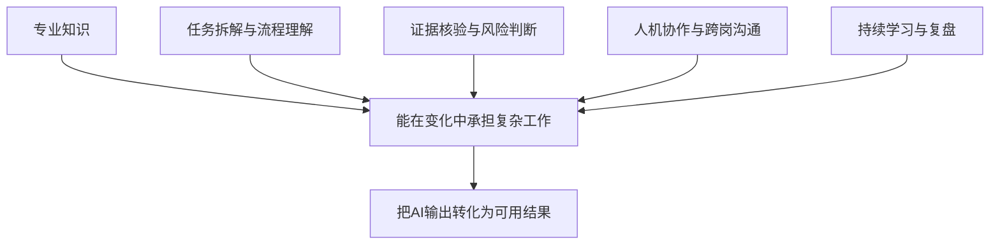
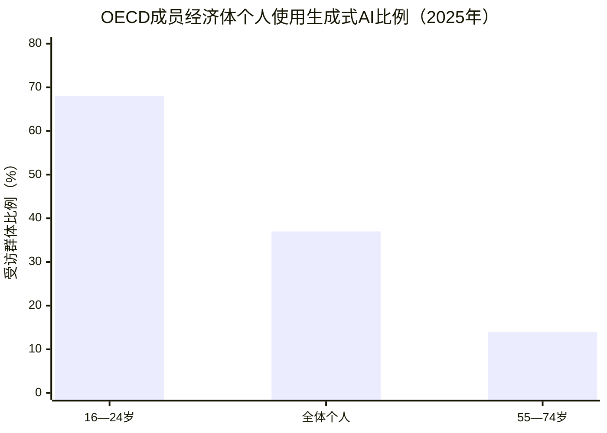

# 第十八章　个人能力和岗位发展面临哪些变化

**AI改变任务的组合，也会改变个人积累经验、发展专业能力和获得工作机会的路径。**

人工智能能够帮助员工检索资料、生成初稿、整理数据和自动处理重复事项。工作做得更快之后，个人仍要面对一个新的问题：哪些能力会因工具变得更有价值，哪些经验要通过新的方式积累？岗位变化由技术能力、组织安排、培训和绩效制度共同影响，这些条件也会影响员工能否从变化中获得机会。

过去，新员工常从资料整理、会议纪要、数据录入和初稿撰写开始熟悉业务。AI可以接手这些任务的一部分，员工有机会更快参与较复杂的工作；如果单位没有安排带教、审查和轮岗，新人也可能失去理解业务细节的入口。对个人而言，适应AI时代需要掌握工具，也要持续建立专业判断、沟通协作和学习新知识的能力。

## 经验积累的路径会发生变化

在很多岗位中，基础任务是理解业务的起点。行政人员通过核对材料学会表格规范，政策研究人员通过查找原文熟悉文件体系，产品人员通过整理用户反馈理解服务问题，工程师通过巡检和维修认识设备状态。AI减少了其中的重复操作，也改变了员工接触业务的顺序。

如果一个新人第一次处理会议材料就让Agent代写全部内容，他可能较快交付稿件，却不一定了解哪些意见属于研究事项、哪些已经形成决定、哪项任务需要继续跟踪。团队可以让AI先整理材料，再安排新人核对原话、修正任务性质并说明修改原因。这样既利用工具，也保留学习业务判断的机会。

岗位训练需要从“让新人做重复事”转向“让新人理解重复事背后的规则”。导师可以讲解案例，给新人安排低风险任务，让他们检查模型结果并逐渐承担更复杂的判断。若部门只追求即时速度，长期可能出现基层岗位没有足够人员理解业务细节的情况，组织还会面临专业梯队断层。

## 个人能力会更多集中在理解、判断和协作

AI工具使用能力会成为工作中的基础能力，但熟悉一个产品界面并不能代表具备稳定的人机协作能力。员工还要知道怎样判断任务适不适合交给AI，怎样提供必要背景，怎样检查答案是否有依据，什么时候应当停止使用并转向人工处理。

| 能力 | 工作中的表现 |
| --- | --- |
| 工具使用 | 选择合适的模型和功能，说明任务背景与限制 |
| 专业判断 | 结合本单位制度、行业标准和服务对象情况评估结果 |
| 问题定义 | 说清流程中的问题、所需资料和验收条件 |
| 证据核验 | 追查原文、时间、范围和数据口径 |
| 沟通协作 | 让业务、技术、数据与安全人员理解彼此责任 |

*表18-1　AI协作能力落在具体工作动作上，岗位之间的侧重点可以不同。*

在此基础上，专业知识会变得更加重要。AI可以根据现有材料提供选项，员工要判断方案是否符合本单位制度、行业标准和服务对象实际情况。懂得农业生产的人能够看出模型给出的种植建议是否适合土壤和天气；懂得财务制度的人能发现报销答复有没有遗漏审批条件；熟悉工程现场的人能分辨设备告警是否由传感器故障引起。

问题定义和流程理解也会影响AI使用效果。员工要把“提高效率”进一步转成具体任务，例如哪一段流程出现等待、需要什么数据、什么结果算完成、谁承担审核责任。若输入目标含糊，模型就会按常见表达补足细节；能识别任务边界的人，能够让工具协助得更准确。

证据判断会成为日常工作的重要能力。模型可能引用过时资料、混淆相近名称或把推测写成事实。员工需要追溯原始文件、核对时间和适用范围、发现数据差异，并说明尚未确认的内容。事实核验能力和专业经验一起，决定AI生成材料能否用于工作。

沟通协作也会变得更重要。一个任务可能同时涉及业务部门、信息化团队、数据管理、安全合规和服务对象。员工要向模型说明任务，也要向同事解释AI输出如何形成、哪里仍需核对、哪些问题应该由人作决定。跨岗位沟通越清楚，系统越容易进入真实流程。

*图18-1　个人能力由专业判断、协作和持续学习共同支撑*

> **原文摘录：** “including AI and big data, networks and cybersecurity and technological literacy, which are anticipated to be the top three fastest-growing skills.”
>
> **中文释义：** 报告预计，人工智能与大数据、网络与网络安全、技术素养将成为增长最快的三类技能。
>
> **来源：** [世界经济论坛《The Future of Jobs Report 2025》](https://www.weforum.org/publications/the-future-of-jobs-report-2025/)。该报告反映受访雇主的预期。

## 新机会来自人机协作和专业服务扩展

AI可以让部分员工接触过去成本较高的能力。基层单位可以通过模型快速整理政策资料，科研团队可以缩短候选分子的筛选时间，小型企业也能够低成本制作软件原型和营销内容。个人如果熟悉专业领域，又能使用工具提升工作效率，可能承担更广泛的任务。

组织内部也会出现新的工作职责。员工可能负责维护知识库、设计模型评价任务、组织Agent运行、审核系统访问权限和培训业务团队。部分岗位不一定以“AI工程师”命名，实际工作却需要连接业务、数据和技术。懂业务的人能够帮助技术团队了解例外条件，懂技术的人可以将业务要求变成接口、规则和监测指标。

个人发展的机会也来自岗位之间的重新组合。客服人员可能从重复答疑转向复杂个案和关系维护；研究助理可能从手工汇总转向证据比较与分析；现场人员可能从按步骤巡检转向异常判断和机器人运维。任务结构改变后，组织要同步调整职责、培训和评价方式，员工才能看见新的成长路径。

这些机会需要以实际业务为基础。AI工具可以让个人更快完成一份方案，却不能自动提供专业资格、组织信任或承担业务责任。员工需要在真实工作中积累案例经验，向同事学习，接受质量反馈，并把一次工具使用转化为可重复的职业能力。

## 工作压力和机会分配也会变化

技术提高速度后，组织可能提高处理量和交付标准。员工每天要审核更多AI生成内容，处理时间缩短，工作强度未必下降。若管理者只统计生成数量和处理速度，员工可能承担更多任务，却没有获得相应的报酬、培训和决策权。

AI工具也可能改变管理者对员工工作过程的观察方式。系统能够记录输入、响应时间、操作步骤和错误情况，有助于发现流程问题；若这些数据在员工不了解的情况下用于绩效和纪律管理，也可能形成持续监控。组织需要说明采集什么数据、用途是什么、谁能够查看，并让员工有渠道了解和纠正记录。

不同年龄、地区、岗位和教育背景的人接触AI工具的机会不一样。OECD《数字经济与社会展望2026》估计，2025年有37%的成员经济体个人使用生成式AI，16至24岁群体约68%，55至74岁群体约14%。这些数字来自OECD成员经济体，不能直接当作中国用户比例；它们说明技术普及中仍存在年龄和技能差异。[OECD《数字经济与社会展望2026》](https://www.oecd.org/en/about/news/press-releases/2026/11/oecd-digital-economy-and-society-outlook-2026.html)

*图18-2　数据来自OECD成员经济体，展示年龄组差异，不代表中国用户比例。来源：[OECD《数字经济与社会展望2026》](https://www.oecd.org/en/about/news/press-releases/2026/11/oecd-digital-economy-and-society-outlook-2026.html)。*

让工具真正帮助员工，还要提供设备、网络、岗位化培训和使用时间。若单位只给部分部门配备系统，或者只对管理人员培训，基层人员可能无法参与改进；若工具只支持少数语言和常见表达，老年人、残障人士或专业群体也可能难以使用。技术管理需要考虑谁能够进入新工作、谁承担新增负担、谁能分享效率收益。

## 领导干部要支持员工平稳转变

领导干部要解释组织为什么引入AI、系统可以处理什么、员工保留哪些责任、项目数据如何使用。员工看见工作方式发生变化，通常会关心岗位是否调整、绩效怎样计算、错误由谁承担。清楚沟通能帮助员工提出业务问题，让组织尽早发现工具和流程之间的差异。

培训要围绕岗位任务展开。政策人员可以学习如何核对文件来源和条款；生产人员可以学习如何阅读设备告警、确认异常和启动人工接管；管理人员可以学习如何设定目标、评估Agent任务和检查风险。培训后还要留出实际使用时间，不能只在会议室演示一次，就假定员工已经能够承担新职责。

管理者要参与设计新人学习路径。基础任务交给AI后，可以安排新人做案例复盘、制度适用条件判断、模型结果核对、跨部门跟岗和客户沟通，让他们继续接触真实业务。经验丰富的员工则可以参与知识整理和问题分析，把个人经验转化为团队可以使用的工作资料。

组织应当按结果调整绩效。评价员工时，可以关注工作质量、时效、服务体验、风险控制、团队协作和知识贡献。若AI增加了任务量，管理者应审视工作安排是否合理；若AI减少重复操作，员工也可以承担更多专业服务。考核规则要与岗位责任同步变化。

## 职业发展需要持续学习和重新定位

AI时代，个人职业发展很难依靠一次培训或一套固定技能长期维持。员工可以定期观察岗位任务变化，识别哪些工作流程正在自动化，哪些新任务随之出现，再选择相应学习方向。学习内容可能包括领域知识、AI工具、数据判断、项目管理、沟通协作和新型设备运维。

持续学习也不等于不断追逐最新模型。工具更新很快，能迁移的能力包括理解工作目的、拆解任务、验证结果、复盘错误和承担责任。员工应在一个具体工作领域中把这些能力练出来，形成能够跨产品版本复用的经验。

AI带来的挑战和机会往往同时出现。重复劳动减少，经验积累方式要调整；服务能力提升，工作节奏可能加快；新岗位形成，机会分配仍需组织支持。个人需要主动学习，组织也要提供培训、参与和转岗的制度条件。技术转型的质量，最终会体现在员工能否持续成长、组织能否保留专业经验和服务对象能否得到更好结果。

## 不同职业阶段需要不同的学习重点

新员工需要掌握业务基础、资料核验和工具使用，继续通过真实任务建立判断力。经验丰富的专业人员可以把AI用于扩展分析范围、比较多种方案和处理复杂个案，同时把自己的判断条件整理成团队可复用的资料。团队负责人要进一步学习任务分配、Agent运行监测和跨部门协调，确保效率提升与服务质量同步。

员工可以在专业领域保持一项稳定优势，再向相邻能力拓展。政策研究人员可以加强数据分析，设备工程师可以学习机器人协作，业务管理者可以掌握模型评价与权限治理。发展路径由实际岗位需要决定，持续学习把专业经验和新技术连接起来。

## 学习AI要从一项真实任务形成闭环

个人可以选择低风险、重复发生、结果易核对的一项工作，先了解现有做法，再尝试让AI参与其中一个环节。保留原始输入和工具输出，核对遗漏、事实错误、结构偏差和新增复核成本。经过几次使用后，员工能够区分适用条件，形成自己可以解释、团队也能够复用的工作方法。

学习记录可以比“用了什么模型”更具体：我让它完成哪一步，提供了哪些背景，输出中出现什么错误，怎样核对，节省或增加了多少时间，最终质量有没有变化。这样的记录帮助个人理解自己的能力边界，也为部门培训提供真实案例。工具更新后，任务拆解和验证经验仍能继续使用。

员工还要有意识地保留基础技能。使用AI写报告的人仍需练习逻辑组织和事实核验；使用代码Agent的人要能阅读修改差异、运行测试；使用机器人建议的工程师要理解设备状态和现场规程。完全依赖自动输出，可能造成技能退化，遇到系统停机或异常时就难以继续工作。

## 机会会出现在专业岗位和新型协作之间

新的岗位职责通常从实际业务需求中出现。一个单位需要有人协调模型与办公系统、维护内部知识库、设计服务评测、组织员工反馈和分析异常事件。部分职责会形成专门岗位，部分会作为现有业务岗位的新能力。具备专业经验的人能够帮助技术团队把业务条件转换成数据、规则和测试案例。

AI也可能让员工承担更完整的工作链。研究人员更快整理资料后，可以把精力投入比较证据和提出问题；客服人员减少常见问答后，可以关注复杂事项和服务关系；设备维护人员获得告警汇总后，可以更早判断检修计划。机会能否出现，取决于单位是否重新安排任务、提供学习机会并认可新增贡献。

个体职业发展可以沿“专业深化、业务拓展、技术协同、管理协调”几种方向展开。专业人员可以用AI扩大分析范围，业务人员可以学习数据和Agent运行，技术人员可以深入行业问题，管理人员可以承担组织变革和风险治理。不同路径并不要求所有人都转成算法工程师；组织需要的是能够在本领域负责任地使用新工具的人。

## 机会分配要考虑不同岗位的条件

能够接触AI工具的员工通常更容易积累经验，也更可能参加新项目。基层、偏远地区、年长员工、残障人员和临时用工，可能因为设备、网络、培训或工具可及性而落在后面。组织要提供适合岗位的训练、可访问的界面和正式的使用时间，让技术机会能够覆盖到真正承担工作的人员。

当单位把模型日志用于绩效评价时，员工也要清楚记录内容、使用目的、查看权限和申诉渠道。工作数据有助于发现流程阻塞，直接拿响应速度或操作次数评价员工可能忽略任务难度、服务对象差异和人工复核。管理制度应保护员工合理表达问题的空间，使技术改进建立在真实反馈上。

AI技能的价值最终要通过工作结果体现。组织可以看员工是否更快发现问题、处理更复杂任务、提升服务质量、改善跨部门协作和降低错误风险。学习机会和效率收益的分配也会影响员工是否愿意参与。把员工的专业成长纳入转型目标，组织更有可能保留知识、吸引人才并形成持续改进能力。

技能培养还应关注“会使用”与“能承担责任”的差别。员工可以熟练操作助手，却未必知道内容来自哪里、错误会带来什么影响、谁批准了工具权限。专业培训要把实际任务、数据边界、结果复核和异常上报放在同一情境中练习，并根据岗位风险确定所需深度。这样形成的能力比单次产品讲解更能迁移到未来工具。

## 资料来源与说明

- [ILO《生成式人工智能与就业：职业暴露全球指数》](https://www.ilo.org/publications/generative-ai-and-jobs-refined-global-index-occupational-exposure)：任务变化与职业暴露分析。
- [ILO实证研究综述](https://www.ilo.org/publications/impact-genai-jobs-productivity-and-work-organization-review-empirical)：员工时间节省、就业和生产率的实证证据。
- [WEF《未来就业报告2025》](https://www.weforum.org/publications/the-future-of-jobs-report-2025/)：雇主对技能变化的预测及调查范围。
- [OECD《数字经济与社会展望2026》](https://www.oecd.org/en/about/news/press-releases/2026/11/oecd-digital-economy-and-society-outlook-2026.html)：个人与组织采用生成式AI的统计和差异。
