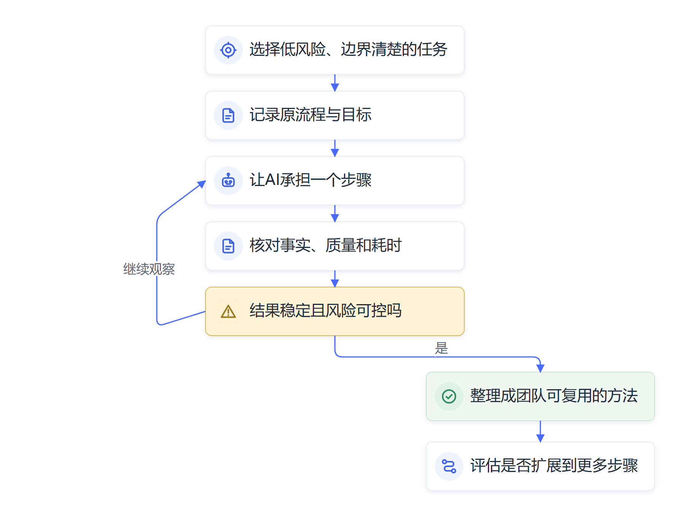

# 第十九章　个人行动与领导干部的责任

**面对AI带来的工作变化，个人需要持续学习，领导干部需要为组织转型作出明确安排。**

人工智能的发展速度已经影响到个人、团队和组织的日常工作。对个人来说，学习如何使用模型只是起点，能否理解任务、判断信息、检查结果和承担责任，决定工具能否转化为工作能力。对领导干部来说，部署软件或购买服务也只是起点，真正的管理任务是把技术放进业务流程、岗位职责和治理制度。

## 个人从真实任务开始形成能力

个人可以从一项重复、边界清楚、结果容易检查的工作开始使用AI。使用前了解原来的流程、耗时和质量要求；使用中记录工具读了什么资料、做了哪些操作；使用后核对事实、计算结果和业务条件，再比较整段流程有没有改善。

实际使用会让人更清楚哪些任务适合交给AI，哪些任务需要自己判断。会议任务清单可以由助手先整理，员工再核对责任部门和时限；政策材料可以让助手检索，工作人员再打开原文确认适用范围；预算数据可以让模型初步汇总，财务人员仍需复算和查明口径。每次复核都能帮助个人积累业务经验。

学习不能停留在模型当前版本。人工智能产品会改变，使用方式也会不断更新；员工可以持续练习任务拆解、资料核实、输出评价、工作流程设计和跨岗位沟通。这些能力能够跨工具迁移，也能帮助个人在岗位职责变化时重新定位。

## 团队需要把个体经验转成组织知识

一个员工摸索出的有效方法，若只保留在个人账号或聊天记录里，团队难以复用。部门可以整理经验证的任务说明、资料来源、检查步骤和错误案例，明确由谁维护、何时更新、哪些内容适用于不同岗位。组织知识库应标注来源和版本，避免未经确认的个人经验被当成正式制度。

团队也要建立反馈渠道。员工发现AI理解错了任务、使用了旧材料、操作越权或增加了额外工作时，应能报告问题，并获得后续处理。项目组可以定期回看错误类别，判断问题来自模型、数据、工具接口、流程设计还是培训不足，再决定调整系统或缩小使用范围。

专业经验不能只由文件承载。老员工知道政策执行中的例外，现场人员熟悉设备异响和季节差异，服务人员理解群众容易误解的表达。团队需要通过案例讨论、导师带教和现场复盘保留这类知识，再决定哪些部分可以编码成规则或辅助模型使用。组织有了有效知识，Agent才能按真实业务条件工作。

## 领导干部负责设定方向和责任边界

领导干部要说明人工智能项目为什么做、希望改善什么、哪些部门参与、需要多少资源、谁对业务结果负责。跨部门项目要指定业务负责人和技术负责人，避免技术团队单独定义业务价值，也避免业务部门在上线后才发现系统无法连接原有流程。

领导干部还要把安全、合规和责任要求纳入项目设计。涉及个人信息、政务数据、商业秘密、生产控制或公共服务的项目，应按组织制度选择工具和运行环境，明确数据范围、身份权限、人工审批、操作日志、异常处理和退出方案。数据责任、系统责任和业务决策责任需要分别落实。

项目评价应回到业务结果。管理者要看服务是否更好、质量是否稳定、总成本是否下降、员工能否处理异常、风险是否在可接受范围内。模型生成了多少文字、Agent调用了多少次工具，可以作为运行信息，不能替代工作成效。评估结果达不到预期时，组织应及时改造流程、调整目标或停止项目。

## 组织要让员工参与转型过程

技术改变工作时，员工最先面对任务变化。组织应提前说明哪些岗位受到影响、培训如何安排、员工可以提出什么意见、考核如何调整。若项目目标只是要求大家尽快使用工具，却没有解释数据用途和岗位安排，员工容易担心失去工作或承担不清楚的责任。

员工应从场景选择阶段参与项目设计和试点评估。业务人员能够指出哪些重复任务最占时间、哪些例外最难处理、哪些服务对象最容易受到影响。把他们纳入设计和测试，可以减少工具与现场脱节，也能让组织更早发现模型错误。

组织还要规划职业发展和新人培养。基础任务减少后，可以通过轮岗、案例复盘、流程审查和导师指导，让员工继续掌握专业判断。工作重组带来的效率收益也要公平分配，既要改善公共服务和经营质量，也要考虑岗位工作量、培训机会和员工成长。

## 推进过程需要有节奏

组织可以先建立共同认识，明确业务目标和数据边界；再选取一项有价值、可验证的任务，安排业务、技术和治理人员共同试点；试点后比较基线、复核成本、运行质量和用户反馈；结果稳定后逐步扩大范围，并持续维护模型、知识库、系统权限和人员能力。

每个阶段都要保留决策依据。项目为何启动、为何选这个场景、数据怎样处理、系统由谁审核、哪些问题导致暂停、扩大时依据什么，都应记录下来。记录既保护组织，也帮助后续团队理解项目选择和错误处置过程。管理者根据证据推进工作，可以减少追逐热点带来的反复建设。

组织还需要设定退出条件。模型持续失准、工具供应停止、数据条件变化、风险超出控制或维护成本无法承担时，项目应能够暂停并回到可用流程。供应商变化或模型退役后，单位要能够迁移数据、保留业务记录并恢复人工处理，避免把关键职责完全交给无法控制的外部服务。

## 个人可以建立一条持续学习的工作路径

个人行动可以从熟悉自己的工作开始。把一周中经常重复、经常等待、容易返工的事项列出来，观察每项工作需要什么资料、有什么判断点、结果由谁使用。再选一项边界清楚且失败后容易回退的任务，让AI承担资料整理、格式转换、初步分类或草拟等步骤，保留人工核对和正常流程。

每次使用后，个人可以记录完成时间、核对时间、常见错误和实际效果。若AI节省了起草时间，却增加了来源核实和修订时间，就继续调整任务范围；若它在某类问题上稳定有效，可以整理成经验证的操作说明，供团队讨论。个人试用的目标是形成判断能力，知道工具什么时候可靠、什么时候需要停下来。

随着经验积累，可以从单一步骤逐渐扩展到一条工作链。先让系统检索和整理资料，再让它形成草稿；在充分验证后，再考虑连接文件、表格或业务接口。每次增加能力都要重新确认数据权限、操作风险、异常去向和最终责任人。个人的能力成长因此与组织的授权机制同步推进。

*图19-1　个人从一次尝试逐步形成可复用的工作能力*

## 领导干部要承担四类组织责任

领导干部的组织责任可以归纳为四项：

1. **确定业务问题。**把AI项目与公共服务、生产经营或管理目标连接起来，要求业务部门说明现状、预期价值、数据条件、风险、替代方案和改进指标。
2. **安排岗位与资源。**指定业务牵头人、技术协作人和运行维护岗位，为员工安排工具、培训和参与设计的时间；任务变化后同步调整工作量、职责、绩效和新人培养。
3. **设定治理边界。**落实数据分类、权限审批、供应商管理、日志审查、人工复核和应急接管。涉及个人权益、公共服务、资金或生产安全的任务，要明确AI可以建议或执行到哪一步。
4. **依据证据调整方向。**持续观察质量、服务、成本、员工负荷、风险事件和维护能力，再决定改造流程、缩小范围、补充数据、扩大应用或结束项目。

## 团队应把经验沉淀成可以共同使用的资产

组织需要把员工使用AI时积累的经验保留下来。经核实的任务说明、资料目录、业务规则、错误案例、审查步骤和异常转交方式，可以进入团队知识库并标明维护岗位、版本和适用范围。团队要区分正式制度、个人经验和待验证建议，防止未经确认的回答成为新的工作规则。

项目复盘可以定期讨论三件事：哪些任务改善最明显，哪些错误重复出现，下一步最值得投入什么。业务人员讲工作条件，技术团队说明模型和接口表现，数据与安全人员分析来源和权限，管理者据此决定后续行动。复盘要形成具体责任和期限，也要把已经验证不适用的方法记录下来。

人才培养要覆盖新员工、骨干和管理者。新员工需要学习专业基础和结果核验；业务骨干可以参与流程重构和Agent测试；领导干部需要掌握项目价值、授权边界和组织影响的判断。岗位训练应结合本单位真实任务，避免只介绍产品功能而没有运行责任。

## 面对变革，组织需要保持人的判断和公共责任

人工智能正在扩大人和组织能够处理的信息量与任务范围。能力扩展也会带来新的选择：哪些服务应该更容易获得，哪些工作需要保留人的交流，效率收益怎样用于员工成长和公共价值，自动化决策如何接受监督。这些问题不会由模型自动解决，需要组织通过制度、专业判断和社会讨论作出安排。

领导干部、业务人员和技术人员承担不同责任，却共同影响技术最终产生的结果。干部明确目标和制度，业务人员判断服务与专业条件，技术团队确保系统按授权运行，组织成员持续反馈运行中的问题。AI可以承担越来越多操作，人的判断、责任和价值选择仍决定它走向哪里。

面对快速变化，个人可以保持学习，团队可以分享经验，组织可以用证据推进转型。每一次技术引入都应让工作对象获得更好的服务，让员工更有能力解决问题，也让组织更稳健地承担职责。

## 建立能够听见员工意见的转型机制

岗位变化会触及工作量、收入预期、专业身份和成长路径。组织应当设置员工代表、一线岗位和管理者都能参与的沟通机制，在场景设计、试点评估和扩围决策中听取实际使用者意见。员工提出的问题需要得到反馈，项目组应说明哪些建议已采纳、哪些暂时不能实施以及原因。

透明的工作数据使用规则也很重要。组织可以说明系统日志用于故障排查、质量改进或合规审计，分别由哪些人员访问，保存多久，员工如何核对记录。若数据要用于绩效判断，应说明指标和申诉流程，并考虑任务难度与服务对象差异。清楚的规则能够支持责任追踪，也能减轻员工对不明监控的顾虑。

领导干部还要定期检查效率收益的去向。节省出的时间可以用于缩短群众等待、开展更细致的服务、支持技术维护和员工培训，也可能使岗位工作量增加。收益分配是组织管理的一部分，应结合业务成效和员工反馈持续调整。转型能够让组织整体能力提升，员工也能在变化中获得成长，技术投入才更容易得到长期支持。

## 组织转型要把长期能力放在年度项目之外

人工智能的影响会跨越多个年度预算和岗位周期。组织除了管理单个试点，还应建立持续观察机制，跟踪技术进步、行业案例、法律政策、员工能力和业务需求。观察结果用于更新组织战略、人才规划和信息化路线，帮助干部提前准备数据治理、算力、供应链和岗位调整。

长期规划也要保留调整空间。技术市场变化很快，某项模型或供应商可能在合同期内发生重大升级，组织不宜把关键业务绑定在无法迁移的单一路径上。数据格式、接口标准、退出安排、备份系统和内部维护能力都需要纳入决策。组织掌握关键业务记录和运行知识，才有能力在技术变化时更换工具或恢复流程。

领导干部可以围绕年度工作设定几类持续观察指标：哪些岗位任务已经改变，哪些流程的人工复核持续增加，哪些项目形成稳定收益，哪些数据和接口仍是关键瓶颈，哪些员工群体需要更多培训。这些指标用于帮助组织调整行动，并应始终服务于真实业务决策。年度复盘把技术、组织和人才信息放在一起，能够支持更稳健的下一轮决策。

## AI时代的管理责任仍属于人和组织

模型可以生成建议、完成重复操作、协调多个工具，也能帮助员工扩大处理问题的范围。组织负责设定目标、安排权限、建立业务制度并决定是否采纳结果；员工在岗位职责范围内核对依据、处理异常、解释决定并承担应有责任。把责任写清楚，AI才能在组织里发挥作用。

人类面对AI大变革，需要保持学习和判断。技术进步会继续加快，新的Agent和数字员工还会改变办公室、生产现场和公共服务。个人要发展专业能力和协作能力，组织要推动岗位和流程调整，领导干部要处理效率、安全、发展和公平之间的关系。

人工智能能够扩展人的行动范围，也会把更多决策带入机器系统。它最终服务什么目标、怎样分配效率收益、怎样保护服务对象和劳动者，仍由人类社会作出选择。面对变革，组织既要学习新工具，也要守住公共责任、专业标准和人的尊严。

## 资料来源与说明

- [ILO《生成式人工智能与就业：职业暴露全球指数》](https://www.ilo.org/publications/generative-ai-and-jobs-refined-global-index-occupational-exposure)：任务变化和职业暴露研究。
- [ILO实证研究综述](https://www.ilo.org/publications/impact-genai-jobs-productivity-and-work-organization-review-empirical)：生产率、就业和工作组织近期证据。
- [WEF《未来就业报告2025》](https://www.weforum.org/publications/the-future-of-jobs-report-2025/)：雇主预测的技能变化和调查样本范围。
- [国务院“人工智能+”行动意见](https://www.cac.gov.cn/2025-08/27/c_1758018277755538.htm)：人工智能发展与应用的国家政策方向。
- [《网络数据安全管理条例》](https://app.www.gov.cn/govdata/gov/202409/30/520076/article.html)：数据处理活动中的安全保护和委托处理责任。
