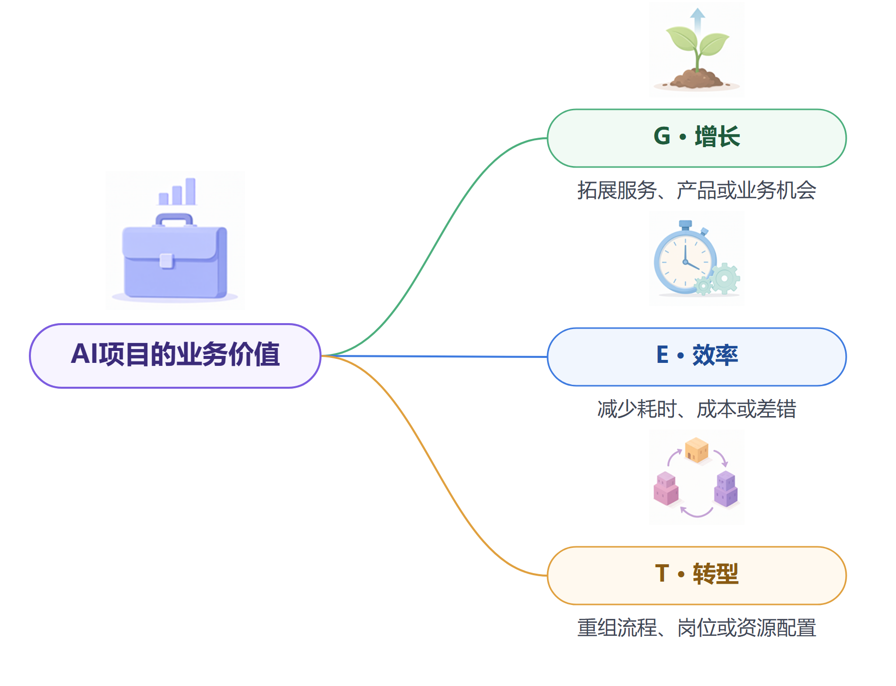
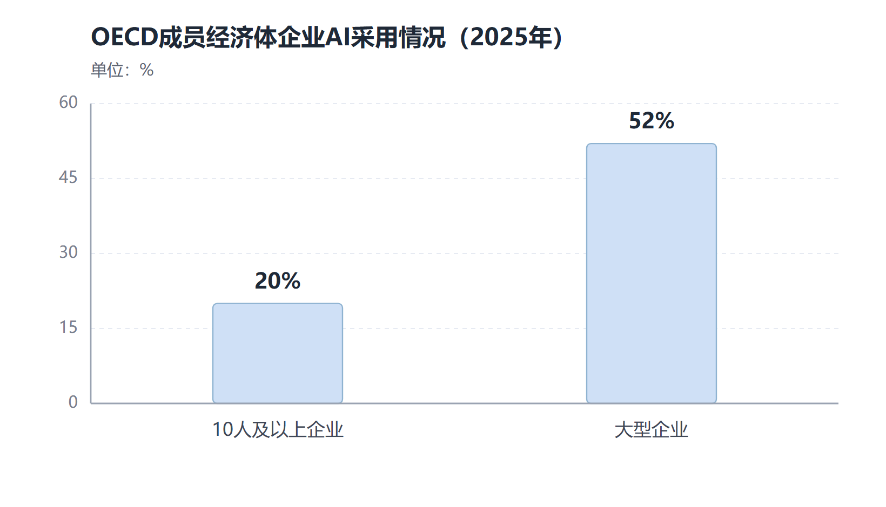

# 第十四章　AI项目先想清业务价值与应用场景

**组织投入人工智能之前，应先确定业务要改善什么，再选择值得验证的工作。**

人工智能工具越来越多，模型能力和产品也在快速更新。组织容易从“部署什么模型”开始讨论，但一个项目能否产生价值，首先取决于它是否解决了实际工作中的问题。工作人员已经能在几分钟内完成某项任务，使用更强模型未必带来明显收益；一项高频工作如果经常等待资料、重复录入和返工，重新设计流程可能比单独购买模型更有效。

组织需要把“AI要产生价值”转化成具体目标。本章所说的GET，分别取Growth、Efficiency、Transformation三个词的首字母，对应增长、效率和转型。管理者可以先用这三个方向判断项目希望带来的业务结果，再把目标落实到场景、资源和评价指标。

*图14-1　GET从增长、效率和转型三个方向识别AI项目的业务价值。*

| GET方向 | 管理者可以先问 | 常见观察结果 |
| --- | --- | --- |
| **G · Growth（增长）** | 哪些服务、产品或业务机会可以拓展？ | 服务对象扩大、业务覆盖增加、新产品或新服务形成 |
| **E · Efficiency（效率）** | 哪些工作时间、成本或差错可以减少？ | 办理周期缩短、单位成本下降、返工和漏错减少 |
| **T · Transformation（转型）** | 哪些流程、岗位分工或资源配置需要调整？ | 端到端流程重组、人机职责变化、组织能力更新 |

一个项目可能同时带来两种或三种价值。立项时，管理者仍应确定主要价值方向和预期的次级结果，并说明各自的观察指标。这样，项目团队可以据此安排资源，也能避免用“提质增效”概括所有目标。

## 从组织目标落到可观察的业务结果

增长型项目通常面向服务能力、覆盖范围和新业务机会。政务服务系统可以帮助群众更快找到办事指南，也可能让部门处理更多类型的咨询；国有企业可以使用视觉模型检查产品质量、开发新材料或改进客户服务。评价这类项目，要看服务对象是否增加、质量是否改善、业务周期是否缩短，以及组织是否承担新的运营成本。

效率型项目关注重复劳动和流程时间。材料审核可以由模型标出字段缺项，客服部门可以让Agent先分类和整理工单，设备维护人员可以通过模型汇总告警与检修记录。它们可能减少手工录入和信息查找时间，也可能增加复核、维护和系统处理成本。应计算整个流程的净变化，不把单个步骤的速度直接等同于整体效率。

转型型项目会改变工作本身的结构。Agent如果接入业务系统，组织需要重新划分数据维护、流程审批、异常处理和结果责任；具身智能进入生产线后，现场岗位要调整设备维护、人机协作和安全管理。转型项目的价值可能需要较长时间才会显现，组织要同时跟踪岗位能力、服务体验和工作质量。

人工智能有时只替代一个局部步骤，有时会促使业务流程重新设计。一个人事部门可以用AI快速整理政策问答，也可以进一步把问题反馈、知识更新、咨询转办和制度解释连成一套服务流程。前者主要减少查找时间，后者可能改变部门分工和信息维护方式。组织应先说明希望发生哪一种改变，再决定项目范围。

## 选择场景要看价值、条件和风险

同一个AI能力能用于很多工作，组织应优先挑选价值清楚、数据可得、结果可检查、错误可控的场景。筛选时可以同时考察四项条件：问题是否频繁出现，现有流程是否有可改善空间，所需资料是否完整，失败后是否能够及时发现和纠正。

| 评估维度 | 需要了解的情况 | 可观察的证据 |
| --- | --- | --- |
| 业务价值 | 工作频率、服务对象、现有耗时和问题影响 | 办理时长、返工、服务评价、成本基线 |
| 技术可行性 | 数据、系统、接口和流程是否具备运行条件 | 数据完整度、接口稳定性、测试结果 |
| 组织准备度 | 负责人、实际使用岗位和维护人员是否明确 | 资源安排、岗位参与、运行责任 |
| 风险水平 | 错误会影响谁，是否涉及资金、权利或安全 | 错误后果、授权范围、复核和恢复机制 |

政策检索、会议任务提取、热线工单分类、设备告警归并等工作，通常容易限定任务范围并核对结果，适合早期验证。审批、执法、人员录用、资金拨付、重大设备控制和安全生产等工作，错误可能造成严重后果，组织需要增加审核、权限隔离和人工决策要求。

场景筛选还要考虑组织的数字基础。一个部门拥有多年业务记录，如果数据格式不一致、制度版本不清、系统没有接口，模型很难稳定发挥作用。项目组要把资料整理、系统改造、运行维护和员工培训也计入准备工作。资料整理、系统改造、运行维护和员工培训，都是系统进入日常工作的必要投入。

## 用完整成本计算项目是否值得推进

人工智能项目的支出不仅包括模型采购或API调用。组织还可能支付数据整理、算力、系统集成、流程改造、网络安全、权限管理、人工复核、员工培训、模型评测、故障处理和持续维护等费用。若更换供应商或模型，还要考虑数据迁移、接口改造和业务中断成本。

收益也不能只按“节省了多少分钟”计算。工作人员可能把节约时间投入更复杂的服务，组织也可能因错误或复核增加额外工作。项目组需要先记录人工处理的总时间，再把模型生成、员工检查、异常转办、技术维护和返工时间都纳入对照。单位成本、质量、等待时间和用户体验应一起看。

很多AI项目会遇到局部效率提高、整体收益尚不清楚的情况。国际劳工组织2026年对生成式AI工作影响的实证研究综述指出，生产率收益确实存在，但分布不均且经常未经充分验证；员工报告的时间节省尚未普遍转化为可测量的产出、收入或就业变化。不同研究的任务和组织不同，不能直接套用其中一个百分比预测本单位收益。[ILO实证研究综述](https://www.ilo.org/publications/impact-genai-jobs-productivity-and-work-organization-review-empirical)

## 建立基线，让组织知道发生了什么变化

项目运行前，组织应记录现有流程的处理时间、错漏率、返工次数、等待时间和用户评价。若某项工作每月处理多少单、多少单需要人工补正、平均用时多少，这些数据可以帮助项目组判断改造后是否改善了业务。没有基线，系统上线后即使使用量增加，管理者也难以判断服务是否更好。

评价时要使用一致的任务范围、统计周期和计算方法。人工智能处理的任务如果比人工样本简单，结果比较就不公平；项目团队只选取最成功的案例展示，也会高估实际效果。可以让新旧流程同时处理一批可比较任务，随机抽取样本复核质量，或在不同部门分批上线，逐步识别效果来自技术、流程变化还是业务量波动。

结果指标应覆盖效率、质量、风险和使用情况。效率包括耗时和单位成本；质量包括准确率、漏项率、返工和满意度；风险包括隐私事件、越权调用和错误决定；使用情况包括活跃岗位、任务占比和人工转办。部门还要记录系统运行稳定性、调用失败、模型版本和维护工时，帮助团队持续改进。

## 组合多个场景，避免项目孤立建设

组织不应把每个部门的AI项目都当成独立采购。多个场景可能共用制度知识库、身份权限、检索能力、模型服务和安全管理；由统一平台提供共性能力，可以降低重复建设。场景仍要由业务部门负责定义，统一平台不能替代业务责任和专业知识维护。

场景组合还可以形成清楚的投资顺序。基础数据和系统接口先建设，组织可以较快支持多个低风险任务；复杂Agent或机器人项目再接入经过验证的工具和权限；高影响场景则需要更长的技术验证、法律审查和专业评估。不同场景对模型、算力和人工介入的要求不同，单位应按组合价值安排资源。

OECD《数字经济与社会展望2026》估计，2025年有10名及以上员工的成员经济体企业中，约20%使用AI，大型企业采用比例约52%。采用率说明组织是否使用人工智能，不能证明部署后的产出提高。报告也记录了企业遇到的技能、系统兼容、数据质量、隐私、法规不确定和成本障碍。对党政机关和央国企而言，国际企业数据可作趋势参照，不能替代本单位的应用评估。[OECD《数字经济与社会展望2026》](https://www.oecd.org/en/publications/oecd-digital-economy-and-society-outlook-2026_022ed474-en/full-report/digital-technology-diffusion-and-the-economy_b355e780.html)

*图14-2　数据为OECD成员经济体调查估算；企业采用AI不等于项目已经产生业务收益。来源：[OECD《数字经济与社会展望2026》](https://www.oecd.org/en/publications/oecd-digital-economy-and-society-outlook-2026_022ed474-en/full-report/digital-technology-diffusion-and-the-economy_b355e780.html)。*

## 用问题链判断AI介入是否值得

组织发现一项工作耗时长、差错多或群众反复咨询时，不能马上把问题等同于“需要一个模型”。项目团队可以沿着一条问题链往下追问：问题发生在哪个流程环节，主要原因是什么，哪些信息已经存在，员工现在如何补救，想要改善的结果怎样观测。这样可以区分技术问题、制度问题、数据问题和流程问题。

例如，政策答复慢可能源于文件分散、版本不一、部门职责不清，也可能源于工作人员缺少检索工具。若文件版本混乱，先建立统一的制度管理机制比购买大模型更直接；若政策已经整理好，工作人员仍花很多时间寻找条款，检索助手可能缩短查找时间；若群众问的问题超出指南范围，流程还要安排专业人员接续服务。一个真实问题经常需要多项改进共同解决。

类似地，设备故障增加可能来自传感器老化、检修周期不合理、备件缺货或异常识别不及时。机器学习模型可以辅助预测风险，但不能代替设备维护、数据校准和备件供应。项目组选定技术方案前，要先确认模型能够影响哪一步，以及其输出会如何进入现有决策。

## 从价值假设推导衡量办法

一个项目的价值主张可以写成“针对什么对象，在什么条件下，系统帮助完成什么工作，预期改善哪项结果，同时守住什么底线”。例如，某服务窗口希望通过政策检索助手缩短常见咨询时间，并保持依据准确、复杂事项及时转人工。项目组随后要确定平均处理时长、来源正确率、转人工比例和群众反馈的基线及目标。

价值指标要和作用机制相连接。若系统只生成材料初稿，可能影响起草时间和格式返工；若Agent进一步读取系统并创建工单，可能影响分流速度和状态跟踪；若机器人参与现场操作，可能影响设备停机、产出质量和人员安全。指标沿着工作链安排，管理者才能看见技术在哪一步产生作用、哪一步仍然受其他因素限制。

公共部门和国有组织的价值也不只体现在节省经费。办事信息更容易找到、服务时间更稳定、偏远地区更容易获得同等服务、专业人员能更早发现风险，这些结果具有公共价值。评价时仍要把服务质量、覆盖对象、公平性和维护成本放在一起观察，不能只用“节省了多少人时”代表整体成效。

## 用场景组合安排组织的投资顺序

单位可以把拟议项目放在一张场景组合图上，观察业务价值、落地条件和后果风险。价值清楚、数据和流程成熟、结果容易检查的工作，可以先进行小范围验证；价值高但数据缺口大、系统改造复杂的场景，可以先安排数据治理和接口建设；风险高且人工很难及时纠错的任务，应先明确不可自动化的决定和严格的审批边界。

不同场景还可能共享基础能力。多个部门都要查制度，可以共用身份管理、检索服务、文档版本和审计日志；生产单位有类似的设备监测需求，可以复用数据接入、模型评估和异常管理能力。共性平台能减少重复投入，业务部门仍要负责各自的规则、指标和日常运行。项目组合因此同时包含具体业务场景和支撑它们的组织能力。

管理者还应检查“没有采用AI”的方案。调整表单、删除重复审批、统一数据口径、增加业务人员或改进系统搜索，有时更快、更便宜，也更容易解释。对比这些方案后仍决定引入AI，项目目标就会更清楚，采购和实施范围也更容易控制。

## 一个机关服务流程如何形成可衡量的价值目标

设想某机关经常收到基层单位关于项目申报条件的咨询。项目组先核对近几个月的咨询记录，发现不同单位反复询问适用对象、材料清单和截止时间，业务人员需要在多个文件中查找。团队可以先统一现行指南，比较网页检索、政策知识库和对话助手的方案，再选定一个试点范围。

价值目标可以同时覆盖几项结果：常见问题平均答复时间是否缩短，答复是否引用现行文件，工作人员是否减少重复查找，复杂问题是否及时转办，基层单位是否更容易完成申报。基线数据来自正式记录和抽样观察，目标值由业务负责人结合服务要求确定。若助手提升了答复速度，却增加了错误申报或重复咨询，项目团队就要检查知识内容和答复流程。

这个例子说明，业务价值要从组织希望改善的结果往回推到系统功能。团队先明确服务目标，再决定是否需要大模型、检索系统或流程改造；技术方案服务于任务，验收指标则服务于业务结果。目标明确后，项目范围、预算和责任人都更容易安排。

项目组合也要定期调整。行业要求、公众需求、数据条件和模型能力都会变化，过去价值一般的场景可能出现新的机会，已上线的系统也可能因维护成本和流程变化失去优势。管理层可以按年度或重要业务变化重新审视项目目标、使用范围和投入安排，使技术建设与组织任务保持一致。

## 让项目目标成为组织共同语言

AI项目往往由业务部门、信息化部门、数据管理、安全合规和采购部门共同参与。各方对“成功”的理解可能不同：业务团队看服务和质量，技术团队关注准确率和稳定性，财务部门关心总体投入，安全岗位检查数据和权限。项目启动时就应约定首要业务结果、验收指标、风险阈值和责任人，避免上线后才争论价值如何计算。

人工智能产生真实价值，需要项目选对问题，也需要组织愿意改变工作流程。单位可以先找出一个频繁发生、边界清楚、能够测量的任务，再比较人工智能介入前后的流程表现。若数据和系统尚未准备好，可以先治理数据；若错误后果难以控制，可以缩小授权范围；若业务价值不足，可以停止投资。项目选择以事实和组织目标为依据，AI投入才能逐步转化成可持续的工作成果。

## 资料来源与说明

- [国务院“人工智能+”行动意见](https://www.cac.gov.cn/2025-08/27/c_1758018277755538.htm)：国家层面的人工智能应用行动方向。
- [工信部《制造业企业人工智能应用指南》](https://www.miit.gov.cn/cms_files/filemanager/1226211233/attach/20261/735011cb05584824b3cb2a45666a58ce.pdf)：应用场景、数字化基础和经济性评估。
- [ILO实证研究综述](https://www.ilo.org/publications/impact-genai-jobs-productivity-and-work-organization-review-empirical)：就业、生产率和工作组织的近期经验研究。
- [OECD《数字经济与社会展望2026》](https://www.oecd.org/en/publications/oecd-digital-economy-and-society-outlook-2026_022ed474-en/full-report/digital-technology-diffusion-and-the-economy_b355e780.html)：企业采用差异与实施障碍。
