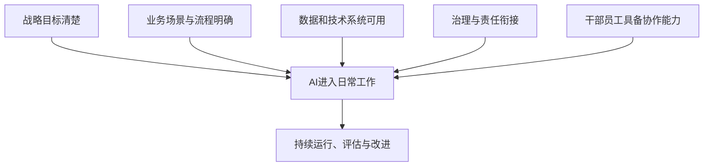

# 第十五章　五项条件支撑AI进入日常工作

**要让人工智能长期服务业务，组织需要同时准备目标、场景、数据系统、治理机制和人才队伍。**

一次演示可以展示模型会做什么，常态应用则要求组织连续提供合适资料、权限、流程和维护能力。某个部门试用聊天助手后，若员工无法找到可信文件，系统不能连接业务工具，出现错误也没有人负责，使用热度很快就会下降。人工智能进入日常工作，需要多项组织条件共同成熟。

领导干部负责确定方向和资源，业务部门负责说明实际工作，技术和数据团队准备运行条件，安全与合规岗位设置边界，使用人员反馈结果和异常。五项条件相互依赖，项目负责人要把各项准备工作落实到部门和岗位。

## 第一项条件：组织战略要落到明确目标

组织应当说明为什么要引入人工智能，计划改善哪项业务结果，谁对结果负责。提高公共服务可及性、减少企业办理材料的重复核对、改善设备检修效率、降低研发资料查询时间，都比“建设AI能力”更容易成为行动目标。

战略目标还要与组织的职能和主责主业衔接。党政机关需要考虑法定职责、公共服务对象和治理目标；央国企需要结合行业特点、生产安全、经营质量和产业竞争力。单位可以把一个目标分解成年度任务、试点范围、人员和预算安排，再确定哪些项目优先推进。

没有明确目标，项目可能围绕模型采购、宣传演示或部门创新考核展开，业务人员却没有持续使用的理由。若领导只关心一次展示效果，团队会倾向于准备最容易成功的任务；若项目目标与长期业务改进挂钩，单位就会关注实际使用、服务质量和维护成本。

组织还应确定目标之间的取舍。例如，客服助手要扩大覆盖范围，可能需要接入更多用户问题和业务资料；系统接入越深，数据和权限风险也会提高。管理者需要说明首要目标是什么，哪些边界不可突破，预算如何安排，项目不达标时如何调整。

## 第二项条件：业务场景要有责任人和清楚流程

每个项目都要有熟悉业务的负责人。负责人能够描述任务从哪里开始、需要哪些材料、由谁处理、哪些步骤可以交给AI、哪些情形必须转人工。只有把现有流程讲清，技术团队才能设计适合的系统，业务人员才能判断结果是否可以接受。

工作流程的输入、输出和边界也要明确。比如，制度问答助手应知道可使用哪些文件、如何识别文件版本、什么时候需要提供条款出处；会议任务提取Agent应知道什么内容算作正式决定、谁确认责任部门和期限、如何处置含糊表述。每个场景都要列出常见例外，避免模型把未确定事项写成已经决定的结论。

业务流程经常存在隐性规则。员工知道遇到特殊情况要咨询法务、向上级请示或查阅地方文件，制度文本里却未必写全。业务部门要把这类判断条件整理出来，再让模型在合适的节点追问或转交。项目不能要求一线人员把所有复杂工作压缩成几句话，组织需要投入时间梳理业务知识。

场景责任人还要参与测试。技术团队可以测试程序是否运行，业务负责人需要判断答案是否符合实际职责、服务流程是否仍顺畅、失败任务能否及时转办。项目上线后，业务规则变化时也要通知系统维护人员，更新知识和测试案例。

## 第三项条件：数据和技术系统能够支撑任务

AI系统要使用正确、及时、适用的数据。资料的来源、版本、生效范围、保存期限和访问权限需要有人负责。文档里如果有多个版本，系统必须知道哪份是现行文件；设备数据若缺少统一标识，模型可能把不同型号当成同一对象；业务记录里的错误标签也可能传入训练和评价过程。

技术团队需要检查模型、检索系统、数据接口和运行环境是否满足业务要求。简单分类任务可能使用小模型和规则，政策问答可能需要检索增强生成，Agent操作业务系统需要接口、身份权限、任务状态和审计日志。模型不能替代所有软件能力；已有办公系统和流程平台也可能更适合承载一部分工作。

单位还要了解数据经过哪些环节。使用云服务时，应核对资料会不会传出本地，供应商保存什么日志，谁能访问，模型服务如何处理数据；使用本地模型时，也要考虑联网搜索、插件、文件索引、备份和终端管理。部署位置不同，数据保护和运行成本要求也不同。

数据需要持续治理。法规、制度、产品规格、服务指南和设备台账会发生变化，模型知识库和接口也要同步更新。组织应明确哪些部门维护数据，多久检查一次，版本变更后怎样重新测试，出现错误时由谁撤回旧资料。

## 第四项条件：组织治理和业务责任能够衔接

组织应当明确业务部门、技术团队、数据管理、安全合规、采购、审计和供应商各自负责什么。业务部门确认任务要求和结果，技术团队维护模型与接口，数据岗位管理资料来源和权限，安全岗位检查系统风险，供应商按照合同提供服务。职责不清时，模型输出出错后容易出现“每个部门都参与了，却没人负责”的局面。

权限应与任务需要相称。制度查询可以使用只读权限，表单草拟可以限制在个人工作区，正式提交和发布则需要明确审批。系统应保留操作记录，让工作人员知道Agent读取了哪些资料、调用了什么工具、何时修改了结果。对可能影响群众权益、人员资格、资金、安全和生产控制的任务，组织要提高审核等级，保留人工决定权。

治理规则也要覆盖采购和运维。单位在采购AI产品时，应询问模型服务地点、训练数据和日志处理方式、系统更新频率、异常响应时限、数据迁移方式和退出安排。供应商演示的功能不一定等于合同交付能力，项目组应在真实业务范围内做验收，记录模型版本、测试样本和失败场景。

员工需要知道人工智能会怎样影响自己的工作。组织应说明系统收集哪些数据，输出如何进入考核、哪些操作需要人工确认，员工如何报告错误和偏差。若员工担心每次操作都被不透明监控，可能会回避使用或隐瞒问题，反而难以发现系统风险。

## 第五项条件：干部和员工具备协作能力

人工智能素养不仅是会打开工具或写提示词。领导干部要能识别哪些工作适合交给AI，制定目标和权限范围，查看业务指标并承担组织决策责任；业务人员要能说明任务条件、核对材料来源、发现模型错误并处理异常；技术团队需要把模型、数据、系统和业务流程接起来；安全人员要理解数据流向和工具权限。

培训应围绕岗位任务组织。政策研究人员要练习查找来源、比对文件和标注不确定内容；设备维护人员要学习如何使用模型整理告警，同时保留现场检查；业务审批人员要了解Agent可以预填哪些字段、哪些结论仍由工作人员确认。岗位差异越大，统一讲授一套工具操作越难转化成稳定使用能力。

组织还要安排新人训练和经验传承。基础整理任务减少后，新员工可能较少通过查资料、写初稿和复核报表学习业务。主管可以用案例复盘、轮岗、数据核查和模拟审查，让新人继续掌握业务规则、判断方法和责任边界。成熟员工则可以参与知识整理和Agent效果反馈，把经验转成可维护的流程说明。

使用文化决定一线员工是否愿意报告问题。管理者应允许员工指出模型错误，不能把提出问题简单理解为抵触技术；团队可以记录常见错误、修正方法和适用条件，让改进经验在部门间分享。组织对AI的评价也不应只看调用量和生成数量，还要看工作质量、服务体验、风险和维护投入。

*图15-1　五项条件共同支撑AI从试用进入日常工作*

## 用一项具体服务检查五项条件

假设一个组织准备让AI助手回答群众关于惠企政策的问题。领导层要先决定希望减少哪类重复咨询、提升哪项服务指标，并确定试点资源；业务部门挑选若干政策范围，整理适用对象、申报条件和办理方式；数据人员检查文件版本、地区差异和有效期限，技术团队选择可检索原文的模型方案；安全与业务负责人设置只读权限、来源展示、转人工和日志规则；窗口工作人员测试常见提问，指出哪些回答会误导申请人。

服务运行后，五项条件仍要持续发挥作用。政策更新由业务部门通知维护团队，模型或检索组件升级后重新测试，工作人员报告新增问题，负责人查看办事结果和用户评价。若发现某项资格条件经常被漏掉，项目组要同步修改资料、测试案例和工作流程。这样的服务才会随着政策和业务变化继续可用。

## 五项条件需要一起准备

这五项条件相互依赖。战略目标帮助场景摆脱短期演示导向；业务负责人维护规则和异常处置；可用数据支撑准确服务；治理机制明确权限；岗位能力支撑员工核验和反馈。项目团队应在设计阶段把这些依赖纳入计划，并持续更新治理安排。

这五项条件可以用来检查一个项目是否具备进入日常工作的基础：

| 条件 | 组织需要回答的问题 | 缺失时常见表现 |
| --- | --- | --- |
| 战略目标 | 希望改善什么，谁对结果负责？ | 工具展示很多，业务目标不清 |
| 业务场景 | 哪项工作由谁完成，边界在哪里？ | 任务要求含糊，异常无人接手 |
| 数据与技术 | 资料是否可信，系统能否稳定连接？ | 回答过时、重复建设、接口失败 |
| 治理机制 | 谁授权、审核、记录和维护？ | 权限过宽，故障责任不清 |
| 人员能力 | 干部和员工怎样参与、判断与反馈？ | 工具上线后使用率低，问题难发现 |

某项条件看似齐备，也不能证明其他条件自动成熟。组织可能拥有高质量的数据集，却没有实际业务需求；某个场景很有价值，信息化团队可能还没有合适接口；技术系统运行稳定，员工也可能因职责不清而不敢操作。项目负责人要在计划中分别安排责任、经费、进度和验收方法。

五项条件的准备程度还会随任务风险变化。内部会议纪要初稿可能采用较宽的试用范围，安排工作人员检查结果；面向群众的政策答复需要保证来源可查、适用条件准确和转人工渠道可用；生产控制系统则要采用隔离环境、冗余控制和设备安全测试。相同的模型能力，放在不同业务里需要不同组织准备。

## 让五项条件落实到一套治理关系

五项条件要转化为日常分工，组织可以为每个项目指定业务负责人、技术负责人、数据责任人和风险联络人。业务负责人确定任务边界和验收标准；技术负责人维护模型、接口和运行环境；数据责任人确认资料来源、版本与访问范围；风险岗位检查数据安全、权限和应急安排。重要决定由相应责任人共同审议，具体执行仍保留清楚的单一责任入口。

项目启动时，牵头部门可以形成一页运行说明，写清项目目标、服务对象、输入数据、系统会执行的动作、人工确认节点、异常去向和停止条件。这份说明帮助员工知道Agent能做什么，也方便审计和维护团队了解实际运行方式。系统更新、业务规则调整或供应商更换后，负责人应回看说明是否仍然准确。

采购和供应商管理贯穿模型使用全周期。单位需要确认服务能力、数据处理方式、模型和插件更新、故障响应、日志留存、知识产权、迁移支持和退出安排；合同要求还要能转换成上线验收与日常检查。组织不应把供应商的产品介绍直接当作本单位业务效果，真实材料和实际用户参与的验证才有助于判断能力边界。

## 按组织成熟度分阶段建设

组织可以把AI应用准备分成几个发展状态：先掌握数据来源和工作流程，再开展受控的辅助任务，随后建立共享平台和部门间协作，最终根据证据扩大Agent自主执行范围。不同部门可能处在不同状态，同一部门的文件检索和生产控制也需要不同授权程度。这样的判断能让资源投向当前最需要补齐的条件。

成熟度提高不表示审核要求不断减少。任务越接近对群众、员工、资金和设备产生实际影响，系统越需要清楚的权限、记录和人工接管机制。成熟度体现的是组织对流程、数据、技术和责任的理解能力，组织据此可以更有效地判断哪些操作适合自动化、何时要求人工复核、怎样处理突发问题。

五项条件也要形成稳定的跨部门协作节奏。项目初期由业务和技术共同确认任务及接口，试点阶段让安全、数据和一线岗位参加评估，常态运行后定期检查规则更新、模型变化和工作结果。若各部门只在审批节点出现，知识、权限和运行问题往往会互相等待；形成固定协作机制，组织才能及时处理跨部门依赖。

## 从单个项目建设组织能力

各单位的人工智能成熟度不同，项目选择也应相应变化。数据整理和权限机制尚不完善的组织，可以先建设统一资料管理和基础接口；业务负责人明确、风险较低的工作，可以试点助手或单Agent；当多项业务在相同数据和工具上形成需求时，再考虑共性平台和跨部门协作。过早搭建复杂平台会增加维护压力，过晚统一数据则会让部门重复建设。

成功项目应把经验留给组织。资料来源、业务规则、工具说明、测试记录和异常处理方式，需要沉淀成可维护的工作资产。新项目可以复用组织已经建立的能力，同时继续按具体任务进行验证。这样，AI应用才不会停留在几位员工的个人技巧，而会逐步进入日常制度、系统和管理流程。

## 资料来源与说明

- [国务院“人工智能+”行动意见](https://www.cac.gov.cn/2025-08/27/c_1758018277755538.htm)：组织推进人工智能应用的政策方向。
- [工信部《制造业企业人工智能应用指南》](https://www.miit.gov.cn/cms_files/filemanager/1226211233/attach/20261/735011cb05584824b3cb2a45666a58ce.pdf)：数据治理、场景和运行条件参考。
- [OECD《数字经济与社会展望2026》](https://www.oecd.org/en/publications/oecd-digital-economy-and-society-outlook-2026_022ed474-en/full-report/digital-technology-diffusion-and-the-economy_b355e780.html)：组织采用人工智能的条件与障碍。
