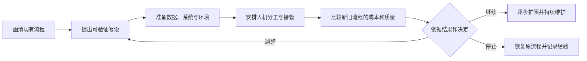

# 第十六章　从小范围试点走向持续应用

**用真实流程、可比较的指标和明确责任，决定AI项目何时扩大、何时调整、何时停止。**

人工智能项目常从一次演示或部门试用开始。演示能证明系统在某个准备好的任务里运行过，试点能观察它在限定流程和数据范围内表现如何，持续应用则要求单位长期维护资料、系统和岗位分工。三个阶段对应不同证据，组织应根据连续验证结果决定何时扩大应用。

*图16-1　从试点准备、评估到继续、调整或停止的决策路径*

## 第一步：把现有工作流程画清楚

项目组应先记录一项工作从接收任务到交付结果经过哪些步骤，谁在什么条件下参与，使用哪些材料和系统，发生异常时如何处理。流程图要标出重复录入、等待、退回、人工审核和跨部门交接，也要说明任务量和时间分布。

例如，制度问答可能经过群众提出问题、窗口人员判断事项、查找文件、确认适用条件、准备答复和后续转办。若工作人员经常因为文件版本不一致而请示，问题核心可能在制度管理；如果查找时间长、制度已经统一，检索助手才可能直接缩短流程。先看清问题，能避免把技术用在错误的环节。

## 第二步：提出一项可以验证的假设

项目目标应描述业务变化和验证方法。例如，项目组假设AI助手可以减少常见政策咨询的平均处理时间，同时保持答复准确率；或者假设视觉模型能够减少一类工件缺陷漏检。假设要包含对象、范围、目标指标和观察期限，让团队知道试点结果能够说明什么。

项目开始前，组织应记录人工流程基线。平均处理时间、漏项率、返工次数、设备停机时间、用户满意度和单位成本都可能成为指标。不同指标之间也可能存在取舍：缩短响应时间如果导致答案准确率下降，就不算完整改善。项目组需要确定首要指标和必须守住的质量、安全条件。

## 第三步：准备数据、系统和运行环境

试点前，项目组要核对所需资料的来源、版本、权限和完整性。数据里存在历史错误、字段缺失或重复记录时，应先决定是否清洗。知识库要设置更新责任人，业务系统接口要确定身份认证、读写权限、调用频率和日志保存方式。

技术团队可以搭建隔离环境或影子模式，让Agent先处理真实任务副本，结果暂不影响正式业务。影子运行可以检查模型回答、调用工具和员工现有处理结果之间的差异，也能发现系统接口与数据格式问题。涉及隐私或敏感业务时，团队需要根据单位制度设定脱敏、访问控制、模型部署和留存边界。

## 第四步：安排人机分工和接管机制

Agent在试点中的权限应与验证阶段相称。初期可以只读取资料、生成草稿或提出建议；工作人员核对后再进行正式录入和提交。系统遇到资料缺失、规则冲突、低置信度、工具异常或高影响决定时，要能暂停并转给指定人员。

现场人员需要知道怎样检查AI结果，如何标记错误，遇到问题找谁处理。项目组要记录人工修改内容及原因，区分模型判断错误、资料过时、接口故障、权限不足和业务规则未说明。若没有这些记录，系统团队只能把所有投诉归为“模型不准”，难以找到可修复的原因。

## 第五步：比较新旧流程的总成本与质量

试点运行期间，组织要按照相同口径记录新流程和旧流程。计算AI完成第一稿所需的时间时，还要加上员工复核、异常转办、技术维护、错误返工和工具调用成本。若AI缩短了查询时间，却增加了大量审核和申诉工作，组织需要重新计算净收益。

试点评估还要检查样本是否具有代表性。业务量高峰、特殊对象、政策变化和罕见异常可能不常出现，却会决定系统能否长期使用。项目组可以分层抽取常见与复杂任务，分别检查错误类型，并请业务专家复核高影响输出。公开演示的成功任务不应成为唯一验收样本。

## 第六步：设定继续、调整和停止的判断条件

项目启动时就应约定哪些指标达到后可以扩大试点，哪些问题出现后必须暂停。扩大条件可包括准确率达到业务门槛、人工复核时间下降、服务质量不降、权限和日志符合要求、维护团队具备支持能力。停止条件可包括错误后果超出控制、数据来源不清、维护成本过高或岗位无法接管系统问题。

| 阶段 | 组织要回答的问题 | 需要留下的证据 |
| --- | --- | --- |
| 演示 | 某项能力是否可以运行？ | 任务设定、演示记录和限制说明 |
| 影子运行 | 系统在真实任务副本上表现怎样？ | 输出比较、错误分类和接口日志 |
| 有限试点 | 员工能否在明确范围内安全使用？ | 基线对照、人工修改、异常和成本记录 |
| 常态应用 | 系统能否持续稳定并由组织维护？ | 运行指标、版本记录、服务保障和岗位安排 |
| 扩大应用 | 能否复制到其他部门或场景？ | 新场景评估、适配成本和风险复核 |

## 案例：让制度问答助手进入日常服务

以下案例为教学设定。某国有集团的多个部门经常收到差旅和采购制度咨询，项目组决定先从差旅住宿标准查询开始。项目负责人先检查现行制度、适用地区和人员类别，再和窗口人员整理常见问法。技术团队建立制度检索功能，助手只提供原文片段和答复草稿，正式解释仍由经办人员确认。

试点开始前，项目组记录人工查询时间、常见问题量和需要请示的问题比例。运行中，工作人员检查助手是否引用了正确版本，记录未检索到依据、地区条件混淆和多份制度冲突等情况。对涉及特殊审批或例外报销的事项，助手提示补充条件并转人工处理。项目负责人按周查看问答准确性、人工复核时长和用户反馈。

若试点发现主要错误来自旧版文件混在知识库，项目组先调整资料管理再继续测试；若模型反复把单位内部口径当成通用规则，则需要修改提示说明和知识结构；若人工复核时间没有下降，组织可以缩小应用范围或评估检索方式。项目的目的在于看清哪些工作适合由助手承担，不能预设一定会节约时间。

## 常态运行需要持续维护

进入日常应用后，制度更新、系统字段变化、模型升级和用户工作方式都会影响效果。组织要安排业务负责人复核知识更新，技术团队维护接口、权限和运行日志，安全人员检查数据路径，服务团队处理员工反馈。每次模型更新或工具变更后，都应复测关键业务案例。

运行指标也应持续监测。错误率突然上升、用户频繁转人工、工具接口调用失败、响应时间延长或不常见任务大幅增加，都可能说明系统需要调整。组织应设置暂停开关和回滚方案，在异常时先恢复原流程，再查明原因。

## 扩大部署要重新评估新场景

一个部门试点成功，不代表其他部门可以直接复制。新部门的数据格式、岗位权限、服务对象、业务规则和系统接口可能不同。组织可以复用模型服务和基础平台，但仍要让新业务负责人重新确认目标、流程、异常和验收标准。

扩大应用时还要观察组织层面的变化。若更多部门共用Agent，数据访问量、系统调用、模型费用和维护需求都会增长；若Agent的工作职责重叠，员工可能收到重复提醒或相互冲突的建议。规模化应分阶段进行，组织在每一阶段都要重新检查风险、服务和成本。

AI项目从试点走向常态，依赖可比较的证据、清晰的业务责任和持续维护。项目组应让模型在限定范围内运行，用记录说明它做了什么、哪里出错、人工怎样处理；管理者再依据业务结果决定是否扩大。这样的推进方式能够让组织逐步建立自己的判断依据，也为下一轮技术改进积累真实经验。

## 试点评估要把技术效果和流程效果分开

试点结果常同时受到模型、数据、人员熟悉度和流程变化的影响。项目组可以把观察指标分成几层：模型层记录答案正确、检索命中、识别误差和工具调用成功；流程层记录等待、转办、返工、复核和异常恢复；组织层记录人员负荷、用户体验、单位成本和持续维护能力。层次分清后，团队更容易判断问题出在哪里。

比较新旧流程时，尽量选择任务条件相近的样本。不同部门可以分批上线，未上线的部门暂时作为参照；若只能在单一部门试用，可以把相似任务分为人工处理组和AI辅助组，使用同一套质量标准复核。统计结果时还应记录任务复杂度、政策更新、业务高峰和人员变化，避免把外部变化全部归因于模型。

平均值会遮住少数高风险错误。项目组可以同时查看不同事项、不同服务对象、不同设备和不同工作时段的结果，观察模型对复杂问题、低质量数据和异常工况的表现。若整体准确率很高，但涉及重要权益的少数错答没有被及时发现，项目仍需调整上线范围和复核要求。

试点期间应形成错误台账。每条记录包括任务类型、输入条件、模型和工具版本、系统给出的结果、人工修正、影响程度和根本原因。团队可以把错误区分为资料问题、模型问题、界面问题、工具接口问题、权限设置问题和流程交接问题。错误台账连接项目复盘与后续改进，比只汇总“准确率”更能指导行动。

## 让上线成为受控的职责转移

当系统从“只生成建议”走到“可以操作业务工具”，组织实际上在转移一部分工作步骤。每项新权限都要回答：Agent可以访问什么、能修改哪些字段、怎样确认对象、操作失败如何恢复、什么情形必须停止。权限可以从只读开始，再逐步开放草拟、提交申请、执行低风险动作等能力，每次扩大都要配套重新验证。

上线前还需要明确工作交接。系统无法判断时，应把已获取的信息、已完成步骤和未解决问题一并交给工作人员；工作人员处理后，结果可在规则允许的范围内反馈到系统维护流程。这样可以避免用户重复说明情况，也能帮助组织改善知识库和异常处理说明。系统和人工之间的交接质量，往往决定群众或员工最终感受到的服务是否顺畅。

人员排班、岗位说明、培训和绩效也要随着流程变化。若AI把一项任务从20分钟缩短到5分钟，但员工随即被分配更多同类任务，组织获得了处理能力提升，员工负荷未必减轻。项目组要观察工作量、复杂任务占比、复核时间和加班变化，决定效率收益如何用于缩短等待、提升质量或支持人员成长。

## 常态运行需要版本、事件和恢复管理

日常运行中，模型版本、系统提示、检索资料、工具接口和权限都会变化。组织应保留版本记录，重要更新先在测试环境复核典型任务和边界条件，再部署到业务系统；若指标明显变差，要能回到上一版本。数据源更新和制度变更也应纳入运行流程，明确谁提出变更、谁核验、何时生效。

遇到错误操作或敏感数据暴露时，团队要有一条清楚的事件处理路线：停止相关功能、保护现场日志、评估影响范围、通知业务和安全负责人、恢复人工流程、修复原因并复盘。处理目标包括减少现实影响、恢复服务和防止再次发生。事件记录要形成后续改进事项，而不止是责任追究材料。

服务连续性还需要考虑模型服务不可用、网络中断、供应商故障和接口升级。高频业务可以保留原有人工流程或备用系统，告诉一线人员何时切换、切换后怎样记录业务状态。恢复以后要核对中断期间的待办，避免重复提交或遗漏办理。Agent运行状态和业务状态应该能够相互对照。

## 扩围之前要证明组织可以复制

试点能够复制，取决于目标场景的相似程度和组织是否掌握必要能力。相同模型在另一部门面对不同文件格式、岗位习惯和业务规则，往往需要重新配置知识、接口和检查流程。扩围预算应包括适配时间、培训、数据清理、系统容量、维护排班和用户支持，不能只按新增模型账号计价。

组织可以先把一个场景形成可复用的“业务包”：经确认的任务说明、数据目录、权限设计、工具接口、测试样本、错误分类、培训材料和运行指标。新部门采用时仍由当地业务负责人核对差异并完成验收。共用能力可以提高建设效率，专业判断和责任仍应留在实际业务部门。

若系统效果达到预设目标，组织可以分阶段增加任务量和操作范围；若收益不明显，可以调整目标、简化流程或停止使用；若技术效果良好但员工复核负担过重，团队应改进交接界面、知识质量或任务范围。停用也应保留数据和业务记录，安排人员接续未完成事项，并总结已经验证出的适用边界。

项目组还可以设置分阶段的“进入门槛”。准备期确认流程、数据和责任人；影子运行期观察系统在真实任务副本中的表现；有限试点期让员工在明确范围内使用；常态运行期建立值守、更新和问题处理机制。每一道门槛都由业务结果、系统可靠性和风险处置能力共同决定，满足条件后再扩大范围。

常态应用后，组织还可以安排独立复核，抽查高影响任务的处理记录、权限使用和业务结果。定期复核既检查模型输出，也检查审批、转办、培训和供应商服务是否按制度运行。发现问题后形成整改负责人和完成时间，下一轮复核再确认改进是否生效。
从试点到持续应用，组织逐步建立让智能系统参与工作、接受监督、处理异常并持续更新的运行能力。每一次扩围都依据实际证据推进，成功经验和失败教训都进入下一轮决策。

## 资料来源与说明

- [工信部《制造业企业人工智能应用指南》](https://www.miit.gov.cn/cms_files/filemanager/1226211233/attach/20261/735011cb05584824b3cb2a45666a58ce.pdf)：场景选择、基础评估和业务指标参考。
- [国务院“人工智能+”行动意见](https://www.cac.gov.cn/2025-08/27/c_1758018277755538.htm)：人工智能应用推进与治理要求。
- [ILO实证研究综述](https://www.ilo.org/publications/impact-genai-jobs-productivity-and-work-organization-review-empirical)：生产率和工作组织变化的近期证据。
- 案例中的单位、制度、任务和流程均为教学设定，组织应使用本单位数据建立基线并复核效果。
