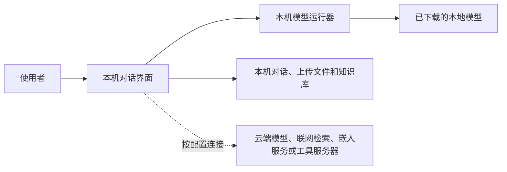

# 第一章　高阶课程｜在本地电脑部署个人智能助手

**用本机模型、受控资料和可检查的工作规则，搭建个人试验环境**

本课以 Ollama 运行本地模型、以 Open WebUI 提供对话界面为演示架构。安装方法参考下文列出的官方指南，具体操作以实际版本为准。

“本地运行”描述的是某一段处理过程。模型、界面、知识库、联网检索和工具可能分别连接不同服务，部署前要查清每一段数据去向。

只有模型推理、文件解析、向量嵌入和工具调用都经过核实并留在获准环境中，数据链路才符合本地处理的预期。界面选用本地模型时，单独配置的云端模型、搜索服务、嵌入服务或工具服务器仍可能接收输入内容。

## 一、先确定使用范围

用一台专门的试验设备、一个单独的工作目录和一组模拟文件开始。明确谁可以登录、助手需要读取哪些文件、生成结果保存在哪里、联网功能是否开启、对话和文件保存多久。

模型需要的内存、磁盘和处理能力随模型大小、上下文长度和任务类型变化。先查看设备规格和模型卡，再下载适合本机的模型。核对模型来源、使用许可、适用语言、上下文能力和更新记录；不同模型的开放权重与许可条件可能不同。

## 二、安装模型运行器和对话界面

按照 Ollama 和 Open WebUI 的官方安装指南选择适合本机系统的安装方式。课堂使用时记录软件版本、安装来源和模型名称，下载完成后核对模型是否出现在界面中。培训部署可以由技术人员预先准备，避免安装和下载时间挤占操作练习。

首次连接时，选择本机模型并发送一条不含敏感内容的短消息。Ollama 的本机服务默认监听回环地址；如需从其他设备访问，不要直接扩大网络监听范围，应由信息化人员设计身份认证、访问控制和网络边界。

Ollama 官方说明，可以关闭 Ollama 自身的云端模型和网页搜索功能。[Ollama 常见问题](https://docs.ollama.com/faq) Open WebUI 的模型连接和网页搜索另有管理员设置，配置本地模型时仍需逐项检查云端模型、联网搜索、文件解析、嵌入服务和工具服务器的连接。[Open WebUI 设置说明](https://docs.openwebui.com/getting-started/quick-start/settings/) 要求离线的环境还应通过网络策略限制外部连接。

## 三、给资料设定边界

在专用目录中放入两三份公开或模拟文件，再把这些文件加入 Open WebUI 的知识库。提问时指定知识库，要求助手引用文件名、章节或页码。检索结果应回到原文核对，特别检查数字、条件、日期和例外情形。

知识库会保存文档并检索相关片段。内容解析和向量嵌入由配置的服务完成；部署前要确认这些步骤使用本地组件还是外部服务。工作目录只放本次练习需要的副本，避免把整个用户目录或单位共享盘开放给助手。

可以先使用这样的工作规则：

> 请只依据本次指定的知识库回答。每项结论后注明文件名和章节；材料没有说明的内容标为“材料未说明”。需要计算时列出数据范围、公式和单位。当前只生成文字草稿，不调用联网、文件写入、系统命令或外部发送工具。

## 四、把工作规则做成可复用技能

先把重复使用的要求写成简短提示词或 Markdown 技能，例如“查找会议制度”“按模板整理报送材料”。技能说明工作步骤、输入要求、输出格式和人工复核点。通过试验问题检查它是否引用了指定材料，遇到材料缺项时是否明确标注。

Open WebUI 的 Skills 是可复用的文本指令；Tools、Functions 等扩展会执行服务器端代码。官方安全说明指出，部分工具和函数在服务端运行，可能访问文件、网络、子进程、环境变量和数据库。添加代码工具前要阅读源码、确认数据流，并在隔离的测试环境中逐项验证权限。热门、推荐或排名靠前的插件也需要单独审查。

第一次部署只启用知识检索和文本技能。邮件发送、自动填表、浏览器控制、系统命令和批量改文件等能力，应在单位批准后单独设计权限、确认步骤和日志留存。

## 五、管理账户、数据和更新

确认应用的登录方式、管理员账户、数据目录、对话记录、上传文件和知识库的保存位置。设置符合使用目的的保留期限，限制目录访问人员；备份放在获准且与主机分离的位置，并定期检查能否恢复。

再检查各组件记录哪些事件、日志是否包含请求内容、日志保存在哪里、谁可以查看以及保存多久。按单位要求保留排障和管理所需的信息，减少无关内容进入日志。

更新前先备份数据目录，阅读发行说明，再在副本或测试环境验证模型连接、文件检索、技能和现有数据。Open WebUI 官方指南建议关键部署固定版本并在升级前备份；个人试验环境也应记录版本，避免更新后无法复现课堂结果。

## 怎样把本地个人智能助手用好

课堂使用公开或模拟材料。机关、央国企设备接入真实业务前，应完成信息化、网络安全、保密和运维审查，逐项确认模型、界面、知识库和工具的数据去向。

## 六、课堂练习：建立一个本地资料助手

练习约需30分钟。由技术人员提前安装软件、下载模型并准备两份模拟制度文件。

1. 确认界面连接的是本机模型，查看当前是否启用了云端模型、联网搜索、外部嵌入或工具连接。
2. 将两份模拟制度文件加入单独的知识库，询问一个原文有明确答案的问题，并要求列出文件名和条款位置。
3. 再问一个资料中没有答案的问题，检查助手能否标注“材料未说明”。
4. 用一份不同版本的制度文件复问，核对助手是否区分文件日期和版本。
5. 查看数据目录和保存设置，记录知识库、对话记录、备份位置、启用的连接及责任人。

练习结束时，讲授者应检查本地模型选择、资料引用、缺项处理、外部连接和数据保存范围。课堂不添加代码工具，不使用真实内部材料，不把模型回答当作正式意见。

## 记忆方法：定用途、选模型、限资料、审技能、留记录

每次增加新模型、知识库或工具，都先说明用途和输入范围，再检查数据去向与权限。测试通过后记录版本、设置和复核结果。

## 官方资料

- [Ollama 快速开始](https://docs.ollama.com/quickstart)：安装本机模型运行器并启动模型。
- [Ollama 常见问题](https://docs.ollama.com/faq)：本地运行与云端功能、服务监听和本地模式设置。
- [Open WebUI 快速开始](https://docs.openwebui.com/getting-started/quick-start/)：安装界面并连接本地或云端模型。
- [Open WebUI 连接本地与云端模型](https://docs.openwebui.com/getting-started/quick-start/connect-a-provider/)：所选模型接口决定推理位置；外部工具和嵌入服务需另行确认。
- [Open WebUI 设置说明](https://docs.openwebui.com/getting-started/quick-start/settings/)：管理员分别配置模型连接、网页搜索等实例功能。
- [Open WebUI 知识库](https://docs.openwebui.com/features/workspace/knowledge/)：建立知识库、检索文件并复核来源。
- [Open WebUI Skills](https://docs.openwebui.com/features/workspace/skills/)：创建和使用可复用的 Markdown 工作指令。
- [Open WebUI 插件执行机制](https://docs.openwebui.com/features/extensibility/plugin/development/under-the-hood/)：Tools、Functions 等代码扩展的执行权限说明。
- [Open WebUI 安全加固](https://docs.openwebui.com/getting-started/advanced-topics/hardening/)：网络边界、身份认证、外部请求和安全配置。
- [Open WebUI 环境变量说明](https://docs.openwebui.com/reference/env-configuration/)：数据目录、日志级别及相关配置项。
- [Open WebUI 更新与备份](https://docs.openwebui.com/getting-started/updating/)：数据备份、版本固定和更新前检查。

## 相关章节

- 本地文件处理、工作空间权限和跨工具交付，与实务卷后续相关章节相衔接。当前已发布章节见[实务卷目录](../01-实务卷/SUMMARY.md)，后续章节发布后再补充对应链接。
